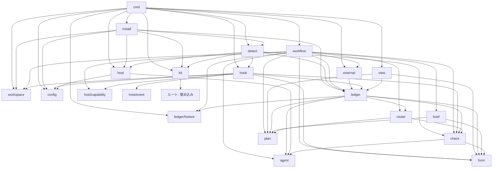

# dev-kit のアーキテクチャ

dev-kit は、単一バイナリの runtime と、バージョンを持つ kit の固定物を組み合わせる。runtime は外側で計画を回す workflow と、ホストのセッションから呼ばれる hook を持ち、計画・判定・判断の意味論をホストや保存形式から分離する。記録は作業を単位に ledger へ残し、対象のバージョンに結び付いた check と人の承認によって進行を制御する。置き場所は設定に集約し、チームでも同じ固定物と契約を使って中断・再開できる構造とする。

## 前提

- **runtime**: 単一バイナリとし、名前は `devkit` を仮決定とする。外側でループ計画を回す workflow と、ホストのセッション内から呼ばれる hook の面を持つ。[runtime の契約](parts/runtime.md)に従う。
- **ホスト**: Claude Code と Codex CLI を対象とし、どちらも既定にしない。hook の形式は共通とする。担当は子プロセスとして起動し、標準入力で brief を渡し、JSON Schema で縛った出力と結果ファイルで結果を受け取る。評価対象の設定・hook・skill・指示ファイルの探索停止を確認できないホストは起動しない。書き込み可の作業者には、ファイルシステムの隔離と外部通信の制限も検出試験で確認されたホストだけを使う。ホストが代行する通信ツールは固定設定で無効にし、モデル API への通信だけを外部通信の制限から除く。検証プロセスの隔離は環境の能力として扱い、未確認なら実行しない。
- **ループ計画**: 状態機械のデータとし、router の分類をキーにした遷移表を持つ。条件式は書かせない。計画の作り直しを一級の操作として扱う。[ループ計画](loop-plan.md)と[ステージ](stages.md)の契約に従う。
- **設定**: 単一の設定ファイルを置き場所の正本とする。最初の入口は本体のルート直下の `devkit.toml` に固定する。初期化時に生成するリポジトリ識別子を git 管理の `devkit.toml` と環境の記録に持ち、育てるものの同一性にだけ使う。状態ディレクトリの鍵はリポジトリ識別子と checkout の鍵の組とする。checkout の鍵は共通 git ディレクトリの実パスから `init` が導き、環境の記録だけに持つ。利用者の状態ディレクトリの下のこの組ごとの場所を既定とし、同じ共通 git ディレクトリの worktree は同じ状態へ、独立した clone は別の状態へ解決する。状態ディレクトリは本体 checkout の外に置き、`devkit.toml` で場所を変えられる。環境の記録に記録ルートは重ねて持たず、設定とリポジトリ識別子・checkout の鍵から解決する。設定の所在の変更は `doctor --reinit` で反映する。設定で変えるのは置き場所だけであり、動作の分岐は置かない。実行の記録は git 管理にしない。モデルは計画の担当で決め、view は実行の終了ごとに必ず生成する。
- **ファイルの分類**: kit が触るファイルは、固定物、育てるもの、実行の記録、生成物に分ける。
- **チーム開発**: 同じリポジトリで複数人が別々の作業を進めることを対象に含める。共有は PR 本文の計画の要約と決定、および git 管理の育てるものを通して行う。
- **部品**: [brief](parts/brief.md)、[check](parts/check.md)、[router](parts/router.md)、[ledger](parts/ledger.md)、[form](parts/form.md)、[view](parts/view.md)、[runtime](parts/runtime.md)を提供単位とする。各部品は契約・テンプレート・試験を持つ。[基本設計](design.md)に従う。

## データモデル

### エンティティ

- **リポジトリ**: kit を導入した git リポジトリであり、設定ファイルと育てるものの所有者である。リポジトリ範囲の記録は機械ごとの環境の記録だけとし、共有の記録は持たない。
- **作業（Work）**: 1つの課題に対する1本のループの単位であり、ULID の作業 ID を持つ。課題への参照（Issue の URL など）、ブランチまたは worktree への束縛、依頼者、承認者、開始時に固定する記録形式のバージョンと基点コミットを持つ。計画の最初のバージョンの作成から完了または中止まで存続し、作業範囲の記録を所有する。
- **計画（Plan）**: 作業に属し、バージョンを持つ。内容は ID 付きの完了条件の列、ステージの列、各ステージの担当・観点・ゲート・遷移表・計数の上限・戻り先・検証コマンドの集合への名前による参照、必須 check の集合である。検証コマンドの定義は基点コミットの `.devkit/verify.json` を正本とし、参照する集合は空でもよい。担当にはロールとエンジン・モデル・effort を持ち、観点は完了条件 ID と実行主体を持つ。実行主体は判定者または機械である。各バージョンの承認者と承認状態は、承認の記録から導く派生値である。提案の状態は提案中・却下・撤回・実行可能とし、計画の Judgment、撤回の記録、必要な承認から導く派生値である。「実行可能なバージョン」は、計画の check を通り、ゲートが必要なら承認済みである最新のバージョンとする。新規作成または作り直しで作ったバージョンは提案中とし、提案中のバージョンがある間は古いバージョンを実行しない。旧バージョンの実行を妨げない撤回は、人が自発的に起票して撤回した提案だけに限る。「前のステージに戻る」による再計画では、提案が却下されても旧バージョンには戻さず、指摘を渡して計画の上限内で再提案するか人に確認する。
- **ステージの実行（StageRun）**: 実行 ID を持ち、作業と開始時に束縛した計画のバージョンに属する。ラウンドの列、子プロセスの識別を含む起動記録、実行状態、観測時刻、停止理由、次に動く主体を持つ。実行状態は、実行中・回答待ち・承認待ち・確認待ち・中断・異常終了・不明・失効である。「再計画待ち」は失効の一種である。実行中は束縛したバージョンを使い続け、計画のバージョンの切り替えはステージの開始時だけに行う。「前のステージに戻る」を router が記録した時点で旧 StageRun を再計画待ちにし、旧バージョンの実行を再開しない。作り直しで置き換えられる未完了の StageRun は失効として記録し、新しいバージョンの戻り先から新しい StageRun を開始する。
- **ラウンド（Round）**: brief → 作業 → check → router の往復である。ラウンド ID、内容ハッシュで表す brief のバージョン、作業者の起動記録、対象のバージョン、check の結果の集合、router の判断を持つ。起動記録にはホスト、セッション ID、コンテキスト ID、履歴継承の有無、使用量を含める。
- **対象のバージョン（TargetVersion）**: ツリーのスナップショット、計画のバージョン、構造のバージョンの直和である。ツリーのスナップショットは検査対象の内容を一意に表す git のツリーハッシュと、対応するコミットオブジェクトを持つ。workspace が追跡ファイルと ignore されていない未追跡ファイルから、一時インデックスを用いてブランチに乗せないコミットオブジェクトを作る。記録ディレクトリと生成物だけを除外し、追跡されるホストの設定ファイルは含める。ignore された未追跡ファイルは含めない。記録を書いてもツリーの対象のバージョンは変わらない。スナップショットのコミットには `refs/devkit/<作業 ID>/<対象のバージョン>` を付け、作業の完了・中止と成果物の永続化まで保持する。計画のバージョンは作業内の計画のバージョン、構造のバージョンは資産のハッシュで識別する。check の結果と成果物の記録が参照し、現在のバージョンとの一致は成果物の種類ごとに照合する。
- **基点コミット**: リポジトリ本体の既定ブランチの最新コミットである。作業の開始時に記録し、作業中は固定する。再開時に更新するかは人が判断し、更新したら計画の check を再実行する。影響する Judgment・成功記録・未実行の承認を古い扱いとして再評価する。リポジトリ側の規範、設定、skill、外部書き込みの登録、検証コマンド、deny の規則はすべてこのバージョンから読む。規範の同一性は、実際に供給した観点ファイル、principles、部品の契約、規則、分類表と追記、固定物の内容のハッシュで表す。基点コミットと kit のバージョンは来歴であり、同一性の代わりにはしない。
- **check の結果（Judgment）**: 観点 ID、観点ファイルのバージョン、規範の同一性である内容ハッシュと、来歴である基点コミット・kit のバージョン、対象のバージョン、確認した完了条件 ID の集合、判定、指摘、確認した範囲と未確認の範囲、方法と環境、実行主体、判定者の起動記録または機械のコマンド実行記録を持つ。対象のバージョンはツリーのスナップショット・計画のバージョン・構造のバージョンの直和である。判定は `PASS`・`FAIL`・`NOT ASSESSED` である。指摘は Finding として持つ。判定者の起動記録にはホスト・モデル・セッション ID・コンテキスト ID・履歴継承の有無を含める。判定者による結果の受理時に、同じラウンドの作業者と別セッション・別コンテキストであり、履歴を継承していないことを照合する。満たさなければ `NOT ASSESSED` として扱う。機械の check は workflow が検査用 worktree でコマンドを実行し、同じ受理境界で結果を `Judgment` に変換する。
- **指摘（Finding）**: 指摘 ID、blocking かどうか、`auto-fixable` または `needs-decision`、失敗のシナリオ、適用除外の主張と根拠の有無、解決した指摘への参照を持つ。修正ラウンドの判定依頼には前回の指摘 ID を渡し、解決の参照と確認した完了条件 ID の増加から進展を計算する。
- **決定（Decision）**: 追記のみとする。有効性、置換、依存、適用条件、決定者、暫定か確定かを持つ。未読・承認・却下・保留の状態は、追記する状態変更の記録から導く派生値である。
- **問い（Question）**: form に従う人への確認事項である。問い ID、承認対象、承認者、選択肢、推奨、停止理由の分類、回答で進むステージ、止まる範囲と進められる範囲、根拠への参照を持つ。承認対象はツリーのスナップショット、計画のバージョン、外部操作の直和であり、外部操作は操作 ID と入力のハッシュで識別する。承認者欄は「この機械の利用者」に固定する。別の人の判断が必要な問いは、PR レビューなど外部の合意への参照を回答に添える。承認対象が変わったら新しい問い ID で起票し直し、古い問いへの回答・承認は拒否する。
- **回答・承認（Answer / Approval）**: 追記のみとし、同一性は（問い ID、承認対象、承認者）である。同じ同一性で内容も同じ記録は再送として扱う。内容が異なる場合は訂正とし、置換の参照を持つ新しい記録にする。同じ置換元を複数の訂正が置換した場合は未解決とし、workflow は進めず問いを再起票する。承認者の同一性は、初期化時に環境の記録へ置く OS の利用者名と人が入力した名前に基づき、引数では指定できない。書き手の種別「人の CLI」の判定根拠として、管理対象の作業 ID・ロールの環境変数がないことと、対話端末からの起動であることを記録する。
- **外部への書き込み（ExternalOp）**: 論理的な操作ごとの操作 ID、操作の種別、対象、入力のハッシュ、承認への参照、操作 ID から導く冪等キー、要求の受理、実行前の記録、実行結果、外部側の識別子を持つ。操作 ID と入力のハッシュは workflow が要求を受理した時点で、承認より前に発行して記録する。人が端末から起動した `devkit run` の対話確認による開始確定を持つ。承認の記録は意思の記録とし、管理対象の作業者と非対話の起動に対する開始確定の根拠は端末の確認である。端末確認が守る範囲は管理対象の作業者と非対話の起動に限る。利用者のシェルを持つ対話セッションは利用者本人と区別できず、疑似端末による確認の代行と記録ファイルの直接作成を含め、その中からの外部操作の開始は防がない。実行結果は成功・失敗・結果不明である。担当には結果とともに操作 ID を返し、再送は提示された操作 ID で識別する。操作 ID の提示がない同種の要求は別操作として承認を求める。
- **進捗記録（Progress）**: 追記のみとする。書き手である workflow・hook のセッション・担当の CLI・人の CLI、観測時刻、対象のバージョン、現在の作業状況、不具合のある箇所、使用するコマンドと終了ブロックを持つ。終了ブロックには判定、終了の種別、次のアクション、変更したファイル、確認済み事項、未確認事項、変更禁止事項、一時状態、再開条件を持つ。終了の種別は完了を主張・停止して確認・外部書き込みの要求・中断である。一時状態には確認方法・出典・無効になる条件を持たせる。`devkit progress` は終了ブロックを入力として `<worktree>/.devkit-stage/` に書き、workflow が担当の返却後に取り込んで ledger に写す。workflow も担当の `Result` の終了ブロックから書く。担当の出力と `progress` の入力検証は同じスキーマを使う。担当の CLI の記録は参考情報であり、ステージの完了条件には使わないが、Stop の進捗記録の条件には受け入れる。
- **checkpoint**: 記録ではなく派生値である。実行状態を持つ最新の StageRun と、次に動く主体の最新の進捗記録から組み立てる。書き手の優先順位は、workflow の StageRun の状態、人の回答・承認、hook と担当の CLI の進捗記録の順である。注入のたびに ledger から組み立て、同じセッション ID の進捗記録をステージングから読んで担当の CLI の優先順位で合流させ、一時状態の無効条件を照合し、無効なものは注入しない。本文ファイルは `<worktree>/.devkit-stage/checkpoint.json` に置く生成物である。本体 checkout の対話セッションでは本体の `.devkit-stage/checkpoint.json` に置く。SessionStart の注入のたびに本文を組み立て直し、組み立て元の記録 ID と観測時刻を含める。ホストの上限に収まるなら本文を直接注入し、ファイルは参照用とする。hook の ledger へのアクセスは読み取り専用である。
- **成功記録（BuildTestResult）**: 追記のみとする。対象のバージョン、検証に使った内容である `verify.json` の該当項目と依存物の集合のハッシュ、来歴である基点コミット・kit のバージョン、コマンドの名前と定義のバージョン、結果、書き手のプロセス識別、実行者のセッションと起動記録への参照を持つ。同一性は対象のバージョンと検証に使った内容の組であり、規範全体の内容ハッシュには結び付けない。principles や分類表の変更だけでは失効しない。再構築の結果である取り込んだ依存の集合のハッシュも残す。完了条件に使う記録は、作業者の返却後に workflow 自身がステージから名前で参照した検証コマンドの集合を対象のバージョンの検査用 worktree で実行して書く。担当の CLI が `devkit record` でステージングに書く成功記録は参考情報とし、workflow が返却後に取り込む。作業者の検証は自分の確認のため、workflow の検証は完了条件のためであり、ステージの完了条件には workflow の実行結果だけを使う。検証プロセスの隔離が未確認なら実行せず、成功記録を `NOT ASSESSED` 相当として記録し、完了できない。Stop は検証コマンドの集合が空でなければ、完了を主張する場合のステージングの参考の成功記録と現在のツリー内容を照合する。空集合なら参考の成功記録を要求しない。router は workflow の成功記録を照合する。
- **成果物（Artifact record）**: 成果物 ID とバージョン、変更前後、完了条件 ID、変更の種類、決定への参照、永続化先であるコミットまたは参照への参照を持つ。
- **カーソル（Cursor）**: 閲覧者と作業の組ごとに1つ保持し、上書きする。チームでは閲覧者ごとに別ファイルとする。
- **検出試験の記録（DetectionTest）**: check・観点ファイル・hook・分類表の追記・ホスト能力・検証プロセスの隔離能力・deny の規則の ID とバージョン、固定物のバージョン、規範の同一性である内容ハッシュと、来歴である基点コミット・kit のバージョン、判定の担当（エンジン・モデル・effort）、違反例・適合例・許容例、期待判定と実際の判定、根拠を持つ。同一性と再利用条件は実際に供給した規範・対象・試験仕様の内容ハッシュに結び付け、証拠ファイル自身はハッシュの対象に含めない。基点コミットとの一致は要求しない。判定の担当との組み合わせの同一性には担当を含める。観点ファイル・hook・分類表の追記のバージョンに対する合格記録は git 管理の資産として `.devkit/detect/<対象の種別>/<対象の内容ハッシュ>-<試験仕様のハッシュ>.json` に置く。判定の担当との組み合わせの合格は環境の記録に置き、資産へ写すのは任意とする。不足する組み合わせは `run` が kit の違反例・適合例とリポジトリ固有の例で検出試験を実行し、合格してから必須化する。リポジトリ固有の観点ファイルの違反例・適合例は、kit の例と同じ形式で `.devkit/detect/examples/<観点 ID>/` に置く。ホスト能力の検出試験も環境の記録とし、実行ファイル・バージョン・起動オプション・設定内容に束縛する。計画の受理時に、資産のバージョンと必須 check の担当に一致する合格記録を照合する。
- **構造の記録（Structure）**: 育てるものの資産としてバージョンを持つ。`.devkit/structure/current` はバージョン ID だけを持つ1行のポインタとし、本文は `.devkit/structure/history/<バージョン>.json` に置く。履歴には構造の本文、基底バージョン、承認者、承認対象のハッシュ、承認根拠への外部参照である PR の URL を持つ。構造のバージョンの承認は PR の承認で代用し、対応する PR の URL をそのバージョンの承認根拠として残す。PR を作った作業は承認者欄を空で書き、PR の承認後、マージを行う人がマージ時に PR の URL と承認者を履歴へ写す。`doctor --structure` は未記入を報告する。新しいバージョンは作業の成果物として PR に含め、通常のコミット・PR・マージで更新する。並行した変更はポインタの同じ行で衝突させ、競合は git のマージと人のレビューで解決し、runtime は機械間を調停しない。基点コミットを読むときに cmd/devkit が現在のバージョンの履歴の存在と、基底バージョンの連鎖が分岐せずにつながることを照合し、満たさなければ `run` を止め、`doctor --structure` で人が修復する。
- **規則と強制手段（Rules）**: リポジトリが育てる git 管理のファイルを正本とする。決定 ID と移行先を持つ移行記録は `rules.md` 自体の項目として残す。router の決定 ID は作業への外部参照として扱い、決定の根拠が必要なものは資産側に写す。正本は資産であり、作業の決定は経緯である。
- **作業の束縛（WorkBinding）**: ブランチ・worktree と作業 ID の対応を、環境の記録として持つ。
- **ホストの能力（HostCapability）**: 環境の記録として、ホスト名、実行ファイル、バージョン、起動オプション、設定内容、検出試験で確認した能力を持つ。同一性には起動方法を含め、workflow が使う起動方法そのもので試験する。能力には hook の動作、hook がホストの sandbox の下で動きステージングへ書けて記録ルートへ書けないこと、JSON Schema の遵守、再開の可否、出力上限、ファイルシステムの隔離、ホストが代行する通信ツール経由の送信拒否を含む外部通信の制限、ask の有無、評価対象の設定・hook・skill・指示ファイルの探索の停止を含める。検証コマンドと機械の check のプロセスの隔離は環境の能力として記録し、実際の起動方法に束縛する。
- **記録形式のバージョン**: 各記録が持つ。作業と環境は形式のバージョンを固定し、移行は `devkit migrate` による明示的な操作だけで行う。バイナリは読めるバージョンの範囲と単一の書くバージョンを宣言する。すべての書き手は書く前に作業または環境の形式のバージョンと状態ディレクトリの移行中の印を照合し、書くバージョンとの不一致または印があれば fail-closed とする。hook は `block` と理由を返す。`run` だけでなく、hook・担当の CLI・人の CLI も移行前に異なる形式を混在させない。

### 所有と生存期間

データの所有と生存期間、整合性を守る境界は、[`principles/data.md`](../principles/data.md) の原則5に従う。

- **作業範囲の記録**: 作業が所有する。完了・中止後は、実行履歴である StageRun、Judgment、決定、成果物、外部操作を読み取り専用で残す。カーソルの更新と人の判断である回答・承認・状態変更の追記は完了後も許す。
- **リポジトリ範囲の環境の記録**: リポジトリが所有し、機械ごとの事実を持つ。作業の束縛、ホストの能力とその検出試験、検証プロセスの隔離とその検出試験、初期化時に確定した本体のルート・共通 git ディレクトリの実パス・設定の所在・リポジトリ識別子・checkout の鍵、利用者の識別、実体化先の利用登録、判定の担当との組み合わせの検出試験、取り込んだ対話セッションの hook の失敗を含める。記録ルートの項目は持たず、状態ディレクトリは `devkit.toml` の設定とリポジトリ識別子・checkout の鍵から解決する。作業の記録とともに本体 checkout の外の状態ディレクトリに置き、git 管理にしない。 既存の状態は本体のルート・共通 git ディレクトリを起動情報と照合し、不一致なら再利用前に拒否する。
- **育てるものの資産**: リポジトリが所有する git 管理のファイルである。構造の現在のバージョンのポインタと履歴、規則と強制手段と移行記録、検証コマンドの定義、deny の規則、観点ファイル・hook・分類表の追記のバージョンに対する検出試験の合格記録を含める。作業範囲の記録への参照は、作業 ID・課題の URL・PR の URL による外部参照だけとする。共有に必要な決定の根拠は資産側に写す。
- **生成物**: view の HTML、基点コミットと埋め込み固定物の実体化先、検査用・作業用 worktree、検証プロセスのキャッシュは runtime が所有し、本体 checkout の外の状態ディレクトリに置く。checkpoint の本文も runtime が所有し、セッションが使う worktree の `.devkit-stage/checkpoint.json` に置く。本体 checkout の対話セッションでは本体のステージングを使う。skill のコピーも runtime が所有する生成物である。view・checkpoint・skill のコピーは再生成でき、削除してよい。検査用 worktree は作業ごとに保持する永続の生成物とし、ラウンドごとに追跡ファイルをスナップショットのコミットへリセットする。再利用する ignore された依存物は `.devkit/verify.json` に有効条件と再構築コマンドを列挙し、workflow が有効条件を照合し、必要なら検証プロセスと同じファイルシステムの境界の下で検証の一段として再構築コマンドを実行する。workflow の権限では実行せず、外部通信は `verify.json` に列挙した送信先であるレジストリの許可値だけを許す。許可値付きの外部通信を隔離で実現できなければ再構築を実行せず、`NOT ASSESSED` 相当として完了できない。ラウンドごとに破棄する生成物・一時領域は同じ定義に別に列挙し、検証の開始前に初期化する。期限超過の途中出力も初期化で除く。作業用・検査用 worktree と `refs/devkit/<作業 ID>/<対象のバージョン>` は、作業の完了・中止と成果物のコミットまたは参照への永続化がそろうまで保持する。基点コミットと固定物の実体化先は、実体化した内容の集合の内容ハッシュで名付けた不変のディレクトリとし、一時ディレクトリから rename で公開する。実体化する対象の集合が変われば別の名前になる。公開済みは通常の実行では削除せず、`doctor` の明示的な掃除だけを許す。`run` は状態ディレクトリの `lock` の共有 flock の下で、実体化先の存在と内容ハッシュの確認、環境の記録への利用登録、存在しない場合の一時ディレクトリへの実体化と rename による公開、再確認を一続きに行ってから使う。登録された実体化先は必ず存在する。基点コミットの更新などによる切り替えも同じ境界を使う。`doctor` は排他 flock の下で利用登録のない実体化先だけを確認して削除する。

### 整合性の境界

- **記録**: 範囲は作業と環境だけである。カーソルを除き追記のみとし、checkpoint は記録に含めない。記録 ID は一意とし、参照先の記録 ID は存在するか、外部の参照であることを示す。実行の記録は git 管理にしない。
- **完了条件**: router がステージの完了を認めるには、作業者の返却後に workflow が検証コマンドの集合を実行した成功記録、現在の対象のバージョンに対する必須 check のすべての `PASS`、検出試験の合格を要する。集合が空なら成功記録は不要である。必須 check の観点ファイル・hook・使用する分類表の追記のバージョン、固定物のバージョン、必須 check の判定の担当に対応する合格記録を照合する。対象のバージョンの一致は成果物の種類ごとに照合し、現在供給する規範の内容ハッシュと規範の同一性が一致しない Judgment は古い扱いとする。成功記録は対象のバージョンと、検証に使った `verify.json` の該当項目・依存物の集合のハッシュで照合し、規範全体の内容ハッシュでは失効させない。この完了条件は hook には渡さない。
- **作業の排他**: 同じ作業を同時に回す workflow プロセスを、作業ディレクトリのロックで排他する。ロックには PID・開始時刻・ホスト名を持たせる。同一ホストで PID と開始時刻を照合して保持者の死亡を確認できた場合だけ引き継ぐ。別ホストや確認不能なら失敗とし、人が明示的に解除する。 状態の再利用前にはリポジトリ識別子・本体のルート・共通 git ディレクトリを環境の記録と照合する。開いている作業がある間は状態ディレクトリの変更を拒否し、移設は `doctor --reinit` で実行中のプロセスと開いている作業がないことを排他 flock の下で確認してから行う。記録と worktree の移設、git の worktree 登録の修復、検証を済ませて最後に設定を切り替え、途中停止時は旧状態を正本とする。
- **計画のバージョン**: 単調に増加させ、StageRun の開始時に束縛する。提案中のバージョンがある間は旧バージョンを実行しない。人が自発的に起票して撤回した提案だけは旧バージョンの実行を妨げない。`devkit plan --withdraw` は撤回を追記する。`devkit plan` は作業のロックを取り、停止中だけ提案を記録し、実行中は拒否する。`run` が計画の check を実行し、ゲートが必要なら問いを起票して停止する。承認は `approve` の経路だけとする。「前のステージに戻る」の記録と同時に旧 StageRun を再計画待ちにし、旧バージョンへ戻さない。提案が却下されたら指摘を渡して計画の上限内で再提案するか、人に確認する。新しいバージョンが置き換える未完了の StageRun は失効させる。
- **承認**: 同一性は（問い ID、承認対象、承認者）である。承認対象が変わったら問いを起票し直す。同一内容の再送と、置換の参照を持つ訂正を区別する。訂正が同じ置換元で競合した場合は未解決とし、進行を止めて問いを再起票する。管理対象の起動情報がある `approve`・`answer`・`read` は拒否する。問いの承認者欄は「この機械の利用者」に固定する。別の人の判断が必要なら「停止して確認」で止め、PR レビューか外部の合意への参照を回答に添え、利用者が自分の名前で記録する。問いと承認を機械間で共有する経路は設計の範囲外である。
- **外部への書き込み**: 要求の受理時に操作 ID と入力のハッシュを発行して記録し、その組を承認対象とする。承認への参照、実行前の記録、実行、結果の記録の順を守る。外部操作の実行開始は、人が端末から起動した `devkit run` の対話確認で確定する。問い ID、承認対象である操作の種別・対象・入力の要約とハッシュ、承認者、記録時刻を表示し、tty から確認を読む。tty のない `run` は外部操作を実行せず、確認待ちで停止する。作業のロックの下で、承認の訂正の受理と同じ調停境界で有効な承認を読み直し、端末の確認と合わせて開始を確定する。承認の記録だけを開始確定の根拠にはしない。開始確定後の訂正では実行中の操作を止めず、結果に「開始後に訂正あり」を残して人に報告する。提示された操作 ID による再送時だけ同じ ID と冪等キーを使い、入力のハッシュを照合する。同じ ID で入力が異なれば別操作として停止して確認する。ID の提示がなければ同種でも別操作として承認を求める。実行と照会は登録ごとの期限を持ち、超過は結果不明とする。結果不明の場合は、外部側で識別・照会できるときだけ照会して確定し、できなければ再実行せず人に確認する。
- **資産の更新**: 構造の現在のバージョン、規則の移行、検出試験の合格記録は通常の変更としてコミット・PR・マージで更新する。機械間の直列化は git に任せ、競合はマージと人のレビューで解決する。runtime に共有の記録や有効化の調停を持たせない。
- **検査対象の固定**: ツリーの対象のバージョンからコミットオブジェクトを作り、作業ごとの検査用 worktree の追跡ファイルをそのコミットへリセットする。依存物の有効条件を照合し、必要な再構築は workflow の権限ではなく検証プロセスと同じファイルシステムの境界で検証の一段として実行し、生成物・一時領域を検証の開始前に初期化する。読み取り専用はファイルシステム全体ではなく権限で表し、判定者はツールの許可を読み取りだけにする。検証コマンドと機械の check を実行するプロセスの隔離は環境の能力として扱う。書き込み先は `.devkit/verify.json` に列挙した検査用 worktree 内の ignore されたパスと、保護対象と重ならない `work/<作業 ID>/cache/` の列挙した領域に限定する。記録ルート・実体化先・本体 checkout への書き込みと資格情報へのアクセスを拒否する。外部通信は拒否し、依存物の再構築時だけ `verify.json` に列挙したレジストリの許可値を許す。許可値付きの外部通信を実現できなければ再構築を実行せず `NOT ASSESSED` 相当とする。候補は Linux の Landlock、macOS の seatbelt、専用の OS 利用者、モデルを介さない sandbox 実行である。起動方法ごとの検出試験で列挙外のパスへの書き込みと許可されていない外部通信の失敗を確認する。確認できない環境では実行せず、成功記録を `NOT ASSESSED` 相当、機械の check を `NOT ASSESSED` として記録し、完了できない。実行後に一時 index の `write-tree` で追跡ファイルの入力内容を照合し、変わっていれば結果を無効にする。作業用 worktree の変更は検査対象を変えない。

### 書き手と調停

書き手は、作業ごとにロックで排他された workflow プロセス、ホストのセッション内から起動される短命な hook プロセス、担当の CLI、人の CLI である。hook は同時に複数動くことがある。担当の CLI とセッション内の hook は、ignore された `<worktree>/.devkit-stage/` にだけ書き、記録ルートへの書き込み権限は持たない。対話セッションでも同じであり、本体 checkout を使う場合は本体にも `.devkit-stage/` を用意する。ステージングは共通 git ディレクトリ側の worktree ごとの `info/exclude` で ignore し、評価対象のツリーに `.gitignore` を足さない。workflow が担当の返却後にステージングを取り込み、ledger に公開する。人の操作は承認・回答・カーソルの更新を含む。共有状態と副作用の扱いは、[`principles/data.md`](../principles/data.md) の原則6と [`principles/engineering.md`](../principles/engineering.md) の原則2に従う。

- **追記のみの記録**: 記録 ID をファイル名とし、記録ごとに独立した JSON ファイルを作る。すべての書き手は公開の直前に状態ディレクトリの `lock` の共有ロックを flock で取り、移行中の印の不在と作業または環境の形式のバージョンを確認してから、一時ファイルを rename で公開する。共有 flock の待機には上限を持ち、上限内に取得できなければ fail-closed として、hook は block と理由を返し、CLI は失敗する。`migrate` は同じ `lock` の排他ロックを取ってから `migrating` の印を置き、切替と印の除去も排他ロックで調停する。`doctor` の掃除は排他ロックの下で利用登録のないものだけを対象に行う。掃除と `migrate` の排他区間は短く保ち、長い処理は印を置いた後に排他を解放して行い、最後に再び排他を取って切り替える。読み手は一時ファイルを無視し、公開済みの記録を一覧して統合する。壊れた記録は隔離ディレクトリへ移して報告し、失敗を隠さない。
- **上書きする記録**: カーソルだけとし、閲覧者ごとに別ファイルへ保存する。置き換えにも状態ディレクトリの共有ロックの取得、形式のバージョンと移行中の印の照合を適用する。一時ファイルへ書き、rename で原子的に置き換える。
- **資産**: 育てるものの資産は通常の git の変更として更新し、機械間の競合は git のマージと人のレビューで解決する。作業の記録への参照は外部参照だけとする。
- **承認・回答の重複と訂正**: （問い ID、承認対象、承認者）と内容の一致で再送を吸収する。内容の訂正は、置換の参照を持つ新しい記録として追記する。同じ置換元を複数の訂正が置換した場合は未解決とし、workflow は進めず問いを再起票する。承認者の同一性は、初期化時に環境の記録へ置く OS の利用者名と人が入力した名前に基づき、引数では指定できない。書き手の種別「人の CLI」の判定根拠として、管理対象の作業 ID・ロールの環境変数がないことと、対話端末からの起動であることを記録する。
- **書き手の識別**: 記録に書き手の種別、セッション ID、起動記録への参照、記録形式のバージョンを含める。種別は workflow・hook・担当の CLI・人の CLI である。担当の CLI が書く `progress`・`record`・`check` は参考情報であり、ステージの完了条件の派生値には使わない。Stop の進捗記録の条件には担当の CLI の記録を受け入れる。不明な書き手の成功記録・Judgment・承認は派生値から除外して報告する。完了に使う成功記録は workflow 自身が検証コマンドを実行して書いたものに限定する。識別情報の照合は隔離による保護を前提とし、識別情報だけで改ざんを防ぐとはしない。

- **ステージングの取り込み**: workflow はラウンドの開始時にステージングを初期化し、`stage.json` にラウンド ID を書く。担当の返却後は現在のラウンド ID の記録だけを対象に、作業・セッション・種別とスキーマを照合し、進捗記録・参考の成功記録・単発 check の結果・Stop の状態だけを受け入れる。書き手の種別は「担当の CLI」「hook」に固定して ledger に写す。承認、完了条件に使う Judgment、workflow の成功記録は取り込まない。Stop の記録範囲の照合は、変更ファイルの一覧とステージングの進捗記録・参考の成功記録の照合に限る。ledger との照合は取り込み時に workflow が行う。Stop はステージングを読み、SessionStart の注入だけが ledger を読み取り専用で参照し、同じセッション ID のステージングの進捗記録も合流させる。

## モジュール

各モジュールは Go のパッケージとすることを仮決定とする。ポートは workflow の `Agent` だけとし、[`principles/structure.md`](../principles/structure.md) の原則3に従って利用側に置く。Workspace と External は interface にせず具体型とし、試験では関数値を差し替える。git、ホストの JSON、設定ファイルなどの外部の型は、境界で内部の型に変換する。公開契約・記録・ドメインの型には含めず、同ファイルの原則5に従う。

plan、brief、check、router、form、agent は、入出力を持たないドメインの核とし、自分でファイルを読まない。cmd/devkit が config から kit の供給源を一度だけ解決し、バージョン、`fs.FS`、解析済みの値を各モジュールへ渡す。ポートの実装はポートを定義する利用側を import してよいが、ポートの利用側からその実装へは依存しない。

### plan

- **責務**: ループ計画の意味論を扱う。JSON Schema による検証、router の分類から次のステージを選ぶ遷移、計数の上限の判定、現在のバージョンと残りの計画から新しいバージョンを作る操作と差分、実行可能なバージョンの判定を扱う。
- **持つデータ**: `Plan`、`Stage`、`Assignee`、`Gate`、`Transition`、`Limits`、`ReturnTarget` の型、ID 付きの完了条件、観点と完了条件の対応、観点の実行主体、必須 check とステージごとの検証コマンドの集合への名前による参照、router が使うステージの完了条件の規則を持つ。Stop の返却条件は持たない。
- **公開する契約（ポート）**: 計画の型と、検証・遷移・上限判定・作り直し・実行可能なバージョンの判定を公開する。スキーマ、計画の check の結果、承認の記録は引数で受け取る。提案の状態は Judgment・撤回・承認の記録から判定する。人が自発的に起票して撤回した提案だけは旧バージョンの実行を妨げず、再計画待ちの旧 StageRun は提案の却下後も再開しない。
- **依存**: 他のモジュールに依存しない。スキーマは kit の固定物から供給される値を使い、計画の型は plan が持つ。
- **置くもの・置かないもの**: 入出力を伴わない計画の意味論を置く。保存は ledger に置く。計画の生成は担当が行い、workflow が検証する。

### brief

- **責務**: ステージ定義、前のステージの出力、リポジトリの事実から brief を組み立てる。修正ラウンドでは前回の指摘と指摘 ID を取り込む。依存の宣言であるロックファイル・マニフェストの差分は、人に確認する対象として含める。hook の注入能力が使えないホストでは checkpoint 本文も取り込む。
- **持つデータ**: brief の型と、内容ハッシュで表すバージョンを持つ。
- **公開する契約（ポート）**: brief の型と組み立てる関数を公開する。
- **依存**: ステージの型を持つ plan と、テンプレートを持つ form に依存する。
- **置くもの・置かないもの**: brief の組み立てとバージョンの計算を置く。担当の起動は host に、記録は ledger に置く。

### check

- **責務**: 観点ファイルを解析し、blocking の定義、確認事項、報告しない事項、出力形式を扱う。基点コミットから供給された CLAUDE.md・AGENTS.md、[principles](../principles/README.md)、[部品の契約](design.md#部品)、[規則](rules.md)、brief、計画、観点ファイルを規範として束ね、判定依頼を組み立てる。結果を解析し、判定者による check は受理時に作成側と判定側のセッション ID・コンテキスト ID・履歴継承の有無を照合する。独立性を満たさなければ `NOT ASSESSED` とする。機械の check は workflow のコマンド実行結果を同じ受理境界で `Judgment` に変換する。適用除外の主張と根拠がある場合は違反としない。判定は `FAIL`、`NOT ASSESSED`、`PASS` の優先順で集約する。必須 check の網羅、成果物の種類ごとの対象のバージョンの一致、検出試験の合格と固定物のバージョン・判定の担当の一致を照合し、検出試験の仕様も扱う。
- **持つデータ**: `Judgment` と `Finding` の型、解析した観点ファイル、判定依頼と解析結果、違反例・適合例・許容例と期待判定からなる検出試験の仕様を持つ。観点ファイルは作業に固定した基点コミットを規範として使う。Judgment と検出試験は実際に供給した規範の内容ハッシュを同一性として持ち、現在供給する内容との一致を照合する。基点コミットと kit のバージョンは来歴として持つ。Finding は指摘 ID、blocking、`auto-fixable` / `needs-decision`、失敗のシナリオ、適用除外の主張と根拠、解決した指摘への参照を持つ。計画の check では、コードを変えるステージがリポジトリの検証コマンドの集合を省略していないこと、省略するなら根拠があることを確認する。計画の観点「差分」では、依存の宣言であるロックファイル・マニフェストの差分を「人に確認する」の分類に含めることを確認する。Stop の内容照合が時間の上限に収まらない規模では、返却ゲートを終了ブロックと進捗記録だけにするかを、設定ではなく計画の check で人が判断する。
- **公開する契約（ポート）**: ポートは持たない。規範・観点ファイル・対象のバージョンと場所・出力スキーマと、修正ラウンドでは前回の指摘 ID から判定者用の `agent.Request` を組み立て、`agent.Result` または機械のコマンド実行結果から `Judgment` を解析する操作を公開する。判定者用の依頼には再開 ID を型として持たせない。独立性の照合、適用除外、集約、必須 check と検出試験の照合も公開する。
- **依存**: 観点ファイルの形式と `Judgment` のスキーマを扱う form、起動の型を持つ agent に依存する。
- **置くもの・置かないもの**: 入出力を伴わない判定の意味論、依頼の組み立て、結果の解析・受理、検出試験の仕様を置く。判定者の起動は workflow の `Agent` を経由して host が行う。結果の保存は ledger に、次の行動の判断は router に置く。

### router

- **責務**: 分類表の固定物とリポジトリ側の追記を cmd/devkit が基点コミットから読み込み、解析した値を引数で受け取り、次の行動を判断する。合格記録のない追記は読み込みを拒否する。check の集約、ラウンド数、workflow が計算した進展の有無、計画の上限、停止分類から、「修正する」「人に確認する」「前のステージに戻る」「完了する」を選ぶ。plan から受け取るステージの完了条件を照合し、人への確認を分類する。依存の宣言であるロックファイル・マニフェストの差分は「人に確認する」に含める。現在のバージョンは成果物の種類ごとに照合する。
- **持つデータ**: 人への確認、check の結果、教訓の反映先、ロールとエンジン、振り返りに関する分類表の型と内容を持つ。
- **公開する契約（ポート）**: 分類表の型と、渡された分類表による判断、完了条件の照合、人への確認の分類、教訓の反映先の分類を公開する。
- **依存**: 上限と遷移の語彙を持つ plan、判定の型を持つ check に依存する。
- **置くもの・置かないもの**: 分類と判断を置く。担当の起動は host に、判断に従ってループを進める処理は workflow に置く。

### form

- **責務**: 固定フォーマットの定義を持ち、スキーマの型、テンプレートの適用、人向けの Markdown の描画を提供する。
- **持つデータ**: 担当の出力である作業の返却内容、終了ブロック、人への確認事項、計画、`Judgment` の JSON Schema の型を持つ。終了ブロックは判定、終了の種別、次のアクション、変更したファイル、確認済み事項、未確認事項、変更禁止事項、一時状態（確認方法・出典・無効条件）、再開条件を持つ。終了の種別は完了を主張・停止して確認・外部書き込みの要求・中断である。担当の出力と `devkit progress` の入力検証で同じスキーマを使う。Finding の出力スキーマにも指摘 ID、`auto-fixable` / `needs-decision`、失敗のシナリオ、解決した指摘への参照を含める。skill の構成、playbook、観点ファイル、計画の要約と決定を含む PR 本文、設計案のテンプレートを受け取って扱う。
- **公開する契約（ポート）**: 固定フォーマットの定義と、受け取ったスキーマ・テンプレートの適用、Markdown の描画を公開する。
- **依存**: 他のモジュールに依存しない。スキーマとテンプレートの本体の正本は kit の固定物とし、form は供給された値を使う。
- **置くもの・置かないもの**: 入出力を伴わない形式の定義と描画を置く。固定物の読み込みは kit に、計画や判定の意味論は plan と check に、HTML の生成は view に置く。

### agent

- **責務**: 担当の起動で受け渡す型だけを持つ。
- **持つデータ**: `Request` は brief 本文、出力スキーマ、作業ディレクトリ、基点コミットの実体化先、ロール、エンジン・モデル・effort、権限の範囲、環境に渡す作業 ID・ロール・本体のルート・ステージ情報・ラウンド ID、ステージングの場所、上限時間を持つ。ロールは作業者・判定者・計画者であり、権限の範囲は読み取り専用または作業用 worktree 内と、その worktree の git メタデータである `.git/worktrees/<名前>/` の index・HEAD・logs の書き込み可である。再開するセッション ID は作業者用だけに持たせ、判定者用の `Request` 型には項目を置かない。`Result` は出力 JSON、終了ブロック、子プロセスの識別を含む起動記録、セッション ID、コンテキスト ID、履歴継承の有無、使用量、終了の種別を持つ。Result のプロセスの終了の種別は、完了・停止して確認・外部書き込みの要求・失敗・時間超過であり、終了ブロックの終了の種別とは区別する。
- **公開する契約（ポート）**: ロールごとの `Request` と `Result` を公開する。インターフェースは持たず、利用側が定義する。
- **依存**: 他のモジュールに依存しない。
- **置くもの・置かないもの**: 入出力を伴わない起動の型を置く。起動の実装は host に、起動するタイミングの制御は workflow に置く。

### ledger

- **責務**: 記録の意味論、問い合わせ、記録範囲の照合を扱う。決定のグラフから有効性・置換・依存を解決する。checkpoint の組み立てと一時状態の無効条件の照合、有効な決定とその状態、実行可能な計画のバージョンと提案中・却下・撤回の状態、観点ごとの最新判定とバージョンの一致、完了記録のない StageRun、未回答の問い、承認の解決を派生値の問い合わせとして提供する。成功記録の同一性は対象のバージョンと、検証に使った `verify.json` の該当項目・依存物の集合のハッシュの組とし、規範全体の内容ハッシュでは失効させない。訂正が競合した回答・承認は未解決とし、不明な書き手の記録は完了条件に関わる派生値から除外して報告する。
- **持つデータ**: ULID の記録 ID と参照、作業・環境の範囲、書き手のプロセス識別、記録形式のバージョンと読める範囲を持つ。種別ごとのペイロードとして、計画のバージョンと撤回、決定、状態変更、問い・回答・承認、外部書き込み、進捗、成功記録、check の結果、ホスト能力と判定の担当との組み合わせの検出試験、ステージの実行、成果物、記録範囲の照合、作業の束縛、ホストの能力、検証プロセスの隔離能力、実体化先の利用登録、本体のルート・共通 git ディレクトリの実パス・設定の所在・リポジトリ識別子・checkout の鍵・利用者の識別、対話セッションの hook の失敗、カーソルを持つ。checkpoint、構造のバージョン、規則の移行、観点ファイル・hook・分類表の追記のバージョンだけに対する合格記録は保存する記録に含めない。担当との組み合わせの合格は環境の記録に含める。
- **公開する契約（ポート）**: Store の interface は持たず、関数は ledger/fsstore の具体型を受け取る。記録の型、派生値の問い合わせ、決定と承認の解決、記録範囲の照合を公開する。カーソルの置き換えと作業の排他は ledger/fsstore の操作として直接呼ぶ。
- **依存**: ペイロードに使う plan、check、router、form、agent の型と、保存を担う ledger/fsstore に依存する。
- **置くもの・置かないもの**: 記録の意味論と問い合わせを置く。ファイル形式は ledger/fsstore に、表示は view に置く。

### ledger/fsstore

- **責務**: ファイルによる保存の具体型を持つ。記録ごとに独立した JSON ファイルを作り、一時ファイルへ書いてから rename で公開する。読み手は一時ファイルを無視し、壊れた記録は隔離して報告する。カーソルの原子的な置き換え、作業ディレクトリのロック、状態ディレクトリの `lock` の flock を扱う。
- **持つデータ**: 作業・環境の記録ファイル、カーソル、一時ファイル、隔離ディレクトリ、PID・開始時刻・ホスト名を持つ作業ロック、状態ディレクトリの `lock` と `migrating` を扱う。同一ホストで PID と開始時刻を照合して死亡を確認できた場合だけロックを引き継ぐ。別ホストや確認不能なら失敗とし、人の明示的な解除を要する。
- **公開する契約（ポート）**: 追記・一覧・取得、カーソルの原子的な置き換え、作業の排他を具体的な操作として公開する。状態ディレクトリと作業・環境の記録ルートは引数で受け取り、渡されたルートの下だけに触る。すべての書き込みは公開直前に状態ディレクトリの `lock` の共有ロックを flock で取り、形式のバージョンと印の不在を照合してから rename する。共有 flock の待機には上限を持ち、上限内に取得できなければ fail-closed として、hook は block と理由を返し、CLI は失敗する。移行の印の設置・切替・除去と `doctor` の掃除は排他ロックで調停する。実体化先の存在・内容ハッシュの確認、利用登録、必要な実体化と公開、再確認は同じ共有 flock の下で一続きに行い、登録された実体化先が必ず存在することを守る。利用登録のないものの確認と削除は排他 flock の下で行う。
- **依存**: 他のモジュールに依存しない。保存形式の型だけを扱い、記録の意味論は扱わない。
- **置くもの・置かないもの**: 保存形式、原子的な公開・置き換え、隔離、排他を置く。記録の意味論は ledger に、パスの決定は config に置く。SQLite は採用しない。単一バイナリで cgo を避けること、作業あたりの記録数が小さいこと、複数の書き手をファイル作成で扱えることが理由である。

### workflow

- **責務**: ループを回す。作業の読み込み、基点コミットの固定と実体化、実行可能な計画のバージョンの選択、再開時の照合、ステージごとのラウンド、brief の組み立て、ラウンド開始時のステージングの初期化と `stage.json` へのラウンド ID の記入、担当への委任、対象のバージョンのスナップショットの取得、検証コマンドと check の実行、router の判断、記録、ゲートでの停止を制御する。提案中の計画のバージョンがあれば計画の check を実行し、ゲートが必要なら問いを起票して承認待ちで停止する。却下・撤回の状態は記録から導く。人が自発的に起票して撤回した提案だけは旧バージョンの実行を妨げない。再計画の提案が却下されたら指摘を渡して計画の上限内で再提案するか、人に確認する。判定の担当との組み合わせの検出試験が環境の記録に不足していれば、kit の違反例・適合例で実行し、合格してから必須化する。判定者による check は依頼の組み立て、`Agent` による起動、check の解析と受理の順で行う。機械の check とステージの検証コマンドは検査用 worktree で自ら実行し、Judgment と成功記録を書く。定義は基点コミットの `.devkit/verify.json` から名前で解決する。依存物の有効条件を照合し、必要な再構築は検証の一段として検証プロセスと同じファイルシステムの境界の下で行う。workflow の権限では実行せず、外部通信は `verify.json` に列挙したレジストリの許可値だけを許す。許可値付きの外部通信を隔離で実現できなければ再構築は実行せず `NOT ASSESSED` 相当とする。取り込んだ依存の集合のハッシュを成功記録に残し、検証開始前に列挙された生成物・一時領域を初期化する。各実行は期限と権限境界を持ち、workflow がプロセスのツリーを所有し、期限超過時は終了させて終了を確認する。隔離は起動方法ごとの検出試験で確認された環境の能力を使い、未確認なら実行せず `NOT ASSESSED` 相当として完了を認めない。結果を成功・失敗・期限超過・入力の変更に分類し、実行後の `write-tree` で入力が変わった結果は無効にする。前回の blocking 指摘 ID に対する解決の参照で未解決の集合が減った、または確認した完了条件 ID が増えた場合を進展とし、Judgment の差から計算して router に渡す。「前のステージに戻る」の記録時に旧 StageRun を再計画待ちにする。計画の作り直しでは計画者ロールの `Agent` に新しいバージョンを作らせ、提案として記録し、計画の check と必要な承認を経て、置き換える未完了の StageRun を失効させて新しいバージョンの戻り先から開始する。外部書き込みの要求は受理時に操作 ID と入力のハッシュを発行して記録し、承認後、人が端末から起動した `run` の対話確認で開始を確定して external に実行させる。tty がなければ確認待ちで停止する。担当の返却後にステージングの現在のラウンド ID の記録から許可した参考記録と Stop の状態を取り込み、ledger との記録範囲の照合を行い、書き手を「担当の CLI」「hook」に固定して ledger に写す。承認・完了条件に使う Judgment・workflow の成功記録は取り込まない。担当の `Result` の終了ブロックからも進捗記録を書く。HostCapability を読み、hook の注入能力が使えない、または未確認のホストでは brief に checkpoint 本文を含め、結果受理後に終了時の状態の check を自分で実行する。時間超過時は host に子プロセスのツリーを終了させ、終了を確認してから StageRun の中断を記録し、worktree を保持する。
- **持つデータ**: 実行中の作業、固定した基点コミット、StageRun の開始時に束縛した計画のバージョン、ステージとラウンドの進行状態、子プロセスの識別、対象のバージョンと検査用 worktree、外部書き込みの要求と承認の参照、端末での開始確認、ステージングの取り込み結果、ホストと検証プロセスの隔離能力を扱う。永続化する状態は ledger に記録する。
- **公開する契約（ポート）**: 作業者・判定者・計画者を起動する `Agent` だけを定義する。判定者の起動ポートも `Agent` に一本化する。workspace の `Workspace` と external の `External` は具体型として使い、試験では関数値を差し替える。
- **依存**: plan、brief、check、router、ledger、form、agent、能力の型を持つ host/capability、workspace、external、ledger/fsstore に依存する。保存には ledger/fsstore の具体型を受け取る ledger の関数を使い、カーソルの置き換えと作業の排他は ledger/fsstore の操作として直接呼ぶ。
- **置くもの・置かないもの**: ループの進行、計画を作り直す手続き、人が担当するステージの分岐を置く。ホスト固有の起動は host に、git の操作は workspace に、外部書き込みの実行は external に、保存の実装は ledger/fsstore に置く。

人が担当するステージでは `Agent` を起動せず、人への確認事項を記録し、回答待ちで終了する。回答は CLI から記録され、再開時に続きを進める。

workflow は常に別プロセスである。ロール未指定の対話セッションは、束縛があれば SessionStart の checkpoint 注入と PreToolUse の deny を行う。Stop ゲートと完了に効く記録は行わず、その編集は次のラウンドで workflow が対象のバージョンを取り判定するまで完了の材料にならない。hook の失敗は注入の本文に警告として返し、ステージングに書いて workflow の取り込み後に環境の記録に残す。承認は管理対象の起動情報がない人の CLI から対話端末で記録し、承認者を引数で指定することは許さない。

### external

- **責務**: kit が管理する外部への書き込みの唯一の実行経路を担う。workflow が受理時に発行して記録した操作 ID と入力のハッシュに対し、承認への参照、実行前の記録、実行、結果の記録、結果不明の扱いをまとめて管理する。実行と照会は登録ごとの期限を持ち、超過は結果不明として照会または人の確認につなぐ。外部側で識別・照会できる場合は照会して結果を確定し、できなければ再実行せず人に確認する。
- **持つデータ**: `ExternalOp` の操作 ID、操作の種別、対象、入力のハッシュ、承認への参照、操作 ID から導く冪等キー、端末での開始確認、実行前の記録、成功・失敗・結果不明の結果、外部側の識別子、登録済みの定型コマンドと照会コマンドを扱う。登録は実行ファイルのパス、固定引数の配列、対象となるリポジトリ・環境名の許可値、実行と照会の期限、外部パスを使う場合の実行ファイルのハッシュ、スクリプトの依存物の一覧を持つ。
- **公開する契約（ポート）**: interface ではなく具体型の `External` として公開する。同じ操作の再送では提示された操作 ID と入力のハッシュを照合し、入力が異なれば停止して確認する。操作の入力は標準入力の JSON で渡し、シェル展開しない。対象は登録に列挙された許可値から選び、範囲外は拒否する。結果を記録してから操作 ID とともに制御を返す。実行開始時は作業のロックの下で有効な承認を読み直し、訂正の受理と同じ境界で、人の端末の対話確認を根拠に開始を確定する。問い ID、操作の種別・対象・入力の要約とハッシュ、承認者、記録時刻を表示して tty から確認を読む。tty のない `run` は外部操作を実行せず確認待ちで停止する。端末確認が守る範囲は管理対象の作業者と非対話の起動に限る。利用者のシェルを持つ対話セッションは利用者本人と区別できず、疑似端末による確認の代行と記録ファイルの直接作成を含め、その中からの外部操作の開始は防がない。開始後の訂正では実行を止めず、結果に「開始後に訂正あり」を残して人に報告する。
- **依存**: ledger に依存する。定型コマンドの登録は基点コミットから組み立て側が読み、解析済みの値として受け取る。
- **置くもの・置かないもの**: 承認された外部書き込みの実行と回復の手続きを置く。PR の作成・コメント・デプロイなどの種別ごとの実装は持たず、`.devkit/external/<種別>.json` に登録されたリポジトリ側の定型コマンドと照会コマンドを呼ぶ。登録は育てるものとし、`devkit.toml` は所在だけを持つ。作業ディレクトリは基点コミットの実体化先に固定し、スクリプト・設定・補助プログラムと登録に列挙したスクリプトの依存物も基点コミットから解決し、実体化に含める。評価対象の worktree を相対パスの解決先にできる登録は拒否する。実行ファイルは基点コミットのパス（リポジトリ内なら基点コミットの実体化先）か、ハッシュを登録した外部のパスを使う。担当のツールによる直接の外部書き込みは許さない。

### hook

- **責務**: ホストのイベントを受け取るサブコマンドとして動く。host/event が標準入力の JSON を共通イベントへ変換する。hook は cwd の `devkit.toml` を読まず、環境変数に渡された作業 ID・ロール・本体のルートを信頼済みの起動情報として、環境の記録にある本体のルートと設定の所在から束縛と基点コミットの設定を解決する。環境変数のある管理対象で束縛や設定が解決できなければ失敗として `block` する（fail-closed）。環境変数のない対話セッションは、束縛があれば SessionStart の注入と PreToolUse の deny を行い、束縛がなくても `approve`・`answer` の deny は行い、それ以外の無関係な呼び出しは早期終了する。対話セッションの hook の失敗は注入の本文に警告として返し、ステージングに書いて workflow の取り込み後に環境の記録に残す。hook はセッション内ではステージングにだけ書き、記録ルートは書き込み許可に含めない。
- **持つデータ**: 共通イベント、解決した作業の束縛、作業者・判定者のロール、組み立てた checkpoint、終了時の状態の確認結果、ホストの能力、ステージングの場所とラウンド ID を含む `stage.json`、Stop の継続回数、イベントに伴う記録を扱う。
- **公開する契約（ポート）**: `devkit hook <event>` として、イベントごとの決定的な処理結果を返す。出力の形式と上限は host/event を通してホストに合わせる。
- **依存**: ledger、終了時の状態を決定的に確認する check、config、host/event、host/capability、workspace、form に依存する。
- **置くもの・置かないもの**: イベントごとの決定的な処理を置く。時間と出力の制約があるため、モデルによる判定は置かない。必要な判定は記録して workflow に回す。

- **SessionStart**: ledger を読み取り専用で参照して checkpoint の派生値を組み立て、一時状態の無効条件を照合し、無効なものを除いて注入する。同じセッション ID の進捗記録をステージングから読み、担当の CLI の優先順位で合流させる。本文は `<worktree>/.devkit-stage/checkpoint.json` に置く生成物とし、本体 checkout の対話セッションでは本体のステージングを使う。注入のたびに組み立て直す。組み立て元の記録 ID と観測時刻を含め、ホストの上限に収まるなら本文を直接注入し、ファイルは参照用とする。起動・再開・compaction 後に同じ処理を行う。セッション内の hook の書き込みはステージングだけとする。
- **Stop**: 管理対象の作業者ロールだけをゲートの対象とし、ステージングを読んでセッション内で満たせる返却条件を照合する。現在の作業 ID・ラウンド ID に対応する担当の CLI の進捗記録、終了ブロックの終了の種別に応じた再開条件、[`principles/context.md`](../principles/context.md) の原則5の決定的に確認できる項目を要する。ステージ情報は起動時の環境変数とステージングの `stage.json` から読み、現在のラウンド ID の記録だけを読む。検証コマンドの集合が空なら参考の成功記録を要求しない。空でなく完了を主張する場合は、ステージングの参考の成功記録が現在のツリーと同じ内容に対応することを要する。workspace はステージング内に一時 index と書き込み用の `objects/` を置く。`GIT_INDEX_FILE` と `GIT_OBJECT_DIRECTORY` をそれらへ向け、`GIT_ALTERNATE_OBJECT_DIRECTORIES` で既存オブジェクトを読み取り参照する。本体の共通 git ディレクトリには書かない。index をこの一時 index にコピーし、追跡ファイルと ignore されていない未追跡ファイルの内容を反映して `write-tree` でハッシュを取り、記録の内容ハッシュと照合する。stat キャッシュは使うが、以前の対象のバージョンや変更ファイルの一覧の一致を代用しない。時間内に照合できなければ「未検証」をステージングに書いて `block` する。workflow の成功記録・必須 check・検出試験というステージの完了条件は照合しない。記録範囲の照合は変更ファイルの一覧とステージングの進捗記録・参考の成功記録の照合に限り、ledger との照合は取り込み時に workflow が行う。実行状態・観測時刻・停止理由・次に動く主体、記録範囲の照合と未照合の範囲、継続回数を Stop の状態としてステージングに書き、workflow が返却後に取り込む。条件未達なら `block` と `reason` を返し、`stop_hook_active` でも継続する。継続回数の上限で中断を記録して停止を許し、完了を報告させない。判定者ロールはステージングへの記録だけを行い、対話セッションではゲートも完了に効く記録も行わない。ledger は読まない。
- **PreToolUse**: `devkit approve`・`devkit answer` は束縛のない対話セッションを含む全セッションで deny する。管理対象と束縛のある対話セッションには、基点コミットの `.devkit/deny.json` の実行ファイル・引数・パスのパターンを適用する。規則は「保護対象への書き込み」と「元に戻せないもの・外部への書き込みの一覧」に分ける。保護対象は本体 checkout 全体と、状態ディレクトリのうち作業用 worktree とステージング以外である。作業者にはその worktree の git メタデータの index・HEAD・logs だけを例外として書き込み可とし、共通のオブジェクトディレクトリには書かせない。本体の対話セッションのステージングも書き込み先として用意する。`devkit read` と外部操作の開始に至る `devkit run` も deny 一覧に含め、外部書き込みは external の経路だけを許す。作業用 worktree は保護対象の外にあり、通常の編集と `.devkit`・`.agents/skills` のメタループの編集を許す。それらの変更はマージまでデータであり、固定した基点コミットの規範として読まない。作業者が実行する評価対象コードの外部通信を防ぐのは隔離の境界であり、deny のパターンは補助である。大きな文書の Read はホストの能力に応じて拒否し、見出しを返す。deny の規則と人向けの `irreversible.md` の対応は検出試験で確かめる。
- **SubagentStop**: 管理対象で、出力予定のファイルが実在することを確認する。
- **PostToolUse**: 管理対象で skill の編集を検知し、harness の check を促す記録と、操作に伴う記録をステージングへ書く。対話セッションでは操作に伴う記録を行わず、失敗の警告を残す場合もステージングを使う。

### host

- **責務**: ホストとの境界を担い、ホスト固有の起動とデータの変換を行う。評価対象のツリーのホスト設定・hook・skill・指示ファイルの探索を止め、基点コミットから供給された内容と明示した設定に固定して起動する。探索停止が未確認なら判定者・計画者を含め起動を拒否する。作業者は書き込み先を作業用 worktree 内と、その worktree の git メタデータである `.git/worktrees/<名前>/` の index・HEAD・logs に限定し、外部通信と資格情報へのアクセスも制限する隔離を検出試験で確認されたホストに限る。記録ルートは書き込み許可に含めず、CLI と hook の記録はステージングへ書く。作業者の起動では、ホストが代行する通信ツールを基点コミットの固定した設定で無効にする。Claude Code の WebFetch・WebSearch とネットワークを使う MCP は `--settings` の disallowedTools で無効にし、Codex の web search は `-c` の機能フラグで無効にして MCP の登録を基点コミットの固定設定に限る。外部通信の制限から除くのはホストのモデル API への通信だけである。隔離だけが未確認なら読み取り専用の判定者・計画者に限る。子プロセスのツリーを所有し、時間超過時は終了させ、終了を確認してから制御を返す。再開前に起動記録と照合して残存がないことを確認する。
- **持つデータ**: agent の `Request` と `Result`、ホスト固有の起動情報、子プロセスの識別、出力 JSON、セッション ID、コンテキスト ID、履歴継承の有無、使用量、共通イベント、ホスト名・実行ファイル・バージョン・起動オプション・設定内容、検出試験で確認した能力を扱う。
- **公開する契約（ポート）**: `host/claude` と `host/codex` は workflow の `Agent` を満たす。`host/event` はイベントの変換と出力整形を、`host/capability` は能力の型を公開する。
- **依存**: 起動の型を持つ agent と、バイナリのパスを持つ config に依存する。
- **置くもの・置かないもの**: ホスト固有の起動・変換を置く。判定結果の解析・受理は check に、人への問いと回答待ちの分岐は workflow に、判断は router に、記録の管理は ledger に置く。

- **host/claude・host/codex**: `claude -p` と `codex exec` を子プロセスとして起動する。brief を標準入力で渡し、JSON Schema を指定し、結果ファイルを回収する。作業 ID・ロール・本体のルート・ステージ情報・ラウンド ID を環境変数で渡し、workflow がラウンド開始時に初期化したステージングの `stage.json` を使い、上限時間を扱う。セッション ID、コンテキスト ID、履歴継承の有無、使用量を内部の型に変換し、資格情報は含めない。判定者・計画者には読み取り専用、作業者には作業用 worktree 内と、その worktree の git メタデータである `.git/worktrees/<名前>/` の index・HEAD・logs の書き込みを指定する。共通のオブジェクトディレクトリには書かせず、コミットと stash は作らせない。`git status`・`git diff`・`git add` に必要な index の書き込みは許す。Claude Code は `--bare` と `--settings` で hook の登録を明示し、`--add-dir` で信頼済みの実体化先を渡す。Bash の sandbox による書き込み先の限定は、host/claude の実装前に公式ドキュメントとホストのバージョンごとの検出試験で確認し、外部通信の遮断も確認できるまでは作業者に使わない。Codex は `--sandbox workspace-write` と `writable_roots` の列挙で隔離し、sandbox の既定の外部通信遮断を検出試験で確認する。判定者だけを `--ephemeral` とし、再開する作業者は ephemeral にしない。`CODEX_HOME` の分離は資格情報の複製を要するため採らず、再開の可否は能力として扱う。再開できない場合は外部書き込みの後に新しいセッションへ brief と結果を渡す。`-c` で `skills.config` と `project_doc_*` を固定し、プロジェクト層の `.codex` は信頼しない。探索の停止が確認できなければ判定者としても起動を拒否する。hook の注入能力は探索停止・隔離と別に扱い、未確認なら brief に checkpoint 本文を含め、workflow が終了時の状態を確認する。
- **host/event**: hook のイベント JSON を共通イベント型へ変換し、ホストの上限と対応表に合わせて出力 JSON を整形する。
- **host/capability**: ホスト名・実行ファイル・バージョン・起動オプション・設定内容と、検出試験で確認した能力の型を持つ。同一性に起動方法を含める。hook の注入、hook の sandbox 下でのステージングへの書き込み可否と記録ルートへの書き込み拒否、JSON Schema、再開、出力上限、ファイルシステムの隔離、ホストのツール経由の送信拒否を含む外部通信の制限、ask の有無、評価対象の設定・hook・skill・指示ファイルの探索の停止を表し、workflow と hook が能力に応じた処理を選ぶ。

### workspace

- **責務**: git CLI を使い、worktree の作成・削除、対象のバージョンとなるスナップショットとコミットオブジェクトの作成、変更ファイルの一覧、永続化、ブランチ名、リポジトリ本体のルートと共通 git ディレクトリの解決を行う。worktree からでも同じ状態ディレクトリへ辿るための基点を得る。
- **持つデータ**: 作業用と検査用の worktree、ブランチ名、リポジトリ本体のルート、共通 git ディレクトリ、変更ファイル、対象のバージョン、スナップショットのコミットオブジェクト、永続化先のコミットまたは参照を扱う。
- **公開する契約（ポート）**: interface ではなく具体型の `Workspace` として公開する。対象のバージョンは追跡ファイルと ignore されていない未追跡ファイルから一時インデックスで計算し、記録ディレクトリと生成物だけを除外する。ホストの設定ファイルも追跡されていれば含める。ブランチに乗せないコミットオブジェクトを作り、`refs/devkit/<作業 ID>/<対象のバージョン>` を付ける。検査用 worktree は作業ごとの永続の生成物とし、ラウンドごとに追跡ファイルをスナップショットへリセットする。ignore された依存物は verify.json の有効条件を満たす間だけ再利用し、workflow が必要性を判断し、検証プロセスと同じファイルシステムの境界の下で検証の一段として再構築コマンドを実行する。workflow の権限では実行せず、外部通信は `verify.json` に列挙した送信先であるレジストリの許可値だけを許す。許可値付きの外部通信を隔離で実現できなければ再構築を実行せず、`NOT ASSESSED` 相当として完了できない。生成物・一時領域は依存物と分けて列挙し、検証の開始前に初期化する。期限超過の途中出力も残さない。読み取り専用や出力先の制限はプロセスの権限で実現し、実行後の入力を一時 index の `write-tree` で照合する。Stop の内容照合はステージング内の一時 index と書き込み用オブジェクトディレクトリで行う。`GIT_INDEX_FILE` と `GIT_OBJECT_DIRECTORY` をステージングへ向け、`GIT_ALTERNATE_OBJECT_DIRECTORIES` で既存オブジェクトだけを読み取り参照し、未保存の変更の内容ハッシュを `write-tree` で得る。本体の共通 git ディレクトリには書かない。ステージングは共通 git ディレクトリ側の worktree ごとの `info/exclude` で ignore し、評価対象のツリーに `.gitignore` を足さない。成果物の永続化であるコミットは workspace の責務に一本化する。作業用・検査用 worktree とスナップショットの refs は、作業の完了・中止と成果物の永続化がそろってから削除する。本体のルートは `git worktree list` の main worktree から得る。bare など main worktree がなければ設定の明示を要し、解決できなければ失敗する。
- **依存**: 他のモジュールに依存しない。外部の git CLI を使う。
- **置くもの・置かないもの**: git の操作と出力の内部型への変換を置く。作業の進行は workflow に、置き場所の決定は config に置く。

### config

- **責務**: 設定ファイルの読み込みと検証、置き場所の解決、作業の束縛の規則、ホストのバイナリ、要求するバイナリのバージョンの互換範囲を扱う。パスを決める唯一の箇所とする。設定ファイルの形式は TOML を仮決定とする。最初は本体のルート直下の固定位置 `devkit.toml` を入口にする。git 管理の設定に持つリポジトリ識別子と、共通 git ディレクトリの実パスから `init` が導いて環境の記録に持つ checkout の鍵から、利用者の状態ディレクトリの下の組ごとの場所を解決する。checkout の鍵は `devkit.toml` には持たない。`devkit.toml` で変更する場合も本体 checkout の外に置く。環境の記録に記録ルートは持たず、設定の所在の変更は `doctor --reinit` で反映する。作業中の登録・検証コマンド・deny を含む設定は基点コミットから読む。
- **持つデータ**: 状態ディレクトリ、リポジトリ識別子、checkout の鍵、そこから解決する作業・環境の記録ルートと実体化先・worktree・view・checkpoint・ステージング・検証のキャッシュの場所、育てるもののディレクトリ、固定物の参照先、skill の置き場所、指示ファイルのパス、束縛の規則、ホストのバイナリのパス、要求するバイナリのバージョンの互換範囲、外部書き込みの登録、検証コマンドの定義、deny の規則の所在、main worktree がない場合に明示する本体のルートを持つ。外部書き込みの種別や実行方式は育てるものの登録に置く。
- **公開する契約（ポート）**: 検証済みの設定と、解決した置き場所・束縛の規則・バイナリのパスと互換範囲を公開する。workspace が `git worktree list` の main worktree から本体のルートを得て、その直下の `devkit.toml` を最初に発見する。`devkit.toml` の設定とリポジトリ識別子・checkout の鍵から状態ディレクトリを解決する。同じ共通 git ディレクトリの worktree は同じ状態へ、独立した clone は別の状態へ解決する。環境の記録の識別子・本体のルート・共通 git ディレクトリを起動情報と照合し、不一致なら再利用前に拒否する。記録ルートの項目は持たない。完了・中止していない開いている作業がある間は、設定の状態ディレクトリの変更を拒否する。状態ディレクトリの移設と設定の所在を変える場合は `doctor --reinit` で環境の記録へ反映する。main worktree がない場合は設定の明示を使い、解決できなければ失敗する。hook では cwd の設定を探索しない。
- **依存**: 他のモジュールに依存しない。
- **置くもの・置かないもの**: 設定の読み込み・検証とパスの決定を置く。実行の記録の git 管理の選択肢、既定モデルや view の切り替えなどの動作の分岐は置かない。モデルは計画の担当で決め、view は実行の終了ごとに必ず生成する。渡されたルート以下の保存処理は ledger/fsstore に、ホストの起動は host に置く。

### install

- **責務**: kit を導入する。設定ファイル、本体 checkout の外の状態ディレクトリ、固定物のコピーまたは参照を用意する。未導入ならリポジトリ識別子を生成して `devkit.toml` と環境の記録に持つ。識別子が既にあれば保持し、本体のルートまたは共通 git ディレクトリが既存の環境と異なれば別の checkout として別の状態ディレクトリを作る。同じ checkout の再初期化では既存の状態を使う。共通 git ディレクトリの実パスから checkout の鍵を導き、`devkit.toml` には入れず環境の記録に持つ。本体のルート、共通 git ディレクトリの実パス、設定の所在、OS の利用者名と初期化時に人が入力した名前を環境の記録に書く。記録ルートの項目は持たない。`.devkit/` は git 管理の育てるものだけとし、実行の記録と生成物のための gitignore の追加は不要である。セッション内の記録用の `.devkit-stage/` は別に用意し、共通 git ディレクトリ側の worktree ごとの `info/exclude` で ignore する。評価対象のツリーに `.gitignore` を足さない。ユーザー側の設定ファイルを既定として `devkit hook` を登録し、リポジトリ内への登録は選択肢とする。正本から両ホストの置き場所へ skill を配置し、コピーは正本からの生成物として更新し、ハッシュで一致を照合する。AGENTS.md の索引と、それを取り込むだけの CLAUDE.md を用意する。既存の CLAUDE.md は置き換えず、本文を AGENTS.md へ移す提案を出力して人の確認を待つ。検出試験を実行して記録する。何度実行しても同じ状態になるよう冪等にする。
- **持つデータ**: 導入先の設定、固定物のバージョン、hook と skill の登録・配置状態、skill のコピーのハッシュ、バイナリのバージョンの互換、検出試験と照合の結果を扱う。
- **公開する契約（ポート）**: 導入処理と `doctor` の処理を公開する。`doctor` は設定・能力に加え、kit が使うイベントに登録されたコマンドのうち kit のバイナリ以外のもの、skill のコピーの一致、バイナリのバージョンの互換、固定物のバージョン・判定の担当・起動方法と検出試験の一致を照合し、不一致を報告する。バイナリのバージョンを戻す場合は、作業の記録形式が旧バイナリの読める範囲内であることと、記録形式の移行後の追記の有無も確認する。環境の記録形式も対象とする。`doctor --reinit` は設定の所在の変更と状態ディレクトリの移設を扱う。開いている作業がある間は状態ディレクトリの変更を拒否する。移設は旧状態を特定し、排他 flock の下で実行中のプロセスがないことと開いている作業がないことを確認してから、記録と worktree の移設、git の worktree 登録の修復、検証、設定の切り替えの順で行う。切り替えは最後の操作とし、途中で止まったら旧状態を正本として再開する。記録形式の `migrate` とは別の操作である。`doctor --structure` は構造の履歴の連鎖が不正な場合に人が修復するための操作であり、履歴の承認者と PR の URL の未記入も報告する。実体化先の掃除は明示操作に限り、状態ディレクトリの排他 flock の下で利用登録のないものの確認と削除を行う。利用登録されたものは削除しない。掃除の排他区間は短く保ち、長い準備処理が必要なら印を置いた後に排他を解放し、最後に再び排他を取って未使用を確認して削除する。対話セッションをホストの sandbox の下で起動できる環境では、その起動を推奨として案内する。
- **依存**: config、kit、host、detect、ledger、workspace に依存する。
- **置くもの・置かないもの**: 導入先の構成と登録・照合を置く。パスの決定は config に、検出試験の実行は detect に置く。バイナリを配布・配置する方法は未決定である。

### detect

- **責務**: 観点ファイル・hook・分類表の追記・ホスト能力・deny の規則に対し、違反例と適合例・許容例を用意し、期待した判定になることを確かめて記録する。[`principles/harness.md`](../principles/harness.md) の原則2に従い、必須ゲートにする前の条件とする。ホスト能力は workflow が使う起動方法そのもので試験し、評価対象のツリーに置いた hook・skill・指示ファイルが担当で動かない・読まれないことを検出試験の項目とする。作業者の書き込み先が作業用 worktree 内と、その worktree の git メタデータである `.git/worktrees/<名前>/` の index・HEAD・logs に限定され、評価対象コードからの外部通信と資格情報へのアクセスが制限されることを確かめる。hook が sandbox の下でステージングへ書けて記録ルートへ書けないことを HostCapability の試験に含める。ホストが代行する通信ツール経由の送信が拒否され、除外するのはホストのモデル API への通信だけであることを、HostCapability の外部通信の制限の試験に含める。hook が隔離の下でステージング内の一時 index と書き込み用オブジェクトディレクトリを使い、本体の共通 git ディレクトリに書かずに未保存の変更の内容ハッシュを取得できることも試験する。検証プロセスも実際の起動方法で、列挙したキャッシュ領域に書けること、列挙外のパスへの書き込みと許可されていない外部通信が失敗することを試験し、環境の能力に記録する。依存物の再構築は検証と同じファイルシステムの境界の下で行い、列挙したレジストリの許可値への通信だけが通ることを確認する。既定配置で通常の編集とメタループの編集が通ること、deny の規則と `irreversible.md` の対応も確かめる。
- **持つデータ**: 検出試験の対象の ID とバージョン、固定物のバージョン、規範の同一性である内容ハッシュと、来歴である基点コミット・kit のバージョン、判定の担当であるエンジン・モデル・effort、違反例・適合例・許容例、期待判定、実際の結果、判定の根拠、ホストの実行ファイル・バージョン・起動オプション・設定内容を扱う。
- **公開する契約（ポート）**: 検出試験の実行と結果の記録を公開する。観点ファイル・hook・分類表の追記のバージョンに対する合格記録は `.devkit/detect/` の git 管理の資産とし、対象の内容ハッシュと試験仕様のハッシュで名付ける。証拠ファイル自身はハッシュの対象に含めない。リポジトリ固有の観点の違反例・適合例は `.devkit/detect/examples/<観点 ID>/` に kit の例と同じ形式で置く。判定の担当との組み合わせの合格とホスト能力の結果は環境の記録に残す。組み合わせが不足していれば `run` が kit の違反例・適合例で試験し、合格してから必須化する。組み合わせの合格を資産へ写すのは任意とする。規範・対象・試験仕様の内容ハッシュと必須 check の担当に一致する合格記録を照合し、基点コミットとの一致は要求せず、合格記録のない分類表の追記は読み込みを拒否する。
- **依存**: check、hook、host、ledger、違反例の固定物を持つ kit に依存する。
- **置くもの・置かないもの**: 検出試験の実行と記録を置く。判定の意味論と検出試験の仕様は check に、違反例などの固定物は kit に置く。

### kit

- **責務**: バージョンを持つ固定物を提供する。供給源は埋め込みまたは基点コミットに含まれるリポジトリ内のコピーとし、cmd/devkit が config の参照先から一度だけ解決する。埋め込みのときは起動時に `<状態ディレクトリ>/kit/<内容ハッシュ>/` へ実体化し、生成物としてハッシュを照合する。実体化先は実体化した内容の集合の内容ハッシュで名付けた不変のディレクトリとし、一時ディレクトリに作って rename で公開する。公開済みは通常の実行では削除しない。`run` は状態ディレクトリの `lock` の共有 flock の下で、実体化先の存在と内容ハッシュの確認、環境の記録への利用登録、存在しない場合の一時ディレクトリへの実体化と rename による公開、再確認を一続きに行ってから使う。登録された実体化先は必ず存在する。`doctor` の明示操作で排他 flock の下で利用登録のないものだけを確認して削除する。互換性のないバージョンの組み合わせは起動時に拒否する。
- **持つデータ**: ステージ定義、kit 提供の観点ファイル、テンプレート、router の分類表の既定、規則の既定、JSON Schema、skill、AGENTS.md の断片、部品の契約、check の規範となる [principles](../principles/README.md)、検出試験の違反例・適合例・許容例を持つ。`docs/parts` と `principles` を直接埋め込み、`kit/contracts` のコピーは作らない。リポジトリ内のコピーである `.devkit/kit/<バージョン>/` にも principles と部品の契約を含める。
- **公開する契約（ポート）**: 解決した固定物のバージョン、`fs.FS`、解析済みの値を公開する。すべての利用側へ同じ供給源の内容を渡す。判定者に渡す規範の参照先は常にディスク上の実体化先とし、埋め込みでも実在するパスに解決する。
- **依存**: 他の処理モジュールに依存しない。埋め込みの供給源はルートパッケージから読む。
- **置くもの・置かないもの**: バージョンを持つ固定物を置く。利用側のリポジトリが育てる内容、実行の記録、生成物は含めない。ドメインの核から固定物を直接読ませない。

### view

- **責務**: ledger、育てるものの構造の資産の履歴、作業用 worktree の `.devkit/structure/history/<バージョン>.json` の候補から静的 HTML を生成する。候補は「提案」として描画し、ゲートで人が図として読めるようにする。冒頭の固定形式、3群の主表示、判断対象ごとの束ね、完了条件 ID ごとの確認範囲の地図、カーソル、構造の履歴から作る図を描画する。承認待ち・確認待ち・失効を含む実行状態を表示し、失効の一種である再計画待ちも区別する。図は Mermaid のテキストとする。実行の終了ごとに必ず生成する。
- **持つデータ**: ledger から得た表示用の情報、カーソル、構造の図、生成した HTML を扱う。HTML は再生成できる生成物である。
- **公開する契約（ポート）**: ledger の記録、構造の資産の履歴、作業用 worktree の提案中の構造から HTML を生成する処理を公開する。
- **依存**: ledger、問いを描画する form、ステージ名を持つ plan に依存する。
- **置くもの・置かないもの**: 人向けの表示を置く。サーバは持たない。未読・承認・却下・保留の状態変更は HTML から直接行わず、CLI で記録する。静的 HTML 内のフォームがコマンドを生成する形も許す。

静的 HTML と CLI による状態変更を仮決定とする。情報の群分けと冒頭の形式は [view の契約](parts/view.md)に従う。

### cmd/devkit

- **責務**: 組み立ての根として、サブコマンドの定義と実装の配線を行う。本体直下の `devkit.toml` を最初の入口にして、設定とリポジトリ識別子・checkout の鍵から状態ディレクトリを解決する。基点コミットの config から kit の供給源を一度だけ解決し、バージョン・`fs.FS`・解析済みの値を渡す。規範・設定・skill・登録・検証コマンド・deny の規則を基点コミットから読み、分類表の固定物とリポジトリ側の追記も、検出試験の合格を照合してから解析済みの値を渡す。構造の current が指すバージョンが history に存在し、基底バージョンの連鎖が分岐せずにつながることを照合し、不正なら `run` を止め、`doctor --structure` で人が修復する。すべての書き込み経路に記録形式のバージョンと移行中の印の照合を適用する。
- **持つデータ**: CLI の引数、検証済みの設定、解決した固定物のバージョンと値、配線した実装を扱う。
- **公開する契約（ポート）**: `init`、`doctor`、`plan`、`run`、`abort`、`answer`、`approve`、`read`、`status`、`hook <event>`、`record`、`progress`、`check`、`view`、`ledger`、`detect`、`migrate`、`version` を公開する。`init` は導入、`doctor` は導入状態と互換の照合、`doctor --reinit` は設定の所在と状態ディレクトリの場所の変更の反映を担い、`doctor --structure` は構造の履歴の修復を担う。`plan` は停止中の新規作成・作り直しの提案の記録だけを行い、`plan --withdraw` は撤回を追記する。`run` は提案の計画の check と次のゲートまたは完了までの実行・再開を担い、ゲートが必要なら問いを起票して停止する。`abort` は中止を記録して束縛を解放し、作業の中止と成果物の永続化がそろってから worktree と refs を削除する。`answer` は人の回答、`approve` は承認の唯一の経路である。`approve`・`answer`・`read` は管理対象の作業 ID・ロールの環境変数があれば拒否する。承認者の識別は初期化時の環境の記録から得て引数では受け付けず、人の CLI の判定根拠を記録する。`read` はカーソル、`status` は状態の照会、`record` は担当の CLI から呼ぶ参考用の成功記録、`progress` は終了ブロックを入力とする進捗記録、`check` は単発の check、`ledger` は記録の照会、`migrate` は作業・環境の記録形式の明示的な移行を担う。担当の CLI の `progress`・`record`・`check` はステージングに書き、workflow が返却後に取り込む参考情報とし、ステージの完了条件に使わない。`run` は外部操作の開始時に人の端末で対話確認し、tty がなければ確認待ちで停止する。再開は `run` に統合する。
- **依存**: すべての実装パッケージに依存する。
- **置くもの・置かないもの**: サブコマンドと配線だけを置く。処理本体は各責務を持つモジュールに置く。

### ルートパッケージ

- **責務**: `go:embed` で `principles/`、`docs/parts/`、`kit/` をバイナリに直接埋め込む。
- **持つデータ**: 埋め込んだ principles、部品の契約、kit の固定物を持つ。
- **公開する契約（ポート）**: 埋め込んだ内容を `fs.FS` として公開し、kit パッケージが読む。
- **依存**: 他のモジュールに依存しない。
- **置くもの・置かないもの**: 埋め込みと公開だけを置く。固定物を利用する処理は kit と各モジュールに置く。

## 依存の向き

矢印は、利用する側から依存先へ向ける。依存は一方向とし、循環させない。



- **下位モジュール**: plan、form、agent、kit、config、workspace は、上位の名前を知らない。コメントやエラー文言にも上位の名前を書かない。契約を理解するための利用例としての参照は許す。
- **ポートの所有**: workflow が `Agent` だけを定義し、host が満たす。check は起動ポートを持たない。Store の interface は置かず、ledger の関数は ledger/fsstore の具体型を受け取る。Workspace と External も具体型として利用し、試験では関数値を差し替える。カーソルの置き換えと作業の排他は ledger/fsstore の操作として直接呼ぶ。
- **外部型の変換**: host はホストの JSON と終了コード、workspace は git の出力、config は TOML、ledger/fsstore はファイル形式、external は外部コマンドの入出力を境界で変換する。外部の型は plan・ledger・check に入れない。
- **共通の通過点**: パスは config だけが決める。追記記録の書き込みには ledger/fsstore の具体型を受け取る ledger の関数を使い、カーソルの置き換えと作業の排他は ledger/fsstore を直接使う。担当の起動は workflow の `Agent` を経由して host が行い、管理対象の操作の `deny` は hook が担う。外部への書き込みは external の経路だけとする。固定物は cmd/devkit が供給源を一度だけ解決し、kit から同じバージョンと内容を供給する。規範・設定・skill・登録・検証コマンド・deny の規則は固定した基点コミットから供給する。
- **記録を巡る依存**: ledger はドメインの型に依存し、workflow と view は ledger に依存する。hook は ledger と check に依存する。記録や表示から実行側への循環は作らない。

## 配置

### dev-kit のリポジトリ

```text
dev-kit/
  cmd/devkit/            組み立ての根。サブコマンドの定義と配線だけ
  internal/
    plan/                計画の意味論
    brief/               brief の組み立て
    check/               観点ファイル、判定、集約、適用除外、検出試験の仕様
    router/              分類表と判断
    form/                固定フォーマットのスキーマと描画
    agent/               担当の起動の型
    ledger/              記録の型と問い合わせ
      fsstore/           記録ごとに独立したファイルを作る実装
    workflow/            ループを回すエンジン、ポート定義
    external/            外部への書き込みの唯一の実行経路
    hook/                ホストのイベント処理
    host/
      claude/            Claude Code の起動
      codex/             Codex CLI の起動
      event/             イベント JSON の変換と出力の整形
      capability/        能力の型
    workspace/           git の操作
    config/              設定の読み込みと置き場所の解決
    install/             導入
    detect/              検出試験
    view/                HTML の生成
  kit/                   固定物の埋め込み元
    stages/              ステージ定義
    checks/              観点ファイル
    templates/           form のテンプレート
    router/              分類表の既定
    rules/               規則の既定
    schemas/             JSON Schema
    skills/              skill の正本
    instructions/        AGENTS.md の断片
    examples/            検出試験の違反例・適合例・許容例
  principles/            既存の原則。埋め込み対象
  docs/                  既存の設計書
    parts/               部品の契約。直接埋め込む正本
  embed.go               principles、docs/parts、kit の埋め込み
```

各ディレクトリの配置ガイドは、`doc.go` の先頭コメントまたは README に置く。置くもの、置かないもの、置かない場合の配置先を記す。[`principles/structure.md`](../principles/structure.md) の原則1に従い、[メタループ](meta-loop.md)で挙げられた配置ガイドの欠落を防ぐ。

### 利用側のリポジトリ

置き場所は設定で変えられる。導入後の既定は次の構成とする。

```text
<repo>/
  devkit.toml                  設定ファイル。置き場所とリポジトリ識別子の正本。git 管理
  AGENTS.md                    指示の正本。索引と開始・終了時の手順。git 管理
  CLAUDE.md                    "@AGENTS.md" だけ。git 管理
  .devkit/                     育てるものだけ。git 管理
    checks/                    kit の観点ファイルの上書きと追加
    playbooks/
    router/                    分類表の追記
    rules.md                   規則と強制手段。移行記録も項目として持つ
    irreversible.md            元に戻せないものと外部への書き込みの人向けの一覧
    verify.json                検証コマンド、依存物の有効条件と再構築、通信先の許可値、キャッシュ、生成物・一時領域
    deny.json                  保護対象への書き込みと、元に戻せないもの・外部書き込みの規則
    structure/
      current                  現在のバージョン ID だけを持つ1行のポインタ
      history/<バージョン>.json        本文、基底バージョン、承認者、対象のハッシュ、承認根拠の PR の URL
    detect/
      <対象の種別>/
        <対象の内容ハッシュ>-<試験仕様のハッシュ>.json   観点・hook・分類表の追記への合格記録
      examples/<観点 ID>/      リポジトリ固有の違反例・適合例。kit と同じ形式
    external/<種別>.json       定型コマンド、照会コマンド、スクリプトの依存物の登録
    kit/<バージョン>/                  固定物のコピー。principles と部品の契約を含む
  .devkit-stage/               本体で対話セッションを使う場合のステージング。info/exclude で ignore
    checkpoint.json            注入のたびに組み立て直す参照用の本文
    objects/                   内容照合の書き込み用 git オブジェクト
    index                      内容照合の一時 index
  .agents/skills/              skill の正本。Codex の置き場所
  .claude/skills -> ../.agents/skills   Claude Code の置き場所。生成物
```

実行の記録と生成物は本体 checkout の外の状態ディレクトリへ置く。ただし checkpoint の本文はセッションが使う worktree のステージングに置き、本体 checkout の対話セッションでは本体のステージングを使う。既定は利用者の状態ディレクトリである XDG の state に相当する場所の下とし、リポジトリ識別子と checkout の鍵の組で分ける。

```text
<state>/<リポジトリ識別子>/<checkout の鍵>/
  env/records/<ULID>.json       環境の記録。束縛、能力、合格、本体ルート、共通 git ディレクトリ、識別子、checkout の鍵、利用者、利用登録
  work/<作業ID>/
    records/<ULID>.json         作業範囲の追記のみの記録
    cursor/<閲覧者>.json        上書き
    run.lock                   workflow の排他
    inspect/                   永続の検査用 worktree。依存物を条件付きで保持
    cache/                     verify.json に列挙した検証プロセスのキャッシュ領域
    worktree/                  作業用 worktree
      .devkit-stage/           CLI と hook が書き、workflow が取り込む。info/exclude で ignore
        stage.json             ステージ情報と現在のラウンド ID
        checkpoint.json        注入のたびに組み立て直す参照用の本文
        objects/               Stop の書き込み用 git オブジェクト
        index                  Stop の一時 index
    view/index.html            生成物
  base/<内容ハッシュ>/         基点コミットの実体化。不変
  kit/<内容ハッシュ>/          固定物の実体化。不変
  lock                         公開・移行・利用登録・掃除を調停する flock
  migrating                    移行中の印。存在中は通常の公開を拒否
```

本体のルートは `git worktree list` の main worktree のパスとし、その直下の固定位置 `devkit.toml` を最初の入口にする。`init` は未導入ならリポジトリ識別子を生成して git 管理の `devkit.toml` と環境の記録に持ち、育てるものの同一性にだけ使う。既存の識別子は保持する。共通 git ディレクトリの実パスから checkout の鍵を導き、環境の記録に持つが `devkit.toml` には入れない。識別子が同じでも本体のルートまたは共通 git ディレクトリが異なれば別の checkout として別の状態ディレクトリを作る。既存の環境の本体のルート・共通 git ディレクトリと起動情報が一致しなければ再利用前に拒否する。状態ディレクトリとその中の記録ルートは設定とリポジトリ識別子・checkout の鍵から解決し、環境の記録に記録ルートの項目は持たない。設定の所在の変更は `doctor --reinit` で反映する。bare など main worktree がない場合は設定で明示し、解決できなければ失敗する。同じ共通 git ディレクトリの worktree からは同じ状態ディレクトリを使い、独立した clone は別の状態ディレクトリを使う。開いている作業がある間は状態ディレクトリの変更を拒否する。移設は `doctor --reinit` で排他 flock の下に実行中のプロセスと開いている作業がないことを確認し、記録と worktree の移設、git の worktree 登録の修復、検証、設定の切り替えの順で行う。切り替えは最後の操作とし、途中停止時は旧状態を正本として再開する。記録形式の `migrate` とは別の操作である。`.devkit/` に実行時の `run/` は置かず、実行の記録と生成物のための gitignore の追加は不要である。ステージングは共通 git ディレクトリ側の worktree ごとの `info/exclude` で ignore し、評価対象のツリーに `.gitignore` を足さない。保護対象は本体 checkout 全体と状態ディレクトリのうち作業用 worktree とステージング以外である。作業者にはその worktree の git メタデータの index・HEAD・logs だけを例外として書き込み可とし、共通のオブジェクトディレクトリには書かせない。作業用 worktree は保護対象の外である。deny は保護対象への書き込みと、元に戻せないもの・外部への書き込みの一覧の規則に分ける。作業・環境の実行の記録は git 管理にしない。対象のバージョンから除外するのは記録ディレクトリと生成物だけであり、追跡されるホストの設定ファイルは含め、ignore された未追跡ファイルは含めない。

構造の現在のバージョンと履歴、規則の移行、検出試験の合格記録は育てるものとしてコミット・PR・マージで更新する。作業の記録を必要とする参照は外部参照だけとし、共有する根拠は資産側に写す。チームでの共有は PR 本文の計画の要約と決定、および育てるものを通して行う。構造の current は本文を持たずバージョン ID だけを指し、history に承認者・承認対象のハッシュ・承認根拠の PR の URL を残す。PR を作った作業は承認者欄を空で書き、PR の承認後、マージを行う人がマージ時に PR の URL と承認者を写す。`doctor --structure` は未記入を報告し、連鎖の照合は履歴の存在と基底バージョンの連鎖だけを見る。判定の担当との組み合わせの検出試験の合格は環境の記録とし、資産へ写すのは任意である。

workflow は作業に固定した基点コミットの `.devkit/`、指示ファイル、principles、部品の契約、設定、skill、登録、検証コマンドを `<状態ディレクトリ>/base/<内容ハッシュ>/` に実体化し、ハッシュを照合する。記録と生成物は実体化の対象に含めない。実体化先は実体化した内容の集合の内容ハッシュで名付けた不変のディレクトリとし、一時ディレクトリから rename で公開する。公開済みは通常の実行では削除しない。`run` は共有 flock の下で実体化先の存在と内容ハッシュの確認、利用登録、存在しない場合の一時ディレクトリへの実体化と rename による公開、再確認を一続きに行う。登録された実体化先は必ず存在する。`doctor` は排他 flock の下で利用登録のないものだけを確認して削除する。担当と判定者にはそのパスを渡し、評価対象の worktree 内の同名ファイルはデータとして扱う。固定物の供給源が埋め込みなら `<状態ディレクトリ>/kit/<内容ハッシュ>/` にも実体化し、判定者に渡す参照先は常にディスク上の実体化先とする。

hook の登録先はユーザー側の `~/.claude/settings.json` と `~/.codex/hooks.json` を既定とし、kit が使うイベントには kit のバイナリを登録する。リポジトリ内への登録も選択肢とし、チームで managed 設定に寄せる場合を含める。管理対象の起動では基点コミットの信頼済み設定に固定する。hook は cwd の `devkit.toml` を読まず、環境変数の起動情報と環境の記録から解決し、管理対象で解決できなければ fail-closed とする。環境変数がない対話セッションも、束縛があれば注入と deny を行う。hook の失敗は注入の本文に警告として返し、ステージングに書いて workflow の取り込み後に環境の記録に残す。

`.claude/skills` はシンボリックリンクとし、使えない環境では正本から生成したコピーを置く。コピーは install が更新してハッシュを照合し、`doctor` が不一致を報告する。管理対象で使う skill は基点コミットから実体化した内容に固定する。利用側の配置ガイドは、各パッケージの README または AGENTS.md に置く。

スナップショットのコミットには共通 git ディレクトリ内の `refs/devkit/<作業 ID>/<対象のバージョン>` を付ける。refs はファイル配置の図にある実行の記録ではなく git の参照であり、コミットの gc を防ぐ。作業の完了・中止と成果物のコミットまたは参照への永続化がそろってから削除する。検査用 worktree も同じ条件まで保持し、ラウンドごとに追跡ファイルをリセットし、verify.json の有効条件を満たす ignore された依存物だけを再利用する。条件を満たさなければ検証プロセスと同じファイルシステムの境界の下で検証の一段として再構築コマンドを実行する。workflow の権限では実行せず、外部通信は `verify.json` に列挙した送信先であるレジストリの許可値だけを許す。許可値付きの外部通信を隔離で実現できなければ再構築を実行せず、`NOT ASSESSED` 相当として完了できない。生成物・一時領域は別に列挙し、検証開始前に初期化して期限超過の途中出力も除く。

## 1ラウンドの流れ

### 作業の読み込みと再開

`devkit run <作業>` は本体のルート直下の固定位置 `devkit.toml` を最初の入口にし、`devkit.toml` の設定とリポジトリ識別子・checkout の鍵から本体 checkout の外の状態ディレクトリを解決する。リポジトリ識別子は育てるものの同一性にだけ使い、checkout の鍵は共通 git ディレクトリの実パスから `init` が導いて環境の記録だけに持つ。同じ共通 git ディレクトリの worktree は同じ状態へ、独立した clone は別の状態へ解決する。既存の状態は本体のルート・共通 git ディレクトリを起動情報と照合し、不一致なら再利用前に拒否する。環境の記録に記録ルートの項目は持たない。設定の所在の変更は `doctor --reinit` で反映する。要求するバイナリのバージョンの互換範囲、作業の記録形式のバージョン、kit の固定物のバージョンを照合し、互換性のない組み合わせは失敗とする。作業・環境の記録形式がバイナリの単一の書くバージョンと異なる場合、または状態ディレクトリに移行中の印がある場合は書き込みを拒否する。この照合は workflow・hook・担当の CLI・人の CLI の全書き手に適用し、hook は `block` と理由を返す。形式の変更は `migrate` を要求する。

基点コミットは作業開始時のリポジトリ本体の既定ブランチの最新コミットを記録して固定する。再開時に更新するかは人が判断し、更新したら計画の check を再実行し、影響する Judgment・成功記録・未実行の承認を古い扱いとして再評価する。規範である指示ファイル・principles・部品の契約・規則・元に戻せないものの一覧・分類表と追記・観点ファイル、設定、skill、外部書き込みの登録、検証コマンド、deny の規則はすべて基点コミットから読み、`<状態ディレクトリ>/base/<内容ハッシュ>/` に実体化してハッシュを照合する。固定物は基点コミットに含まれるリポジトリ内のコピーまたは埋め込みから一度だけ解決し、埋め込みなら起動時に `<状態ディレクトリ>/kit/<内容ハッシュ>/` へ実体化する。どちらも内容のハッシュで名付けた不変のディレクトリへ一時ディレクトリから rename で公開し、公開済みは通常の実行では削除しない。構造は current が指す history の存在と基底バージョンの連鎖を cmd/devkit が照合し、不正なら run を止めて doctor --structure で人が修復する。実体化先の存在と内容ハッシュの確認、環境の記録への利用登録、存在しない場合の一時ディレクトリへの実体化と rename による公開、再確認は、状態ディレクトリの lock の共有 flock の下で一続きに行ってから使う。登録された実体化先は必ず存在する。共有 flock は待機に上限を持ち、上限内に取れなければ fail-closed として、hook は block と理由を返し、CLI は失敗する。基点コミットの更新による切り替えも同じ境界を使う。

計画の受理・実行開始時に、必須 check の ID とバージョン、判定の担当、基点コミットで使う観点ファイルと hook のバージョン、固定物のバージョンに対応する検出試験の合格記録を照合する。観点ファイル・分類表の追記などのバージョンに対する合格は資産から読み、判定の担当との組み合わせの合格は環境の記録から読む。組み合わせが不足していれば `run` が kit の違反例・適合例で検出試験を実行し、合格してから必須化する。不一致や未確認のバージョンは必須 check にできない。規範・対象・試験仕様の内容ハッシュを照合し、証拠ファイル自身はハッシュに含めない。基点コミットと kit のバージョンは来歴として残すだけで、基点コミットとの一致は要求しない。分類表の追記も対応する合格記録がなければ読み込みを拒否する。ホスト能力の合格記録は実際の実行ファイル・バージョン・起動オプション・設定内容に一致しなければ再利用しない。評価対象の設定・hook・skill・指示ファイルの探索停止が未確認なら、判定者・計画者を含め起動を拒否する。隔離だけが未確認のホストは読み取り専用の判定者・計画者に限り、作業者にはしない。hook の注入能力の未確認だけは checkpoint を brief に含め、workflow が終了時の状態を確認する代替経路を使う。

ledger/fsstore を開いて作業ディレクトリをロックする。同一ホストで PID と開始時刻を照合して保持者の死亡を確認できた場合だけ引き継ぐ。別ホストや確認不能なら失敗し、人の明示的な解除を要する。再開前に host が StageRun の起動記録と子プロセスの識別を照合し、残存がないことを確認する。

ledger から実行可能な計画のバージョンと提案中のバージョンを問い合わせる。`devkit plan` は同じ作業のロックを取り、停止中に提案を記録するだけである。提案中のバージョンがあれば `run` が計画の check を実行し、ゲートが必要なら問いを起票して承認待ちで停止する。承認は管理対象の起動情報がない人の CLI の `approve` だけで行う。提案中のバージョンがある間は旧バージョンを実行しない。提案の状態は Judgment・撤回・承認の記録から導く。人が自発的に起票して撤回した提案だけは旧バージョンの実行を妨げない。再計画の提案が却下された場合は、指摘を渡して計画の上限内で再提案するか人に確認し、再計画待ちの旧 StageRun には戻らない。`devkit plan --withdraw` は同じ作業のロックの下で撤回を追記する。計画の check は、コードを変えるステージが `.devkit/verify.json` の検証コマンドの集合を省略していないこと、省略するなら根拠があることも確認する。Stop の内容照合が時間の上限に収まらない規模で、返却ゲートを終了ブロックと進捗記録だけにするかも、設定ではなく計画の check で人が判断する。

完了記録のない StageRun を照合して再開する。StageRun は開始時の計画のバージョンに束縛され、バージョンの切り替えはステージの開始時だけに行う。「前のステージに戻る」を router が記録した時点で旧 StageRun を再計画待ちにし、旧バージョンの実行を再開しない。作り直しで置き換えられる未完了の StageRun は失効として記録し、新しいバージョンの戻り先から新しい StageRun を開始する。

### brief の組み立て

workflow は解決済みの kit の現在のステージ定義、前のステージの出力、リポジトリの事実から brief を組み立て、バージョンを記録する。リポジトリの事実には配置ガイド、元に戻せないものの一覧、利用可能な check を含める。規範として使う内容と skill は固定した基点コミットの実体化先を参照させる。依存の宣言であるロックファイル・マニフェストの差分は人に確認する対象として含め、計画の観点「差分」でも扱う。修正ラウンドでは前回の指摘と指摘 ID も取り込む。HostCapability を読み、hook の注入能力が使えない、または未確認のホストでは ledger から組み立てた checkpoint 本文も含める。一時状態の無効条件を照合し、無効なものは含めない。

### 担当への委任

人が担当するステージでは `Agent` を起動せず、workflow が問いを記録し、StageRun を回答待ちにして終了する。

エージェントが担当する場合は workflow の `Agent` を通して `host/claude` または `host/codex` を起動する。workflow はラウンド開始時に `<worktree>/.devkit-stage/` を初期化し、`stage.json` にステージ情報とラウンド ID を書く。ステージングは共通 git ディレクトリ側の worktree ごとの `info/exclude` で ignore し、評価対象のツリーに `.gitignore` を足さない。作業 ID・ロール・本体のルート・ステージ情報・ラウンド ID を環境変数で渡す。ホストの設定・hook・skill・指示ファイルの探索を固定する。作業者は worktree で書き込み可能とし、返却内容は form の「作業の返却内容」スキーマに従う。セッション ID、コンテキスト ID、履歴継承の有無、使用量、子プロセスの識別を記録する。作業者は隔離と探索停止が確認されたホストに限り、書き込み先を作業用 worktree 内と、その worktree の git メタデータの index・HEAD・logs に限定し、記録ルートには書けないようにする。共通のオブジェクトディレクトリには書かせず、コミットと stash は作らせない。git status・git diff・git add に必要な index の書き込みは許す。評価対象コードの外部通信と資格情報へのアクセスも制限し、ホストのモデル API への通信だけを除く。ホストが代行する通信ツールは固定設定で無効にする。Claude Code は `--settings` の disallowedTools で WebFetch・WebSearch・ネットワークを使う MCP を無効にし、Codex は `-c` の機能フラグで web search を無効にして MCP の登録を基点コミットの固定設定に限る。Codex は `--sandbox workspace-write` と `writable_roots` を使い、再開可能な作業者は ephemeral にしない。再開の可否は HostCapability で扱い、`CODEX_HOME` は分離しない。host は子プロセスのツリーを所有し、上限時間を超えた場合は終了させ、終了を確認してから StageRun の中断を記録し、worktree を保持する。hook の注入能力が未確認のホストでは、返却後に workflow が終了時の状態の check を実行する。

担当が「外部書き込みの要求」を返した場合、workflow は操作 ID の提示がない要求を新しい操作として受理し、その時点で操作 ID と入力のハッシュを発行して記録する。再送として操作 ID が提示されていれば記録済みの入力のハッシュを照合し、不一致なら停止して確認する。操作 ID と入力のハッシュに対応する承認を確認し、未承認ならその組を承認対象とした問いを起票して承認待ちで停止する。承認後も承認の記録だけでは開始しない。人が端末から起動した `devkit run` で問い ID、操作の種別・対象・入力の要約とハッシュ、承認者、記録時刻を表示し、tty から確認を読む。tty がなければ外部操作を実行せず確認待ちで停止する。端末での開始確定後は external が基点コミットから読んだ登録を使い、許可値の照合、実行前の記録、定型コマンドの実行、結果の記録を行う。実行ファイルのパスと固定引数の配列を使い、入力は標準入力の JSON として渡し、シェル展開しない。実行と照会の期限超過は結果不明とする。結果不明なら照会で確定するか人に確認し、無条件には再実行しない。作業ディレクトリは基点コミットの実体化先に固定し、スクリプト・設定・補助プログラムと登録に列挙したスクリプトの依存物も基点コミットから解決し、実体化に含める。評価対象の worktree を相対パスの解決先にできる登録は拒否する。実行開始時には作業のロックの下で有効な承認を読み直し、訂正の受理と同じ境界で端末の確認を根拠に開始を確定する。開始後の訂正では実行を止めず、結果に「開始後に訂正あり」を残して人に報告する。結果を記録してから操作 ID とともに担当へ返す。再開能力があるホストでは同じラウンドで再開し、再開できなければ新しいセッションに brief と結果を渡す。

skill の終了手順は `devkit progress` に終了ブロックを渡し、`devkit record` に定型コマンドの結果をステージングへ記録する。単発の `check` の結果と hook の Stop の状態・PostToolUse の記録もステージングにだけ書く。Stop はこの領域を読んで返却条件を照合する。workflow は担当の返却後に現在のラウンド ID の記録だけを読み、作業・セッション・種別とスキーマと ledger との記録範囲を照合し、進捗記録・参考の成功記録・単発 check の結果・Stop の状態だけを「担当の CLI」「hook」の書き手で ledger に写す。承認・完了条件に使う Judgment・workflow の成功記録は取り込まない。workflow も `Result` の終了ブロックから進捗記録を書く。作業者の検証は自分の確認のため、workflow の検証は完了条件のためであり、作業者による成功記録は参考情報である。終了ブロックは判定、終了の種別、次のアクション、変更したファイル、確認済み事項、未確認事項、変更禁止事項、一時状態（確認方法・出典・無効条件）、再開条件を持つ。担当の出力スキーマと `progress` の入力検証は同じスキーマである。指示ファイルも開始時に checkpoint を参照し、終了時は `devkit progress` と workflow による永続化を使う。担当に checkpoint 本文の更新や commit をさせず、コミットは workspace に一本化する。

### 対象のバージョンと成果物の記録

workspace は追跡ファイルと ignore されていない未追跡ファイルから、記録ディレクトリと生成物だけを除外してスナップショットを作る。一時インデックスからブランチに乗せないコミットオブジェクトを作り、そのツリーハッシュを対象のバージョンとする。コミットには `refs/devkit/<作業 ID>/<対象のバージョン>` を付け、作業の完了・中止と成果物の永続化まで保持する。追跡されるホストの設定ファイルも含め、評価対象の worktree 内では規範や設定と同名のファイルもデータとして扱う。

変更ファイルを一覧して成果物を記録する。成果物の記録は完了条件 ID、変更前後、決定への参照、永続化先のコミットまたは参照を持つ。worktree は永続化先への記録が済むまで保持する。計画のバージョンを判定するときは計画のバージョン、構造のバージョンを判定するときは資産のハッシュを対象とする。

検査用 worktree は作業ごとの永続の生成物とし、ラウンドごとに追跡ファイルをスナップショットのコミットへリセットする。再利用する ignore された依存物と、ラウンドごとに破棄する生成物・一時領域を分ける。依存物の有効条件と再構築コマンド、生成物・一時領域は基点コミットの `.devkit/verify.json` に列挙し、workflow が有効条件を照合し、必要なら検証プロセスと同じファイルシステムの境界の下で検証の一段として再構築コマンドを実行する。workflow の権限では実行せず、外部通信は `verify.json` に列挙した送信先であるレジストリの許可値だけを許す。許可値付きの外部通信を隔離で実現できなければ再構築を実行せず、`NOT ASSESSED` 相当として完了できない。検証の開始前に生成物・一時領域を初期化し、期限超過の途中出力も除く。worktree は作業の完了・中止と成果物の永続化まで保持する。判定者にはツールの許可で読み取りだけを許す。workflow はステージから名前で参照した検証コマンドの集合を基点コミットの `.devkit/verify.json` から解決し、検査用 worktree で自ら実行する。定義は実行ファイル・固定引数・期限・書き込みを許すパスを持つ。検証プロセスの隔離は環境の能力として扱い、起動方法ごとの検出試験で確認された境界を使う。書き込みは列挙された検査用 worktree 内の ignore されたパスと、保護対象と重ならない `work/<作業 ID>/cache/` の列挙された領域だけに許し、記録ルート・実体化先・本体 checkout への書き込みと資格情報へのアクセスを拒否する。Go のビルドキャッシュなど toolchain が必要とする領域も `verify.json` に列挙する。外部通信は拒否し、依存物の再構築時だけ列挙されたレジストリの許可値を許す。許可値付きの外部通信を隔離で実現できなければ再構築を実行せず `NOT ASSESSED` 相当とする。未確認の環境では実行せず、成功記録を `NOT ASSESSED` 相当として記録し、完了できない。workflow がプロセスのツリーを所有し、期限超過時は終了させ、終了を確認する。実行後に一時 index の `write-tree` で追跡ファイルの内容を照合し、入力が変われば結果を無効にする。結果は成功・失敗・期限超過・入力の変更に分類し、対象のバージョンと検証に使った内容である `verify.json` の該当項目・依存物の集合のハッシュに結び付ける。コマンドの名前と定義のバージョン、再構築で取り込んだ依存の集合のハッシュも残す。規範全体の内容ハッシュには結び付けず、principles や分類表の変更だけでは成功記録を失効させない。基点コミットと kit のバージョンは来歴として記録する。集合が空なら成功記録は不要である。

### check の実行

計画の観点ごとに実行主体を選ぶ。判定者による check は check が判定依頼を組み立て、workflow の `Agent` で判定者を起動する。判定者は読み取り専用の検査用 worktree、別セッション・別コンテキストを使い、作成側の履歴を継承しない。判定者用の `Request` 型には再開 ID を持たせない。依頼には基点コミットの規範、観点ファイル、対象のバージョンと場所、出力スキーマを渡す。Codex の判定者は `--ephemeral` とする。機械の check である lint・型検査なども基点コミットの `.devkit/verify.json` の定義を名前で解決し、workflow が検証コマンドと同じ権限境界・期限・プロセスの所有・終了確認・入力変更の検出と結果分類で実行して `Judgment` に変換する。隔離が未確認なら機械の check は実行せず `NOT ASSESSED` とする。期限超過や入力の変更を `PASS` にはしない。修正ラウンドの判定依頼には前回の指摘 ID を渡す。これは作成者の説明ではなく前回の判定への参照である。

観点ファイルは規範として扱い、読むバージョンを作業開始時に固定した基点コミットに限定する。評価対象の差分に含まれる観点ファイルの変更は規範に使わない。埋め込みの固定物を含め、判定者に渡す参照先は常にディスク上の実体化先とする。

check は `agent.Result` または機械の実行結果を解析し、共通の受理境界へ渡す。判定者による結果は同じラウンドの作業者と判定者のセッション ID・コンテキスト ID・履歴継承の有無を照合し、独立性を満たさなければ `NOT ASSESSED` とする。確認した完了条件 ID の集合を持つ `Judgment` を workflow が記録し、規範の同一性が現在供給する規範の内容ハッシュと一致すること、必須 check の網羅、成果物の種類ごとの対象のバージョン、固定物のバージョンと判定の担当に対応する検出試験の合格を照合して判定を集約する。完了条件に使う派生値からは不明な書き手の記録を除外して報告する。

### router の判断

workflow は Judgment の差から、前回の blocking 指摘 ID に対する解決の参照で未解決の集合が減った、または確認した完了条件 ID が増えた場合を進展として計算する。router は集約した判定、ラウンド数、進展の有無、上限、停止分類から判断し、記録する。

- **修正する**: 指摘を brief に取り込み、brief の組み立てから次のラウンドを始める。
- **人に確認する**: 依存の宣言であるロックファイル・マニフェストの差分もこの分類に含める。問いを記録し、StageRun を回答待ちにして終了する。
- **前のステージに戻る**: この判断を記録した時点で旧 StageRun を失効の一種である再計画待ちにしてから、計画を作り直す。計画者ロールの `Agent` に新しいバージョンを生成させ、バージョン・差分・作り直した理由を記録する。新しいバージョンが提案中である間は旧バージョンを実行せず、計画の check を通し、ゲートがある場合は承認待ちで終了する。提案が却下されたら、指摘を渡して計画の上限内で再提案するか人に確認する。旧 StageRun は再計画待ちのままであり、旧バージョンの実行は再開しない。置き換える未完了の StageRun は失効として記録し、実行可能になった新しいバージョンの戻り先から新しい StageRun を開始する。
- **完了する**: plan から受け取ったステージの完了条件で、ステージの検証コマンドの集合に対する workflow の成功記録、必須 check のすべての `PASS`、検出試験の合格を照合する。検証コマンドの集合が空なら成功記録は不要である。現在のバージョンは成果物の種類ごとに照合し、基点コミットで使う観点ファイル・hook・分類表の追記のバージョン、固定物のバージョン、判定の担当に対応する合格記録を要する。ステージ完了を記録して次のステージへ進む。規範の同一性が現在供給する規範の内容ハッシュと一致しない Judgment は古い扱いとし、完了の材料にしない。成功記録は対象のバージョンと、検証に使った `verify.json` の該当項目・依存物の集合のハッシュが一致するものを使い、規範全体の変更だけでは失効させない。Stop の通過だけではステージの完了にしない。最後のステージなら作業完了とする。記録範囲を照合する。

### 終了と人の回答

終了時は StageRun の状態・観測時刻・停止理由・次に動く主体を記録し、記録範囲を照合して、view を必ず生成する。進捗は `devkit progress` または workflow が受け取る終了ブロックから追記する。checkpoint は記録として書かず、次の注入時に ledger から組み立て、同じセッション ID のステージングの進捗記録を担当の CLI の優先順位で合流させる。本文は `<worktree>/.devkit-stage/checkpoint.json` に置き、本体 checkout の対話セッションでは本体のステージングを使う。SessionStart の注入のたびに組み立て直す。本文は組み立て元の記録 ID と観測時刻を持ち、無効になった一時状態は注入しない。

人は view を読み、管理対象の作業 ID・ロールの環境変数がない対話端末から `devkit answer` または `devkit approve` で回答・承認を記録する。管理対象の起動情報があれば `approve`・`answer`・`read` は拒否する。承認者は環境の記録にある初期化時の OS の利用者名と人が入力した名前から得て、引数での指定は許さない。人の CLI と判断した根拠を承認の記録へ残す。環境変数を消す経路をこの確認だけでは防げないため、作業者の隔離を前提とする。端末確認が守る範囲は管理対象の作業者と非対話の起動に限る。利用者のシェルを持つ対話セッションは利用者本人と区別できず、疑似端末による確認の代行と記録ファイルの直接作成を含め、その中からの外部操作の開始は防がない。`approve`・`answer` は束縛のない対話セッションを含む全セッションで deny する。束縛のある対話セッションでは外部操作の開始に至る `devkit run` も deny する。外部操作は承認の記録だけでは開始せず、人が端末から起動した `run` の tty での確認を根拠に開始を確定する。承認者は作業を回す機械の利用者に限り、他者の判断が必要なら「停止して確認」で止め、PR レビューか外部の合意への参照を回答に添え、利用者が自分の名前で記録する。問いと承認を機械間で共有する経路は範囲外である。同一性は（問い ID、承認対象、承認者）とし、訂正は置換の参照を持つ新しい記録にする。承認対象はツリーのスナップショット・計画のバージョン・外部操作の直和である。承認対象が変わった場合は新しい問いを起票し、古い問いへの回答・承認は拒否する。同じ置換元に対する訂正が競合した場合は未解決とし、workflow は進めず問いを再起票する。決定の未読・承認・却下・保留は状態変更の追記から、計画のバージョンの承認状態は承認の追記から導く。閲覧した記録は `devkit read` でカーソルへ反映し、`devkit status` で状態を確認し、`devkit run` で再開する。

作業完了後は StageRun、Judgment、決定、成果物、外部操作の実行履歴を読み取り専用にする。カーソルの更新と人の回答・承認・状態変更の追記は完了後も許す。

`devkit abort` は中止を記録し、作業の束縛を解放する。作業用・検査用 worktree とスナップショットの refs は、完了または中止に加えて成果物の永続化が済んだ後に削除する。永続化が済んでいなければ保持する。

### hook の流れ

ホストが `devkit hook <event>` を起動し、`host/event` が共通イベントに変換する。管理対象では環境変数の作業 ID・ロール・本体のルートを信頼済みの起動情報とし、環境の記録にある本体のルートと設定の所在から作業の束縛と基点コミットの設定を解決する。cwd の `devkit.toml` は読まない。管理対象で設定や束縛が解決できなければ失敗として `block` する。環境変数のない対話セッションは、束縛があれば SessionStart の注入と PreToolUse の deny を行う。Stop ゲートと完了に効く記録は行わない。hook の失敗は注入の本文に警告として返し、ステージングに書いて workflow が取り込んだ後に環境の記録へ残す。束縛がなくても `approve`・`answer` の deny は行い、それ以外は早期終了する。

SessionStart だけが ledger を読み取り専用で参照し、checkpoint を組み立て、同じセッション ID の進捗記録をステージングから読んで担当の CLI の優先順位で合流させて注入する。本文は `<worktree>/.devkit-stage/checkpoint.json` に置く生成物であり、本体 checkout の対話セッションでは本体のステージングを使う。ホストの上限に収まるなら本文を直接注入し、ファイルは参照用とする。注入のたびに組み立て直して記録 ID と観測時刻を含める。hook の書き込みはステージングに限る。対話セッションでも同じであり、本体 checkout を使うなら本体にも `.devkit-stage/` を用意し、共通 git ディレクトリ側の worktree ごとの `info/exclude` で ignore する。評価対象のツリーに `.gitignore` を足さない。

workflow はラウンド開始時にステージングを初期化して `stage.json` にラウンド ID を書く。Stop と取り込みは現在のラウンド ID の記録だけを読む。Stop は管理対象の作業者の返却条件だけをステージングから照合し、判定者はステージングへの記録だけを行う。担当の CLI の進捗記録、終了の種別に応じた再開条件、context の原則5の決定的な項目を確認する。起動時の環境変数と `stage.json` のステージ情報により、検証コマンドの集合が空なら参考の成功記録を要求しない。空でなく完了を主張する場合は、ステージング内の一時 index と書き込み用の `objects/` を使う。`GIT_INDEX_FILE` と `GIT_OBJECT_DIRECTORY` をステージングへ向け、`GIT_ALTERNATE_OBJECT_DIRECTORIES` で既存オブジェクトだけを読み取り参照する。本体の共通 git ディレクトリには書かず、一時 index に現在の内容を反映して `write-tree` で参考の成功記録と照合する。以前の対象のバージョンは再利用せず、時間内に照合できなければ「未検証」をステージングに記録して block する。`stop_hook_active` でも条件未達なら継続し、継続回数の上限で中断を記録して完了を報告させない。Stop の記録範囲の照合は、変更ファイルの一覧とステージングの進捗記録・参考の成功記録の照合に限る。Stop の状態とこの照合を workflow が返却後に取り込み、ledger との照合はそのときに行う。ステージの完了条件はその後に router が照合し、hook には渡さない。

PreToolUse は全セッションで `devkit approve`・`devkit answer` を deny する。管理対象と束縛のある対話セッションでは、基点コミットの規則で保護対象への書き込みと、元に戻せないもの・外部への書き込み・`devkit read`・外部操作の開始に至る `devkit run` を拒否する。保護対象は本体 checkout 全体と状態ディレクトリのうち作業用 worktree とステージング以外である。作業者にはその worktree の git メタデータの index・HEAD・logs だけを例外として書き込み可とし、共通オブジェクトには書かせない。作業用 worktree は保護対象の外であり、通常の編集と `.devkit`・`.agents/skills` の編集を許す。PostToolUse の記録もステージングに書き、workflow が取り込む。各イベントの出力はホストの形式と上限に合わせて整形する。対話セッションの編集は、次のラウンドで workflow が対象のバージョンを取り判定するまで完了の材料にならない。

## 性能・観測性・ロールアウト・脅威モデル

運用上の制約と対策は、[`principles/designing.md`](../principles/designing.md) の原則6に従う。

- **性能**: 作業あたりの記録数は小さいため、記録ごとに独立したファイルを作り、一覧して読み込む方式で足りる。view は記録を全走査して生成する。完了後も人の判断やカーソルを更新でき、必要に応じて view を再生成する。対象のバージョンの計算は追跡ファイルと ignore されていない未追跡ファイルを走査し、コミットオブジェクトと検査用 worktree を作れる規模のリポジトリを前提とする。検査用 worktree は作業ごとに保持し、有効条件を満たす依存物をラウンド間で再利用する。生成物・一時領域は検証開始前に初期化する。Stop はステージング内の一時 index と書き込み用オブジェクトディレクトリを使い、既存オブジェクトを読み取り参照して本体の共通 git ディレクトリには書かない。index を一時 index にコピーして現在の内容を反映し、stat キャッシュを使いながら `write-tree` で内容ハッシュを取る。時間の上限を超えたら「未検証」として block し、継続回数の上限で中断して完了を報告させない。この上限を超える規模では、Stop の返却ゲートを終了ブロックと進捗記録だけにするかを、検証コマンドの集合の省略と同様に計画の check で人が判断する。設定によるゲートの緩和は持たない。
- **観測性**: 記録そのものを観測の基盤とする。ledger の問い合わせを使う `devkit status` と view で状態を確認する。プロセスのログは標準エラー出力へ出す。担当のトークン使用量を記録し、ホストから費用を取得できる場合は費用も記録する。
- **ロールアウト**: バイナリ、固定物、記録形式はそれぞれバージョンを持つ。設定は要求するバイナリのバージョンの互換範囲を持ち、バイナリは読める記録形式の範囲と単一の書くバージョンを宣言する。未知のバージョンや互換性のない組み合わせは失敗を隠さずエラーとする。作業と環境の記録形式を固定し、全書き手が書く前に形式のバージョンと移行中の印を照合する。不一致なら fail-closed とし、hook は block と理由を返す。`devkit migrate` は作業のロックを取り、状態ディレクトリの `lock` の排他 flock の下で `migrating` の印を置いてから移行する。通常の公開は同じ `lock` の共有 flock の下で印の不在と形式のバージョンを確認して rename し、共有 flock の待機には上限を持ち、上限内に取得できなければ fail-closed として、hook は block と理由を返し、CLI は失敗する。印がある間は全書き手の通常の書き込みを拒否する。印を置いた後に排他を解放して作業・環境の記録を別ディレクトリへ移行し、最後に再び排他を取って切替ファイルを rename する。掃除も長い準備処理は印を置いて排他を解放し、最後に再び排他を取って利用登録のないものだけを削除する。排他区間は短く保つ。印の設置前に受理された書き込みも公開との調停で取りこぼさず、ULID の時刻による事後検出には頼らない。中断時は旧状態を保ち、印が残る間は書き込みを再開しない。移行の切替と完了後の印の除去も排他 flock の下で行う。移行後に追記された記録が存在すれば旧バージョンへの戻しを拒否し、バックアップからの復元はしない。戻す場合は作業・環境の形式が旧バイナリの読める範囲内であることと移行後の追記がないことを `doctor` が確認する。固定物は基点コミットの `.devkit/kit/<バージョン>/` のコピーで固定でき、チームで同じバージョンを使う。`run` は状態ディレクトリの `lock` の共有 flock の下で、実体化先の存在と内容ハッシュの確認、環境の記録への利用登録、存在しない場合の一時ディレクトリへの実体化と rename による公開、再確認を一続きに行ってから使う。登録された実体化先は必ず存在する。掃除は `doctor` の明示操作として排他 flock の下で利用登録のないものの確認から削除まで行う。検出試験には固定物のバージョンと規範の同一性を持たせ、資産のバージョンへの合格と環境の記録にある判定の担当との組み合わせの合格を照合する。不足する組み合わせは run が試験してから必須化する。契約・skill の手順・組み立て試験は「契約の改訂」に列挙した内容で同時に切り替える。
- **脅威モデル**: 利用側のリポジトリ、資格情報、記録が改ざんされていないことを守る。攻撃者として、評価対象のコード・Issue・レビューコメントに仕込まれた指示と、信頼できない hook を想定する。hook には kit のバイナリをユーザー側の設定に登録する。規範・設定・skill・外部書き込みの登録・検証コマンド・deny の規則を固定した基点コミットから不変のディレクトリへ実体化し、評価対象の同名ファイルはデータとする。Claude Code は `--bare`・`--settings`・`--add-dir`、Codex は `-c` による `skills.config`・`project_doc_*` の固定を使い、判定者だけを `--ephemeral` にする。探索の停止は実際の起動方法で検出試験し、未確認なら判定者としても起動を拒否する。hook の注入能力だけは別に扱い、checkpoint を brief に含めて workflow が終了時の状態を確認する代替経路を持つ。観点ファイルは [check の契約](parts/check.md)に従う規範であり、評価対象の差分に含まれる変更は規範に使わない。作業者は書き込み先を作業用 worktree 内と、その worktree の git メタデータである `.git/worktrees/<名前>/` の index・HEAD・logs に限定する隔離も確認されたホストだけとする。Codex は `--sandbox workspace-write` と `writable_roots` を使い、Claude Code の Bash の sandbox は公式ドキュメントとバージョンごとの検出試験で確認できるまで作業者に使わない。隔離が未確認なら読み取り専用の判定者・計画者に限る。判定者は権限を読み取りだけとし、検証プロセスの書き込みは検査用 worktree 内の列挙された ignore パスと、保護対象と重ならない `work/<作業 ID>/cache/` の列挙された領域だけに許す。Go のビルドキャッシュなど toolchain が必要とする領域も `verify.json` に列挙する。依存物の再構築も検証の一段として同じファイルシステムの境界の下で実行し、通信先は `verify.json` のレジストリの許可値に限る。workflow の権限では再構築しない。記録ルート・基点コミットと固定物の実体化先・本体 checkout への書き込み権限と外部サービスの資格情報は渡さず、入力の変更を実行後の write-tree で検出して結果を無効にする。管理対象と束縛のある対話セッションには deny を適用し、外部操作の開始に至る `devkit run` も一覧に含める。対話セッションをホストの sandbox の下で起動できる環境では、`doctor` がその起動を推奨として案内する。deny のパターンは `.devkit/deny.json` を正本とし、人向けの一覧との対応を検出試験する。作業用 worktree の `.devkit` と `.agents/skills` は編集できる。`approve`・`answer`・`read` は管理対象の起動情報があれば拒否し、承認者は初期化時の環境の記録から得る。環境変数がないことと対話端末からの起動を人の CLI の判定根拠として残すが、環境変数を消す経路はこの照合だけでは防げず、隔離を前提とする。書き手の識別や worktree の分離だけを改ざん防止の保証とはしない。完了に使う成功記録は workflow 自身の実行結果に限定し、担当の CLI の記録は参考情報とし、不明な書き手は派生値から除外して報告する。権限は [`principles/engineering.md`](../principles/engineering.md) の原則6に従う。外部への書き込みは external に集約し、基点コミットの実体化先を作業ディレクトリとして実行コード・設定・補助プログラムも固定する。登録の固定引数、標準入力の JSON、対象の許可値、期限、操作 ID と入力のハッシュへの承認、開始時の承認の再読込、実行前後の記録、結果不明時の照会または人への確認で二重適用を防ぐ。記録に秘密を書かず、host が結果を変換するときに資格情報の環境変数を記録へ含めない。情報の扱いは [`principles/writing.md`](../principles/writing.md) の原則9に従う。記録と生成物は本体 checkout の外の状態ディレクトリに置く。ただし checkpoint の本文はセッションが使う worktree のステージングに置く。保護対象は本体 checkout 全体と状態ディレクトリのうち作業用 worktree とステージング以外とする。作業者の git メタデータの index・HEAD・logs だけは例外として書き込み可とし、共通のオブジェクトディレクトリには書かせず、コミットと stash は作らせない。担当の CLI と hook はステージングへだけ書き、workflow は許可した参考記録と Stop の状態だけを取り込む。承認・完了条件に使う Judgment・workflow の成功記録はステージングから受け入れない。評価対象コードの外部通信は作業者と検証プロセスの隔離の境界で制限し、ホストのモデル API への通信だけを除く。ホストが代行する WebFetch・WebSearch・web search・ネットワークを使う MCP は固定設定で無効にし、ツール経由の送信も検出試験で拒否を確認する。deny のパターンは補助である。検証プロセスの隔離は起動方法ごとの検出試験で確認する環境の能力とし、未確認なら検証を実行せず完了できない。`approve`・`answer` は束縛のない対話セッションを含む全セッションで deny する。承認の記録は意思の記録であり、外部操作の開始は人が端末から起動した `devkit run` の tty での対話確認で確定する。端末確認が守る範囲は管理対象の作業者と非対話の起動に限る。利用者のシェルを持つ対話セッションは利用者本人と区別できず、疑似端末による確認の代行と記録ファイルの直接作成を含め、その中からの外部操作の開始は防がない。規範の同一性と判定の再利用は実際に供給した内容のハッシュに結び付け、基点コミットと kit のバージョンは来歴としてだけ残す。

## 不可逆な決定

保存済みデータや導入済みリポジトリ、外部から呼ばれる契約に影響する決定は、[`principles/designing.md`](../principles/designing.md) の原則1に従って扱う。

- **記録の形式**: 記録ごとの独立ファイル、JSON、記録 ID の形式、参照の列は保存済みデータに影響する。形式のバージョンと読める範囲の宣言方法を定め、明示的に移行できるようにする。
- **計画の JSON Schema**: 保存済みの計画のバージョンに影響するため、スキーマにバージョンを持たせる。
- **設定ファイルの名前と形式**: 導入済みリポジトリに影響する。
- **利用側のディレクトリ名**: 導入済みリポジトリに影響する。設定で変更できるため、影響は限定される。
- **CLI のサブコマンド名**: hook の登録と skill から呼ばれる公開契約である。
- **hook の登録の形**: ユーザー側の設定ファイルに登録する形と、ホストの設定ファイルへ書く内容に影響する。
- **外部書き込みの定型コマンドの登録形式**: 育てるものの `.devkit/external/<種別>.json` に置く実行・照会コマンドの形式、標準入力の JSON、対象の許可値、実行ファイルのハッシュ、スクリプトの依存物、期限は、リポジトリ側の実装との契約になる。
- **検証と deny の資産の形式**: `.devkit/verify.json` の名前付きの定義・依存物の有効条件と再構築コマンド・生成物と一時領域の列挙、および `.devkit/deny.json` の保護対象への書き込みと元に戻せないもの・外部書き込みを表す実行ファイル・引数・パスのパターンは、計画と実行時の照合に使う契約である。
- **構造の資産の形式**: current のバージョン ID のポインタと history の本文・基底バージョン・承認者・承認対象のハッシュ・承認根拠の PR の URL は、共有されたバージョンとその承認を結び付ける契約である。
- **変更可能な内部の決定**: モジュールの内部構造、view の見た目、ledger/fsstore の最適化は、後から変更できる。

## 試験

- **plan**: 遷移表の評価、上限の判定、作り直しの差分、スキーマ検証による不正な計画の拒否、ID 付きの完了条件と観点の対応、実行可能なバージョンの判定を確認する。観点の実行主体、検証コマンドの集合の名前による参照、空集合の扱いを確認する。コードを変えるステージでリポジトリの検証コマンドを省略していないこと、省略するなら根拠があることを計画の check で確認する。提案中・却下・撤回・実行可能が記録から導かれ、人が自発的に起票して撤回した提案だけは旧バージョンの実行を妨げず、再計画の提案の却下後は旧バージョンに戻らないことを確認する。ステージの完了条件を router に渡し、Stop には渡さないことを確認する。再計画待ちが失効の一種であり、「戻る」の記録時点で旧 StageRun が再開不能になること、提案却下後は指摘付きの再提案を上限内で行うか人に確認することを確認する。Stop の内容照合が上限に収まらない場合の返却ゲートも計画の check で人が判断することを確認する。 依存の宣言であるロックファイル・マニフェストの差分を、観点「差分」で人に確認する対象として扱うことを確認する。
- **brief**: 固定の入力から同じ内容とバージョンの brief ができること、指摘を取り込めること、hook 未確認のホストでは checkpoint 本文を含めることを確認する。基点コミットの実体化先を参照し、無効になった一時状態を含めないことを確認する。 依存の宣言の差分を人に確認する対象として含めることを確認する。
- **check**: 観点ファイルの解析、依頼の組み立て、結果の解析、集約の優先順、適用除外の扱い、必須 check の網羅、成果物の種類ごとの対象のバージョンの一致、確認した完了条件 ID を確認する。判定者の独立性を満たさなければ `NOT ASSESSED` になること、機械の実行結果も共通の受理境界で Judgment に変換することを確認する。固定物・観点ファイル・hook のバージョンと判定の担当に対応する検出試験の合格がなければ必須化できないこと、読む規範が固定した基点コミットであること、規範の同一性が違う Judgment を古い扱いにすることを確認する。Finding の指摘 ID、blocking、`auto-fixable` / `needs-decision`、失敗のシナリオ、適用除外の主張と根拠、解決した指摘への参照、修正ラウンドへの前回の指摘 ID の受け渡しを確認する。規範の同一性が供給した観点ファイル・principles・契約・規則・分類表と追記・固定物の内容ハッシュであり、基点コミットが同じでも kit の内容変更で過去の判定を再利用できないことを確認する。
- **router**: check の集約、ラウンド数、進展の有無、上限、停止分類の組み合わせに対する判断を確認する。現在の対象のバージョンに対する workflow の成功記録、必須 check の PASS、検出試験の合格を完了条件に含め、検証コマンドの集合が空なら成功記録を要求しないことを確認する。合格記録のない分類表の追記の読み込みを拒否することを確認する。 ロックファイル・マニフェストの差分を「人に確認する」に分類することを確認する。
- **ledger**: 参照の整合、決定の有効性の解決、再開時の照合、記録範囲の照合を確認する。記録の範囲が作業と環境だけであること、checkpoint、決定の状態、計画の提案中・却下・撤回・実行可能と承認状態が追記記録から導かれることを確認する。一時状態の無効条件、承認対象の直和、承認の同一性、再送と置換参照付きの訂正、競合する訂正の未解決化、古い問いへの回答の拒否、不明な書き手の記録の除外と報告を確認する。担当の CLI の progress・record・check は参考情報でステージ完了に使わず、progress は Stop の条件に使えることを確認する。規範の同一性が異なる Judgment の失効、成功記録は対象のバージョンと verify.json の該当項目・依存物の集合のハッシュで照合し principles や分類表の変更だけでは失効しないこと、基点コミット更新時の影響する未実行の承認の再評価を確認する。完了後もカーソルと人の判断を更新でき、実行履歴は更新できないことを確認する。
- **ledger/fsstore**: 複数プロセスの同時追記、一時ファイルを読み込まないこと、rename による公開とカーソルの置き換えの原子性、壊れた記録の隔離と報告、PID・開始時刻・ホスト名を持つロックを確認する。同一ホストで死亡を確認できた場合だけ引き継ぎ、別ホストや確認不能なら失敗することを確認する。Store の interface を置かず、ledger が具体型を受け取ることを確認する。workflow・hook・担当の CLI・人の CLI のすべての書き込みが作業または環境の形式のバージョンと移行中の印を照合し、不一致や移行中は拒否することを確認する。公開と移行の印の設置・切替の調停により追記を失わないことを確認する。状態ディレクトリの lock を flock で使い、公開直前の共有ロック取得・形式のバージョンと印の不在の再照合・rename、取得不能時の拒否、移行の印の設置・切替・除去の排他ロックを複数プロセスで確認する。実体化先の利用登録と掃除が競合しても、排他ロックの下の未使用確認から削除までに新たな利用が入らず、共有ロックで登録した使用中の実体化先を削除しないことを確認する。 共有 flock が待機の上限内に取得できなければ hook は block と理由を返し CLI は失敗すること、掃除と migrate は印を置いて長い処理の間は排他を解放し、最後に排他を取り直すことを確認する。実体化先の存在・内容ハッシュの確認、利用登録、必要な実体化と rename による公開、再確認を同じ共有 flock の下で行い、掃除と競合しても登録された実体化先が必ず存在することを確認する。
- **workflow**: 偽の `Agent` と、関数値を差し替えた具体型の `Workspace`・`External` を使い、ラウンドの実行、修正ラウンド、ゲートでの停止と再開、計画の作り直し、人が担当するステージの分岐を確認する。plan は提案を記録し、run が計画の check と必要な問いの起票を行い、人の CLI の approve だけが承認することを確認する。提案中なら旧バージョンを実行せず、人が自発的に起票して撤回した提案だけは旧バージョンの実行を妨げないこと、plan --withdraw が撤回を記録することを確認する。StageRun 開始時の計画のバージョンの束縛、実行中の plan の拒否、置き換える未完了の StageRun の失効を確認する。基点コミットの固定・実体化・更新と、計画の再検査、影響する Judgment・成功記録・未実行の承認の再評価を確認する。指摘 ID の解決参照による未解決の blocking 指摘の減少、または確認した完了条件 ID の増加による進展を確認する。外部要求の受理時に操作 ID と入力のハッシュを発行し、未承認で停止して承認後に external を通り、操作 ID を結果とともに返すことを確認する。外部書き込み直後の中断でも二重適用せず、結果不明なら人に確認すること、再開能力がなければ新しいセッションへ brief と結果を渡すことを確認する。workflow が検証コマンドと機械の check を名前で解決して実行し、権限境界、期限、プロセスのツリーの所有・終了確認、成功・失敗・期限超過・入力の変更の分類、変更された入力に対する結果の無効化を確認する。作業者の成功記録や Stop 通過だけではステージを完了できないことを確認する。担当の出力と progress の入力のスキーマ一致、終了ブロックからの進捗記録、注入能力未確認時の代替、探索停止未確認時の起動拒否、隔離未確認時の作業者の拒否、子プロセス終了確認後の中断と再開前の残存確認、worktree の保持を確認する。abort が中止と束縛の解放を記録し、永続化前には worktree と refs を削除しないことを確認する。ステージングの進捗記録・参考の成功記録・単発 check の結果・Stop の状態だけを取り込み、書き手を「担当の CLI」「hook」に固定すること、承認・完了条件に使う Judgment・workflow の成功記録の取り込みを拒否することを確認する。「戻る」の記録時に旧 StageRun を再計画待ちにし、提案却下後も旧バージョンへ戻らないことを確認する。環境の隔離能力が未確認なら検証コマンドと機械の check を実行せず、NOT ASSESSED 相当として完了を認めないことを確認する。外部操作は承認後も端末確認まで実行せず、tty がなければ確認待ちで停止することを確認する。 ラウンド開始時にステージングを初期化して stage.json にラウンド ID を書き、前ラウンドの記録は取り込まず、ledger との記録範囲の照合は取り込み時に行うことを確認する。依存物の再構築を検証プロセスと同じファイルシステムの境界で実行し、列挙したキャッシュ領域だけに書けること、レジストリの許可値以外への通信は失敗すること、許可値付きの外部通信が未確認なら再構築せず NOT ASSESSED 相当とすること、取り込んだ依存の集合のハッシュを成功記録に残すことを確認する。
- **external**: 操作 ID と入力のハッシュの照合、承認対象との一致、承認への参照、実行前の記録、実行と結果の記録の順序を確認する。操作 ID の提示がなければ別操作として承認を求めることを確認する。基点コミットの登録と実行ファイル、外部の実行ファイルのハッシュ、固定引数、標準入力の JSON、シェル展開しないこと、許可値の範囲外の拒否を確認する。基点コミットの実体化先を作業ディレクトリとし、スクリプト・設定・補助プログラムも基点コミットから解決して、評価対象 worktree を相対パスの解決先にできる登録を拒否することを確認する。作業のロックの下で訂正の受理と同じ境界で有効な承認を読み直して開始し、開始後の訂正では操作を止めず結果に「開始後に訂正あり」を残して報告することを確認する。実行・照会の期限超過を結果不明とし、照会で確定するか再実行せず人に確認することを確認する。人が端末から起動した run が問い ID・操作の種別・対象・入力の要約とハッシュ・承認者・記録時刻を表示して tty から確認を読むこと、approve の記録だけでは開始できないことを確認する。登録に列挙したスクリプトの依存物も基点コミットから実体化されることを確認する。 端末確認の試験が守る範囲は管理対象の作業者と非対話の起動に限る。利用者のシェルを持つ対話セッションによる疑似端末での確認代行や記録ファイルの直接作成は、防止の保証に含めない。
- **hook**: 両ホストのイベント JSON の固定例を使い、注入・block・deny・無関係な呼び出しの早期終了、出力上限に合わせた整形を確認する。cwd の設定を読まず、起動情報と環境の記録から解決し、管理対象で解決不能なら block することを確認する。SessionStart の本文ファイルの更新、記録 ID と観測時刻、無効な一時状態の除外を確認する。Stop は管理対象の作業者にだけ適用し、担当の CLI の進捗記録、終了の種別ごとの再開条件、context の原則5の決定的な項目を確認する。完了を主張する場合は一時 index の write-tree で参考の成功記録との内容一致を確認し、同じファイルの再編集を検出すること、時間内に照合できなければ未検証として block することを確認する。workflow の成功記録や必須 check を Stop に要求しないこと、Stop の状態と記録範囲の照合をステージングに残して workflow が取り込むこと、stop_hook_active でも条件未達なら継続し、回数の上限で中断することを確認する。deny の資産のパターン、devkit approve・devkit answer・devkit read、本体 checkout と状態ディレクトリの保護対象への書き込みの拒否、および作業者に限りその worktree の git メタデータの index・HEAD・logs への書き込みを許すことを確認する。作業用 worktree の .devkit と .agents/skills は編集可能であること、大きな文書の Read の拒否と見出しの返却、worktree から同じ記録ルートへの解決を確認する。対話セッションは束縛があれば注入と deny を行い、Stop ゲートと完了に効く記録は行わず、失敗は本文の警告とステージングに残し、workflow の取り込み後に環境の記録に残すことを確認する。形式のバージョンの不一致や移行中は理由を伴って block することを確認する。Stop が ledger を読まずステージングを照合し、検証コマンドの集合が空なら参考の成功記録を要求しないこと、ステージ情報を環境変数と stage.json から受け取ることを確認する。CLI と hook がステージングにだけ書き、記録ルートへ書けないこと、対話セッションの失敗もステージングを経由することを確認する。approve・answer の deny が束縛のない対話セッションも含む全セッションに適用されること、保護対象の範囲と既定配置で通常の編集・メタループの編集が通ることを確認する。 SessionStart が同じセッション ID の進捗記録をステージングから担当の CLI の優先順位で合流させ、compaction 後にも反映すること、本文を .devkit-stage/checkpoint.json に書いて上限内なら直接注入し、ファイルを参照用にすることを確認する。Stop は現在のラウンド ID の記録だけを読み、ステージング内の一時 index と objects/ を GIT_INDEX_FILE・GIT_OBJECT_DIRECTORY で指定して GIT_ALTERNATE_OBJECT_DIRECTORIES で既存オブジェクトを読み取り参照し、未保存の変更のハッシュを隔離の下で取得でき、本体の共通 git ディレクトリには書かないことを確認する。Stop の記録範囲の照合は変更ファイルの一覧と進捗・参考の成功記録に限り、ledger との照合は workflow の取り込みで行うこと、束縛のある対話セッションで外部操作の開始に至る devkit run も deny することを確認する。
- **host**: スクリプトによる偽のバイナリで、標準入力、スキーマ、結果ファイル、終了コード、起動記録の変換を確認する。作業 ID・ロール・本体のルートの環境変数、上限時間、子プロセスのツリーの終了確認、判定者用の Request 型に再開 ID がないことを確認する。Claude Code の bare・settings・add-dir、Codex の判定者だけの ephemeral、sandbox workspace-write と writable_roots、skills.config と project_doc_* の固定を確認する。CODEX_HOME は分離せず、再開の可否に従って再開か新しいセッションへの引き継ぎを選ぶことを確認する。実ホストでは実行ファイル・バージョン・起動オプション・設定内容そのもので探索停止と書き込み先の隔離を検出試験する。探索停止が未確認なら判定者としても起動を拒否し、隔離が未確認なら読み取り専用の判定者・計画者に限ることを確認する。hook の注入能力を別に扱うことを確認する。hook が sandbox の下でステージングに書けて記録ルートには書けないこと、作業者からの評価対象コードの外部通信が失敗することを実際の起動方法で検出試験する。モデルとの通信経路を除く条件も確認する。 作業者は作業用 worktree 内とその git メタデータの index・HEAD・logs にだけ書け、git status・git diff・git add を許し、共通オブジェクトへの書き込みとコミット・stash は許さないことを確認する。Claude Code の --settings の disallowedTools と Codex の -c の機能フラグ・基点コミットの MCP 登録により、WebFetch・WebSearch・web search・ネットワークを使う MCP の送信が拒否されることをバージョンごとに検出試験する。外部通信の制限から除くのはモデル API への通信だけである。
- **workspace**: 一時リポジトリで worktree と対象のバージョンを確認する。記録・生成物の変更ではバージョンが変わらず、追跡されるホスト設定の変更では変わり、ignore された未追跡ファイルを含めないことを確認する。ブランチに乗せないコミットと refs/devkit の参照による保持、作業ごとの永続の検査用 worktree、追跡ファイルのリセットと ignore された依存物の保持、作業用 worktree の変更からの独立性を確認する。検証後に write-tree で入力の変更を検出できることを確認する。git worktree list の main worktree と固定の devkit.toml から発見し、devkit.toml の設定とリポジトリ識別子・checkout の鍵から同じ共通 git ディレクトリの worktree は同じ状態ディレクトリへ、独立した clone は別の状態ディレクトリへ解決し、環境の記録には記録ルートを持たないこと、main worktree がなければ明示設定を要求して解決不能なら失敗することを確認する。コミットによる永続化を workspace に一本化し、作業の完了・中止と永続化がそろう前に worktree・refs を削除しないことを確認する。依存物の有効条件を満たす間だけ再利用し、条件外なら workflow が検証の一段として検証プロセスと同じファイルシステムの境界の下で登録された再構築コマンドを実行し、workflow の権限では実行しないこと、生成物・一時領域を検証開始前に初期化することを確認する。削除されたソースの古い出力や期限超過の途中出力で検証が成功しないことを確認する。 ステージングを共通 git ディレクトリ側の worktree ごとの info/exclude で ignore し、評価対象のツリーに .gitignore を足さないことを確認する。Stop の一時 index とオブジェクトディレクトリがステージング内にあり、本体の共通 git ディレクトリに書かずに未保存の変更の内容ハッシュを取れることを隔離の下で検出試験する。
- **install**: 冪等性、本体のルート・設定の所在・リポジトリ識別子・OS の利用者名と人が入力した名前の初期化時の記録、固定位置の設定の発見と doctor --reinit による変更の反映を確認する。既存の CLAUDE.md は置き換えず、AGENTS.md への本文の移行を提案して人の確認を待つことを確認する。hook の登録内容の照合範囲、skill のコピーのハッシュ照合と更新、バイナリの互換、固定物のバージョンと検出試験の照合・記録を確認する。doctor が kit のイベント以外の正当な hook を不一致とせず、実体化先の掃除は明示操作に限り使用中なら削除しないことを確認する。識別子を初期化時に生成して devkit.toml と環境の記録に持つこと、実行時の場所が本体 checkout の外にあり .devkit は育てるものだけであること、記録・生成物のための gitignore 追加が不要であることとステージングだけは ignore することを確認する。doctor --structure による人の修復と、排他 flock の下での掃除を確認する。 既存のリポジトリ識別子を保持し、本体のルートまたは共通 git ディレクトリが異なれば別の checkout として別の状態を作ること、同じ checkout なら再利用すること、起動情報と既存の環境の本体ルート・共通 git ディレクトリが不一致なら再利用前に拒否することを確認する。checkout の鍵は共通 git ディレクトリの実パスから導き環境の記録だけに持つこと、開いている作業があれば状態ディレクトリの変更を拒否することを確認する。doctor --reinit は排他 flock で実行中のプロセスと開いている作業がないことを確認し、記録と worktree の移設・git の登録修復・検証・設定の切り替えの順を守り、途中停止時は旧状態を正本として再開すること、記録形式の migrate と分けることを確認する。doctor --structure が承認者と PR の URL の未記入を報告し、対話セッションを sandbox で起動できる環境では doctor がその起動を推奨することを確認する。
- **detect**: 違反例で FAIL、適合例・許容例で PASS となること、根拠・固定物のバージョン・規範の同一性・判定の担当を記録することを確認する。観点ファイル・hook・分類表の追記のバージョンへの合格は資産、担当との組み合わせの合格とホスト能力の試験は環境の記録となること、組み合わせが不足すれば run が試験してから必須化すること、資産への複写は任意であることを確認する。能力の合格が実行ファイル・バージョン・起動オプション・設定内容に束縛されること、deny.json と irreversible.md の対応を確認する。対象の内容ハッシュと試験仕様のハッシュで合格資産を名付け、証拠ファイル自身をハッシュに含めず、基点コミットとの一致を要求しないことを確認する。規範の内容が同じなら証拠のコミット後も再利用でき、規範の内容が変われば再利用できないことを確認する。リポジトリ固有の例の所在と形式、検証プロセスの起動方法ごとの列挙外への書き込み・許可されていない外部通信の失敗、hook の sandbox 下でのステージングへの書き込みと記録ルートへの書き込み拒否を確認する。 作業者の git メタデータへの書き込み許可と共通オブジェクトへの書き込み拒否、ホスト代行ツール経由の送信拒否、隔離の下でステージング内の一時 index とオブジェクトディレクトリによる未保存の変更の内容ハッシュの取得を検出試験する。検証プロセスの列挙したキャッシュへの書き込みと、依存物の再構築時のレジストリの許可値への通信は通り、列挙外の書き込みと通信は拒否されることを確認する。
- **kit**: 埋め込みまたは基点コミットのリポジトリ内のコピーから供給源を一度だけ解決し、各利用側へ同じバージョンと解析済みの値を渡すこと、docs/parts と principles を直接埋め込みコピーにも含めること、互換性のない組み合わせの拒否を確認する。埋め込みは <状態ディレクトリ>/kit/<内容ハッシュ>/ に実体化してハッシュを照合し、判定者が常にディスク上の実体化先を参照できることを確認する。基点コミット・固定物の実体化先はハッシュ名の不変ディレクトリとし、一時ディレクトリから rename で公開し、通常の実行では公開済みを削除しないことを確認する。実体化した内容の集合の内容ハッシュで名付け、実体化対象の集合が変われば別の名前になることを確認する。 実体化先の確認・利用登録・必要な実体化と公開・再確認を同じ共有 flock の下で行い、登録された実体化先が存在し、掃除は利用登録のないものだけを削除することを確認する。
- **資産**: 構造の current をバージョン ID だけの1行のポインタとし、history に本文・基底バージョン・承認者・対象のハッシュ・承認根拠の PR の URL を保持すること、PR の承認とバージョンの対応を確認する。基点コミットの読み込み時に現在のバージョンの履歴の存在と基底バージョンの連鎖を照合し、不正なら失敗することを確認する。並行した更新がポインタの行で衝突し、git のマージと人のレビューで解決することを確認する。規則の移行と検出試験の合格もコミット・PR・マージで更新し、作業への参照を外部参照だけとして共有に必要な根拠を資産側に持つことを確認する。verify.json の名前・実行ファイル・固定引数・期限・書き込み許可パスと、deny.json の実行ファイル・引数・パスのパターンを基点コミットから読むことを確認する。PR を作った作業は構造の承認者欄を空で書き、PR の承認後、マージを行う人がマージ時に PR の URL と承認者を写し、doctor --structure が未記入を報告すること、不正な連鎖では run を止め doctor --structure で人が修復することを確認する。verify.json の依存物の有効条件・再構築コマンドと生成物・一時領域、external のスクリプトの依存物の登録も確認する。
- **view**: 固定の ledger と構造の資産から HTML を生成し、冒頭の固定形式と3群があること、同じ判断対象が1か所だけに現れること、完了条件 ID ごとの確認範囲の地図、カーソルの計算、承認待ち・失効の表示を確認する。描画結果は [`principles/ui.md`](../principles/ui.md) の原則9に従って確認する。構造の資産の履歴と作業用 worktree の候補を入力とし、候補を「提案」として図に表示すること、確認待ち・再計画待ちの状態も表示することを確認する。
- **組み立て**: 保存先と再開時の読み込み先が worktree 間でも一致し、実行の記録を git 管理にしないこと、checkpoint が別セッションの SessionStart と compaction 後に組み立てられて本文ファイルを切り替え注入されること、実行終了ごとの view の生成を確認する。approve・answer・read は管理対象の起動情報があれば拒否し、承認者の引数指定は拒否して初期化時の利用者の識別を使い、人の CLI の判定根拠を記録することを確認する。別の人の判断は停止して外部の合意を待ち、機械間で問い・承認を共有しないことを確認する。全書き手の形式のバージョンと移行中の印の照合、migrate のロック・印の設置・作業と環境の別ディレクトリへの移行・切替ファイルの rename・完了後の印の除去を確認する。公開との調停、中断時の旧状態の維持と書き込み拒否、移行後に記録があれば旧バージョンへの戻しを拒否しバックアップから復元しないことを確認する。問いの承認者欄が「この機械の利用者」に固定され、他者の判断は回答の外部合意への参照となること、全セッションの approve・answer の deny と、人の端末での開始確定を確認する。 clone と worktree の状態の識別、状態の移設の条件・手順・中断からの再開、ラウンド開始時のステージングの初期化と古い記録の排除、同じセッションの進捗を合流させた checkpoint の注入を確認する。実体化先の確認から利用登録・公開・再確認までを掃除と調停し、共有 flock の待機上限を超えたら fail-closed とすること、長い移行・掃除では排他区間を短くすることを確認する。

## 契約の改訂

- **ledger**: checkpoint は派生値とし、本文ファイルは再生成できる生成物のキャッシュとする。「checkpoint: 上書き」は正本の更新として扱わない。記録は1記録1ファイルの JSON とし、「改行・タブを除く」の制限を外す。StageRun の状態に承認待ち・失効を含める。記録の範囲は作業と環境だけとし、構造のバージョン、規則の移行、観点ファイル・hook・分類表の追記のバージョンへの検出試験の合格記録は育てるものの資産とする。構造の各バージョンの承認者・承認対象のハッシュ・承認根拠の PR の URL は資産の履歴に保持し、PR の承認を構造のバージョンの承認として対応させる。判定の担当との組み合わせの合格は環境の記録とする。書き手の種別に「担当の CLI」を加え、その progress・record・check は参考情報とする。Progress に対象のバージョンと一時状態の確認方法・出典・無効になる条件を含める。Judgment・検出試験に規範の同一性を持たせ、成功記録の同一性は対象のバージョンと検証に使った内容である verify.json の該当項目・依存物の集合のハッシュの組とする。成功記録は規範全体の内容ハッシュに結び付けず、principles や分類表の変更だけでは失効させない。基点コミットの更新で影響する判定・成功記録・未実行の承認を再評価する。全書き手の形式のバージョンと移行中の印の照合を作業・環境の記録に適用する。規範の同一性を実際に供給した内容のハッシュとし、基点コミットと kit のバージョンは来歴とする。書き手は workflow・hook・担当の CLI・人の CLI とし、ステージングの取り込みでは「担当の CLI」「hook」に固定する。公開は共有 flock、移行の印の設置・切替・除去は排他 flock で調停する。StageRun に確認待ちと失効の一種である再計画待ちを含める。構造の承認者欄は PR を作った作業では空で書き、PR の承認後、マージを行う人がマージ時に PR の URL と承認者を写す。
- **runtime**: 実行の記録を git 管理にする選択肢を削除し、hook の登録先はユーザー側を既定とする。Stop は管理対象の作業者の返却条件とし、ステージの完了条件は返却後に router が照合する。検証コマンドの集合が空なら workflow の成功記録は要求しない。ロール未指定の対話セッションは注入と deny を行い、Stop ゲートと完了に効く記録は行わない。指示ファイルの開始時は checkpoint を参照し、終了時は devkit progress と workflow による永続化を使う。実行時の置き場所の既定を本体 checkout の外の状態ディレクトリとし、.devkit は育てるものだけとする。担当の CLI と hook の書き込みはステージング経由で workflow が取り込む。Stop はステージングを読み、空の検証コマンドの集合には参考の成功記録も要求しない。外部操作の開始確定は人の端末の対話確認とし、tty がなければ確認待ちとする。検証プロセスの隔離を環境の能力として扱い、未確認なら実行しない。状態の鍵はリポジトリ識別子と共通 git ディレクトリの実パスから導く checkout の鍵の組とし、同じ共通 git ディレクトリの worktree は同じ状態、独立した clone は別の状態に解決する。環境の記録と本体のルート・共通 git ディレクトリが一致しなければ再利用を拒否する。開いている作業がある間は状態ディレクトリの変更を拒否し、doctor --reinit は排他 flock で実行中のプロセスと開いている作業がないことを確認し、記録と worktree の移設・git の登録修復・検証・設定切り替えの順で行う。切り替えは最後とし、途中停止時は旧状態を正本とする。記録形式の migrate とは別の操作とする。SessionStart の本文はステージングに置き、同じセッション ID の進捗記録を合流させる。ラウンド開始時にステージングを初期化して stage.json にラウンド ID を書き、Stop と取り込みは現在のラウンドだけを読む。Stop の一時 index と書き込み用オブジェクトディレクトリもステージングに置き、既存オブジェクトだけを読み取り参照する。依存物の再構築は検証の一段として同じファイルシステムの境界と、通信先をレジストリの許可値に限る境界の下で行う。作業者のホスト代行の通信ツールを固定設定で無効にする。端末確認が守る範囲は管理対象の作業者と非対話の起動に限り、対話セッションからの外部操作の開始は防がない。
- **repository**: 実行の記録を git 管理にする選択肢を削除し、hook の登録先はユーザー側を既定とする。指示ファイルの終了手順にある checkpoint の更新と commit を devkit progress と workflow の永続化へ置き換える。検証コマンドの正本を verify.json、deny 規則の正本を deny.json の資産とし、基点コミットから読む。既存の CLAUDE.md は置き換えず、本文を AGENTS.md へ移す提案と人の確認を経る。記録ディレクトリの記述を本体 checkout の外の状態ディレクトリに置き換え、リポジトリ識別子を設定と環境の記録に持つ。実行時の run と、そのための gitignore の追加をなくす。ステージングは共通 git ディレクトリ側の worktree ごとの `info/exclude` で ignore し、評価対象のツリーに `.gitignore` を足さない。
- **router**: ステージの完了条件に workflow の成功記録、必須 check の PASS、検出試験の合格を定め、Stop と共有しない。規則の移行記録の保存先は rules.md 自体の項目とする。「前のステージに戻る」の記録時点で旧 StageRun を再計画待ちにし、提案却下後は指摘付きの再提案を上限内で行うか人に確認する。旧バージョンの実行を妨げない撤回は人が自発的に起票して撤回した提案だけに限る。依存の宣言であるロックファイル・マニフェストの差分は「人に確認する」の分類に含め、brief と計画の観点「差分」で扱う。
- **view**: 実行状態に承認待ち・失効を含める。構造図の入力元を構造の資産の履歴と作業用 worktree の候補とし、候補は「提案」として描画する。
- **check**: 実行主体が機械の観点は workflow が権限を限定した検査用 worktree でコマンドを実行し、共通の受理境界で Judgment にする。計画の check は、コードを変えるステージの検証コマンドの集合の省略とその根拠を確認する。Finding に指摘 ID、auto-fixable / needs-decision、失敗のシナリオ、解決した指摘への参照を持たせる。修正ラウンドでは前回の指摘 ID を判定者に渡すため、「対象のバージョン・観点ファイル・規範だけを渡す」を改訂する。指摘 ID は作成者の説明ではなく前回の判定への参照である。
- **form**: 終了ブロックを devkit progress の入力とし、判定、終了の種別、次のアクション、変更したファイル、確認済み事項、未確認事項、変更禁止事項、一時状態（確認方法・出典・無効条件）、再開条件を持たせる。担当の出力スキーマと progress の入力検証を同じスキーマにする。Finding に指摘 ID、auto-fixable / needs-decision、失敗のシナリオ、解決した指摘への参照を含める。PR 本文に計画の要約と決定を含める。
- **skill の終了手順**: devkit progress と devkit record を呼ぶ手順に切り替える。担当による記録は参考情報とし、コミットによる永続化は workflow が workspace に行わせる。
- **組み立ての試験**: 派生値の組み立て・注入・本文ファイルの切替を含め、保存形式・進捗の書き込み・注入の切替を確認する。Stop とステージの完了の分離、隔離と探索停止の必須能力、承認者の同一性、全書き手の移行中の拒否、資産からの読み込みを同じ切替の対象とする。状態ディレクトリへの配置、ステージングの取り込み、flock による公開・移行・掃除、検証プロセスと hook の隔離の検出試験、人の端末での開始確定、規範と合格資産の内容ハッシュも同時に切り替える。checkout の識別と状態の移設、ステージングでの checkpoint と Stop の内容照合、ラウンドの初期化、検証のキャッシュと再構築の通信先の許可値、ホスト代行の通信ツールの無効化、実体化先の確認・登録・公開の一体化、flock の待機上限と排他区間の短縮も対象とする。

## 未確認の前提

- Claude Code の `--bare` と `--settings` により、評価対象のツリーの設定・hook・skill・指示ファイルが読まれないことは、ホストのバージョンと起動方法ごとの検出試験で確認する必要がある。確認できなければ判定者・計画者としても起動を拒否する。
- Claude Code に Bash の sandbox による書き込み先の限定があるかは未確認である。host/claude の実装前に、公式ドキュメントの一次情報とホストのバージョンごとの検出試験で確認する。隔離が確認できるまでは読み取り専用の判定者・計画者に限り、探索停止も未確認なら起動を拒否する。
- Codex の `-c` による上書きで、プロジェクト層の設定と skill・指示ファイルの探索を止められるかは未確認である。確認できなければ Codex も判定者として起動を拒否する。hook の注入能力の代替経路では探索停止を代替しない。
- `git worktree list` の main worktree が本体のルートとして常に正しいかは、submodule・bare を含めて未確認である。main worktree がない場合は設定で明示し、解決できなければ失敗する。
- 検証プロセスの隔離に、Linux の Landlock、macOS の seatbelt、専用の OS 利用者、モデルを介さない sandbox 実行のどれを各環境で使えるかは未確認である。workflow の検証実行の実装前に、起動方法ごとの検出試験で列挙外のパスへの書き込みと許可されていない外部通信の失敗を確認する。確認できるまで検証コマンドと機械の check は実行せず、完了できない。
- Claude Code の sandbox が外部通信を遮断できるかは未確認である。host/claude の実装前に一次情報とバージョン・起動方法ごとの検出試験で確認し、確認できるまで書き込み可の作業者には使わない。
- hook がホストの sandbox の下で動き、ステージングへ書けて記録ルートへ書けないかは未確認である。hook のステージングへの書き込みを実装する前に、HostCapability の起動方法ごとの検出試験で確認する。
- 隔離の下で、ステージング内の一時 index と書き込み用オブジェクトディレクトリを使い、既存オブジェクトを読み取り参照して、未保存の変更の内容ハッシュを取れるかは未確認である。実際の起動方法ごとの検出試験で確認する。
- 依存物の再構築に必要な、レジストリの許可値付きの外部通信を隔離で実現できる環境は未確認である。実現できなければ再構築を実行せず `NOT ASSESSED` 相当とする。
- 状態ディレクトリがネットワーク上のホームディレクトリにある場合に flock を使えるかは未確認である。
- ホストが代行する通信ツールを固定設定で無効にできるかは、ホストのバージョンごとに未確認である。HostCapability の外部通信の制限の検出試験で、ツール経由の送信が拒否されることを確認する。

## 仮決定

1. 言語は Go とする。
2. バイナリ名は `devkit`、設定ファイル名は `devkit.toml` とする。
3. 設定ファイルは TOML とする。計画・記録・担当の出力は JSON とし、JSON Schema で縛る。
4. 記録は記録ごとに独立した JSON ファイルへ保存し、記録 ID は ULID とする。追記記録の公開とカーソルの上書きは一時ファイルと rename で行う。SQLite は採用しない。
5. ツリーの対象のバージョンは、作業ツリーから一時インデックスで作る、ブランチに乗せないコミットオブジェクトのツリーハッシュとする。記録ディレクトリと生成物だけを除外し、追跡ファイルと ignore されていない未追跡ファイルを含める。コミットには refs/devkit/<作業 ID>/<対象のバージョン> を付け、作業の完了・中止と成果物の永続化まで保持する。
6. 作業 ID は ULID とする。ブランチ・worktree と作業の束縛は、リポジトリ範囲の環境の記録とする。
7. 記録の範囲は作業と環境だけとし、別ディレクトリに置く。共有の記録は持たない。
8. 「停止して確認する」相手は作業を回す機械の利用者に固定し、brief と問いに承認者を持たせる。問いの承認者欄は「この機械の利用者」とする。他者の判断が必要な場合は PR レビューなど外部の合意への参照を回答に添え、利用者が自分の名前で記録する。問いと承認を機械間で共有する経路は範囲外とする。
9. 人のレビューゲートは check の後段に置く。承認は問い ID・承認対象・承認者に結び付けて記録する。承認対象はツリーのスナップショット・計画のバージョン・外部操作の直和である。PR レビューは外部で行い、PR 本文には計画の要約と決定を写す。
10. workflow は常に別プロセスとする。対話セッションは束縛があれば SessionStart の注入と PreToolUse の deny を行い、Stop ゲートと完了に効く記録は行わない。hook の失敗は本文の警告とステージングに残し、workflow の取り込み後に環境の記録に残す。approve・answer・read は管理対象の起動情報があれば拒否する。
11. checkpoint は書き手の競合を上書きで解決せず、workflow の StageRun の状態、人の回答・承認、hook と担当の CLI の進捗記録の優先順で組み立てる。進捗記録に書き手と観測時刻、一時状態の確認方法・出典・無効になる条件を持たせ、無効な状態は注入しない。
12. 指示ファイルは AGENTS.md を正本とし、CLAUDE.md は @AGENTS.md だけを持つ。init は既存の CLAUDE.md を置き換えず、本文を AGENTS.md へ移す提案を出力して人の確認を待つ。
13. skill は `.agents/skills` を正本とし、`.claude/skills` はシンボリックリンクとする。コピーする場合は生成物として install が更新し、ハッシュを照合する。
14. 固定物は `go:embed` で principles・`docs/parts`・kit を直接埋め込む。チームでは原則と契約を含むリポジトリ内のコピーを既定とし、基点コミットの config の参照先から供給源を一度だけ解決する。埋め込みは起動時に `<状態ディレクトリ>/kit/<内容ハッシュ>/` へ実体化してハッシュを照合する。
15. view は静的 HTML とし、実行の終了ごとに必ず生成する。状態変更は CLI で行い、追記記録から状態を導く。
16. hook ではモデルによる判定を行わず、決定的な確認だけを行う。
17. 利用側では育てるものを `.devkit/`、実行の記録と生成物を本体 checkout の外の状態ディレクトリに置く。ただし checkpoint の本文はセッションが使う worktree のステージングに置く。既定は利用者の状態ディレクトリの下のリポジトリ識別子と checkout の鍵の組ごとの場所とし、devkit.toml で変更できる。識別子は初期化時に生成して設定と環境の記録に持つ。実行時の run は置かず、そのための gitignore の追加は不要である。
18. 検査用 worktree は作業ごとの永続の生成物とし、ラウンドごとに追跡ファイルをスナップショットへリセットする。ignore された依存物は verify.json の有効条件を満たす間だけ再利用し、workflow が必要性を判断し、検証プロセスと同じファイルシステムの境界の下で検証の一段として再構築コマンドを実行する。workflow の権限では実行せず、外部通信は `verify.json` に列挙した送信先であるレジストリの許可値だけを許す。許可値付きの外部通信を隔離で実現できなければ再構築を実行せず、`NOT ASSESSED` 相当として完了できない。生成物・一時領域は別に列挙して検証開始前に初期化する。判定者の読み取り専用はツールの権限で表し、検証コマンドと機械の check は確認済みの隔離の下で列挙された検査用 worktree 内の ignore パスと、保護対象と重ならない work/<作業 ID>/cache/ の列挙した領域にだけ書ける。完了・中止と成果物の永続化まで保持する。
19. 作業と環境の記録に形式のバージョンを持たせ、全書き手が書く前にバージョンと移行中の印を照合する。不一致または移行中なら fail-closed とし、hook は block と理由を返す。
20. メタループは専用モジュールを持たない。観点 harness・skill の試験・前提の批評・計画のテンプレートという kit の固定物と、router の「教訓の反映先」で表す。
21. インストーラがバイナリを置く配布方法は未決定のままとする。
22. checkpoint は進捗記録と StageRun の状態から組み立てる派生値とする。本文ファイルは <worktree>/.devkit-stage/checkpoint.json に置き、本体 checkout の対話セッションでは本体のステージングを使う。同じセッション ID のステージングの進捗記録を担当の CLI の優先順位で合流させ、SessionStart の注入のたびに組み立て直して、組み立て元の記録 ID と観測時刻を含める。 ホストの上限に収まるなら本文を直接注入し、ファイルは参照用とする。
23. 記録は1記録1ファイルの JSON とし、記録内の改行・タブを制限しない。
24. hook の登録はユーザー側の設定を既定とする。
25. 外部への書き込みは external の経路に集約し、種別ごとの実装は基点コミットの .devkit/external/<種別>.json の登録で表す。登録は実行ファイルと固定引数、標準入力の JSON、対象の許可値、外部の実行ファイルのハッシュ、実行と照会の期限を持つ。作業ディレクトリは基点コミットの実体化先とし、スクリプト・設定・補助プログラムと登録に列挙したスクリプトの依存物も基点コミットから解決し、実体化に含める。評価対象 worktree を相対パスの解決先にできる登録は拒否する。
26. 記録形式のバージョンは作業と環境ごとに固定し、移行は明示操作とする。全書き手が形式のバージョンと移行中の印を照合する。migrate は作業のロックに加え、状態ディレクトリの lock の排他 flock を取り migrating の印を置く。通常の公開は共有 flock の下で印の不在と形式のバージョンを確認して rename する。印を置いた後に排他を解放して別ディレクトリへ移行し、切替ファイルの rename と完了後の印の除去も再取得した排他 flock の下で行う。排他区間は短く保つ。中断時は旧状態を保ち、印が残る間は書き込みを拒否する。ULID の時刻による事後検出は使わず、移行後に追記があれば旧バージョンへの戻しを拒否する。
27. 書き込み可の作業者には、ファイルシステムの隔離と評価対象の設定・hook・skill・指示ファイルの探索停止を検出試験で確認したホストだけを使う。隔離が未確認なら読み取り専用の判定者・計画者に限り、探索停止が未確認なら判定者としても起動を拒否する。Claude Code の Bash の sandbox は host/claude の実装前に一次情報とバージョンごとの検出試験で確認する。
28. 観点ファイルを含む規範、設定、skill、外部書き込みの登録、検証コマンド、deny の規則は、作業開始時に固定した既定ブランチの最新コミットを基点コミットとして読む。再開時の更新は人が判断し、計画の check を再実行して影響する Judgment・成功記録・未実行の承認を再評価する。
29. host/human は置かず、人が担当するステージは workflow の分岐とする。
30. 構造の current のバージョン ID のポインタと history、規則の移行、観点ファイル・hook・分類表の追記のバージョンへの検出試験の合格記録は git 管理の育てるものとする。競合は git のマージと人のレビューで解決する。判定の担当との組み合わせの合格は環境の記録とし、資産への複写は任意とする。
31. 育てるものから作業の記録への参照は外部参照だけとし、必要な根拠は資産側に写す。
32. 本体のルートは git worktree list の main worktree から得て、直下の固定位置 devkit.toml を最初の入口にする。設定とリポジトリ識別子・checkout の鍵から状態ディレクトリを解決し、環境の記録に記録ルートの項目は持たない。設定の所在の変更は doctor --reinit で反映する。main worktree がなければ設定で明示し、解決不能なら失敗する。
33. 操作 ID と入力のハッシュは workflow の要求受理時に発行して記録し、承認対象にする。担当には操作 ID を結果とともに返し、再送時は提示を求める。
34. 同じ置換元に対する回答・承認の訂正が競合した場合は未解決とし、workflow は進めず問いを再起票する。
35. 基点コミットは <状態ディレクトリ>/base/<内容ハッシュ>/、埋め込み固定物は <状態ディレクトリ>/kit/<内容ハッシュ>/ に実体化してハッシュを照合し、担当と判定者にパスを渡す。実体化した内容の集合の内容ハッシュで名付けた不変ディレクトリとし、一時ディレクトリから rename で公開する。通常の実行では公開済みを削除しない。run は共有 flock の下で実体化先の存在と内容ハッシュの確認、環境の記録への利用登録、存在しない場合の一時ディレクトリへの実体化と rename による公開、再確認を一続きに行ってから使う。登録された実体化先は必ず存在する。doctor は排他 flock の下で利用登録のないものだけを確認して削除する。基点コミット更新などの切り替えも同じ境界を使う。評価対象の同名ファイルはデータとする。
36. 管理対象の hook は環境変数の作業 ID・ロール・本体のルートと環境の記録から解決し、cwd の設定を読まない。設定や束縛が解決不能なら fail-closed とする。
37. HostCapability の同一性に実行ファイル・バージョン・起動オプション・設定内容を含め、workflow の起動方法そのもので探索停止と隔離を検出試験する。hook の注入能力は別とし、未確認なら checkpoint 本文と終了時の状態確認で代替する。Codex の再開は能力として扱い、CODEX_HOME は分離しない。再開できない場合は新しいセッションへ brief と結果を渡す。
38. 完了に使う成功記録は workflow が検査用 worktree で検証コマンドを実行して書いたものだけとする。不明な書き手の成功記録・Judgment・承認は派生値から除外して報告する。
39. 作業ロックは同一ホストで死亡を確認できた場合だけ引き継ぐ。host が子プロセスのツリーを所有し、時間超過時の終了と再開前の残存確認を担う。
40. devkit progress を終了ブロックの入力経路とし、workflow も Result の終了ブロックから進捗記録を書く。担当の出力と progress の入力検証は同じスキーマを使う。Stop はステージング内の一時 index と書き込み用オブジェクトディレクトリを GIT_INDEX_FILE・GIT_OBJECT_DIRECTORY で指定し、GIT_ALTERNATE_OBJECT_DIRECTORIES で既存オブジェクトを読み取り参照する。本体の共通 git ディレクトリには書かず、現在の内容を write-tree で照合し、時間内にできなければ未検証として block する。継続回数の上限で中断し、完了を報告させない。
41. Stop は作業者の返却条件だけを照合する。ステージ完了は返却後に router が workflow の成功記録、必須 check の PASS、検出試験の合格で判断し、この規則を hook に渡さない。検証コマンドの集合が空なら成功記録は不要とする。
42. 進展は前回の blocking 指摘 ID に対する解決の参照で未解決の集合が減った、または確認した完了条件 ID が増えた場合とする。機械の check は workflow が検査用 worktree で検証コマンドと同じ権限境界・期限・プロセスの所有・入力変更の検出を適用し、Judgment に変換する。
43. plan は提案の記録だけ、plan --withdraw は撤回の追記とし、run が計画の check と必要な問いの起票、approve が承認を行う。提案中・却下・撤回・実行可能は Judgment・撤回・承認から導く。旧バージョンの実行を妨げない撤回は人が自発的に起票して撤回した提案だけに限る。「前のステージに戻る」の記録時点で旧 StageRun を再計画待ちにし、提案却下後は指摘付きの再提案を上限内で行うか人に確認する。置き換える未完了の StageRun は失効させる。Judgment の対象のバージョンはツリーのスナップショット・計画のバージョン・構造のバージョンの直和とする。
44. DetectionTest は固定物のバージョンと規範の同一性を持つ。観点ファイル・hook・分類表の追記のバージョンへの合格は資産、判定の担当との組み合わせの合格は環境の記録に置く。不足する組み合わせは run が kit の違反例・適合例で検出試験を行ってから必須化する。合格記録のない分類表の追記は読み込みを拒否する。
45. ポートは workflow の Agent だけとする。Store の interface は置かず、ledger の関数は fsstore の具体型を受け取る。Workspace と External は具体型とし、カーソルの置き換えと作業の排他は fsstore を直接呼ぶ。
46. doctor の hook 登録の照合は、kit が使うイベントのコマンドに限定する。完了後もカーソルと人の回答・承認・状態変更は更新できる。
47. 検証コマンドは育てるものの .devkit/verify.json に名前付きの集合として定義し、実行ファイル・固定引数・期限・書き込みを許す検査用 worktree 内のパスと保護対象と重ならない work/<作業 ID>/cache/ の領域、再構築時のレジストリの許可値を持つ。計画は名前で参照し、コードを変えるステージでの省略と根拠を計画の check で確認する。
48. deny の規則は .devkit/deny.json の実行ファイル・引数・パスのパターンを正本とし、irreversible.md との対応を検出試験する。規則は保護対象への書き込みと、元に戻せないもの・外部への書き込みの一覧に分ける。保護対象は本体 checkout 全体と状態ディレクトリのうち作業用 worktree とステージング以外である。作業者の worktree ごとの git メタデータの index・HEAD・logs だけは例外として書き込み可とし、共通オブジェクトへの書き込みは許さない。管理対象と束縛のある対話セッションに適用し、外部操作の開始に至る devkit run も deny に含める。approve・answer は束縛のない対話セッションを含む全セッションで deny する。作業用 worktree では通常の編集と .devkit・.agents/skills のメタループの編集を許す。
49. 承認者の同一性は初期化時の環境の記録の OS の利用者名と人が入力した名前から得て、引数での指定は許さない。人の CLI の判定根拠として管理対象の環境変数がないことと対話端末からの起動を残す。作業者の隔離を前提とし、approve・answer・read は deny の一覧にも含める。
50. 外部操作は作業のロックの下で、訂正の受理と同じ境界で有効な承認を読み直し、人が端末から起動した run の tty での確認を根拠に開始を確定する。tty がなければ確認待ちで停止する。開始後の訂正は実行を止めず、結果に「開始後に訂正あり」を残して人に報告する。
51. 構造の current はバージョン ID だけを持つ1行のポインタとし、history に本文・基底バージョン・承認者・承認対象のハッシュ・承認根拠の PR の URL を持つ。PR の承認をそのバージョンの承認とし、PR を作った作業は承認者欄を空で書き、PR の承認後、マージを行う人がマージ時に PR の URL と承認者を履歴へ写す。doctor --structure は未記入を報告する。連鎖の照合は履歴の存在と基底バージョンの連鎖だけを見る。cmd/devkit が現在のバージョンの履歴の存在と基底バージョンの連鎖を照合し、不正なら run を止め doctor --structure で人が修復する。
52. Judgment・検出試験は規範の内容ハッシュを同一性として持つ。現在供給する規範の内容ハッシュと一致しない Judgment は古い扱いとする。成功記録の同一性は対象のバージョンと検証に使った内容である verify.json の該当項目・依存物の集合のハッシュの組とし、規範全体の内容ハッシュには結び付けず、principles や分類表の変更だけでは失効させない。基点コミットと kit のバージョンは来歴として持ち、基点コミット更新時は影響する判定・成功記録・未実行の承認を再評価する。
53. 終了ブロックは判定、終了の種別、次のアクション、変更したファイル、確認済み事項、未確認事項、変更禁止事項、一時状態の確認方法・出典・無効条件、再開条件を持つ。終了の種別は完了を主張・停止して確認・外部書き込みの要求・中断とする。
54. devkit abort は中止を記録して束縛を解放し、作業用・検査用 worktree と refs は作業の完了・中止と成果物の永続化がそろってから削除する。コミットによる永続化は workspace に一本化し、指示ファイルの終了手順を devkit progress と workflow の永続化に置き換える。
55. 担当の CLI を書き手の種別とし、progress・record・check は参考情報としてステージの完了条件の派生値から除外する。Stop の進捗記録の条件は担当の CLI の記録を受け入れる。
56. 検証コマンドと機械の check は workflow がプロセスのツリーを所有し、期限と終了確認を持つ。隔離は起動方法ごとの検出試験で確認された環境の能力を使い、未確認なら実行せず `NOT ASSESSED` 相当として完了を認めない。結果を成功・失敗・期限超過・入力の変更に分類し、実行後の write-tree で追跡ファイルが変わっていれば結果を無効にする。保護対象への書き込み権限と外部サービスの資格情報は渡さない。
57. 担当の CLI とセッション内の hook は ignore された `<worktree>/.devkit-stage/` にだけ書き、workflow が返却後に進捗記録・参考の成功記録・単発 check の結果・Stop の状態だけを「担当の CLI」「hook」として取り込む。承認・完了条件に使う Judgment・workflow の成功記録は取り込まない。Stop はステージングを読み、SessionStart の注入だけが ledger を読み取り専用で参照する。対話セッションでも同じ経路を使う。 workflow はラウンド開始時にステージングを初期化し、stage.json にラウンド ID を書く。Stop と取り込みは現在のラウンド ID の記録だけを読む。Stop の記録範囲の照合は変更ファイルの一覧とステージングの進捗・参考の成功記録の照合に限り、ledger との照合は取り込み時に workflow が行う。
58. 承認の記録は意思の記録とし、外部操作の開始確定は人が端末から起動した devkit run の対話確認とする。問い ID・操作の種別・対象・入力の要約とハッシュ・承認者・記録時刻を表示し、tty から確認を読む。tty がなければ確認待ちとする。端末確認が守る範囲は管理対象の作業者と非対話の起動に限る。利用者のシェルを持つ対話セッションは利用者本人と区別できず、疑似端末による確認の代行と記録ファイルの直接作成を含め、その中からの外部操作の開始は防がない。
59. 規範の同一性は実際に供給した内容のハッシュとし、Judgment・検出試験・再利用条件をこれに結び付ける。合格資産の名前は対象の内容ハッシュと試験仕様のハッシュとし、証拠ファイル自身を含めず、基点コミットとの一致を要求しない。実体化先は実体化した内容の集合の内容ハッシュで名付ける。
60. 状態ディレクトリの lock を flock で使い、公開直前の共有ロックの下で印の不在と形式のバージョンを照合して rename する。共有 flock の待機には上限を持ち、上限内に取得できなければ fail-closed として、hook は block と理由を返し、CLI は失敗する。移行の印の設置・切替・除去と doctor の掃除は排他ロックで調停する。実体化先の存在・内容ハッシュの確認、利用登録、必要な実体化と公開、再確認は同じ共有 flock の下で一続きに行い、利用登録のないものの確認と削除は排他 flock の下で行う。掃除と migrate の排他区間は短く保ち、長い処理は印を置いた後に排他を解放して行い、最後に排他を取り直して切り替える。
61. 検証コマンドと機械の check のプロセスの隔離は環境の能力とする。起動方法ごとの検出試験で列挙外のパスへの書き込みと許可されていない外部通信の失敗を確認し、未確認なら実行せず NOT ASSESSED 相当として完了を認めない。作業者の隔離にもホストのモデル API への通信だけを除く外部通信の制限を含める。
62. 状態の鍵はリポジトリ識別子と checkout の鍵の組とする。リポジトリ識別子は git 管理の devkit.toml に持ち、育てるものの同一性にだけ使う。checkout の鍵は共通 git ディレクトリの実パスから init が導き、環境の記録だけに持つ。同じ共通 git ディレクトリの worktree は同じ状態へ、独立した clone は別の状態へ解決する。init は識別子が同じでも本体のルートまたは共通 git ディレクトリが異なれば別の状態を作り、既存の環境と起動情報が不一致なら再利用前に拒否する。
63. 開いている作業がある間は状態ディレクトリの変更を拒否する。doctor --reinit は旧状態を特定し、排他 flock で実行中のプロセスと開いている作業がないことを確認して、記録と worktree の移設、git の worktree 登録の修復、検証、設定の切り替えの順で行う。切り替えは最後の操作とし、途中停止時は旧状態を正本として再開する。記録形式の migrate とは別の操作とする。
64. 依存物の再構築は workflow の権限では実行せず、検証の一段として検証プロセスと同じファイルシステムの境界の下で行う。通信先は verify.json に列挙したレジストリの許可値に限り、許可値付きの外部通信を実現できなければ再構築を実行せず NOT ASSESSED 相当とする。取り込んだ依存の集合のハッシュを成功記録に残す。依存の宣言の差分は brief と計画の観点「差分」で扱い、router の「人に確認する」に含める。
65. 作業者のホスト代行の通信ツールは固定設定で無効にする。Claude Code は --settings の disallowedTools で WebFetch・WebSearch・ネットワークを使う MCP を無効にし、Codex は -c の機能フラグで web search を無効にして MCP の登録を基点コミットの固定設定に限る。HostCapability の外部通信の制限の検出試験にツール経由の送信拒否を含め、除外するのはモデル API への通信だけとする。
66. 端末確認が守る範囲は管理対象の作業者と非対話の起動に限る。利用者のシェルを持つ対話セッションからの外部操作の開始は、疑似端末による確認の代行と記録ファイルの直接作成を含め、防がない。束縛のある対話セッションの deny に外部操作の開始に至る devkit run を含め、sandbox の下で対話セッションを起動できる環境では doctor がその起動を推奨する。
67. ステージングは共通 git ディレクトリ側の worktree ごとの info/exclude で ignore し、評価対象のツリーに .gitignore を足さない。

## 不採用の案

- **SQLite による ledger**: 複数の書き手の調停は容易になるが、cgo または純 Go ドライバの依存が増え、作業あたりの記録数に対して過剰である。
- **Markdown を正本とする計画**: 散文と構造が食い違うため採用しない。構造化データを正本とし、人は view で読む。
- **ホストのセッション内で回す workflow**: skill から runtime を呼ぶ方式は、計画の順序を守る保証が弱い。セッション内からの呼び出しは hook の面に限定する。
- **メタループ専用モジュール**: 既存の部品で表せるため採用しない。[`principles/designing.md`](../principles/designing.md) の原則5と [`principles/structure.md`](../principles/structure.md) の原則7に従う。
- **hook 内でモデルに判定させる check**: 時間と出力の制約、および信頼の問題があるため採用しない。
- **ホストごとに分けた skill の正本**: ホスト間でバージョンがずれるため採用しない。
- **checkpoint の上書き記録**: 複数の書き手で古い状態が新しい状態を上書きするため採用しない。StageRun の状態と進捗記録から組み立てる派生値とする。
- **問い ID だけで同定する承認**: 承認対象の違いを区別できないため採用しない。問い ID・承認対象・承認者で同一性を定める。
- **担当のツールに任せる外部への書き込み**: 冪等キーと承認を迂回できるため採用しない。承認と実行前後の記録を external の経路に集約する。
- **リポジトリ内のホスト設定に登録した hook を評価対象のツリーで起動する方式**: PR に仕込まれた設定や hook を実行しうるため採用しない。ユーザー側の登録を既定とし、ホストの設定を固定して起動する。
- **共有の記録を ledger に置く方式**: 構造の現在のバージョンや規則の移行、検出試験の合格を機械間で調停し、共有しない作業の記録への参照を維持する必要が生じるため採用しない。git 管理の育てるものの資産にし、作業へは外部参照だけを持つ。
- **専用 ref への CAS による有効化**: 共有状態のための独自の調停を増やすため採用しない。資産の更新を通常のコミット・PR・マージに含め、git と人のレビューで競合を解決する。
- **実行の記録の git 管理**: 機械ごとの環境や作業の履歴の統合を持ち込むため採用しない。作業・環境の記録は git 管理にせず、共有は PR 本文と育てるものを通して行う。
- **対話セッションのゲート**: 人が開いたセッションはループの外であるため採用しない。束縛があれば SessionStart の注入と PreToolUse の deny を行い、その編集は次のラウンドで workflow が対象のバージョンを取り判定するまで完了の材料にしない。
- **隔離のないホストでの作業者**: 記録・承認・実体化した規範の保護を deny や書き手の識別だけで保証できないため採用しない。隔離と探索停止の両方を確認したホストだけを作業者にする。
- **CODEX_HOME の分離**: 資格情報の複製を要するため採用しない。再開はホストの能力として扱い、再開できなければ外部操作の結果と brief を新しいセッションへ渡す。
- **Store の interface**: 保存の抽象化を増やさず、ledger の関数が fsstore の具体型を受け取る。ポートは workflow の Agent だけとする。
- **構造の現在のバージョンを本文で持つ方式**: 並行した変更が別の行に分かれると現在のバージョンの競合を検出できないため採用しない。current はバージョン ID だけのポインタとし、本文と承認根拠は history に置く。
- **記録ルートを作業者の書き込み許可に含める方式**: 承認や workflow の記録を偽造できるため採用しない。担当の CLI と hook はステージングへ書き、workflow が許可した参考記録と Stop の状態だけを取り込む。
- **記録と worktree をリポジトリ内の .devkit/run/ に置く方式**: 本体 checkout の保護と作業用 worktree の編集の許可が両立しないため採用しない。実行の記録と生成物は本体 checkout の外の状態ディレクトリに置く。
- **規範の同一性を基点コミットで表す方式**: 合格記録を追加するコミットによって証拠が古くなり再利用できず、埋め込み固定物の変更も識別できないため採用しない。実際に供給した規範の内容ハッシュを使い、基点コミットと kit のバージョンは来歴とする。
- **リポジトリ識別子だけで状態ディレクトリを決める方式**: 独立した clone が同じ状態に解決されるため採用しない。リポジトリ識別子と checkout の鍵を組み合わせる。
- **依存物の再構築を workflow の権限で実行する方式**: 評価対象が選んだパッケージのスクリプトが workflow の権限で動くため採用しない。検証の一段として検証プロセスと同じファイルシステムの境界と、通信先を許可値に限る境界の下で実行する。
- **端末の確認で対話セッションからの外部操作まで防ぐ方式**: 利用者のシェルを持つ対話セッションは疑似端末で確認を代行でき、利用者本人と区別できないため採用しない。端末確認が守る範囲は管理対象の作業者と非対話の起動に限る。
