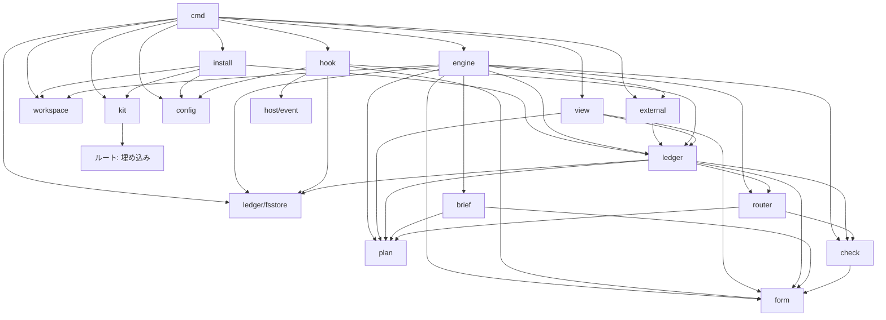

# dev-kit のアーキテクチャ

dev-kit は、単一バイナリの `devkit` と、バージョンを持つ kit の固定物(skill、観点ファイル、テンプレート、hook の登録、サブエージェントの定義)を組み合わせる。人は通常どおり Claude Code や Codex CLI のセッションを開き、他の skill や plugin と同じように kit の skill で作業を始める。セッションのエージェントは作業を実行し、計画の進行・完了条件の判定・記録に関する決定はすべて `devkit` が行う。エージェントは `devkit next` で指示を受け取り、`devkit submit` で結果を返す。判定者と計画者はホストのサブエージェントとして起動し、その結果は kit の SubagentStop hook が受け取る。人への問いはチャットで伝え、`devkit answer` は kit の UserPromptSubmit hook が観測した人の答えだけを受理する。

## 前提

- **信頼の前提**: 作業者(セッションのエージェント)と評価対象のコードに悪意はないものとする。kit が防ぐのは、誤った場所への書き込み、元に戻せない操作の誤実行、外部書き込みの二重適用、自己評価の偏り(作成者自身による `PASS` の判定、完了の過大申告、手順の省略、人の答えの都合のよい解釈)、中断後に再開する際の食い違い、チームでのバージョンの不一致である。記録や承認の偽造、規範を書き換えて check を通す細工、資格情報の窃取といった悪意のある行為は、同じ OS 利用者の権限で動く kit では防げないため、範囲外とする。チームでは、育てるものをすべて git で管理し、PR レビューで確認できるようにする。[`principles/harness.md`](../principles/harness.md) の原則5に従い、この前提を超える保証をするための仕組みは設けない。
- **実装しないもの**: git と、Claude Code・Codex CLI の両方にある機能で賄えるものは kit で実装しない。ブランチ、worktree、ignore、履歴、アーカイブ、利用者の名前は git に任せる。sandbox、permissions、hook の登録、skill、指示ファイル、サブエージェント(判定者・計画者の起動と隔離)、セッションの再開と compaction、人とのやり取りはホストに任せる。kit が持つのは、ホストに対応する機能がないもの(ループ計画の状態機械、記録、check の依頼の作成と結果の受理、router の判断、検証コマンドの実行、外部操作の冪等性)だけである。[`principles/designing.md`](../principles/designing.md) の原則5に従う。
- **指揮と実行の分離**: 決定的であるべきもの(いまどのステージ・ラウンドか、次に何をするか、完了条件を満たしたか、記録の内容、判定者の結果の受理、人の答えの受理)は `devkit` が計算し、エージェントには委ねない。エージェントは指示に従って作業し、結果を返すだけである。kit が保証するのは「記録上、正しくない完了・承認・外部操作が成立しない」ことである。エージェントが手順を飛ばしても記録上の状態は進まず、次の `devkit next` は同じ指示を返す。セッションが途中で終わっても作業は「作業中」のまま残り、次のセッションに引き継がれる。Stop hook は、作業の指示が続く間のセッションの継続を補助するものであり、唯一の保証ではない。
- **権限の境界**: ホストの設定はリポジトリ内の `.claude/settings.json`・`.claude/agents/`・`.codex/hooks.json`・`.codex/config.toml`・`.codex/agents/`・`.codex/rules/` を正本とし、`init` が kit の設定の断片を追記する。作業はセッションの cwd であるチェックアウトで行い、エージェントの書き込み先と外部通信の制限はホストの sandbox に任せる。`devkit` 自身は git への書き込み(スナップショット、refs、コミット)と外部操作のために sandbox の外で動く。Codex は `.codex/rules/devkit.rules` の `prefix_rule(pattern=["devkit"], decision="allow")`、Claude Code は `sandbox.excludedCommands` の `devkit *` で、`devkit` だけを sandbox の外に出す。Codex の rules の allow は sandbox の外で承認なしに動かす機能であり、experimental であることは確認済みである。Claude Code の `excludedCommands` は sandbox の外に出すだけで権限の問い合わせは残るため、`permissions.allow` の `Bash(devkit *)` を併用する。この挙動と、プロジェクト設定の `sandbox` が効くことは確認済みである。`devkit` は単独のコマンドとして呼び、`cd`・リダイレクト・連結・置換を付けない。付けた場合は sandbox の中で動く。skill にこの呼び方を書き、`devkit` は起動時に `.git` へ一時 ref を作成して削除する書き込み試験を行う。sandbox の中なら記録を書く前に失敗し、理由を返す。元に戻せない操作と external を迂回する外部書き込みの deny は `devkit.toml` の `[deny]` に kit が扱う限定した構文で書き、両ホストとも kit の PreToolUse hook が、束縛のあるセッションにだけ適用する。登録はツール名の matcher だけとし、規則との一致は hook が判定する。リポジトリ全体に適用する操作の deny は、リポジトリの方針として人が `.claude/settings.json` に書く。kit が追加する `permissions.deny` は、実行の記録と観測などへの書き込みを保護する項目に限る。判定者と計画者については、Claude Code ではサブエージェント定義の `tools` を読み取り用に限定する。この制限と `Agent(fork)`・`Agent(model:*)` の deny が効くことは確認済みである。Codex では親の sandbox を継承するため、カスタム定義に `features.shell_tool = false` を指定する。この設定を定義に書けることは確認済みだが、展開先のファイルを読めるかは未確認である。読めなければ shell を残し、編集しない指示と `[deny]` で代える。検証コマンドは `devkit verify` の子プロセスとして実行し、専用の隔離は行わない。検証コマンドは `devkit.toml` に登録する育てるものであり、登録時に人がレビューする。
- **バイナリ**: 単一バイナリとし、名前は `devkit` と仮決定する。エージェントが Bash から呼ぶ CLI と、ホストが呼ぶ hook をインターフェースとして持つ。標準出力には、Claude Code の Bash の上限(正常時は約3万字、失敗時は約1万字)に収まる場合は全文を出し、超えるときは要点とファイルのパスを出す。[runtime の契約](parts/runtime.md)に従う。
- **ホスト**: Claude Code と Codex CLI を対象とし、どちらも既定のホストとはしない。hook の形式は共通とし、SessionStart・Stop・PreToolUse・SubagentStop・UserPromptSubmit の5イベントを使う。判定者と計画者はホストのサブエージェントの定義(Claude Code は `.claude/agents/devkit-<ロール>.md`、Codex は `.codex/agents/devkit-<ロール>.toml`)で表し、`init` が kit の既定の定義を書き込む。名前には `devkit-` の接頭辞を付け、Codex の組み込み名と重複させない。計画の担当はサブエージェントの名前で指定する。別系統のエンジンによる判定は、実行主体を「登録コマンド」として表し、検証コマンドと同じ形式で登録したコマンド(`codex exec --output-schema` など)を `devkit` が子プロセスとして実行する。
- **ループ計画**: 状態機械のデータとし、router の分類をキーにした遷移表を持つ。条件式は書かせない。計画の作り直しを正式な操作として扱う。[ループ計画](loop-plan.md)と[ステージ](stages.md)の契約に従う。
- **設定**: チェックアウトのルート(`git rev-parse --show-toplevel`)直下の `devkit.toml` を正本とし、kit のバージョン、検証コマンド、判定の登録コマンド、外部操作の登録、deny、分類表の追記を持つ。実行の記録と生成物は `.devkit/run/` に置き、`init` が `.gitignore` に1行足す。置き場所は変えられない。設定には動作を分岐させる仕組みを置かない。実行の記録は git の管理対象にしない。
- **ファイルの分類**: kit が扱うファイルは、固定物、育てるもの、実行の記録、生成物に分ける。
- **チーム開発**: 同じリポジトリで複数人が別々の作業を進める使い方も対象に含める。情報の共有は、PR 本文に記載する計画の要約と決定、および git 管理の育てるものを通じて行う。同じ機械で複数の作業を並行するときは、ホストや git の worktree 機能で別のチェックアウトを開く。
- **部品**: [brief](parts/brief.md)、[check](parts/check.md)、[router](parts/router.md)、[ledger](parts/ledger.md)、[form](parts/form.md)、[view](parts/view.md)、[runtime](parts/runtime.md)を提供単位とする。各部品は契約・テンプレート・試験を持つ。[基本設計](design.md)に従う。

## データモデル

### エンティティ

- **リポジトリ**: kit を導入した git リポジトリであり、設定ファイルと育てるものの所有者である。
- **作業(Work)**: 1つの課題に対して実行する1本のループを表す単位であり、ULID の作業 ID を持つ。課題への参照、ブランチ `devkit/<作業 ID>`、基点コミット(来歴を示す開始時のコミット)、使う kit のバージョン、記録形式のバージョンを持つ。セッションと作業の対応はセッションの観測に書かれた束縛から特定する。計画の最初のバージョンを作成してから作業を完了または中止するまで存続し、作業範囲の記録を所有する。
- **セッションの観測(SessionObservation)**: 記録ではなく生成物である。SessionStart hook はブランチに関係なくすべてのセッションで `.devkit/run/sessions/<session_id>.json` に観測を書く。観測は、ホスト名、セッション ID、観測時刻、PreToolUse と UserPromptSubmit の最終観測時刻、Stop の継続回数、束縛した作業 ID を持つ。Claude Code では `CLAUDE_ENV_FILE` に `DEVKIT_SESSION_ID` を書き、以後の `devkit` の呼び出しは環境変数でセッションを識別する。環境変数がなければ最新の観測を使い、指示に警告を含める。`start` は観測に作業 ID を書いて束縛し、`next`・`submit`・`answer`・`external` はこの束縛で作業を特定する。`next` は識別したセッション ID をラウンドに結び付ける。hook もセッションの観測から束縛を取り、cwd のブランチが作業のブランチと違えば警告を返すが、束縛は無効にしない。読む操作(`next`・`status`・`view`)は警告だけで続けるが、書く操作(`submit`・`verify`・`external`・`plan`・`note`・完了の確定)は、cwd のブランチが作業のブランチと一致しなければ拒否する。PreToolUse と UserPromptSubmit は、束縛の有無に関係なく最終観測時刻を更新し、入力の本文は束縛があるときだけ観測する。`devkit` は Bash のツール呼び出しなので、その直前に PreToolUse が発火する。`next`・`submit`・`answer`・`external`・`verify` は、同じセッションの PreToolUse の最終観測が自分の呼び出しの直前(数秒以内)にあることを照合する。なければ処理を拒否し、「hook が動いていない。`devkit doctor` と `/hooks` を確認する」と返す。ゲートの承認もこの照合を通らなければ受理しない。`next` は状態を進めず、「hook の稼働を確認する」指示を返す。
- **計画(Plan)**: 作業に属し、バージョンを持つ。内容は、ID 付きの完了条件の列、ステージの列、各ステージの担当・観点・ゲート・遷移表・計数の上限・戻り先・検証コマンドの集合への名前による参照、必須 check の集合、計画の承認で足りる外部操作の宣言(種別・対象・入力のハッシュ、宣言時の登録定義と実行ファイルの内容ハッシュ)である。担当はロール(作業者・判定者・計画者)とサブエージェントの名前、または登録コマンドの名前を持つ。作業者はセッション自身であり、名前は持たない。観点は完了条件 ID と実行主体(判定者のサブエージェント、登録コマンド、機械)を持つ。各バージョンの承認状態は承認の記録から導く派生値である。提案の状態は提案中・却下・撤回・実行可能とし、計画の Judgment、撤回の記録、必要な承認から導く。「実行可能なバージョン」は、計画の check に合格し、ゲートが必要な場合は承認を得ている最新のバージョンとする。提案中のバージョンがある間は古いバージョンを実行しない。撤回しても旧バージョンの実行を妨げないのは、人が自発的に起票し、その後撤回した提案だけである。「前のステージに戻る」による再計画では、提案が却下されても旧バージョンには戻らず、指摘を渡して計画の上限内で再提案するか人に確認する。
- **ステージの実行(StageRun)**: 実行 ID を持ち、作業と開始時に束縛した計画のバージョンに属する。ラウンドの列、実行状態、観測時刻、停止理由、次に動く主体を持つ。実行状態は、作業中・検証中・判定待ち・回答待ち・承認待ち・外部操作の確認待ち・中断・失効・完了である。「再計画待ち」は失効の一種である。実行中は束縛したバージョンを使い続け、計画のバージョンを切り替えるのはステージの開始時だけとする。「前のステージに戻る」を router が記録した時点で旧 StageRun を再計画待ちにし、旧バージョンの実行を再開しない。
- **ラウンド(Round)**: `next` が brief を渡してから `submit` の結果に対して router が判断を下すまでの往復である。ラウンド ID、結び付けたセッション ID、brief のバージョン(内容ハッシュ)、開始時と返却後の対象のバージョン、終了ブロック、成功記録、check の結果の集合、発行した指示の ID の集合と出し直し回数、router の判断を持つ。
- **指示(Instruction)**: `devkit next` が返す、エージェントへの1つの指示である。指示 ID は(作業 ID、種別、対象のキー、出し直し回数)から導く派生値である。対象のキーは、作業の指示ならラウンド ID、判定ならラウンド ID と観点 ID(計画の check なら計画のバージョンと観点 ID)、計画なら提案番号、検出試験なら観点・試験仕様・定義ファイルのハッシュとする。出し直しは作業の記録に追記し、ラウンドを開く前の計画や検出試験の指示も識別する。記録に含めないのは指示の本文である。種別は、作業(brief を渡す)、検証を続ける、検証中、判定待ち、hook の稼働を確認する、判定(判定者のサブエージェントを起動させる。brief のパスと、判定者に読ませる対象の展開先のパスを持つ)、検出試験、計画(計画者のサブエージェントを起動させる)、問い(人に聞く。問い ID と文面と選択肢)、外部操作の確認、完了、中止である。指示は ledger と計画から導く派生値であり、`next` は未受理の結果があればそれを受理して状態を進めた上で指示を計算する。受理後の状態が同じであれば、同じ指示(同じ指示 ID)を返す。再開後に出し直す指示は新しい指示 ID を持ち、古い指示 ID に対する結果は無視する。同じ指示 ID に複数の結果があれば、SubagentStop の観測時刻が最も早いものだけを受理し、他は参考として記録に残す。判定が食い違えば Finding に `needs-decision` として含める。
- **対象のバージョン(TargetVersion)**: ツリーのスナップショット、計画のバージョン、構造のバージョンの直和である。ツリーのスナップショットは、チェックアウトの追跡ファイルと ignore されていない未追跡ファイルから一時インデックスで作る、ブランチには含めないコミットオブジェクトのツリーハッシュである。`.devkit/` や指示ファイル、kit のコピー、サブエージェントの定義も追跡ファイルとしてスナップショットに含まれる。コミットには `refs/devkit/<作業 ID>/<対象のバージョン>` を付け、作業の完了・中止と成果物の永続化まで保持する。計画のバージョンは作業内の計画のバージョン、構造のバージョンは `.devkit/structure.json` の内容ハッシュで識別する。ラウンドの開始時と返却後に取得し、検証でツリーが変わった場合は返却後のスナップショットを取り直す。開始時のスナップショットは、そのラウンドで使う規範(観点ファイル、検証コマンドと登録コマンドの定義、分類表の追記、deny、サブエージェントの定義)の固定と、ラウンドの差分の計算に使う。
- **check の結果(Judgment)**: 観点 ID、対象のバージョン、規範の識別(開始時のスナップショットにおける `.devkit/`・`devkit.toml`・`.claude/agents/`・`.codex/agents/`・AGENTS.md のツリー ID と blob ID の集合)、確認した完了条件 ID の集合、判定、指摘、確認した範囲と未確認の範囲、方法と環境、実行主体(サブエージェントの名前と定義ファイルの内容ハッシュ、観測した effort(Claude Code)または model(Codex)、または登録コマンドの名前、または機械のコマンド)、指示 ID、結果ファイルのパスを持つ。判定は `PASS`・`FAIL`・`NOT ASSESSED` である。判定者の結果は、SubagentStop hook が書いた結果ファイルだけを `devkit` が読み、スキーマ・指示 ID・対象のバージョンに加え、最初の利用者メッセージが `devkit instruction <指示 ID>` の1行と一致すること、定義ファイルの内容ハッシュがラウンド開始時の固定と一致すること、観測した effort(Claude Code)または model(Codex)が定義の値と一致することを検証して受理する。一致しなければ受理せず、定義の変更は次のラウンドから効く。エージェントが書いたファイルや標準出力は受理しない。Judgment が有効なのは、対象のバージョンと規範の識別の両方が現在と一致するときだけである(計画や構造の判定も、観点や規則が変われば古くなる)。評価対象コードだけの変更では規範の識別は変わらず、計画や構造の判定は失効しない。機械の check と登録コマンドについては、`devkit` がコマンドを実行し、その結果を同じ受理境界で `Judgment` に変換する。
- **指摘(Finding)**: 指摘 ID、blocking かどうか、`auto-fixable` または `needs-decision`、失敗のシナリオ、適用除外の主張と根拠の有無、解決した指摘への参照を持つ。修正ラウンドの判定依頼には前回の指摘 ID を渡し、解決した指摘への参照と、確認した完了条件 ID の増加から進展を計算する。
- **決定と証拠(Decision / Evidence)**: 追記のみとする。`devkit note <種別> <ファイル>` でラウンドの途中でも記録でき、`devkit` がスキーマを検証したうえで書き込む。決定は、有効性、置換、依存、適用条件、決定者、暫定か確定かという情報を持ち、証拠は調査結果の出典と確認方法を持つ。未読・承認・却下・保留の状態は、`devkit answer` で追記する状態変更の記録から導く。未読から承認・却下・保留への状態変更が閲覧の記録を兼ね、確認済みの記録の集合もこの状態変更から導く。
- **問い(Question)**: form に従う人への確認事項である。問い ID、承認対象、選択肢、推奨、停止理由の分類、回答後に進むステージ、停止する範囲と進められる範囲、根拠への参照を持つ。承認対象はツリーのスナップショット、計画のバージョン、外部操作の直和であり、外部操作は操作 ID、入力のハッシュ、登録定義の内容ハッシュ、リポジトリ内の実行ファイルの内容ハッシュで識別する。問いは `devkit` が記録したうえで `next` の指示として返し、エージェントがチャットで人に見せる。form は問いの文面に「回答は『問い ID 選択肢』だけの1行で書く」と記載する。承認対象が変わったら新しい問い ID で起票し直し、古い問いへの回答は拒否する。
- **人の入力の観測(PromptObservation)**: 記録ではなく生成物である。UserPromptSubmit hook が、束縛のあるセッションでは常に、人の入力をそのまま `prompts/<session_id>-<時刻>.txt` に書く。UserPromptSubmit は、人が打った入力以外のサブエージェントの報告、他のセッションからのメッセージ、定期タスクでも発火し、これらを区別する項目がない。これは Claude Code では確認済みであり、Codex では未確認である。選択肢の回答は定型との全文の完全一致でこれらを除く。人が別のセッションから定型を送る経路は範囲外とする。
- **回答・承認(Answer / Approval)**: 追記のみとし、同一性は(問い ID、承認対象、承認者)である。承認者は `git config user.name` から得て、空なら `answer` を拒否する。`devkit answer <問い ID>` は引数で選択肢を受け取らない。その問いの起票後に観測された人の入力のうち、全文から前後の空白を除いたものが「問い ID 選択肢」だけの1行と完全に一致する最新の入力を受理する。引用や説明を含む入力、長文は一致しない。受付期限内に新たな定型の入力が観測されれば、訂正としてそちらを優先する。訂正を受け付けるのは、承認した外部操作の実行開始、またはゲート通過後の次のステージの開始までとする。それ以後の定型の入力は訂正として受理せず、新しい問いの起票を促す。ゲートの承認と外部操作の承認にはこの照合を必須とする。文章での回答(決定の保留の理由など)は、全文が問い ID で始まる入力を最新のものから取り、その本文をそのまま記録に写す。受理時に観測した入力の本文と出所(セッション ID と時刻)を記録に含め、観測ファイルを削除した後も記録だけで根拠を確かめられるようにする。前の回答と内容が異なる再回答は、置換元への参照を持つ新しい記録として追記する。同じ置換元を複数の訂正が置換した場合は未解決とし、問いを再起票する。
- **外部への書き込み(ExternalOp)**: エージェントが `devkit external <種別> <入力ファイル> --request <要求 ID>` で要求する。操作 ID は `devkit` が(種別、対象、入力のハッシュ)から導く。要求 ID は同じ呼び出しの再送を識別するためだけに使う。操作の種別、対象、入力のハッシュ、登録定義の内容ハッシュ、リポジトリ内の実行ファイルの内容ハッシュ、承認への参照、冪等キー、実行前の記録、実行結果、外部側の識別子を持つ。受理時に承認されていなければ問いを起票して「外部操作の確認待ち」で止める。同じ操作 ID で実行中または結果不明の操作があれば、要求 ID が違っても新規には受理せず、記録済みの状態を返す。実行結果は成功・失敗・結果不明である。同じ要求 ID に異なる内容が来たら拒否する。成功済みの操作 ID に対する新しい要求は、記録済みの成功を返し、再実行しない。同じ入力で正当に繰り返す操作(コメントの追加など)は、登録に「発生単位」として要求ごとに変わる入力の項目を宣言し、操作 ID の導出に含める。
- **進捗(Progress)**: ラウンドの終了ブロックである。`devkit submit` の入力として受け取り、`devkit` が記録する。判定、終了の種別、次のアクション、変更したファイル、確認済み事項、未確認事項、変更禁止事項、一時状態(確認方法・出典・無効になる条件)、再開条件を持つ。終了の種別は、完了を主張・停止して確認・中断である。
- **checkpoint**: 記録ではなく派生値である。実行状態を持つ最新の StageRun と最新の進捗、未回答の問い、未受理の指示から組み立てる。SessionStart で注入するたびに ledger から組み立て、一時状態の無効条件を照合し、無効なものは注入しない。hook の出力上限が Claude Code では約1万字、Codex では約2,500トークンであることは確認済みである。この上限に収まるなら本文を注入し、収まらなければ要約を注入して「`devkit status` で全文」と案内する。
- **成功記録(BuildTestResult)**: 追記のみとする。対象のバージョン、コマンドの名前と登録定義の内容ハッシュ、結果、実行時刻を持つ。`devkit verify` が検証コマンドを実行して書く。エージェント自身が行った検証は終了ブロックの確認済み事項に記載するだけで、成功記録にはならない。
- **成果物(Artifact record)**: 成果物 ID とバージョン、変更前後、完了条件 ID、変更の種類、決定への参照、永続化先であるコミットへの参照を持つ。開始時と返却後のスナップショットの差分をもとに、`devkit` が作成する。検証でツリーが変わった場合は、検証前後の差分も「検証による変更」として記録する。
- **検出試験の記録(DetectionTest)**: 観点ファイルの内容ハッシュ、試験仕様(違反例・適合例・許容例と期待判定)の内容ハッシュ、担当(サブエージェントの定義ファイルの内容ハッシュ、または登録コマンドの定義の内容ハッシュ)、観測した effort(Claude Code)または model(Codex)(来歴)、実際の判定、根拠を持つ。合格記録は git 管理の資産 `.devkit/detect.json` の索引に置く。[`principles/harness.md`](../principles/harness.md) の原則2に従い、計画の担当と一致する合格記録がない観点は必須 check にしない。合格記録が不足していれば `next` はラウンドを開く前に検出試験の指示を返し、合格を記録してからラウンドの開始時のスナップショットを取る。不合格なら、観点を修正するか必須から外すかの問いを起票して停止する。合格記録の同一性は、観点・試験仕様・担当の定義ファイルの内容ハッシュで決まり、観測した effort / model は来歴として扱う。Claude Code の effort の上書きは `[deny]` の既定の `Agent(effort:*)` で止める。
- **構造の記録(Structure)**: 構造ステージを使うリポジトリにだけ、育てるものの資産 `.devkit/structure.json` がある。バージョンは内容ハッシュ、履歴は git の履歴、承認は PR のレビューである。
- **規則と強制手段(Rules)**: `.devkit/rules.md` を正本とする。移行記録は `rules.md` 自体の項目として残す。brief の「元に戻せないもの」には、ここと計画にある項目を渡す。`[deny]` はコマンドの規則であり、設計上の変更困難な決定の一覧ではない。
- **記録形式のバージョン**: 各記録が持つ。バイナリは読めるバージョンの範囲と書くバージョンを宣言し、読めない記録は失敗として報告する。移行の仕組みは設けない。読めなくなった作業は、古いバイナリで終えるか `abort` する。

### 所有と生存期間

データの所有と生存期間、整合性を守る境界は、[`principles/data.md`](../principles/data.md) の原則5に従う。

- **作業範囲の記録**: 作業が所有する。完了・中止後も、実行履歴である StageRun、Judgment、決定、成果物、外部操作を読み取り専用で残す。閲覧を兼ねる人の判断である回答・承認・状態変更は、完了後も追記を許す。
- **育てるものの資産**: リポジトリが所有し、git で管理するファイルである。`devkit.toml`、ホストの設定とサブエージェントの定義、AGENTS.md、観点ファイルと違反例・適合例、rules.md、検出試験の合格記録の索引、構造、kit のコピー、skill を含める。作業範囲の記録への参照は、作業 ID・課題の URL・PR の URL による外部参照だけとする。共有に必要な決定の根拠は、資産側に転記する。
- **生成物**: `.devkit/run/work/<作業 ID>/` の下の brief と判定依頼、判定者に読ませる対象の展開先、判定者の結果ファイル、人の入力の観測、view の HTML は `devkit`(CLI と hook)の生成物であり、再生成または削除できる。対象は一時インデックスから `git read-tree` と `git checkout-index --prefix` で展開し、`.gitattributes` の `export-ignore`・`export-subst` の影響を受けない。セッションの観測は作業の外の `.devkit/run/sessions/` にチェックアウトごとに置く。エージェントが終了ブロック・計画・note の入力 JSON を書く場所は、作業の `inbox/` だけとする。スナップショットの `refs/devkit/<作業 ID>/<対象のバージョン>` は、作業の完了・中止と成果物の永続化がそろうまで保持する。

### 整合性の境界

- **記録**: 範囲は作業だけである。追記のみとし、checkpoint・指示の本文・観測は記録に含めない。指示 ID と出し直し回数は作業の記録に含め、ラウンドで発行した指示の ID の集合は Round にも持たせる。ledger の書き手は `devkit` の CLI だけである。hook は ledger を読み、生成物(観測、結果ファイル)だけを書く。記録 ID は一意とし、参照先の記録 ID は存在するものに限るか、外部参照であることを明示する。
- **完了条件**: router がステージの完了を認めるには、返却後の対象のバージョンに対する `devkit verify` の成功記録、すべての必須 check の `PASS`(対象のバージョンと規範の識別が一致するもの)、必須 check の観点と担当に対する検出試験の合格が必要である。集合が空の場合、成功記録は不要である。Stop hook はこの条件を照合しない。
- **指示の決定性**: `next` は未受理の結果(判定者の結果ファイル、検証の完了)を受理して状態を進め、ledger と計画から次の指示を計算する。受理は冪等であり、同じ結果を二度受理しない。受理後の状態が同じであれば、同じ指示を返す。`submit`・`answer`・`external`・`plan`・`note`・`verify` も状態を進めるが、遷移表にない遷移、完了条件を満たさない完了の主張、未回答の問いがあるときの作業の結果、開いているラウンドのない `submit`、cwd のブランチが作業のブランチと一致しない場合の書く操作(`submit`・`verify`・`external`・`plan`・`note`・完了の確定)は受け付けず、理由を返す。読む操作(`next`・`status`・`view`)はブランチの不一致を警告して続ける。問いの「進められる範囲」は表示の情報にとどめ、当面は未回答の間、そのステージの作業を止める。`submit`・`plan`・`note` は作業の `inbox/` の下のファイルだけを受け取る。
- **作業の排他**: 同じ作業に対して `devkit` を同時に実行するプロセス間の排他制御を `.devkit/run/work/<作業 ID>/run.lock` で行う。`verify` だけは実行に時間がかかるため、`next`・`status` はロックを待たずに「検証中」を返す。`next` が「検証中」を返す指示には「`verify` の終了を待ってから `next`」と書き、完了した検証は次の `next` で受理する。
- **計画のバージョン**: 単調に増加させ、StageRun の開始時に束縛する。提案中のバージョンがある間は旧バージョンを実行しない。`devkit plan <ファイル>` は提案を記録し、計画の check と必要なゲートは `next` の指示で進める。`devkit plan --withdraw` は撤回を追記する。
- **承認**: 同一性は(問い ID、承認対象、承認者)である。ゲートと外部操作の承認は、起票後に観測した人の入力のうち、全文(前後の空白を除く)が定型の1行と完全に一致する最新のものだけを受理する。承認対象が変わったら問いを起票し直す。訂正は置換元を持ち、競合は未解決として再起票する。訂正を受け付けるのは、承認した外部操作の実行開始、またはゲート通過後の次のステージの開始までとする。それ以後の定型の入力は訂正として受理せず、新しい問いの起票を促す。問いと承認を機械間で共有する経路は対象範囲に含めない。
- **外部への書き込み**: 操作 ID・入力のハッシュ・登録定義と実行ファイルの内容ハッシュを承認対象とする。計画の承認で足りるのは、計画に宣言した種別・対象・入力のハッシュと、宣言時の登録定義・実行ファイルの内容ハッシュがすべて一致する操作だけであり、それ以外は操作ごとに承認する。承認への参照、実行前の記録、実行、結果の記録の順を守る。実行の開始直前に有効な承認を読み直し、登録定義と実行ファイルの内容ハッシュが受理時と一致することを照合する。一致しなければ新しい問いを起票する。実行と照会には登録ごとに期限を設け、期限を超えた場合は結果不明とする。結果不明の場合は、外部側で識別・照会できるときだけ照会して確定し、できなければ再実行せず人に確認する。
- **資産の更新**: 育てるものは通常の変更としてコミット・PR・マージで更新する。機械間の直列化は git に任せる。
- **検証の対象**: `submit` は終了ブロックを受理し、返却後のスナップショットを取って StageRun を「検証中」にする。`verify` は、開始時のスナップショットから読んだ検証コマンドの定義をチェックアウトで実行し、成功記録を返却後の対象のバージョンに結び付ける。`verify` は冪等で、成功記録がある集合は再実行しない。検証の終了後に一時インデックスで `write-tree` を取り、返却後のスナップショット A と一致しなければ、A の成功記録を無効にし、変更後のツリー B で返却後のスナップショットを取り直す。A から B への差分を「検証による変更」として成果物に記録し、B に対して1回だけ検証をやり直す。以後の判定・完了・コミットの対象は B とし、B がさらに変われば問いを起票する。判定者には返却後のスナップショットを一時インデックスから `git read-tree` と `git checkout-index --prefix` で展開した読み取り専用の場所を読ませ、結果は指示 ID と対象のバージョンで照合する。
- **ラウンド内の固定**: 観点ファイル、検証コマンドと登録コマンドの定義、分類表の追記、`[deny]`、サブエージェントの定義は、ラウンドの開始時のスナップショットから `git show` で読む。エージェントがラウンド中にこれらを編集しても次のラウンドから適用され、変更は対象のバージョンの差分として現れ、ステージがメタループの編集を宣言していなければ router が「人に確認する」に分類する。ラウンドが開いていない計画・ゲート・検出試験の間は、作業のブランチの HEAD(直前の完了コミット、なければ基点コミット)の `devkit.toml` から `[deny]` を読む。

### 書き手と調停

ledger の書き手は `devkit` の CLI だけである。hook も同じバイナリで動作するが、ledger は読むだけで、生成物(セッションの観測、人の入力の観測、判定者の結果ファイル)だけを書く。生成物の名前はセッション ID・agent ID・時刻によって一意になるため、同時に動作する hook が衝突することはない。

- **追記のみの記録**: 記録 ID をファイル名とし、記録ごとに独立した JSON ファイルを作る。一時ファイルに書き込んでから、rename で公開する。読み手は一時ファイルを無視し、壊れた記録は隔離ディレクトリへ移して報告する。生成物も同じ方法で公開する。
- **資産**: 通常の git の変更として更新し、競合は git のマージと人のレビューで解決する。

## モジュール

各モジュールを Go のパッケージとすることを仮決定する。ポート(interface)は持たない。Workspace と External は具体型とし、試験では関数値を差し替える。git、ホストの JSON、設定ファイルなどの外部の型は、境界で内部の型に変換し、公開契約・記録・ドメインで使う型には含めない([`principles/structure.md`](../principles/structure.md) の原則5)。

plan、brief、check、router、form は、入出力を行わないドメインの核とし、自らファイルを読み込まない。cmd/devkit が config と kit から値を解決して渡す。

### plan

- **責務**: ループ計画の意味論を扱う。JSON Schema による検証、router の分類から次のステージを選ぶ遷移、計数の上限の判定、現在のバージョンと残りの計画から新しいバージョンを作成する操作、およびその差分、実行可能なバージョンの判定、計画の承認で足りる外部操作の宣言の照合を扱う。
- **持つデータ**: `Plan`、`Stage`、`Assignee`、`Gate`、`Transition`、`Limits`、`ReturnTarget` の型、ID 付きの完了条件、観点と完了条件の対応、観点の実行主体、必須 check とステージごとの検証コマンドの集合への名前による参照、宣言した外部操作、router が使うステージの完了条件の規則を持つ。
- **公開する契約**: 計画の型と、検証・遷移・上限判定・作り直し・実行可能なバージョンの判定を公開する。
- **依存**: 他のモジュールに依存しない。
- **置くもの・置かないもの**: 入出力を伴わない計画の意味論を置く。保存は ledger に、進行は engine に置く。

### brief

- **責務**: ステージ定義、前のステージの出力、リポジトリの事実から brief を組み立てる。修正ラウンドでは前回の指摘と指摘 ID を取り込む。判定者・計画者のサブエージェントに渡す依頼文も brief の一種として組み立て、結果を最終メッセージとして返す形式を含める。
- **持つデータ**: brief の型と、内容ハッシュで表すバージョンを持つ。
- **公開する契約**: brief の型と、brief を組み立てる関数を公開する。
- **依存**: ステージの型を持つ plan と、テンプレートを持つ form に依存する。
- **置くもの・置かないもの**: brief の組み立てとバージョンの計算を置く。ファイルへの書き出しは engine に置く。

### check

- **責務**: 観点ファイルを解析し、blocking の定義、確認事項、報告しない事項、出力形式を扱う。指示ファイル、[principles](../principles/README.md)、[部品の契約](design.md#部品)、[規則](rules.md)、brief、計画、観点ファイルを規範として束ね、判定依頼を組み立てる。結果ファイルを解析してスキーマを検証し、指示 ID・対象のバージョン・規範の識別の一致に加え、最初の利用者メッセージの定型、定義ファイルの内容ハッシュ、観測した effort / model と定義の値を照合して受理する。同じ指示 ID の結果は最初の SubagentStop の観測だけを受理し、他は参考として残し、判定の食い違いを `needs-decision` の Finding に含める。機械の check と登録コマンドは engine のコマンド実行結果を同じ受理境界で `Judgment` に変換する。適用除外の主張と根拠がある場合は、適用除外によって対象から外れる要求に限り、違反としない。判定は `FAIL`、`NOT ASSESSED`、`PASS` の優先順で集約する。必須 check の網羅状況と、必須 check の観点と担当に対する検出試験の合格を照合する。検出試験の仕様と結果の判定も扱う。
- **持つデータ**: `Judgment` と `Finding` の型、解析した観点ファイル、判定依頼と解析結果、検出試験の仕様と結果を持つ。計画の check では、コードを変えるステージが検証コマンドの集合を省略していないこと、省略する場合は根拠があることを確認する。
- **公開する契約**: 規範・観点ファイル・対象のバージョンと場所・出力スキーマに、修正ラウンドでは前回の指摘 ID も加えて判定依頼を組み立て、結果ファイルまたはコマンド実行結果から `Judgment` を解析する操作を公開する。適用除外、集約、必須 check と検出試験の照合も公開する。
- **依存**: 観点ファイルの形式と `Judgment` のスキーマを扱う form に依存する。
- **置くもの・置かないもの**: 入出力を伴わない判定の意味論、依頼の組み立て、結果の解析・受理、検出試験の仕様を置く。判定者はホストのサブエージェントとして起動し、結果の受け取りは hook が行う。結果の保存は ledger に、次の行動の判断は router に置く。

### router

- **責務**: 分類表の固定物とリポジトリ側の追記を、解析済みの値として引数で受け取り、次の行動を判断する。check の集約、ラウンド数、engine が計算した進展の有無、計画の上限、停止分類から、「修正する」「人に確認する」「前のステージに戻る」「完了する」を選ぶ。plan から受け取るステージの完了条件を照合し、人への確認事項を分類する。「人に確認する」の分類は、kit の分類表に既定のデータとして定義し、リポジトリ側の追記で上書きできる。既定には、依存の宣言(ロックファイル・マニフェスト)の差分、ステージがメタループの編集を宣言していないのに `.devkit/`・`devkit.toml`・ホストの設定・指示ファイル・skill が変更された場合、検証後にツリーが2回変わった場合を含める。hook の稼働が確認できないときは状態を進めず、`next` が「hook の稼働を確認する」指示を返す。
- **持つデータ**: 人への確認、check の結果、教訓の反映先、ロールと担当、振り返りに関する分類表の型と内容を持つ。
- **公開する契約**: 分類表の型と、渡された分類表による判断、完了条件の照合、人への確認の分類、教訓の反映先の分類を公開する。
- **依存**: 上限と遷移の語彙を持つ plan、判定の型を持つ check に依存する。
- **置くもの・置かないもの**: 分類と判断を置く。判断に従ってループを進める処理は engine に置く。

### form

- **責務**: 固定フォーマットの定義を持ち、スキーマの型、テンプレートの適用機能、人向けの Markdown の描画機能を提供する。
- **持つデータ**: 終了ブロック(`submit` の入力)、判定者の結果(最終メッセージの形式)、計画、問い(回答の定型を含む)、決定と証拠、`next` の指示の JSON Schema の型を持つ。終了ブロックは判定、終了の種別、次のアクション、変更したファイル、確認済み事項、未確認事項、変更禁止事項、一時状態(確認方法・出典・無効条件)、再開条件を持つ。Finding のスキーマに指摘 ID、`auto-fixable` / `needs-decision`、失敗のシナリオ、解決した指摘への参照を含める。skill の構成、観点ファイル、計画の要約と決定を含む PR 本文、設計案のテンプレートを受け取って扱う。
- **公開する契約**: 固定フォーマットの定義と、受け取ったスキーマ・テンプレートの適用、Markdown の描画を公開する。
- **依存**: 他のモジュールに依存しない。スキーマとテンプレート本体の正本は kit の固定物とし、form は供給された値を使う。
- **置くもの・置かないもの**: 入出力を伴わない形式の定義と描画を置く。固定物の読み込みは kit に、計画や判定の意味論は plan と check に、HTML の生成は view に置く。

### ledger

- **責務**: 記録の意味論、問い合わせ、派生値を扱う。決定のグラフから有効性・置換・依存を解決する。checkpoint の組み立てと一時状態の無効条件の照合、有効な決定とその状態、実行可能な計画のバージョンと提案中・却下・撤回の状態、観点ごとの最新判定とバージョンの一致、完了記録のない StageRun、未回答の問い、承認の解決、確認済みの記録の集合、未受理の指示を派生値への問い合わせとして提供する。
- **持つデータ**: ULID の記録 ID と参照、記録形式のバージョンと読み取り可能な範囲を持つ。種別ごとのペイロードとして、作業、計画のバージョンと撤回、決定、証拠、状態変更、問い・回答・承認、外部書き込み、進捗、成功記録、check の結果、検出試験の実行、ステージの実行、ラウンド、成果物を持つ。閲覧と確認済みの集合は `answer` による状態変更から導く。
- **公開する契約**: 記録の型、派生値の問い合わせ、決定と承認の解決を公開する。関数は ledger/fsstore の具体型を受け取る。
- **依存**: ペイロードに使う plan、check、router、form の型と、保存を担う ledger/fsstore に依存する。
- **置くもの・置かないもの**: 記録の意味論と問い合わせを置く。ファイル形式は ledger/fsstore に、表示は view に置く。

### ledger/fsstore

- **責務**: ファイルによる保存の具体型を持つ。記録ごとに独立した JSON ファイルを作り、一時ファイルへ書いてから rename で公開する。読み手は一時ファイルを無視し、壊れた記録は隔離して報告する。作業ディレクトリのロックと、生成物の公開(同じく一時ファイルと rename を使う方法)を扱う。
- **公開する契約**: 追記・一覧・取得、作業の排他制御、生成物の公開のための操作を公開する。記録ルートは引数で受け取り、渡されたルートの配下だけを扱う。読めないバージョンの記録は失敗として報告する。
- **依存**: 他のモジュールに依存しない。
- **置くもの・置かないもの**: 保存形式、原子的な公開、隔離、排他を置く。記録の意味論は ledger に、パスの決定は config に置く。SQLite は採用しない。

### engine

- **責務**: ループの状態機械を進める。`start` は作業とブランチを作り、基点コミットと kit のバージョンを記録し、セッションの観測に作業 ID を書いて束縛し、計画者への指示を返す。`next` は未受理の結果(SubagentStop が書いた結果ファイル、完了した検証)を受理して状態を進め、現在の StageRun とラウンドを特定し、次の指示を計算する。作業の指示を返す場合は、必要な検出試験が済んでいることを確かめ、開始時のスナップショットを取り、識別したセッションの観測をラウンドに結び付け、brief をファイルに書いて返す。判定の指示を返す場合は、判定依頼を書き、返却後のスナップショットを一時インデックスから `git read-tree` と `git checkout-index --prefix` で展開し、指示 ID を付けて返す。`submit` は終了ブロックを検証し、返却後のスナップショットを取り、成果物を記録し、StageRun を検証中にする。`verify` は検証コマンドと機械の check、登録コマンドの判定を実行し、成功記録と Judgment を書き、`write-tree` で再照合する。返却後のスナップショット A と異なれば、A の成功記録を無効にし、変更後のツリー B で返却後のスナップショットを取り直し、A から B への差分を「検証による変更」として成果物に記録する。B に対して1回だけ検証をやり直し、以後の判定・完了・コミットの対象を B とする。B がさらに変われば問いを起票する。判定者による check が必要なら判定待ちにする。結果が揃ったら集約し、進展を計算して router の判断を記録し、StageRun の状態を進める。「前のステージに戻る」では旧 StageRun を再計画待ちにし、計画者への指示を返す。`plan` は提案を記録し、計画の check を判定の指示として進め、ゲートが必要なら問いを起票する。`answer` は観測した人の入力と照合して受理する。`external` は要求を受理し、承認の有無に応じて、問いを起票するか実行するかを決める。`note` は決定と証拠を記録する。完了時には workspace に受理済みの返却後のスナップショットのコミットオブジェクトを永続化させ、作業のブランチの参照をそのコミットへ進め、index をその HEAD に合わせ、作業ツリーは触らない。
- **持つデータ**: 現在の作業、StageRun、ラウンド、指示の計算結果、検証の実行状態を扱う。永続化する状態はすべて ledger に記録する。
- **公開する契約**: `start`・`next`・`submit`・`verify`・`plan`・`answer`・`external`・`note`・`abort` に対応する操作を公開する。`Workspace` と `External` は具体型として使う。
- **依存**: plan、brief、check、router、ledger、form、workspace、external、ledger/fsstore に依存する。
- **置くもの・置かないもの**: 状態機械の進行、指示の計算、検証コマンドと登録コマンドの実行、判定者の結果の受理を置く。git の操作は workspace に、外部書き込みの実行は external に、保存の実装は ledger/fsstore に置く。判定者と計画者を起動する処理は置かない。

### external

- **責務**: kit が管理する外部への書き込みの唯一の実行経路を担う。承認された操作について、実行前の記録、実行、結果の記録、結果不明の扱いをまとめて管理する。
- **持つデータ**: `ExternalOp` の各項目と、登録済みの定型コマンドと照会コマンドを扱う。登録には、実行ファイル、固定引数の配列、対象の許可値、実行と照会の期限、同じ入力で繰り返す操作の発生単位を含める。
- **公開する契約**: 具体型の `External` として公開する。操作の入力は標準入力の JSON で渡し、シェル展開しない。対象は登録に列挙された許可値から選び、範囲外の値は拒否する。
- **依存**: ledger に依存する。登録は config が読み込んだ値として受け取る。
- **置くもの・置かないもの**: 承認された外部書き込みの実行と回復の手続きを置く。種別ごとの実装は持たず、`devkit.toml` に登録されたリポジトリ側の定型コマンドをチェックアウトで呼ぶ。エージェントのツールによる直接の外部書き込みは PreToolUse で `[deny]` を適用して止める。

### hook

- **責務**: ホストのイベントを受け取るサブコマンドとして動作する。host/event が標準入力の JSON を共通イベントへ変換する。束縛はセッションの観測から取り、束縛がなければ早期終了する。ただし SessionStart はすべての親セッションで観測を書き、PreToolUse と UserPromptSubmit は束縛がなくても最終観測時刻を更新する。cwd のブランチが作業のブランチと違えば警告を返すが、束縛は無効にしない。読む操作(`next`・`status`・`view`)は警告だけで続けるが、書く操作(`submit`・`verify`・`external`・`plan`・`note`・完了の確定)は、cwd のブランチが作業のブランチと一致しなければ拒否する。サブエージェント内(入力に `agent_id` がある場合)では Stop と SessionStart は何もしない。PreToolUse の deny は親と同じく適用する。ledger は読むだけで、生成物だけを書く。
- **持つデータ**: 共通イベント、解決した作業 ID、組み立てた checkpoint、観測を扱う。
- **公開する契約**: `devkit hook <event>` として、イベントごとの決定的な処理結果を返す。出力の形式と上限は host/event を通してホストに合わせる。
- **依存**: ledger、config、host/event、form、ledger/fsstore(生成物の公開)に依存する。本体のルートは cmd/devkit が workspace で解決し、作業 ID はセッションの観測の束縛から取得して渡す。
- **置くもの・置かないもの**: イベントごとの決定的な処理を置く。モデルによる判定は置かない。

- **SessionStart**: ブランチに関係なく `.devkit/run/sessions/<session_id>.json` に観測を書く。Claude Code では `CLAUDE_ENV_FILE` に `DEVKIT_SESSION_ID` を書く。束縛があれば checkpoint を組み立てて注入する。失敗したら警告を注入する(SessionStart は block できない)。起動・再開・compaction 後に同じ処理を行う。
- **Stop**: このセッションに束縛された作業について、`next` が返す指示が問い・完了・中止・判定待ち・検証中のいずれでもなければ `block` と理由(「`devkit next` を実行する」)を返す。ラウンドの有無ではなく作業単位で扱う。検証中(`verify` がロックを保持している間)は停止を許し、完了した検証は次の `next` で受理する。継続回数はセッションの観測ファイルで管理し、上限に達したら停止を許す(状態は変えない)。Claude Code の上限が8回で、ツール呼び出しでリセットされることは確認済みである。他の hook の `continue: false` が優先される場合があることを前提とし、停止後の再開は SessionStart の注入で行う。
- **PreToolUse**: 束縛の有無に関係なく、セッションの観測の最終時刻を更新する。束縛があれば、ラウンド開始時のスナップショットの `[deny]` を読む。ラウンドが開いていない計画・ゲート・検出試験の間は、作業のブランチの HEAD(直前の完了コミット、なければ基点コミット)の `devkit.toml` から読む。登録はツール名の matcher だけとし、一致の判定は hook が行う。kit が解釈する規則は `Bash(<前方一致> *)` とツール名(MCP ツールを含む)の2種だけである。Bash のコマンドは `&&`・`||`・`;`・`|` の線形な連結を分割し、各部分に前方一致を当てる。リダイレクト・置換・制御構文を含むコマンドは分割せず、規則に触れる可能性があれば deny し、「分けて実行する」と理由を返す。Claude Code の permission rule の意味論は再実装しない。Codex の PreToolUse で `tool_input.command` を取得できることは確認済みである。束縛のあるセッションでサブエージェントを起動するとき(Claude Code の Agent ツール)、`subagent_type` が `devkit-` で始まり、`prompt` が `devkit instruction <指示 ID>` だけの1行でなければ deny する。fork(`isolation` や fork の指定)、`model`・`effort` の明示も deny する。これらは `[deny]` の既定の `Agent(fork)`・`Agent(model:*)`・`Agent(effort:*)` と定型の照合として適用し、リポジトリ全体の `permissions.deny` には足さない。
- **SubagentStop**: 束縛があり、`agent_type` が発行済みの判定または計画の指示の担当名と一致すれば、`last_assistant_message` を `results/<指示 ID>-<agent_id>.json` に書く。Claude Code の `agent_type` が定義の `name` であることは確認済みである。`agent_transcript_path` から最初の利用者メッセージを取り出し、Claude Code は `effort.level` を、Codex は `model` を観測して、そのときのサブエージェント定義ファイルの内容ハッシュと SubagentStop の観測時刻を結果ファイルに添える。一致しなければ何もしない。
- **UserPromptSubmit**: 束縛の有無に関係なく、セッションの観測の最終時刻を更新する。束縛のあるセッションでは常に、`prompt` をそのまま `prompts/<session_id>-<時刻>.txt` に書く。

### host/event

- **責務**: hook のイベント JSON を共通イベント型へ変換し、ホストの上限と対応表に合わせて出力 JSON を整形する。
- **依存**: 他のモジュールに依存しない。

### workspace

- **責務**: git CLI を使い、ブランチの作成と切り替え、対象のバージョンとなるスナップショットとコミットオブジェクトの作成、`git show` によるスナップショットからの読み出し、一時インデックスからの `git read-tree` と `git checkout-index --prefix` による展開、変更ファイルの一覧、永続化(ブランチの参照の更新と index の同期)、cwd のブランチ名の取得、チェックアウトのルートの解決、`git config user.name` の取得を行う。
- **公開する契約**: 具体型の `Workspace` として公開する。対象のバージョンは追跡ファイルと ignore されていない未追跡ファイルから一時インデックスで計算する。ブランチには含めないコミットオブジェクトを作り、`refs/devkit/<作業 ID>/<対象のバージョン>` を付ける。完了時に永続化するのは受理済みの返却後のスナップショットのコミットオブジェクトであり、workspace が作業のブランチの参照をそのコミットへ進める。ブランチの参照を進めた後、index をその HEAD に合わせる(`git reset --mixed` 相当)。作業ツリーは触らず、確定後は HEAD と index がスナップショットに一致し、それ以後の作業ツリーの変更は未ステージの差分として残る。エージェントにはコミットさせない。それ以後の変更は次のラウンドの変更とし、完了には含めない。展開は `.gitattributes` の `export-ignore`・`export-subst` の影響を受けない。refs は作業の完了・中止と成果物の永続化がそろってから削除する。チェックアウトのルートは `git rev-parse --show-toplevel` で得る。
- **依存**: 他のモジュールに依存しない。外部の git CLI を使う。
- **置くもの・置かないもの**: git の操作と、出力を内部の型に変換する処理を置く。worktree の作成は置かない。

### config

- **責務**: `devkit.toml` の読み込みと検証だけを行う。設定として持つのは、kit のバージョン、検証コマンドの定義(名前、実行ファイル、固定引数、期限)、判定の登録コマンド(名前、実行ファイル、固定引数、期限、出力スキーマの指定)、外部操作の登録、`[deny]`、分類表の追記である。`.devkit/run/` の場所は固定とする。
- **依存**: 他のモジュールに依存しない。
- **置くもの・置かないもの**: 設定の読み込み・検証を置く。動作の分岐、モデル名、ホストのバイナリのパスは置かない。

### install

- **責務**: `init` は `devkit.toml`、`.devkit/kit/<バージョン>/`(埋め込みからのコピー)、`.devkit/checks/`・`rules.md` の初期内容、`.gitignore` の `.devkit/run/` の1行、ホスト設定への kit の断片の追記、サブエージェントの定義(`.claude/agents/devkit-*.md`、`.codex/agents/devkit-*.toml`)、`.agents/skills/devkit/` と skill 単位のリンク `.claude/skills/devkit`、AGENTS.md への1行の案内を用意する。ホスト設定に足す断片は、hook の登録(`.claude/settings.json`、`.codex/hooks.json`)、`devkit` を sandbox の外で動かす設定(`sandbox.excludedCommands`、`.codex/rules/devkit.rules`)、Claude Code の `permissions.deny` の `Edit(.devkit/run/**/records/**)`・`Edit(.devkit/run/**/results/**)`・`Edit(.devkit/run/**/sessions/**)`・`Edit(.devkit/run/**/prompts/**)`・`Edit(.devkit/run/**/snap/**)` である。`Agent(fork)`・`Agent(model:*)`・`Agent(effort:*)` は settings に足さず、`[deny]` の既定として hook が適用する。`init` は `permissions.allow` に `Bash(devkit *)` を提案する。これは呼び出しの利便性のためであり、記録上の保証ではない。Claude Code の hook の登録には `onFailure: "block"` 相当の設定を使う。リポジトリ全体に適用される項目は差分として示し、人の確認を待つ。既存の設定、既存の skill、既存の CLAUDE.md は上書きしない。処理は冪等にする。`doctor` は `devkit.toml` の妥当性、kit のコピーと埋め込みの一致、ホスト設定に断片があること、Claude Code の workspace trust(`~/.claude.json` の `hasTrustDialogAccepted`)、Codex のプロジェクトの信頼(`~/.codex/config.toml` の `projects.<パス>.trust_level`)、サブエージェントの定義の存在、skill のリンク、バイナリと記録形式の互換性を照合する。Codex の hook の信頼状態には照会手段がないため、`/hooks` で信頼を設定するよう案内する。Claude Code の `-p` と対話で `permissions.deny`・hook の登録が読み込まれること(対話では workspace trust の受諾後)、Codex のプロジェクト層の hooks・rules・agents が読み込まれる条件がプロジェクトの信頼であることは確認済みである。Codex の skill がシンボリックリンクをたどることも確認済みである。
- **依存**: config、kit、ledger、workspace に依存する。
- **置くもの・置かないもの**: 導入先の構成と登録・照合を置く。バイナリを配布・配置する方法は未決定である。

### kit

- **責務**: バージョンを持つ固定物を提供する。供給源は、リポジトリ内のコピー `.devkit/kit/<バージョン>/` の1つに限定する。埋め込みは、`init` によるコピーの書き出しと、`doctor` による一致の照合にだけ使う。brief と判定依頼が参照する principles・部品の契約・観点ファイル・テンプレートはすべてこのコピーにある。Work に記録した kit のバージョンと一致しないコピーは拒否する。
- **持つデータ**: ステージ定義、kit 提供の観点ファイル、テンプレート、router の分類表の既定、規則の既定、JSON Schema、skill、AGENTS.md の断片、ホスト設定・サブエージェント定義・rules の断片、部品の契約、principles、検出試験の違反例・適合例・許容例を持つ。
- **依存**: 他の処理モジュールに依存しない。埋め込みの供給源はルートパッケージから読む。

### view

- **責務**: ledger と、構造ステージを使う場合の `.devkit/structure.json` から静的 HTML を生成する。冒頭の固定形式、3群の主表示、判断対象ごとにまとめた表示、完了条件 ID ごとの確認範囲の地図、確認済みの集合、構造の図を描画する。記録の網羅性は「`submit` が成果物を記録した範囲」として示し、作業中の StageRun には最後の観測時刻を添える。図は Mermaid のテキストとする。構造の履歴は cmd/devkit が workspace を使って取得し、解析済みの値として渡す。確認済みの集合は `answer` による未読から承認・却下・保留への状態変更から導く。問いの「進められる範囲」は表示の情報にとどめ、当面は未回答の間そのステージの作業を止める。
- **依存**: ledger、問いを描画する form、ステージ名を持つ plan に依存する。
- **置くもの・置かないもの**: 人向けの表示を置く。サーバは持たない。状態変更は HTML から行わず、チャット経由の `answer` で記録する。

### cmd/devkit

- **責務**: 組み立ての根として、サブコマンドを定義し、各実装を接続する。cwd をもとに、workspace を使ってチェックアウトのルートとブランチ名を解決し、環境変数 `DEVKIT_SESSION_ID`(なければ最新の観測)でセッションを識別して作業の束縛を取り、`devkit.toml` と kit のコピーを読み、各モジュールへ値を渡す。標準出力には、上限内なら全文を出し、超える場合は要点とファイルのパスを出す。
- **公開する契約**: エージェントが呼ぶのは `start`、`next`、`submit`、`verify`、`plan`、`answer`、`external`、`note`、`status`、`view`、`abort`。人が呼ぶのは `init`、`doctor`、`version`。ホストが呼ぶのは `hook <event>`。`status` は記録の照会も担う。
- **依存**: すべての実装パッケージに依存する。

### ルートパッケージ

- **責務**: `go:embed` で `principles/`、`docs/parts/`、`kit/` をバイナリに直接埋め込む。
- **公開する契約**: 埋め込んだ内容を `fs.FS` として公開し、kit パッケージが読む。

## 依存の向き

矢印は、利用する側から依存先へ向ける。依存は一方向とし、循環させない。



- **下位モジュール**: plan、form、kit、config、workspace は、上位モジュールの名前を知らない。
- **ポート**: interface は置かない。Workspace と External は具体型として利用し、試験では関数値を差し替える。判定者・計画者はホストのサブエージェントとして起動するため、kit には起動を抽象化する仕組みを置かない。
- **外部型の変換**: host/event はホストの JSON、workspace は git の出力、config は TOML、ledger/fsstore はファイル形式、external は外部コマンドの入出力を境界で変換する。外部の型は plan・ledger・check に持ち込まない。
- **共通の通過点**: ledger の書き込みは engine と cmd だけが行う。hook は生成物だけを書く。外部への書き込みは external の経路だけとする。固定物は kit のコピーから供給する。ホストの設定はホスト自身が読む。

## 配置

### dev-kit のリポジトリ

```text
dev-kit/
  cmd/devkit/            組み立ての根。サブコマンドの定義と配線だけ
  internal/
    plan/                計画の意味論
    brief/               brief と判定依頼の組み立て
    check/               観点ファイル、判定、集約、適用除外、検出試験の仕様
    router/              分類表と判断
    form/                固定フォーマットのスキーマと描画
    ledger/              記録の型と問い合わせ
      fsstore/           記録ごとに独立したファイルを作る実装。生成物の公開も担う
    engine/              状態機械の進行、指示の計算、検証の実行、結果の受理
    external/            外部への書き込みの唯一の実行経路
    hook/                ホストのイベント処理と観測の書き出し
    host/event/          イベント JSON の変換と出力の整形
    workspace/           git の操作
    config/              devkit.toml の読み込み
    install/             導入と doctor
    view/                HTML の生成
  kit/                   固定物の埋め込み元
    stages/              ステージ定義
    checks/              観点ファイル
    templates/           form のテンプレート
    router/              分類表の既定
    rules/               規則の既定
    schemas/             JSON Schema
    skills/              skill の正本(devkit の進め方)
    instructions/        AGENTS.md の断片
    hosts/               ホスト設定、サブエージェント定義、rules の断片
    examples/            検出試験の違反例・適合例・許容例
  principles/            既存の原則。埋め込み対象
  docs/                  既存の設計書
    parts/               部品の契約。直接埋め込む正本
  embed.go               principles、docs/parts、kit の埋め込み
```

各ディレクトリの配置ガイドは、`doc.go` の先頭コメントまたは README に置く。[`principles/structure.md`](../principles/structure.md) の原則1に従う。

### 利用側のリポジトリ

```text
<repo>/
  devkit.toml                kit のバージョン、検証コマンド、登録コマンド、外部操作、deny、分類表の追記。git 管理
  AGENTS.md                  指示の正本(既存のものに kit の案内を1行足す)。git 管理
  .claude/settings.json      hook の登録、excludedCommands、記録・結果・観測・展開先への Edit の deny、Bash(devkit *) の allow の提案。init が項目を足す。git 管理
  .claude/agents/devkit-*.md 判定者・計画者のサブエージェント定義。init が書く。git 管理
  .claude/skills/devkit -> ../../.agents/skills/devkit   skill 単位のリンク。git 管理
  .codex/hooks.json          hook の登録。init が項目を足す。git 管理
  .codex/rules/devkit.rules  devkit を sandbox の外で動かす allow。git 管理
  .codex/agents/devkit-*.toml 判定者・計画者のサブエージェント定義。git 管理
  .agents/skills/devkit/     skill の正本。Codex の置き場所
  .devkit/                   git 管理(run/ を除く)
    checks/<観点ID>.md        観点ファイル。違反例・適合例は checks/<観点ID>/ の下
    rules.md                 規則と強制手段。移行記録も項目として持つ
    detect.json              検出試験の合格記録の索引
    structure.json           構造ステージを使うときだけ
    kit/<バージョン>/         固定物のコピー。principles と部品の契約を含む
    run/                     実行の記録と生成物。.gitignore で除外
      sessions/<session_id>.json   セッションの観測。作業の外にチェックアウトごとに置く
      work/<作業ID>/
        records/<ULID>.json  追記のみの記録
        run.lock
        inbox/               エージェントが終了ブロック・計画・note の入力 JSON を書く唯一の場所
        prompts/             人の入力の観測(UserPromptSubmit が書く)
        brief/               next が書く brief と判定依頼
        snap/<対象のバージョン>/   判定者に読ませる対象の展開(read-tree と checkout-index --prefix)
        results/<指示ID>-<agent_id>.json   判定者の結果(SubagentStop が書く)
        view.html
```

チェックアウトのルートを `git rev-parse --show-toplevel` で取得し、その直下の `devkit.toml` を入口にする。作業はセッションの cwd であるチェックアウトで、ブランチ `devkit/<作業 ID>` で行う。`.devkit/run/` は ignore された未追跡ファイルなので対象のバージョンには含まれない。並行する作業は、ホストや git の worktree 機能で別のチェックアウトを開いて行い、それぞれが自分の `.devkit/run/` を持つ。育てるものはラウンド開始時のスナップショットから読む。

hook の登録先はリポジトリ内のホスト設定を既定とし、`init` が kit のバイナリを登録する。ユーザー側の設定への登録も選択肢とする。束縛のないセッションでは SessionStart の観測と PreToolUse・UserPromptSubmit の最終観測時刻の更新だけを行うので、他の plugin や skill と同じリポジトリで使える。`init` が足す設定のうちリポジトリ全体に適用されるもの(`excludedCommands`、記録・結果・観測・展開先への deny、`Bash(devkit *)` と rules の allow)は、差分として人に示して確認を待つ。

## 1ラウンドの流れ

### 開始

人はセッションで kit の skill を使い、課題を伝える。エージェントは `devkit start <課題>` を実行する。engine は作業 ID を発行し、ブランチ `devkit/<作業 ID>` を作り、基点コミットと kit のバージョンを記録し、セッションの観測に作業 ID を書いて束縛し、計画者への指示(指示 ID と `brief/<指示 ID>.md` のパス)を返す。エージェントは計画者としてサブエージェント `devkit-planner` を起動し、prompt には `devkit instruction <指示 ID>` だけの1行を渡す。計画者の定義には、その1行以外が prompt に含まれていたら `NOT ASSESSED` を返すことと、依頼は `brief/<指示 ID>.md` から読むことを書く。計画者は計画を最終メッセージとして返し、SubagentStop hook がそれを結果ファイルに書く。エージェントが `devkit next` を呼ぶと、engine は結果ファイルを受理し、JSON Schema で検証して提案中の計画として記録する。

### 計画の check とゲート

`devkit next` は提案中の計画に対する計画の check の指示(判定依頼のパスと指示 ID)を返す。エージェントは判定者としてサブエージェント `devkit-judge` を起動し、prompt は `devkit instruction <指示 ID>` だけの1行とする。判定者は結果を最終メッセージとして返し、SubagentStop hook が結果ファイルに書く。次の `next` が結果を受理して集約し、`FAIL` なら指摘を渡して計画者への指示を返し、`PASS` でゲートが必要なら問いを起票して「承認待ち」の指示を返す。エージェントは問いをチャットで人に見せ、人は「問い ID 選択肢」だけの1行で答える。UserPromptSubmit hook がその入力を観測し、エージェントが `devkit answer <問い ID>` を実行すると、engine は起票後の観測のうち、全文(前後の空白を除く)が定型の1行と完全に一致する最新の入力を受理し、本文と出所を記録する。承認されたバージョンが実行可能になる。必須 check の観点に、計画の担当と一致する検出試験の合格がなければ、`next` は検出試験の指示を先に返し、合格すればその記録を `.devkit/detect.json` に書いてから、ラウンドの開始時のスナップショットを取る。不合格なら問いを起票する。

### 作業の指示

`devkit next` は現在の StageRun とラウンドを特定し、必要な検出試験が済んでいることを確かめ、開始時のスナップショットを取り、識別したセッションの観測をラウンドに結び付け、brief をファイルに書き、上限内なら全文を標準出力に出す。brief には、ステージ定義、前のステージの出力、リポジトリの事実(配置ガイド、`rules.md` の元に戻せないもの、利用可能な check)、修正ラウンドの場合は前回の指摘と指摘 ID を含める。規範の参照先は `.devkit/kit/<バージョン>/` と `.devkit/checks/` である。環境変数がなく最新の観測を使ったときは警告を含める。hook の稼働を確認できなければ作業を始めず、「hook の稼働を確認する」指示を返す。人が担当するステージでは問いを起票して回答待ちの指示を返す。

エージェントはセッションの中で作業する(他の skill や plugin も使ってよい)。コミットはしない。途中の決定や調査結果は作業の `inbox/` に入力 JSON を書き、`devkit note` で記録する。作業が終わったら終了ブロックを作業の `inbox/` に JSON で書き、`devkit submit <ファイル>` を実行する。

### submit と verify

engine は終了ブロックをスキーマで検証する(終了の種別に応じた必須項目が欠けていれば受け付けず、理由を返す。開いているラウンドがなければ拒否する)。返却後のスナップショットを取り、成果物を記録し、StageRun を検証中にして、「`devkit verify` を実行する」と返す。エージェントは `devkit verify` を(timeout を Bash の上限値に設定して)実行する。`verify` は開始時のスナップショットから検証コマンドの定義を読み、チェックアウトで実行して成功記録を書き、機械の check と登録コマンドの判定も実行し、その結果を `Judgment` に変換する。検証の終了後に一時インデックスで `write-tree` を取り、返却後のスナップショット A と一致しなければ、A の成功記録を無効にし、変更後のツリー B で返却後のスナップショットを取り直す。A から B への差分を「検証による変更」として成果物に記録し、B に対して1回だけ検証をやり直す。以後の判定・完了・コミットの対象は B とし、B がさらに変われば問いを起票する。中断しても `verify` は冪等なので再実行できる。判定者による check が必要なら StageRun を判定待ちにする。

### 判定

`devkit next` は判定依頼を `brief/<指示 ID>.md` に書き、返却後のスナップショットを一時インデックスから `git read-tree` と `git checkout-index --prefix` で `snap/<対象のバージョン>/` に展開し、指示 ID を付けて判定の指示を返す。展開は `.gitattributes` の `export-ignore`・`export-subst` の影響を受けない。依頼には規範、観点ファイル、対象の展開先、出力の形式(最終メッセージとして返す JSON)、修正ラウンドの場合は前回の指摘 ID も含める。エージェントは判定者のサブエージェントを起動し、prompt には `devkit instruction <指示 ID>` だけの1行を渡す。判定者の定義には、その1行以外が prompt に含まれていたら `NOT ASSESSED` を返すことと、依頼は `brief/<指示 ID>.md` から読むことを書く。判定者は対象については展開先だけを読み、結果を最終メッセージで返す。

SubagentStop hook は `agent_type` を照合し、最初の利用者メッセージ、Claude Code の `effort.level` または Codex の `model`、そのときの定義ファイルの内容ハッシュを結果ファイルに添える。次の `next` はスキーマ・指示 ID・対象のバージョン・規範の識別に加え、最初のメッセージが定型と一致すること、定義ファイルのハッシュがラウンド開始時の固定と一致すること、観測した effort / model が定義の値と一致することを検証して `Judgment` を記録し、集約する。一致しなければ受理せず、定義の変更は次のラウンドから効く。同じ指示 ID に複数の結果があれば、SubagentStop の観測時刻が最も早いものだけを受理する。他は参考として記録に残し、判定が食い違えば Finding に `needs-decision` として含める。通常の書き方(Write、リダイレクト、`cat`・`tee`)によるエージェント自身の結果ファイルへの書き込みは deny で止まり、それ以外は信頼の前提の範囲とする。fork と model・effort の明示は `[deny]` の既定として hook が止める。

### router の判断

engine は Judgment の差分から進展を計算し、router は集約した判定、ラウンド数、進展の有無、上限、停止分類から判断して記録する。

- **修正する**: 次の `next` が指摘を取り込んだ brief を返す。
- **人に確認する**: 問いを記録し、StageRun を回答待ちにする。`next` は問いの指示を返す。
- **前のステージに戻る**: 旧 StageRun を再計画待ちにし、`next` は計画者への指示を返す。提案が却下されたら、指摘を渡して上限内で再提案するか人に確認する。
- **完了する**: 成功記録、すべての必須 check の `PASS`、検出試験の合格を照合し、ステージ完了を記録する。workspace が受理済みの返却後のスナップショットのコミットオブジェクトを永続化し、ブランチの参照をそのコミットへ進める。ブランチの参照を進めた後、index をその HEAD に合わせる(`git reset --mixed` 相当)。作業ツリーは触らず、確定後は HEAD と index がスナップショットに一致し、それ以後の作業ツリーの変更は未ステージの差分として残る。それ以後の変更は次のラウンドの変更とし、完了には含めない。最後のステージなら作業完了とし、`next` は完了の指示を返す。

### 人の回答と再開

人の判断が必要なときは、エージェントがチャットで問いを見せ、セッションを終える(Stop hook は待ちなら停止を許す)。人が「問い ID 選択肢」だけの1行で答えると UserPromptSubmit hook が観測し、エージェントが `devkit answer <問い ID>` で最新の一致する入力を記録して `devkit next` で続ける。束縛のあるセッションでは回答後も入力を観測する。訂正を受け付けるのは、承認した外部操作の実行開始、またはゲート通過後の次のステージの開始までとする。それ以後の定型の入力は訂正として受理せず、新しい問いの起票を促す。セッションをまたいで再開する場合は、ホストのセッション再開と、SessionStart による checkpoint の注入を使う。`devkit answer` は決定の状態変更(承認・却下・保留)も受け付ける。

### 外部操作

エージェントが `devkit external <種別> <入力ファイル> --request <要求 ID>` を実行する。engine は操作 ID を(種別、対象、入力のハッシュ)と、繰り返す操作では登録に宣言した発生単位から導き、登録定義と実行ファイルの内容ハッシュとともに記録する。種別・対象・入力のハッシュ・宣言時の登録定義と実行ファイルの内容ハッシュが計画の宣言とすべて一致しなければ問いを起票して「外部操作の確認待ち」で止める。人が答え、エージェントが `answer` で記録してから同じ呼び出しを再実行すると、external が有効な承認と定義の一致を照合し、実行前の記録、実行、結果の記録を行って結果を返す。同じ要求 ID に異なる内容が来たら拒否する。実行中・結果不明の同じ操作があれば新規には受理せず、成功済みの同じ操作なら記録済みの成功を返して再実行しない。

### hook

ホストが `devkit hook <event>` を起動する。SessionStart はブランチに関係なくセッションの観測を書き、束縛があれば checkpoint を注入する。ほかのイベントはセッションの観測に作業の束縛がなければ早期終了するが、PreToolUse と UserPromptSubmit は先に最終観測時刻を更新する。ブランチが作業のブランチと違っても束縛を保つ。読む操作(`next`・`status`・`view`)は警告だけで続けるが、書く操作(`submit`・`verify`・`external`・`plan`・`note`・完了の確定)は、cwd のブランチが作業のブランチと一致しなければ拒否する。Stop は束縛された作業について、`next` の指示が問い・完了・中止・判定待ち・検証中のいずれでもなければ `block` し、「`devkit next` を実行する」と返す。PreToolUse は `[deny]` とサブエージェント起動時の定型を照合する。SubagentStop は担当名が一致する最終メッセージに、最初の利用者メッセージ・実効条件・定義ファイルのハッシュを添えて結果ファイルに書く。UserPromptSubmit は束縛のあるセッションでは常に、入力の本文を観測する。サブエージェント内では Stop と SessionStart は何もせず、PreToolUse の deny は親と同じく適用する。

## 性能・観測性・ロールアウト・守るもの

運用上の制約と対策は、[`principles/designing.md`](../principles/designing.md) の原則6に従う。

- **性能**: 作業ごとの記録数は少ないため、記録ごとに独立したファイルを作り、一覧して読み込む方式で足りる。`next` は毎回 ledger を全走査して指示を計算する。対象のバージョンの計算は追跡ファイルと ignore されていない未追跡ファイルを走査し、コミットオブジェクトを作れる規模のリポジトリを前提とする。判定者に読ませるための展開は対象のバージョンごとに1回行い、作業の完了・中止時に削除する。標準出力には、上限内なら全文を出し、超える場合はファイルのパスを出す。
- **観測性**: 記録そのものを観測の基盤とする。`devkit status` と view で状態を確認する。プロセスのログは標準エラー出力に出す。
- **ロールアウト**: バイナリ、固定物、記録形式はそれぞれバージョンを持つ。Work は開始時の kit のバージョンを持ち、コピーが一致しなければ拒否する。未知のバージョンや互換性のない組み合わせは失敗を隠さずエラーとする。記録形式の移行の仕組みは設けず、読めなくなった作業は古いバイナリで終えるか `abort` する。
- **守るもの**: 信頼の前提に従い、事故と自己評価の偏りから保護する。kit が保証するのは記録上の正しさ(正しくない完了・承認・外部操作が成立しない)であり、セッションの継続は Stop hook が補助する。誤った場所への書き込みはホストの sandbox で防ぐ。元に戻せない操作と external を迂回する外部書き込みは PreToolUse で `[deny]` を適用して止める。二重適用は操作 ID・冪等キー・実行前後の記録・結果不明時の照会で防ぐ。自己評価の偏りと手順の省略は、記録の書き手を `devkit` に限ること、判定者の結果を SubagentStop hook だけが書くこと、人の答えを UserPromptSubmit hook の観測と照合すること、完了条件を `devkit verify` の記録で判定すること、規範をラウンド開始時に固定することで抑える。再開時の食い違いは StageRun の束縛、指示 ID、checkpoint の派生値で防ぐ。記録には秘密情報を書かない。検証コマンドと登録コマンドは `devkit` の子プロセスとして sandbox の外で動く。エージェントが書いたテストコードも同じ権限で動くため、これも信頼の前提に含める。

## 不可逆な決定

- **記録の形式**: 記録ごとの独立ファイル、JSON、記録 ID の形式、参照の列は保存済みデータに影響する。形式のバージョンと読み取り可能な範囲の宣言方法を定める。
- **計画の JSON Schema**: スキーマにバージョンを持たせる。
- **設定ファイルの名前と形式**、**利用側のディレクトリ名**、**ブランチ名の規則** `devkit/<作業 ID>`: 導入済みリポジトリに影響する。
- **CLI のサブコマンド名と `next`・`submit`・`answer` の入出力の形式、回答の定型**: skill と hook から呼ばれ、人がチャットで使う公開契約である。
- **サブエージェントの定義の名前(`devkit-` 接頭辞)と結果の形式**: ホストの設定と判定者の出力に影響する。
- **外部書き込みと検証・判定の登録形式**: `devkit.toml` の節はリポジトリ側の実装との契約になる。
- **ホストの設定への依存**: deny は `Bash(<前方一致> *)` とツール名の2種に限り、kit の hook が一致を判定する。サブエージェントの起動には、依頼文の定型と fork・model・effort の明示を禁じる既定を適用する。SubagentStop・UserPromptSubmit の入力項目にも依存する。
- **変更可能な内部の決定**: モジュールの内部構造、view の見た目、ledger/fsstore の最適化は、後から変更できる。

## 試験

- **plan**: 遷移表の評価、上限の判定、作り直しの差分、スキーマ検証による不正な計画の拒否、ID 付きの完了条件と観点の対応、実行可能なバージョンの判定、提案中・却下・撤回・実行可能の派生、再計画待ちの扱い、宣言した外部操作の照合を確認する。計画の承認で足りる操作は、種別・対象・入力のハッシュと宣言時の登録定義・実行ファイルの内容ハッシュがすべて一致する場合だけであることを確認する。
- **brief**: 固定の入力から同じ内容とバージョンの brief と判定依頼ができること、指摘を取り込めること、無効になった一時状態を含めないことを確認する。判定者・計画者への起動時の prompt が `devkit instruction <指示 ID>` だけの1行であり、依頼の本文を `brief/<指示 ID>.md` から読むこと、定型以外の prompt には `NOT ASSESSED` を返す定義を確認する。
- **check**: 観点ファイルの解析、依頼の組み立て、結果ファイルの解析とスキーマ検証、指示 ID・対象のバージョン・規範の識別の一致、集約の優先順、適用除外の扱い、必須 check の網羅状況、検出試験の合格がない観点を必須化できないこと、コマンド実行結果の変換を確認する。最初の利用者メッセージの不一致、ラウンド開始時と異なる定義ファイルのハッシュ、定義と異なる effort / model を拒否すること、定義の変更が次のラウンドから効くことを確認する。評価対象コードだけの変更では規範の識別が変わらず計画や構造の判定が失効しないこと、規範のパスの変更では識別が変わること、同じ指示 ID では最初の SubagentStop の観測だけを受理し、残りを参考として記録し、判定の食い違いを `needs-decision` の Finding に含めることを確認する。
- **router**: check の集約、ラウンド数、進展の有無、上限、停止分類の組み合わせに対する判断と、分類表の既定と追記による「人に確認する」の分類を確認する。hook の稼働を確認できない場合は状態を進めず、`next` が「hook の稼働を確認する」指示を返すことを確認する。
- **ledger**: 参照の整合、決定の有効性の解決、checkpoint と状態変更からの確認済みの集合の派生、計画の状態と承認状態の派生、承認の同一性、再送と訂正と競合、古い問いへの回答の拒否、未受理の指示の派生、完了後の更新の制限を確認する。指示 ID を(作業 ID、種別、対象のキー、出し直し回数)から導くこと、対象のキーを作業の指示ではラウンド ID、判定ではラウンド ID と観点 ID(計画の check では計画のバージョンと観点 ID)、計画では提案番号、検出試験では観点・試験仕様・定義ファイルのハッシュとすること、出し直しを作業の記録に追記することを確認する。ラウンドを開く前の計画・検出試験の指示を識別できること、作業・観点・計画のバージョン・提案番号・検出試験のハッシュが異なる指示を区別できること、指示の本文を記録に含めないこと、回答の本文と出所が観測ファイルの削除後も残ることを確認する。網羅性は成果物の記録から導き、実行状態の「異常終了・不明」を設けず最後の観測時刻で表すことを確認する。
- **ledger/fsstore**: 同時追記、一時ファイルを読み込まないこと、rename による公開、壊れた記録の隔離、作業ロック、生成物の公開、読めないバージョンの記録の失敗報告を確認する。
- **engine**: 関数値を差し替えた `Workspace`・`External` と、偽の結果ファイル・観測ファイルを使い、`start`・`next`・`submit`・`verify`・`plan`・`answer`・`external`・`note` の列に対する状態の遷移を確認する。受理後の状態が同じであれば `next` が同じ指示を返すこと、同じ結果を二度受理しないこと、古い指示 ID の結果を無視すること、遷移表にない遷移と完了条件を満たさない完了の主張と開いていないラウンドに対する `submit` を拒否すること、結果ファイルのスキーマ・指示 ID・対象のバージョン・規範の識別の不一致を拒否すること、`verify` の冪等性と `write-tree` の再照合、返却後のスナップショット A から変わったツリー B でのスナップショットの取り直し、A の成功記録の無効化と A から B への差分の「検証による変更」としての成果物への記録、B に対する1回だけの再検証、以後の判定・完了・コミットが B を対象とすること、B がさらに変わった場合の問いの起票、進展の計算、再計画、外部操作の受理・承認・実行・中断後の再送と実行中・結果不明の同じ操作 ID の重複拒否、検出試験の不足と不合格時の問い、hook の稼働が確認できないときの処理の拒否と `next` の確認指示、観測した入力と照合しない `answer` の拒否を確認する。`start` によるセッションの束縛と、`next`・`submit`・`answer`・`external` が同じ束縛で作業を特定すること、ブランチの切り替えでも束縛は無効にならず、読む操作(`next`・`status`・`view`)は警告だけで続け、書く操作(`submit`・`verify`・`external`・`plan`・`note`・完了の確定)は拒否すること、環境変数がなければ最新の観測を使って警告することを確認する。`next`・`submit`・`answer`・`external`・`verify` は同じセッションの直前の PreToolUse の観測がない、または古ければ拒否し、ゲートの承認も通さないことを確認する。`answer` が選択肢を引数で受け取らず、起票後に全文が定型の1行と一致する最新の入力だけを受理すること、前後の空白を許し、引用・説明・長文・起票前の入力を除き、受付期限内に観測した後の一致する入力を訂正として優先すること、承認した外部操作の実行開始またはゲート通過後の次のステージの開始以後は訂正として受理せず新しい問いの起票を促すこと、文章での回答は全文が問い ID で始まる最新の入力をそのまま記録することを確認する。未回答の問いがある間は表示の「進められる範囲」にかかわらずそのステージの作業を止めること、`submit`・`plan`・`note` が `inbox/` の外のファイルを拒否すること、`verify` のロック中は `next` が「`verify` の終了を待ってから `next`」を返し、次の `next` が検証の完了を受理することを確認する。
- **external**: 操作 ID の導出、登録定義と実行ファイルの一致、承認への参照、実行前の記録、実行と結果の記録の順序、許可値の範囲外の拒否、期限超過時に結果不明とする扱いと、照会または人への確認を確認する。計画の宣言と登録定義・実行ファイルの内容ハッシュまで一致しなければ操作ごとの承認を求めること、同じ要求 ID に異なる内容を渡すと拒否すること、成功済みの操作 ID への新しい要求には記録済みの成功を返して再実行しないこと、繰り返す操作は登録した発生単位を操作 ID の導出に含めることを確認する。
- **hook**: 両ホストのイベント JSON の固定例を使い、束縛のないセッションでも SessionStart が観測を書き、PreToolUse と UserPromptSubmit が最終観測時刻を更新し、それ以外は早期終了することを確認する。SessionStart の環境変数の受け渡し、checkpoint の注入と失敗時の警告、ブランチの不一致でも束縛を保って警告を返し、読む操作は続けるが書く操作は拒否されること、サブエージェント内では Stop と SessionStart だけを無視し、PreToolUse の deny を親と同じく適用することを確認する。Stop は開いたラウンドの有無にかかわらず束縛された作業単位で、問い・完了・中止・判定待ち・検証中では停止を許し、それ以外では `block` することと継続回数を確認する。PreToolUse はツール名の matcher だけで登録し、`Bash(<前方一致> *)` と MCP を含むツール名を解釈すること、線形な連結の各部分への前方一致、リダイレクト・置換・制御構文が規則に触れうる場合の deny と「分けて実行する」の理由、ラウンド中と計画・ゲート・検出試験中の `[deny]` の読み出し元を確認する。`devkit-` の起動時に定型以外の prompt、fork・isolation・model・effort の明示を deny すること、SubagentStop の担当名の照合、transcript からの最初の利用者メッセージと effort / model・定義ファイルのハッシュの添付、UserPromptSubmit が束縛のあるセッションでは未回答の問いの有無にかかわらず回答後の訂正も含めて常に本文を観測し、束縛がなければ本文を観測しないことを確認する。通常の Write・リダイレクト・`cat`・`tee` による結果ファイルへの書き込みを deny することを確認する。
- **workspace**: 一時リポジトリでブランチの作成、スナップショット、`git show`、一時インデックスからの `git read-tree` と `git checkout-index --prefix` による展開、refs の保持、ブランチ名の取得、`user.name` の取得、ルートの解決を確認する。`.gitattributes` に `export-ignore`・`export-subst` があっても展開内容が変わらないこと、完了時は受理済みの返却後のスナップショットのコミットオブジェクトへブランチの参照を進め、index をその HEAD に合わせて作業ツリーは触らず、HEAD と index がスナップショットに一致し、それ以後の作業ツリーの変更を未ステージの差分として残して完了に含めないこと、検証で A から B に変わった場合は B のスナップショットを取り直し、展開と永続化の対象も B になること、起動時の一時 ref の作成・削除による書き込み試験が失敗すれば記録を書かずに理由を返すことを確認する。
- **install**: 冪等性、`.gitignore`、ホスト設定・サブエージェント定義・rules への追記と既存設定の保持、リポジトリ全体に適用される項目の差分の提示、kit のコピー、skill 単位のリンク、doctor の照合項目を確認する。`permissions.deny` の追加を records・results・sessions・prompts・snap への Edit に限り、fork・model・effort の禁止を settings に足さず `[deny]` の既定で扱うこと、`inbox/` への入力を妨げないこと、`permissions.allow` に `Bash(devkit *)` を提案すること、hook の登録がツール名の matcher と `onFailure: "block"` 相当の設定を持つことを確認する。
- **kit**: コピーと埋め込みの一致、Work のバージョンと異なるコピーの拒否を確認する。
- **検出試験**: 違反例で `FAIL`、適合例・許容例で `PASS` となること、観点・試験仕様・担当の定義ファイルのハッシュで合格記録を識別することを確認する。観測した effort / model は来歴であり合格記録の同一性に含めないこと、定義ファイルのハッシュが変われば合格記録が一致しなくなることを確認する。
- **view**: 固定の ledger と構造から HTML を生成し、冒頭の固定形式と3群、完了条件 ID ごとの確認範囲の地図、確認済みの集合、待ちと失効の表示、最後の観測時刻の表示を確認する。描画結果は [`principles/ui.md`](../principles/ui.md) の原則9に従って確認する。確認済みの集合が `answer` の状態変更から導かれること、網羅性が成果物の記録から導かれること、問いの「進められる範囲」を表示しても未回答の間はそのステージの作業を止めることを確認する。
- **組み立て**: 実際のセッションを模した skill の手順で、`next`・`submit`・`verify`・`answer` の列と偽の hook 入力を使って `start` から完了までを通し、Stop hook が途中の停止を `block` し、待ち状態では停止を許すこと、SessionStart が別セッションと compaction 後に checkpoint を注入すること、他の skill や plugin があるリポジトリで束縛のないセッションでは観測以外の制御を行わないこと、`devkit` が sandbox の外で動く設定が両ホストで効くことを確認する。`devkit` を単独のコマンドとして呼ぶ手順と、`cd`・リダイレクト・連結・置換を付けて sandbox の中で動いた場合は記録前に失敗すること、Claude Code の `excludedCommands` と `Bash(devkit *)` の allow の併用を確認する。

## 契約の改訂

- **runtime**: workflow のインターフェースを「外側でループを回す」から「`next`・`submit`・`verify` で呼ばれるたびに状態機械を進める」に変える。担当の起動は kit が行わず、ホストのサブエージェントに任せる。依頼文は `devkit instruction <指示 ID>` だけの1行に固定し、依頼の本文は brief から読む。結果は SubagentStop hook が最初の利用者メッセージ・effort / model・定義ファイルの内容ハッシュとともに受け取る。人の答えは UserPromptSubmit hook の観測と照合する。束縛のあるセッションでは回答後も常に入力を観測する。訂正を受け付けるのは、承認した外部操作の実行開始、またはゲート通過後の次のステージの開始までとする。それ以後の定型の入力は訂正として受理せず、新しい問いの起票を促す。実行の記録と生成物は `.devkit/run/`(ignore)に置き、git 管理を選べる仕組みと、その設定項目を削除する。hook の登録先はリポジトリ内のホスト設定を既定とする。Stop はセッションに束縛された作業の `next` の指示を見て、問い・完了・中止・判定待ち・検証中では停止を許す補助として位置づける。記録の網羅性は成果物の記録から導く。「Read では大きな文書の全文読み込みを拒否する」を削る。SubagentStop は結果の受け取りに使い、PostToolUse による skill 編集の検知は、router の分類で扱う。ホストの能力の検出試験と代替経路を削除し、doctor の照合とセッションの観測に置き換える。`devkit` を sandbox の外で動かす設定を導入の項目に加える。「並列作業や試作は worktree で行う」「作業の排他」「委任の区別と依存」は、kit は worktree を作らずホストの機能に任せ、委任はサブエージェントで行い依頼文を定型に固定する内容に改訂する。同じ作業に対する `devkit` のプロセス間の排他は `run.lock` で扱う。セッションの束縛は作業の外の観測に置き、ブランチの不一致では無効にしない。読む操作(`next`・`status`・`view`)は警告だけで続けるが、書く操作(`submit`・`verify`・`external`・`plan`・`note`・完了の確定)は、cwd のブランチが作業のブランチと一致しなければ拒否する。`next`・`submit`・`answer`・`external`・`verify` は同じセッションの直前の PreToolUse の観測を照合する。検証の終了後に一時インデックスで `write-tree` を取り、返却後のスナップショット A と一致しなければ、A の成功記録を無効にし、変更後のツリー B で返却後のスナップショットを取り直す。A から B への差分を「検証による変更」として成果物に記録し、B に対して1回だけ検証をやり直す。以後の判定・完了・コミットの対象は B とし、B がさらに変われば問いを起票する。
- **repository**: 指示ファイルの終了手順を `devkit submit` と `devkit verify` に置き換える。記録ディレクトリの記述を `.devkit/run/` に置き換える。hook の登録先を記載し、ホスト設定・サブエージェント定義・rules を育てるものに含めることを明記する。
- **ledger**: checkpoint を派生値とし、閲覧の記録を `answer` の状態変更に統合し、カーソルと確認済みの集合をその派生値にする。記録は1記録1ファイルの JSON とし、「改行・タブを除く」という制限をなくす。StageRun の状態に検証中・判定待ち・承認待ち・外部操作の確認待ち・失効(再計画待ち)を含める。書き手を `devkit` の CLI に限り、hook は生成物だけを書く。決定と証拠を `devkit note` で途中でも記録できるようにする。検出試験の結果の正本を `.devkit/detect.json` にし、ledger には実行の事実だけを置く。Judgment の失効は対象のバージョンと規範の識別の不一致で判定する。記録範囲の照合の節は削除し、網羅性は成果物の記録から導く。実行状態の「異常終了・不明」は削除し、最後の観測時刻で表す。指示 ID は(作業 ID、種別、対象のキー、出し直し回数)から導く派生値である。対象のキーは、作業の指示ならラウンド ID、判定ならラウンド ID と観点 ID(計画の check なら計画のバージョンと観点 ID)、計画なら提案番号、検出試験なら観点・試験仕様・定義ファイルのハッシュとする。出し直しは作業の記録に追記し、ラウンドを開く前の計画や検出試験の指示も識別する。本文だけを記録に含めない。Round は発行した指示の ID の集合を持ち、結果ファイル名は `results/<指示ID>-<agent_id>.json` とする。検証で返却後のスナップショットを A から B に取り直した場合は、A から B への差分を「検証による変更」として成果物に記録する。回答には観測した入力の本文と出所を保存する。
- **router**: ステージの完了条件を定め、Stop と共有しない。「人に確認する」の分類を分類表に既定の分類として定義し、依存の宣言の差分、宣言のないメタループの編集、検証後のツリーの再変化を既定に含める。hook の稼働が確認できないときは `next` が「hook の稼働を確認する」指示を返す。ロールの語彙を作業者・判定者・計画者に揃え、分類表の出力をサブエージェントまたは登録コマンドの名前にする。
- **check**: 実行主体を「機械、判定者のサブエージェント、登録コマンド(別系統のエンジン)」とする。「作成と判定のコンテキスト ID と履歴継承設定を照合する」を「判定者は別のサブエージェントとして起動し、依頼文を定型に固定し、fork を deny し、結果は hook が受け取る」に改訂する。「Codex ではモデル名を明示する」を「モデルはリポジトリ内のサブエージェントの定義で明示し、起動時の上書きを deny する」に改訂する。機械の観点は `devkit verify` が実行する。修正ラウンドでは前回の指摘 ID を渡す。Finding の項目を定める。「会話の内容を知らないサブエージェント」は「依頼文を定型に固定し、fork を deny したサブエージェント」に改訂する。結果の受理では transcript の最初の利用者メッセージ、ラウンド開始時の定義ファイルのハッシュ、定義と一致する effort / model を照合する。同じ指示 ID の結果は最初の SubagentStop の観測だけを受理し、他は参考として記録し、判定の食い違いを `needs-decision` の Finding に含める。
- **form**: 終了ブロックを `devkit submit` の入力とし、判定者の結果(最終メッセージ)、`next` の指示、問いの回答の定型、決定と証拠のスキーマを定める。playbook は skill として扱う。問いには「回答は『問い ID 選択肢』だけの1行で書く」と示し、`answer` は選択肢を引数に取らず、起票後に観測した全文が定型と完全に一致する最新の入力を受理する。訂正を受け付けるのは、承認した外部操作の実行開始、またはゲート通過後の次のステージの開始までとする。それ以後の定型の入力は訂正として受理せず、新しい問いの起票を促す。文章での回答は全文が問い ID で始まる最新の入力をそのまま記録する。問いの「進められる範囲」は表示の情報にとどめ、当面は未回答の間そのステージの作業を止める。終了ブロック・計画・note の入力 JSON は作業の `inbox/` に限る。
- **view**: 実行状態に待ちと失効を含め、作業中には最後の観測時刻を添える。記録の網羅性を「`submit` が成果物を記録した範囲」とする。構造図の入力元を `.devkit/structure.json` と git の履歴とする。閲覧と確認済みの集合は `answer` の状態変更から導く。問いの「進められる範囲」は表示の情報にとどめ、当面は未回答の間そのステージの作業を止める。
- **loop-plan**: 担当の表記を「ロール → サブエージェントの名前または登録コマンドの名前」、check の実行主体を「機械 / 判定者のサブエージェント / 登録コマンド」にする。計画の承認で足りる外部操作を宣言する項目を追加する。外部操作の宣言には、種別・対象・入力のハッシュに加え、宣言時の登録定義と実行ファイルの内容ハッシュを含める。
- **skill の手順**: 「`devkit start` → `next` → 作業 → `submit` → `verify` → 必要ならサブエージェントの起動 → `next`」の手順と、問いをチャットで見せ、人が「問い ID 選択肢」だけの1行で答えたら `devkit answer <問い ID>` で記録する手順を kit の skill に書く。判定者・計画者を起動するときの prompt は `devkit instruction <指示 ID>` だけの1行とする。`devkit` は `cd`・リダイレクト・連結・置換を付けず単独のコマンドとして呼ぶ。完了時は `devkit` が受理済みの返却後のスナップショットのコミットオブジェクトへブランチの参照を進める。ブランチの参照を進めた後、index をその HEAD に合わせる(`git reset --mixed` 相当)。作業ツリーは触らず、確定後は HEAD と index がスナップショットに一致し、それ以後の作業ツリーの変更は未ステージの差分として残る。

## 未確認の前提

- Codex で escalation を要さない呼び出しにも rules の allow が適用されること。
- Codex の SubagentStop の `agent_type` の値の形式が、サブエージェント定義の名前と照合できること。
- 両ホストの `last_assistant_message` に必ず結果の本文が入ること。Codex では null になりうる。
- Codex の UserPromptSubmit が、回答後の訂正を含めて入力のたびに発火すること。
- Codex の UserPromptSubmit が、人以外のターンでも発火するか。
- Codex で SessionStart hook から後続のコマンドへ環境変数を渡せること。渡せなければ、Codex では同じチェックアウトで同時に複数のセッションを開かないことを前提とする。
- Codex に履歴を継承するサブエージェントの起動があるか、あるなら禁止できるか。禁止できなければ transcript の照合だけで代える。
- 両ホストの `agent_transcript_path` の形式から、最初の prompt を取り出せること。
- Codex の PreToolUse が、サブエージェントの起動を捕まえること。
- Claude Code で `Agent(effort:*)` が effort の上書きを禁止できること。
- Claude Code の hook の登録に `onFailure: "block"` 相当の設定を使えること。
- settings の Stop hook がサブエージェントの終了で発火するか。発火する場合は `agent_id` で無視する。
- Codex の Stop の継続上限と、Bash の出力上限。
- Claude Code の skill がシンボリックリンクされたディレクトリをたどること。
- `features.shell_tool = false` の Codex の判定者が、展開先のファイルを読めること。読めなければ shell を残し、編集しない指示と `[deny]` で代える。

## 仮決定

1. 言語は Go とする。
2. バイナリ名は `devkit`、設定ファイル名は `devkit.toml` とする。設定は TOML、計画・記録・指示・終了ブロック・結果・決定と証拠は JSON とし、JSON Schema で形式を制約する。
3. 人は通常どおりセッションを開き、kit の skill で作業を始める。`devkit` はセッションのエージェントが Bash から呼ぶ CLI であり、人が端末で実行するのは `init`・`doctor`・`version` だけとする。
4. 進行の決定(次の指示、完了条件、記録、結果と答えの受理)は `devkit` が計算し、エージェントは決めない。`next` は未受理の結果を冪等に受理してから指示を計算し、受理後の状態が同じであれば、同じ指示を返す。kit が保証するのは記録上の正しさであり、セッションの継続は Stop hook が補助する。
5. 判定者と計画者はホストのサブエージェントとして起動し、prompt は `devkit instruction <指示 ID>` だけの1行に固定する。定義には、それ以外を含めば `NOT ASSESSED` を返し、依頼は `brief/<指示 ID>.md` から読むと書く。SubagentStop hook は担当名を照合し、最終メッセージに transcript の最初の利用者メッセージ、Claude Code の `effort.level` または Codex の `model`、そのときの定義ファイルの内容ハッシュを添えて結果ファイルに書く。`next` は最初のメッセージの定型、ラウンド開始時の定義ファイルのハッシュ、定義の effort / model との一致を照合し、このファイルだけを受理する。定義の変更は次のラウンドから効く。別系統のエンジンは登録コマンドとして `devkit` が実行する。
6. `devkit answer <問い ID>` は選択肢を引数に取らず、起票後の観測のうち全文(前後の空白を除く)が「問い ID 選択肢」だけの1行と完全に一致する最新の入力を受理する。引用・説明・長文は除き、受付期限内は後の一致する入力を訂正として優先する。束縛のあるセッションでは UserPromptSubmit が常に入力を観測する。訂正を受け付けるのは、承認した外部操作の実行開始、またはゲート通過後の次のステージの開始までとする。それ以後の定型の入力は訂正として受理せず、新しい問いの起票を促す。ゲートと外部操作の承認に必須とする。文章での回答は全文が問い ID で始まる最新の入力の本文をそのまま記録する。本文と出所(セッション ID と時刻)を記録に保存し、観測ファイルの削除後も根拠を残す。
7. `devkit` は sandbox の外で動かす(Codex は rules の allow、Claude Code は `excludedCommands` と `permissions.allow` の `Bash(devkit *)` を併用)。`cd`・リダイレクト・連結・置換を付けず単独のコマンドとして呼び、起動時の一時 ref の作成・削除が失敗したら記録を書く前に理由を返す。検証コマンド・登録コマンドとエージェントが書いたテストコードも `devkit` の子プロセスとして同じ権限で動くことを信頼の前提に含める。
8. 作業はセッションの cwd のチェックアウトで、ブランチ `devkit/<作業 ID>` で行う。kit は worktree を作らない。SessionStart はブランチに関係なく `.devkit/run/sessions/<session_id>.json` に観測を書き、`start` が作業 ID を束縛する。以後のコマンドと hook はこの束縛を使い、ブランチの不一致では警告するが無効にしない。読む操作(`next`・`status`・`view`)は警告だけで続けるが、書く操作(`submit`・`verify`・`external`・`plan`・`note`・完了の確定)は、cwd のブランチが作業のブランチと一致しなければ拒否する。Claude Code は `CLAUDE_ENV_FILE` を介した `DEVKIT_SESSION_ID` でセッションを識別し、環境変数がなければ最新の観測を使って警告する。
9. 記録は `.devkit/run/work/<作業 ID>/` に1記録1ファイルの JSON で置き、記録 ID は ULID、ledger の書き手は `devkit` の CLI だけとする。hook は生成物だけを書く。`.devkit/run/` は `init` が `.gitignore` に足し、場所は固定とする。
10. 対象のバージョンは一時インデックスで作るコミットオブジェクトのツリーハッシュとし、`refs/devkit/<作業 ID>/<対象のバージョン>` で保持する。ラウンドの開始時と返却後に取り、規範は開始時のスナップショットから `git show` で読む。判定者には返却後のスナップショットを一時インデックスから `git read-tree` と `git checkout-index --prefix` で展開して読ませ、`export-ignore`・`export-subst` の影響を受けない。完了時は受理済みの返却後のスナップショットのコミットオブジェクトへブランチの参照を進め、その後、index をその HEAD に合わせる(`git reset --mixed` 相当)。作業ツリーは触らず、確定後は HEAD と index がスナップショットに一致し、それ以後の作業ツリーの変更は未ステージの差分として残る。それ以後の変更は次のラウンドの変更とする。
11. Judgment の有効性は対象のバージョンと規範の識別の一致で判定する。規範の識別は開始時のスナップショットの `.devkit/`・`devkit.toml`・`.claude/agents/`・`.codex/agents/`・AGENTS.md のツリー ID と blob ID の集合とし、評価対象コードだけの変更では変わらず、計画や構造の判定は失効しない。
12. 完了に使う成功記録は `devkit verify` が検証コマンドを実行して書いたものだけとする。`verify` は冪等で、検証の終了後に一時インデックスで `write-tree` を取り、返却後のスナップショット A と一致しなければ、A の成功記録を無効にし、変更後のツリー B で返却後のスナップショットを取り直す。A から B への差分を「検証による変更」として成果物に記録し、B に対して1回だけ検証をやり直す。以後の判定・完了・コミットの対象は B とし、B がさらに変われば問いを起票する。検証コマンドの登録は名前・実行ファイル・固定引数・期限だけとし、準備と掃除は登録コマンド側が担う。
13. 承認者は `git config user.name` とし、空なら拒否する。承認の同一性は(問い ID、承認対象、承認者)とし、訂正は置換元を持つ。
14. 外部操作の操作 ID は(種別、対象、入力のハッシュ)から導き、同じ入力で繰り返す操作は登録に宣言した発生単位も含める。承認対象には登録定義と実行ファイルの内容ハッシュを含め、計画の承認で足りるのは宣言時のこれらすべてが一致する操作だけとする。同じ要求 ID に異なる内容が来たら拒否し、実行中・結果不明の同じ操作があれば新規に受理しない。成功済みの操作 ID への新しい要求は記録済みの成功を返して再実行しない。
15. Stop hook はこのセッションに束縛された作業について、`next` の指示が問い・完了・中止・判定待ち・検証中のいずれでもなければ `block` し、継続上限で停止を許す。サブエージェント内では Stop と SessionStart は何もせず、PreToolUse の deny は親と同じく適用する。
16. deny は `devkit.toml` の `[deny]` に置き、両ホストとも kit の PreToolUse hook が束縛のあるセッションにだけ適用する。規則は `Bash(<前方一致> *)` と MCP を含むツール名の2種とし、線形な連結は分割して各部分に前方一致を当てる。リダイレクト・置換・制御構文が規則に触れうる場合は分割せず deny して分けて実行するよう返す。登録はツール名の matcher だけとし、Claude Code の permission rule の意味論は再実装しない。ラウンド外では作業のブランチの HEAD(なければ基点コミット)から読む。サブエージェントの起動時の定型と `Agent(fork)`・`Agent(model:*)`・`Agent(effort:*)` は `[deny]` の既定とし、settings には足さない。
17. hook はセッションの観測に作業の束縛がなければ早期終了する。ただし SessionStart はすべての親セッションで観測を書き、PreToolUse と UserPromptSubmit は束縛がなくても最終観測時刻を更新する。`next`・`submit`・`answer`・`external`・`verify` は同じセッションの直前(数秒以内)の PreToolUse の観測がなければ拒否し、ゲートの承認も通さない。`next` は状態を進めず hook の稼働を確認する指示を返す。
18. checkpoint は派生値とし、上限を超えるときは要約と `devkit status` の案内を注入する。
19. 指示ファイルは既存の AGENTS.md に kit の案内を1行足すだけとし、CLAUDE.md は生成しない。skill は `.agents/skills/devkit/` を正本とし、`.claude/skills/devkit` を git 管理のシンボリックリンクとする。playbook は skill に統合する。
20. 固定物は `go:embed` で埋め込み、供給源はリポジトリ内のコピー `.devkit/kit/<バージョン>/` だけとする。Work は開始時の kit のバージョンを持つ。
21. view は静的 HTML とし、`devkit view` で生成する。`answer` の未読から承認・却下・保留への状態変更が閲覧の記録を兼ね、確認済みの集合も状態変更から導く。問いの「進められる範囲」は表示の情報にとどめ、当面は未回答の間そのステージの作業を止める。
22. 構造は `.devkit/structure.json` の1ファイルとし、バージョンは内容ハッシュ、履歴は git、承認は PR のレビューとする。
23. 検出試験は観点ファイルだけを対象とし、合格記録は観点・試験仕様・担当の定義ファイルのハッシュで識別して `.devkit/detect.json` に置く。観測した effort / model は来歴とし、同一性には含めない。ラウンドを開く前に `next` の指示で実行し、不合格の場合は問いを起票する。
24. 「人に確認する」の分類は分類表に既定の分類として定義し、依存の宣言の差分、宣言のないメタループの編集、検証後のツリーの再変化を既定に含める。hook の稼働が確認できないときは、`next` が状態を進めず「hook の稼働を確認する」指示を返す。
25. 記録形式の移行の仕組みは設けない。読めない記録は失敗として報告する。
26. メタループは専用モジュールを持たない。kit の固定物と router の「教訓の反映先」で表す。
27. インストーラによるバイナリの配置を含む配布方法は未決定のままとする。
28. ホストの設定(sandbox、hook、サブエージェント定義、rules)の正本はリポジトリ内の設定ファイルとし、`init` が設定の断片を追記し、リポジトリ全体に適用される項目は差分として人に確認する。追加する `permissions.deny` は `Edit(.devkit/run/**/records/**)`・`Edit(.devkit/run/**/results/**)`・`Edit(.devkit/run/**/sessions/**)`・`Edit(.devkit/run/**/prompts/**)`・`Edit(.devkit/run/**/snap/**)` に限る。通常の Write・リダイレクト・`cat`・`tee` による結果ファイルの書き込みは deny で止め、それ以外は信頼の前提の範囲とする。`init` は利便性のため `permissions.allow` に `Bash(devkit *)` を提案する。Claude Code の hook は `onFailure: "block"` 相当の設定で登録する。起動時に kit は何も渡さない。
29. 終了ブロックの終了の種別は完了を主張・停止して確認・中断とする。外部書き込みの要求は `devkit external` で行い、終了ブロックには含めない。
30. 作業の排他制御は `run.lock` で行い、`verify` がロックを保持する間は `next`・`status` が「検証中」を返す。`next` の指示には「`verify` の終了を待ってから `next`」と書き、完了した検証は次の `next` で受理する。
31. 途中の決定と証拠は `devkit note` で記録する。エージェントが終了ブロック・計画・note の入力 JSON を書く場所は `.devkit/run/work/<作業 ID>/inbox/` だけとし、`submit`・`plan`・`note` はその下のファイルだけを受け取る。
32. 指示 ID は(作業 ID、種別、対象のキー、出し直し回数)から導く派生値である。対象のキーは、作業の指示ならラウンド ID、判定ならラウンド ID と観点 ID(計画の check なら計画のバージョンと観点 ID)、計画なら提案番号、検出試験なら観点・試験仕様・定義ファイルのハッシュとする。出し直しは作業の記録に追記し、ラウンドを開く前の計画や検出試験の指示も識別する。記録に含めないのは指示の本文である。
33. 同じ指示 ID に複数の結果があれば、SubagentStop の観測時刻が最も早いものだけを受理し、他は参考として記録に残す。判定が食い違えば Finding に `needs-decision` として含める。

## 不採用の案

- **ラウンド ID・種別・出し直し回数だけで指示を識別する方式**: ラウンドを開く前の計画や検出試験、同じラウンドの異なる観点を識別できない。作業 ID・種別・対象のキー・出し直し回数から導く。
- **ブランチが一致しない場合も書く操作を許す方式**: 作業のブランチと異なるチェックアウトで結果の記録や検証、外部操作、完了が進んでしまう。束縛は保ち、読む操作は続けるが、書く操作は拒否する。
- **完了時にブランチの参照だけを進める方式**: index が受理済みのスナップショットと一致しない。index も HEAD に合わせ、作業ツリーのそれ以後の変更は未ステージの差分として残す。
- **未回答の問いがあるときだけ入力を観測する方式**、**承認後の訂正を期限なく受理する方式**: 回答後の訂正を見落としたり、実行済みの操作や開始済みのステージの承認を後から置き換えたりしてしまう。束縛のあるセッションでは常に入力を観測し、訂正は外部操作の実行開始またはゲート通過後の次のステージの開始まで受け付ける。
- **検証でツリーが変わっても返却後のスナップショットを取り直さない方式**: 再検証した対象と判定・完了・コミットの対象が一致しない。返却後のスナップショット A を変更後のツリー B で取り直し、A から B への差分を「検証による変更」として成果物に記録し、B に対して1回だけ再検証する。B がさらに変われば問いを起票する。
- **外側のプロセスが `claude -p` や `codex exec` を起動してループを回す方式**(前のバージョン): ホストにあるサブエージェント、セッション再開、compaction、チャットでの確認を kit が子プロセスの起動と結果ファイルで再実装することになり、他の skill や plugin と同じセッションで使えない。
- **セッションのエージェントが進行を決める方式**: 計画の順序と完了条件をエージェントの判断に委ねることになり、それまで決定的だった部分の性質が損なわれる。
- **判定者が結果ファイルを自分で書く方式**: 読み取り専用の判定者はファイルを書き込めず、セッションのエージェントが同じファイルを書いても区別できない。SubagentStop hook が最終メッセージを書く。
- **エージェントが人の答えを転記するだけの `answer`**: 曖昧な答えを都合よく解釈する偏りを防げない。UserPromptSubmit の観測と照合する。
- **Stop hook を唯一の強制手段とする言い方**: 他の hook の `continue: false` が優先し、継続上限はツール呼び出しでリセットされ、hook が動かない状態を検知できない。保証の対象を記録上の正しさに定め直し、Stop は補助とする。
- **`devkit` を sandbox の中で動かす方式**: Codex の workspace-write は `.git` を再帰的に読み取り専用にし、ネットワークも既定で無効なので、スナップショット・refs・コミット・外部操作ができない。両ホストにある「特定のコマンドを sandbox の外で動かす」設定を使う。
- **規範を返却後のスナップショットから読む方式**: ラウンド中の書き換えが、そのラウンドに適用される。開始時のスナップショットに固定する。
- **SQLite による ledger**、**Markdown を正本とする計画**、**メタループ専用モジュール**、**hook 内でモデルに判定させる check**、**ホストごとに分けた skill の正本**、**checkpoint の上書き記録**、**問い ID だけで同定する承認**、**担当のツールに任せる外部への書き込み**、**共有の記録を ledger に置く方式**、**実行の記録の git 管理**: 前のバージョンのとおり採用しない。
- **kit 自身による隔離と能力の検出試験**、**ステージング経由の記録**、**基点コミットからの規範の実体化**、**端末での外部操作の開始確定**、**状態ディレクトリ全体の flock**、**構造の current ポインタと履歴の連鎖**、**実行の記録をチェックアウトの外に置く方式**、**埋め込み固定物の実体化**、**上書きするカーソル**、**環境の記録**、**ホストの設定を起動時に雛形で上書きする方式**、**部品ごとの登録ファイル**、**kit が worktree を作る方式**、**記録形式の `migrate`**、**依存物の有効条件・再構築・掃除を kit で管理する方式**、**`devkit progress`・`record`・`check`・`detect`・`ledger` のサブコマンド**: 信頼の前提と「実装しないもの」の方針により採用しない。
- **Judgment の規範の内容ハッシュ(ツリーに含まれないものの照合)**: 規範はすべて開始時のスナップショットに含まれるので、規範のパスのツリー ID と blob ID の集合による識別の一致で表す。
- **リポジトリ全体の `permissions.deny` に kit の `[deny]` を足す方式**: 束縛のないセッションや他の skill にも効くため採用しない。`[deny]` を kit の PreToolUse hook で束縛のあるセッションにだけ適用する。
- **`.claude/skills` 全体をリンクにする方式**: 既存の skill と衝突する。skill 単位のリンクにする。
- **サブエージェントの依頼文をエージェントに書かせる方式**: 作業者の説明や自己評価が依頼に混ざる。定型の1行に固定し、transcript で照合する。
- **観測した入力に定型が含まれるだけで受理する方式**: 引用や説明、サブエージェントの報告を承認として扱えてしまう。全文の完全一致で受理する。
- **ブランチ名だけでセッションを束縛する方式**: 同じチェックアウトの別セッションにも hook が効き、ブランチの切り替えで無効になる。セッションの観測で束縛する。
- **`git archive` による対象の展開**: 属性によって内容が変わる。一時インデックスから `git read-tree` と `git checkout-index --prefix` で展開する。
- **リポジトリ全体のツリーハッシュを規範の識別にする方式**: 無関係な変更で判定が失効する。規範のパスのツリー ID と blob ID の集合で識別する。
