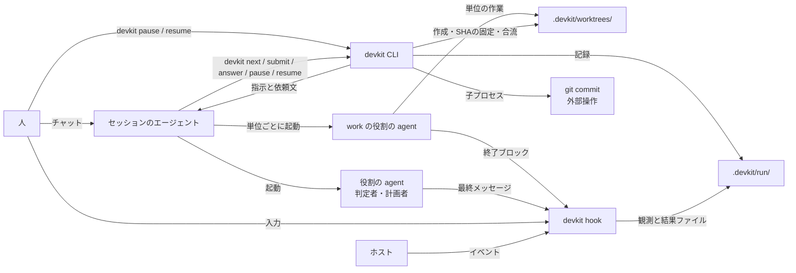

# dev-kit のアーキテクチャ

Claude Code や Codex に開発を任せると、手順の省略、自己 `PASS`、完了の過大申告、セッションをまたぐ文脈の喪失が起きることがある。指示ファイルや skill で頼むだけでは順序と完了条件を守らせる力がないため、dev-kit がこれを担う([基本方針](design.md))。

dev-kit は、リポジトリごとの開発ループを、Claude Code や Codex CLI のセッション内で回すための道具である。まっさらなリポジトリでも、人が要求を伝えると、要件定義・設計・実装・テスト・振り返りを進める。作業者・計画者・判定者の自己申告に頼らず、人との合意、機械の検査、独立した判定、記録で品質を揃える。セッションのエージェントがコードの変更やコマンドの実行を行い、単一バイナリの `devkit` が「次に何をするか」「終わってよいか」「何を記録するか」を決める。

## 全体構成

- **セッションのエージェント**は実行役である。[brief](architecture/modules.md#brief)(作業や判定の依頼文)を読み、コードを書き、[終了ブロック](architecture/data.md#進捗-progress)(作業の結果を固定の形式で書いた JSON)を返す。単位の作業者と判定者・計画者のサブエージェントは、`devkit.toml` に定義した[役割](architecture/data.md#役割-role)の agent であり、[定型の1行の prompt](architecture/guarantees.md#判定結果の受理)で起動する。既定の役割は `worker`(セッション自身)・`unit_worker`(`devkit-worker`)・`judge`(`devkit-judge`)・`planner`(`devkit-planner`)・`human` である。
- **`devkit`** は状態機械である。利用者が組んだ[ループの雛形](architecture/data.md#ループの雛形-plantemplate)(再利用するループの定義)から作る[計画](architecture/data.md#計画-plan)(課題ごとの実行内容)と記録から次の指示を計算し、[ステージの完了と設定に応じたコミットを確定し](architecture/guarantees.md#完了条件)、判定者の結果と人の答えを受理し、記録を書く。エージェントが Bash から呼ぶが、sandbox の外で動く。
- **hook** は同じバイナリの別の呼び出し口である。セッションの開始時に状況を注入し、[Stop](architecture/hooks.md#stop)で停止の可否を判断し、危険な操作を拒み、サブエージェントの結果と人の入力を観測してファイルに書く。
- **人**はチャットで問いに答える。`devkit answer` が hook の観測した入力をもとに回答を受理する条件は、[回答の受理](architecture/guarantees.md#回答の受理)で定める。

## 作業の流れ

1. `devkit init` が導入したファイルをコミットしたリポジトリで、`devkit start --plan <name> <課題>` により[作業を開始](architecture/flow.md#作業の開始)する。`--plan` の省略時は `default_plan` の値(既定 `default`)を使う。計画者は要求の原文、`start` の課題、既存の要件から計画を作る。UserPromptSubmit は束縛のないセッションでも人の最新の入力を1件保持し、`start` が作業に結び付ける。観測がなければ原文なしと記録する。
2. 計画の check を通す。完了条件ごとの確認手段と、その妥当性・網羅性の判断は[計画](architecture/data.md#計画-plan)に従う。既定では最初の計画、承認済みの完了条件の ID または文面が変わる計画、雛形から逸脱する計画、外部操作を宣言する計画を人が承認する。人が承認した完了条件を作業の完了基準とする。`open_questions` が空でない計画は承認方針によらず人が承認する。未決事項と再計画の扱いは[計画の check と人によるレビュー](loop-plan.md#計画の-check-と人によるレビュー)に従う。
3. `devkit next` が[作業の指示](architecture/flow.md#作業の指示)としてステージ(作業を区切る単位)の brief を返す。規範はソース全体をラウンド開始時に固定し、成果は選んだ本文を固定する。判定対象には git のツリーと外部の成果の文書のソース名・ID・内容ハッシュの集合を含める。既定の `[approval] meta_loop_edit = "confirm"` では、未確認のループ自身の変更があれば、効力を持つラウンドを開く前に人へ問いを出して止まる。
4. エージェントが作業し、終了ブロックを `devkit submit` で[提出する](architecture/flow.md#作業結果の提出)。目的のステージでは要件、構造のステージでは構造の記録を更新する。
5. 判定待ちでは `devkit` が判定者に先立って `command:` の check を実行する。未登録のコマンドは修正可能な `FAIL` とし、作業者が検証の手段と登録を用意する。判定者サブエージェントの結果は[作業結果の判定](architecture/flow.md#作業結果の判定)に従って受理する。
6. 判定後は [router](architecture/modules.md#router)(check の結果から次の行動を分類する部品)が判断し、[判断後の処理](architecture/flow.md#router-の判断)へ進む。ステージの遷移が `done: "replan"` なら、完了後に既存の再計画の経路で計画者が残りを作り直し、計画の check と承認の条件を適用する。問いへの回答は[人の回答](architecture/flow.md#人の回答と再開)、ステージの完了の確定は[完了条件](architecture/guarantees.md#完了条件)に従う。
7. 最後の[振り返り](stages.md#振り返り)で、すべての判定・指摘と人の回答を見直し、再発防止をリポジトリの検査とリポジトリ内の書き込めるソースの規範に反映する。リポジトリ外のソースと読み取り専用のソースへの改善は教訓として管理者へ引き継ぐ。`default` と `fix` は必須の `command:test`・`test`・`harness`、`docs` は必須の `harness` だけで確認する。規範を変えた場合は、既定では効力を持つ前、最後のラウンドなら完了時のコミット前に人が確認する。変えなければループ自身の変更に対する確認は不要である。
8. セッションをまたぐ再開は、[人の回答と再開](architecture/flow.md#人の回答と再開)に従う。

既定の `default` は `purpose` の遷移 `done` を `"replan"` とし、最初の計画に要件と完了条件の合意に関する完了条件を持たせる。`purpose` で人に確かめながら要件を詰め、既定の `.devkit/requirements.md`(`[sources.requirements]` で変更可能)に書き、完了条件の案を作る。`purpose` の完了後、合意した完了条件で残りを再計画し、人が承認する。`fix` と `docs` はこの形を使わない。kit は要件定義を特別扱いせず、雛形の遷移に従う。

[ラウンド](architecture/data.md#ラウンド-round)(作業の指示から次の行動の確定までの往復)の判定待ちでは、[Judgment](architecture/data.md#check-の結果-judgment)(`command:` の check を含む判定結果)を受理して次の行動を決める。

雛形のステージに `split: true` があり、計画に `units` があれば、`next` は単位ごとの作業指示を返す。単位の役割(既定 `unit_worker`、agent `devkit-worker`)の agent は devkit が用意する `.devkit/worktrees/<単位の指示 ID>/` で作業し、終了ブロックを最終メッセージで返す。すべての単位の結果を受理したら、devkit がツリーを SHA で固定し、作業ブランチへコミットしないマージで合流する。合流後のツリーと、単位の終了ブロックをまとめた作業者の終了ブロックを通常のステージのラウンドとして判定する。ぶつかった場合の修正、記録と再開、中断・終了時の扱いは[分割した作業と合流](architecture/flow.md#分割した作業と合流)に従う。作業者数は `[parallel] max_workers`(既定3、1以上)で制限する。既定の雛形は分割を使わない。agent のある `work` の役割がステージの担当になったラウンドも、単位が1つの同じ手順で動かす。修正ラウンドの担当は `fix` の遷移の[修正の担当の規則](architecture/data.md#修正の担当の規則)で変えられ、ラウンドの上限は規則より先に効く。

ループ自体は別の worktree で新しいセッションを開いて並行して回せる。作業中のチェックアウトでの2つ目の `start` は拒否する。再計画で完了済みのステージを残りの計画に含めないことは雛形からの逸脱に数えない。

人の依頼でエージェントが呼ぶ、または人が直接実行する `devkit pause`・`devkit resume` の条件と、Stop の継続上限は[中断](architecture/guarantees.md#中断)に従う。

## 利用者が組むもの

利用者は `init` が配る既定を起点に、リポジトリが所有する規範と検査を育てる。知識の接続先と配置は `devkit.toml` の `[sources.<名前>]` で変更できる。必須の「選ぶ」を持つアダプタで接続し、規範はソース全体を固定する。リポジトリ外のソースは読み取り専用である。既定は `files` である。検出試験の索引は `[state] detect`(既定 `.devkit/detect.json`)で設定する。

1. **雛形**: `.devkit/plans/<name>.json` を編集する。既定は `default`・`fix`・`docs` であり、[既定の雛形](loop-plan.md#既定の雛形)から選ぶ。
2. **判定の基準と例**: `.devkit/principles/` の原則と用途別文書、`.devkit/examples/<観点ID>/` の検出試験の例と仕様を育てる。check は `criteria` と `examples` で文書を明示して選ぶ。[検出試験](architecture/guarantees.md#検出試験)で観点の判定能力を確かめる。
3. **検証コマンド(`[commands.<name>]`)**: 雛形の `command:<name>` の check(終了コードによる検証)から使う。テストのないリポジトリでも、必須の `command:test` の指摘を受けて作業の中で仕組みと登録を作る。期限は登録ごとに必須である。
4. **pre-commit**: リポジトリで有効な pre-commit にテストと lint を書く。既存の hook の扱いと実行は[完了条件](architecture/guarantees.md#完了条件)に従う([例](architecture/examples.md#pre-commit))。
5. **ステージ・テンプレート・規則**: `.devkit/stages/`、`.devkit/templates/`、`.devkit/rules.md` を育てる。作業をまたぐ要件は `.devkit/requirements.md`、構造は `.devkit/structure.json` に残す。規範と成果の区別は[リポジトリ側の構成](repository.md#リポジトリ側の構成)に従う。

## 保証の範囲

[保証と対策](architecture/guarantees.md)で保証の対象を定める。保証が成り立つ条件は[信頼の前提](architecture/guarantees.md#信頼の前提)、git とホストに任せる範囲は[実装対象外の機能](architecture/guarantees.md#実装対象外の機能)を参照する。

## 構成要素

- **データ**: 作業に属するデータの種類は[エンティティ](architecture/data.md#エンティティ)、実行の記録(作業ごとに残す記録)の保存と書き手は[記録の書き込みと排他](architecture/data.md#記録の書き込みと排他)で定める。
- **役割**: 計画・判定・進行・記録・表示を分担する。7つの部品と実装モジュールの対応、runtime の内訳と依存は [modules.md](architecture/modules.md)で定める。
- **配置**: [育てるもの](architecture/data.md#所有と生存期間)(リポジトリが所有して git で管理する資産)を含む利用側の配置は [layout.md](architecture/layout.md)で定める。
- **hook**: SessionStart・Stop・PreToolUse・SubagentStop・UserPromptSubmit の5イベント。[hooks.md](architecture/hooks.md)
