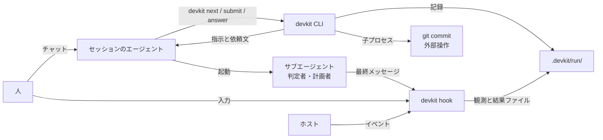

# dev-kit のアーキテクチャ

Claude Code や Codex に開発を任せると、手順の省略、自己 `PASS`、完了の過大申告、セッションをまたぐ文脈の喪失が起きることがある。指示ファイルや skill で頼むだけでは順序と完了条件を守らせる力がないため、dev-kit がこれを担う([基本方針](design.md))。

dev-kit は、リポジトリごとの開発ループを、Claude Code や Codex CLI のセッション内で回すための道具である。人は普段どおりセッションを開き、kit の skill で課題を渡す。セッションのエージェントがコードの変更やコマンドの実行を行い、単一バイナリの `devkit` が「次に何をするか」「終わってよいか」「何を記録するか」を決める。進行の判断は `devkit` が担う。

## 全体構成

- **セッションのエージェント**は実行役である。[brief](architecture/modules.md#brief)(作業や判定の依頼文)を読み、コードを書き、[終了ブロック](architecture/data.md#進捗-progress)(作業の結果を固定の形式で書いた JSON)を返す。判定者と計画者のサブエージェントは、[定型の1行の prompt](architecture/guarantees.md#判定結果の受理)で起動する。
- **`devkit`** は状態機械である。利用者が組んだ[ループの雛形](architecture/data.md#ループの雛形-plantemplate)(再利用するループの定義)から作る[計画](architecture/data.md#計画-plan)(課題ごとの実行内容)と記録から次の指示を計算し、[ステージの完了時に `git commit` し](architecture/guarantees.md#完了条件)、判定者の結果と人の答えを受理し、記録を書く。エージェントが Bash から呼ぶが、sandbox の外で動く。
- **hook** は同じバイナリの別の呼び出し口である。セッションの開始時に状況を注入し、終了を止め、危険な操作を拒み、サブエージェントの結果と人の入力を観測してファイルに書く。
- **人**はチャットで問いに答える。`devkit answer` が hook の観測した入力をもとに回答を受理する条件は、[回答の受理](architecture/guarantees.md#回答の受理)で定める。

## 作業の流れ

1. `devkit start --plan <name> <課題>` で[作業を開始](architecture/flow.md#作業の開始)し、計画者が雛形から計画を作る。[check](architecture/modules.md#check)(評価と判定)と人の承認は[計画の check と承認ゲート](architecture/flow.md#計画の-check-と承認ゲート)に従う。
2. `devkit next` が[作業の指示](architecture/flow.md#作業の指示)としてステージ(作業を区切る単位)の brief を返す。判定に使う規範は[規範の固定](architecture/guarantees.md#規範の固定)に従って確定する。
3. エージェントが作業し、終了ブロックを `devkit submit` で[提出する](architecture/flow.md#作業結果の提出)。
4. `devkit` が判定者に先立って検証を実行する。実行順と失敗時の扱いは[作業結果の判定](architecture/flow.md#作業結果の判定)に従う。
5. `devkit next` の指示で判定者サブエージェントを起動し、結果は[作業結果の判定](architecture/flow.md#作業結果の判定)に従って受理する。
6. [router](architecture/modules.md#router)(check の結果から次の行動を分類する部品)が判断し、[判断後の処理](architecture/flow.md#router-の判断)へ進む。[人の回答](architecture/flow.md#人の回答と再開)や[完了の確定](architecture/guarantees.md#完了条件)は、その判断の後に行う。
7. セッションをまたぐ再開は、[人の回答と再開](architecture/flow.md#人の回答と再開)に従う。

[ラウンド](architecture/data.md#ラウンド-round)(作業の指示から次の行動の確定までの往復)では、[Judgment](architecture/data.md#check-の結果-judgment)(`command:` の check を含む判定結果)を受理して次の行動を決める。

段階ごとの詳細は [flow.md](architecture/flow.md)。

## 利用者が組むもの

1. **雛形**: 既定を `.devkit/plans/<name>.json` に複製して編集する([PlanTemplate](architecture/data.md#ループの雛形-plantemplate)、[例](architecture/examples.md#雛形と計画))。
2. **観点**: `.devkit/checks/<観点ID>.md` と例を置き、雛形の check に使う。[検出試験](architecture/guarantees.md#検出試験)(観点ファイルの判定能力を確かめる試験)の対象・実行条件・合格記録の再利用は参照先に従う([例](architecture/examples.md#観点と検出試験))。
3. **検証コマンド(`[commands]`)**: 雛形で `command:` の check(終了コードによる検証)に使う。登録形式と実行主体(runner)は[計画の check](architecture/data.md#計画-plan)に従う([例](architecture/examples.md#設定))。
4. **pre-commit**: リポジトリで有効な pre-commit にテストと lint を書く。既存の hook の仕組みがない場合の配置は[導入と完了条件](architecture/guarantees.md#完了条件)に従う([例](architecture/examples.md#pre-commit))。

## 保証の範囲

[保証と対策](architecture/guarantees.md)で保証の対象を定める。保証が成り立つ条件は[信頼の前提](architecture/guarantees.md#信頼の前提)、git とホストに任せる範囲は[実装対象外の機能](architecture/guarantees.md#実装対象外の機能)を参照する。

## 構成要素

- **データ**: 作業に属するデータの種類は[エンティティ](architecture/data.md#エンティティ)、実行の記録(作業ごとに残す記録)の保存と書き手は[記録の書き込みと排他](architecture/data.md#記録の書き込みと排他)で定める。
- **役割**: 計画・判定・進行・記録・表示を分担する。7つの部品と実装モジュールの対応、runtime の内訳と依存は [modules.md](architecture/modules.md)で定める。
- **配置**: [育てるもの](architecture/data.md#所有と生存期間)(リポジトリが所有して git で管理する資産)を含む利用側の配置は [layout.md](architecture/layout.md)で定める。
- **hook**: SessionStart・Stop・PreToolUse・SubagentStop・UserPromptSubmit の5イベント。[hooks.md](architecture/hooks.md)

## 設計上の決定

- 仮決定、不採用の案、未決事項、未確認の前提: [decisions.md](architecture/decisions.md)
- 部品の契約への改訂: [contract-changes.md](architecture/contract-changes.md)
