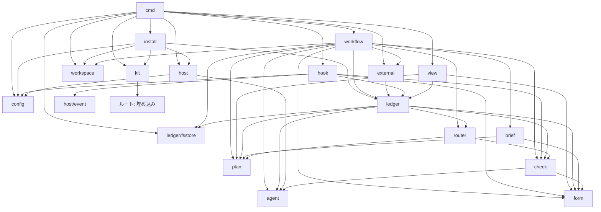

# dev-kit のアーキテクチャ

dev-kit は、単一バイナリの runtime と、バージョンを持つ kit の固定物を組み合わせる。runtime には、外側で計画を実行する workflow と、ホストのセッションから呼ばれる hook の2つの役割があり、計画・判定・判断の意味論をホストや保存形式から分離する。記録は作業ごとに ledger へ追記し、対象のバージョンに結び付いた check と人の承認で進行を制御する。権限の境界はホストのサンドボックスと作業ごとの git worktree に任せ、kit の役割は、初期化時にホストの設定へ必要な項目を足すこととする。

## 前提

- **信頼の前提**: 作業者(エージェント)と評価対象のコードに悪意はないものとする。kit が防ぐのは、誤った場所への書き込み、元に戻せない操作の誤実行、外部書き込みの二重適用、自己評価の偏り(作成者自身の `PASS`、完了の過大申告)、中断後の再開の食い違い、チームでのバージョンの不一致である。記録や承認の偽造、規範を書き換えて check を通す細工、資格情報の窃取といった悪意のある行為は、同じ OS 利用者の権限で動く以上、kit では防げないため、範囲外とする。チームでは、育てるものをすべて git 管理に置き、PR レビューを通して、こうした行為が見えるようにする。[`principles/harness.md`](../principles/harness.md) の原則5(防ぐ失敗と運用負担から仕組みを選ぶ)に従い、この前提を超える保証のための仕組みは設けない。
- **実装しないもの**: git と、Claude Code・Codex CLI の両方にある機能で賄えるものは kit で実装しない。worktree、ブランチ、ignore、履歴、利用者の名前は git に任せる。sandbox、permissions と deny、hook の登録、skill、指示ファイル、モデルとプロファイルはホストの設定に任せる。kit が持つのは、ホストに対応物のないループ計画、記録、check の依頼と受理、router の判断、外部操作の冪等性、検証コマンドの登録だけである。[`principles/designing.md`](../principles/designing.md) の原則5(新しい仕組みを足す前に削除・置き換えを検討する)に従う。
- **権限の境界**: ホストの設定はリポジトリ内の `.claude/settings.json` と `.codex/config.toml` を正本とし、`init` が kit の断片から生成する。起動時に設定を渡さない。作業者の書き込み先は作業用 worktree とその作業の `.devkit/run/work/<作業 ID>/` とする。Codex は `sandbox_mode = "workspace-write"` と `writable_roots`、Claude Code は `permissions` と `sandbox` で制限する。元に戻せない操作と external を迂回する外部書き込みの deny は `.claude/settings.json` の `permissions.deny` を正本とし、Claude Code はそのまま使い、Codex では kit の PreToolUse hook が同じ `permissions.deny` を読んで判定する。判定者と計画者は読み取り専用で起動する。Codex は `--sandbox read-only`、Claude Code は Edit・Write・Bash を外した permissions を使う。検証コマンドは workflow の子プロセスとして作業用 worktree で実行し、専用の隔離は持たない。検証コマンドは `devkit.toml` に登録された育てるものであり、人が登録時にレビューする。
- **runtime**: 単一バイナリとし、名前は `devkit` と仮決定する。外側でループ計画を実行する workflow と、ホストのセッション内から呼ばれる hook の役割を持つ。[runtime の契約](parts/runtime.md)に従う。
- **ホスト**: Claude Code と Codex CLI を対象とし、どちらも既定のホストにはしない。hook の形式は共通とする。担当はホストとプロファイル名で指定する。モデルと effort は Codex の `[profiles.<名前>]`、Claude Code の `--model` と `--agents` に置き、kit はモデル名を持たない。担当を子プロセスとして起動し、標準入力で brief を渡し、JSON Schema で制約した出力と結果ファイルから結果を受け取る。
- **ループ計画**: 状態機械のデータとし、router の分類をキーにした遷移表を持つ。条件式は書かせない。計画の作り直しを一級の操作として扱う。[ループ計画](loop-plan.md)と[ステージ](stages.md)の契約に従う。
- **設定**: 本体のルート直下の `devkit.toml` を正本とし、置き場所、kit のバージョン、検証コマンド、外部操作の登録、分類表の追記を持つ。実行の記録と生成物は `.devkit/run/` に置き、`init` が `.gitignore` に1行足す。設定で変えるのは置き場所と登録だけであり、動作の分岐は置かない。実行の記録は git 管理にしない。view は実行の終了ごとに必ず生成する。
- **ファイルの分類**: kit が触るファイルは、固定物、育てるもの、実行の記録、生成物に分ける。
- **チーム開発**: 同じリポジトリで複数人が別々の作業を進める場合も対象とする。共有は、PR 本文に記載する計画の要約と決定、および git 管理の育てるものを通して行う。
- **部品**: [brief](parts/brief.md)、[check](parts/check.md)、[router](parts/router.md)、[ledger](parts/ledger.md)、[form](parts/form.md)、[view](parts/view.md)、[runtime](parts/runtime.md)を提供単位とする。各部品は契約・テンプレート・試験を持つ。[基本設計](design.md)に従う。

## データモデル

### エンティティ

- **リポジトリ**: kit を導入した git リポジトリであり、設定ファイルと育てるものの所有者である。リポジトリ範囲の記録や共有の記録は持たない。
- **作業(Work)**: 1つの課題に取り組む1本のループを単位とし、ULID の作業 ID を持つ。課題への参照(Issue の URL など)、ブランチ `devkit/<作業 ID>`、依頼者、開始時のコミット(来歴)、記録形式のバージョンを持つ。計画の最初のバージョンを作成してから、作業が完了または中止になるまで存続し、作業範囲の記録を所有する。作業とブランチ・worktree の束縛はブランチ名から引き、記録としては持たない。
- **計画(Plan)**: 作業に属し、バージョンを持つ。ID 付きの完了条件の列、ステージの列、各ステージの担当・観点・ゲート・遷移表・計数の上限・戻り先、検証コマンドの集合を名前で参照する情報、必須 check の集合を持つ。検証コマンドの定義は `devkit.toml` の `[verify]` を正本とし、参照する集合は空でもよい。担当はロールとホストとプロファイル名を持ち、観点は完了条件 ID と実行主体(判定者または機械)を持つ。各バージョンの承認状態は承認の記録から導く派生値である。提案の状態は提案中・却下・撤回・実行可能とし、計画の Judgment、撤回の記録、必要な承認から導く。「実行可能なバージョン」は、計画の check を通り、ゲートが必要なら承認済みである最新のバージョンとする。新規作成または作り直しで作ったバージョンは提案中とし、提案中のバージョンがある間は古いバージョンを実行しない。提案の撤回後に旧バージョンを実行できるのは、人が自発的に起票して撤回した場合だけとする。「前のステージに戻る」による再計画では、提案が却下されても旧バージョンには戻さず、指摘を渡して計画の上限内で再提案するか人に確認する。
- **ステージの実行(StageRun)**: 実行 ID を持ち、作業と、開始時に束縛した計画のバージョンに属する。ラウンドの列、起動記録、実行状態、観測時刻、停止理由、次に動く主体を持つ。実行状態は、実行中・回答待ち・承認待ち・中断・異常終了・不明・失効である。「再計画待ち」は失効の一種である。実行中は束縛したバージョンを使い続け、計画のバージョンの切り替えはステージの開始時だけに行う。「前のステージに戻る」を router が記録した時点で旧 StageRun を再計画待ちにし、旧バージョンの実行を再開しない。作り直しで置き換えられる未完了の StageRun は失効として記録し、新しいバージョンの戻り先から新しい StageRun を開始する。
- **ラウンド(Round)**: brief → 作業 → check → router の往復である。ラウンド ID、内容ハッシュで表す brief のバージョン、作業者の起動記録、対象のバージョン、check の結果の集合、router の判断を持つ。起動記録にはホスト、セッション ID、コンテキスト ID、履歴継承の有無、使用量、子プロセスの PID と開始時刻を含める。
- **対象のバージョン(TargetVersion)**: ツリーのスナップショット、計画のバージョン、構造のバージョンの直和である。ツリーのスナップショットは、作業用 worktree の追跡ファイルと ignore されていない未追跡ファイルから一時インデックスで作る、ブランチに含めないコミットオブジェクトのツリーハッシュである。`.devkit/` や指示ファイルなどの育てるものも追跡ファイルとしてスナップショットに含まれるので、規範や設定の変更は対象のバージョンの変更として現れる。ラウンドの開始時と作業者の返却後の2回スナップショットを取る。開始時のスナップショットは、そのラウンドで使う育てるもの(観点ファイル、検証コマンド、分類表の追記、`permissions.deny`)の固定と、ラウンドの差分の計算に使う。コミットには `refs/devkit/<作業 ID>/<対象のバージョン>` を付け、作業の完了・中止と成果物の永続化まで保持する。計画のバージョンは作業内の計画のバージョン、構造のバージョンは `.devkit/structure.json` の内容ハッシュで識別する。
- **check の結果(Judgment)**: 観点 ID、使った観点ファイルと規範(principles、部品の契約、規則)の内容ハッシュ、対象のバージョン、確認した完了条件 ID の集合、判定、指摘、確認した範囲と未確認の範囲、方法と環境、実行主体、判定者の起動記録または機械のコマンド実行記録を持つ。判定は `PASS`・`FAIL`・`NOT ASSESSED` である。指摘は Finding として保持する。判定者による結果の受理時に、同じラウンドの作業者とは異なるセッションとコンテキストを使い、履歴を継承していないことを照合し、満たさなければ `NOT ASSESSED` として扱う(自己評価の偏りへの対策)。機械の check は workflow がコマンドを実行し、同じ受理境界で結果を `Judgment` に変換する。Judgment が有効なのは、対象のバージョンが現在と一致し、かつ使った観点ファイルと規範の内容ハッシュが現在供給するものと一致するときだけである。この照合で、参照する kit のバージョンや規範の更新による食い違いも捉える。
- **指摘(Finding)**: 指摘 ID、blocking かどうか、`auto-fixable` または `needs-decision`、失敗のシナリオ、適用除外の主張と根拠の有無、解決した指摘への参照を持つ。修正ラウンドの判定依頼には前回の指摘 ID を渡し、解決した指摘への参照と、確認した完了条件 ID の増加から進展を計算する。
- **決定(Decision)**: 追記のみとする。有効性、置換、依存、適用条件、決定者、暫定か確定かを持つ。未読・承認・却下・保留の状態は、追記する状態変更の記録から導く派生値である。
- **問い(Question)**: form に従う人への確認事項である。問い ID、承認対象、承認者、選択肢、推奨、停止理由の分類、回答によって進むステージ、停止する範囲と進められる範囲、根拠への参照を持つ。承認対象はツリーのスナップショット、計画のバージョン、外部操作の直和であり、外部操作は操作 ID、入力のハッシュ、使う登録定義とリポジトリ内の実行ファイルの内容ハッシュで識別する。登録で承認の粒度が「計画の承認で足りる」とされた種別は、計画のバージョンの承認があれば個別の承認を求めない。承認者はこの機械の利用者である。別の人の判断が必要な問いは、PR レビューなど外部の合意への参照を回答に添える。承認対象が変わったら新しい問い ID で起票し直し、古い問いへの回答・承認は拒否する。
- **回答・承認(Answer / Approval)**: 追記のみとし、同一性は(問い ID、承認対象、承認者)である。この組が同じで内容も同じ記録は再送として扱い、内容が異なれば訂正とし、置換元への参照を持つ新しい記録として追記する。同じ置換元を複数の訂正が置換した場合は未解決とし、workflow は進めず問いを再起票する。承認者の名前は `git config user.name` から得る。初期化時の入力は求めない。管理対象の作業 ID・ロールの環境変数を持つプロセスからの `approve`・`answer` は作成者による自己承認を防ぐため、`read` は人が確認した記録の正本である閲覧の記録を守るために拒否する。
- **外部への書き込み(ExternalOp)**: 論理的な操作ごとの操作 ID、操作の種別、対象、入力のハッシュ、承認への参照、操作 ID から導く冪等キー、実行前の記録、実行結果、外部側の識別子を持つ。操作 ID と入力のハッシュは workflow が要求を受理した時点で、承認より前に発行して記録し、使う登録定義とリポジトリ内の実行ファイルの内容ハッシュも承認対象に含める。実行結果は成功・失敗・結果不明である。担当には結果とともに操作 ID を返し、再送は提示された操作 ID で識別する。操作 ID の提示がない同種の要求は別操作として扱い、登録の承認の粒度に従って承認を確認する。実行の開始直前に作業のロックの下で有効な承認を読み直し、登録定義とリポジトリ内の実行ファイルの内容ハッシュが受理時と一致することを照合する。一致しなければ新しい承認対象として問いを起票し直す。
- **進捗記録(Progress)**: 追記のみとする。書き手(workflow・hook・担当の CLI・人の CLI)、観測時刻、対象のバージョン、現在の作業状況、不具合のある箇所、使用するコマンド、終了ブロックを持つ。終了ブロックは判定、終了の種別、次のアクション、変更したファイル、確認済み事項、未確認事項、変更禁止事項、一時状態、再開条件を持つ。終了の種別は完了を主張・停止して確認・外部書き込みの要求・中断である。一時状態には確認方法・出典・無効になる条件を持たせる。`devkit progress` は終了ブロックを入力として ledger に追記する。workflow も担当の `Result` の終了ブロックから進捗記録を書く。担当の出力と `progress` の入力検証には同じスキーマを使う。
- **checkpoint**: 記録ではなく派生値である。実行状態を持つ最新の StageRun と、次に動く主体の最新の進捗記録から組み立てる。書き手の優先順位は、workflow の StageRun の状態、人の回答・承認、hook と担当の CLI の進捗記録の順である。注入のたびに ledger から組み立て、一時状態の無効条件を照合し、無効なものは注入しない。ホストの出力上限に収まるなら本文を直接注入し、収まらなければ要約を注入し、全文は `devkit status` で読むよう案内する。
- **成功記録(BuildTestResult)**: 追記のみとする。対象のバージョン、コマンドの名前と `devkit.toml` の `[verify]` の該当定義の内容ハッシュ、結果、書き手、実行者のセッションと起動記録への参照を持つ。完了条件に使う記録は、作業者の返却後に workflow 自身が検証コマンドを実行して書く。担当の CLI が `devkit record` で書く成功記録は参考情報とし、ステージの完了条件には使わない。作業者は自分の確認のために検証し、workflow は完了条件を満たすために検証する。
- **成果物(Artifact record)**: 成果物 ID とバージョン、変更前後、完了条件 ID、変更の種類、決定への参照、永続化先であるコミットへの参照を持つ。
- **閲覧の記録(Read)**: 追記のみとする。閲覧者、閲覧した記録 ID の集合、観測時刻を持つ。カーソル(確認済みの記録の集合)はこの記録から導く派生値である。
- **検出試験の記録(DetectionTest)**: 観点ファイルの内容ハッシュ、試験仕様(違反例・適合例・許容例と期待判定)の内容ハッシュ、判定の担当(ホストとプロファイル名)、実際の判定、根拠を持つ。合格記録は git 管理の資産 `.devkit/detect.json` に置き、観点の内容ハッシュ、試験仕様の内容ハッシュ、担当(ホストとプロファイル名)、日時の索引を持つ。違反例・適合例は `.devkit/checks/<観点 ID>/` の下に置く。[`principles/harness.md`](../principles/harness.md) の原則2に従い、必須 check にできるのは、計画の担当と一致する合格記録があるときだけである。計画の受理時に不足していれば `run` が検出試験を実行し、合格してから必須化する。合格記録の書き込みはラウンドの開始前、スナップショットを取る前に行い、スナップショット後のツリーを変えない。
- **構造の記録(Structure)**: 育てるものの資産 `.devkit/structure.json` として持つ。構造ステージを使うリポジトリにだけこのファイルを置く。バージョンは内容ハッシュで識別し、履歴は git の履歴で管理し、承認は PR レビューで行う。runtime は機械間の調停を行わない。
- **規則と強制手段(Rules)**: リポジトリが育てる git 管理のファイル `.devkit/rules.md` を正本とする。移行記録は `rules.md` 自体の項目として残す。router の決定 ID は作業への外部参照として扱い、決定の根拠が必要な場合は、その根拠を資産側に写す。
- **記録形式のバージョン**: 各記録が持つ。バイナリは読み取れるバージョンの範囲と書き込みに使う1つのバージョンを宣言し、読み取れない記録は失敗として報告する。`devkit migrate` は作業のロックを取り、`.devkit/run/work/<作業 ID>/migrating` の印を置いてから、記録を新しい形式で別ディレクトリに書き、rename で切り替え、印を除く。すべての書き手は書く前に印の有無を確認し、印があれば拒否する。hook は block と理由を返す。中断時は印が残り、旧ディレクトリが正本である。

### 所有と生存期間

データの所有と生存期間、整合性を守る境界は、[`principles/data.md`](../principles/data.md) の原則5に従う。

- **作業範囲の記録**: 作業が所有する。完了・中止後は、実行履歴である StageRun、Judgment、決定、成果物、外部操作を読み取り専用で残す。完了後も、閲覧の記録と、人の判断である回答・承認・状態変更の追記は許す。
- **育てるものの資産**: リポジトリが所有する git 管理のファイルである。`devkit.toml`(登録を含む)、`.claude/settings.json`、`.codex/config.toml`、AGENTS.md、観点ファイルと違反例・適合例、rules.md、検出試験の合格記録の索引、構造、kit のコピー、skill を含める。作業範囲の記録への参照は、作業 ID・課題の URL・PR の URL による外部参照だけとする。共有に必要な決定の根拠は資産側に写す。
- **生成物**: view の HTML、作業用 worktree、`.claude/skills` のシンボリックリンク(またはコピー)は runtime が所有する。view と skill のリンク・コピーは再生成でき、削除してよい。作業用 worktree と `refs/devkit/<作業 ID>/<対象のバージョン>` は、作業の完了・中止と成果物の永続化がそろうまで保持する。`devkit.toml` の `[verify]` に列挙した依存物(`node_modules` などの ignore されたもの)は作業用 worktree の中に置いたまま再利用し、有効条件を満たさなければ列挙した再構築コマンドを実行する。`[verify]` には検証前に削除する生成物・一時領域も列挙し、workflow が実行前に削除する。前のラウンドの残存物で検証が通ることを防ぐ。

### 整合性の境界

- **記録**: 範囲は作業だけである。閲覧の記録を含めて追記のみとし、checkpoint は記録に含めない。記録 ID は一意とし、参照先の記録 ID が存在することを確かめるか、外部への参照であることを示す。
- **完了条件**: router がステージの完了を認めるには、作業者の返却後に workflow が検証コマンドの集合を実行した成功記録、現在の対象のバージョンに対する有効な必須 check すべての `PASS`、必須 check の観点ファイルと計画の担当に対応する検出試験の合格が必要である。検出試験の合格は `.devkit/detect.json` から照合する。集合が空なら成功記録は不要である。この完了条件は hook には渡さない。Judgment の有効性は、対象のバージョンと、使った観点ファイル・規範の内容ハッシュが現在供給するものと一致することで判定する。
- **作業の排他**: 同じ作業を実行する workflow プロセスが同時に動かないよう、`.devkit/run/work/<作業 ID>/run.lock` で排他制御する。ロックには PID・開始時刻・ホスト名を持たせる。同一ホストで PID と開始時刻を照合してロックを保持するプロセスの終了を確認できた場合だけ引き継ぐ。別ホストの場合や確認できない場合は失敗とし、人が明示的に解除する。
- **計画のバージョン**: 単調に増加させ、StageRun の開始時に束縛する。提案中のバージョンがある間は旧バージョンを実行しない。`devkit plan --withdraw` は撤回を追記する。`devkit plan` は作業のロックを取り、停止中だけ提案を記録し、実行中は拒否する。`run` が計画の check を実行し、ゲートが必要なら問いを起票して停止する。承認は `approve` の経路だけとする。
- **承認**: 同一性は(問い ID、承認対象、承認者)である。承認対象が変わったら問いを起票し直す。同一内容の再送は重複として扱い、訂正は置換元への参照を持つ新しい記録として追記する。同じ置換元を複数の訂正が置換した場合は未解決とし、workflow は進めず問いを再起票する。問いと承認を機械間で共有する経路は設計の範囲外である。
- **外部への書き込み**: 要求の受理時に操作 ID と入力のハッシュを発行して記録し、使う登録定義とリポジトリ内の実行ファイルの内容ハッシュとともに承認対象とする。登録の承認の粒度が「計画の承認で足りる」なら、計画のバージョンの承認を使い、個別の承認を求めない。承認への参照、実行前の記録、実行、結果の記録の順を守る。提示された操作 ID による再送時だけ同じ ID と冪等キーを使い、入力のハッシュを照合する。同じ ID で入力が異なれば別操作として扱い、停止して確認する。実行と照会には登録ごとの期限を設け、期限を超えた場合は結果不明とする。結果不明の場合は、外部側で識別・照会できるときだけ照会して確定し、できなければ再実行せず人に確認する。実行の開始直前に作業のロックの下で有効な承認を読み直し、登録定義とリポジトリ内の実行ファイルの内容ハッシュが受理時と一致することを照合する。一致しなければ新しい承認対象として問いを起票し直す。
- **ラウンド内の固定**: workflow はラウンドの開始時にスナップショットを取り、そのラウンドで使う観点ファイル・検証コマンド・分類表の追記・`permissions.deny` を開始時のスナップショットから `git show` で読む。Codex の PreToolUse hook も同じスナップショットの `permissions.deny` を読む。Claude Code の deny はホスト自身が `.claude/settings.json` を読むので、ラウンド中の変更の扱いはホストに従う。作業者がこれらを編集しても、workflow と Codex の hook では次のラウンドから効き、変更は対象のバージョンの差分として現れる。ステージがメタループの編集を宣言していなければ、router は `.devkit/`・`devkit.toml`・ホストの設定・指示ファイル・skill の変更を「人に確認する」に分類する。
- **資産の更新**: 育てるものは通常の変更としてコミット・PR・マージで更新する。機械間の直列化は git に任せ、競合はマージと人のレビューで解決する。runtime に共有の記録や有効化の調停を持たせない。
- **検証の対象**: 作業者の返却後、workflow が作業用 worktree のスナップショットを取り、引き続き同じ worktree で検証コマンドと check を実行する。検証コマンド・機械の check・束縛のある対話セッション・人のエディタがツリーを変えることがあるため、検証と check の終了後に一時インデックスで `write-tree` を取り、スナップショットのツリーハッシュと照合する。一致しなければ成功記録と Judgment を無効にし、変更後のツリーで1回だけやり直す。2回目も変われば失敗として人に確認する。検証コマンドは期限を持ち、workflow が子プロセスのツリーを所有して期限超過時は終了させる。

### 書き手と調停

書き手は、作業ごとのロックで排他制御された workflow プロセス、ホストのセッション内から起動される短命な hook プロセス、担当の CLI、人の CLI である。hook は同時に複数動くことがある。すべての書き手は同じ `.devkit/run/work/<作業 ID>/records/` へ直接追記する。書く前に `.devkit/run/work/<作業 ID>/migrating` の印を確認し、印があれば拒否する。hook は block と理由を返す。共有状態と副作用の扱いは、[`principles/data.md`](../principles/data.md) の原則6と [`principles/engineering.md`](../principles/engineering.md) の原則2に従う。

- **追記のみの記録**: 閲覧の記録も含め、記録 ID をファイル名とし、記録ごとに独立した JSON ファイルを作る。一時ファイルへ書き、rename で公開する。ファイル名が ULID で一意なので、複数の書き手が同時に書いても衝突しない。読み手は一時ファイルを無視し、公開済みの記録を一覧し、統合する。壊れた記録は隔離ディレクトリへ移して報告し、失敗を隠さない。
- **資産**: 育てるものの資産は通常の git の変更として更新し、機械間の競合は git のマージと人のレビューで解決する。
- **書き手の識別**: 記録に書き手の種別、セッション ID、起動記録への参照、記録形式のバージョンを含める。種別は workflow・hook・担当の CLI・人の CLI である。担当の CLI が書く `progress`・`record`・`check` の結果は参考情報であり、ステージの完了条件の派生値には使わない。Stop の返却条件には担当の CLI の進捗記録を受け入れる。

## モジュール

各モジュールを Go のパッケージとする方針を仮決定とする。ポートは workflow の `Agent` だけとし、[`principles/structure.md`](../principles/structure.md) の原則3に従って利用側に置く。Workspace と External はインターフェースにせず具体型とし、試験では関数値を差し替える。git、ホストの JSON、設定ファイルなどの外部の型は境界で内部の型に変換し、公開契約・記録・ドメインの型には含めない(同ファイルの原則5)。

plan、brief、check、router、form、agent は、入出力を持たないドメインの核とし、モジュール自身ではファイルを読まない。cmd/devkit が config から kit の供給源を一度だけ解決し、バージョン、`fs.FS`、解析済みの値を各モジュールへ渡す。

### plan

- **責務**: ループ計画の意味論を扱う。JSON Schema による検証、router の分類から次のステージを選ぶ遷移、計数の上限の判定、現在のバージョンと残りの計画から新しいバージョンを作る操作およびその差分、実行可能なバージョンの判定を扱う。
- **持つデータ**: `Plan`、`Stage`、`Assignee`、`Gate`、`Transition`、`Limits`、`ReturnTarget` の型、ID 付きの完了条件、観点と完了条件の対応、観点の実行主体、必須 check、ステージごとの検証コマンドの集合を名前で参照する情報、router が使うステージの完了条件の規則を持つ。Stop の返却条件は持たない。
- **公開する契約**: 計画の型と、検証・遷移・上限判定・作り直し・実行可能なバージョンの判定を公開する。スキーマ、計画の check の結果、承認の記録は引数で受け取る。
- **依存**: 他のモジュールに依存しない。
- **置くもの・置かないもの**: 入出力を伴わない計画の意味論を置く。保存は ledger に置く。計画の生成は担当が行い、workflow が検証する。

### brief

- **責務**: ステージ定義、前のステージの出力、リポジトリの事実から brief を組み立てる。修正ラウンドでは前回の指摘と指摘 ID を取り込む。分類表の既定とリポジトリ側の追記に従い、人に確認する対象を brief に含める。
- **持つデータ**: brief の型と、内容ハッシュで表すバージョンを持つ。
- **公開する契約**: brief の型と、brief を組み立てる関数を公開する。
- **依存**: ステージの型を持つ plan と、テンプレートを持つ form に依存する。
- **置くもの・置かないもの**: brief の組み立てとバージョンの計算を置く。担当の起動は host に、記録は ledger に置く。

### check

- **責務**: 観点ファイルを解析し、blocking の定義、確認事項、報告しない事項、出力形式を扱う。指示ファイル、[principles](../principles/README.md)、[部品の契約](design.md#部品)、[規則](rules.md)、brief、計画、観点ファイルを規範として束ね、判定依頼を組み立てる。結果を解析し、判定者による check は受理時に作成側と判定側のセッション ID・コンテキスト ID・履歴継承の有無を照合し、独立性を満たさなければ `NOT ASSESSED` とする。機械の check は workflow のコマンド実行結果を同じ受理境界で `Judgment` に変換する。適用除外の主張と根拠がある場合は、その適用除外で対象から外れる要求に限り、違反としない。判定は `FAIL`、`NOT ASSESSED`、`PASS` の優先順で集約する。必須 check の網羅、成果物の種類ごとの対象のバージョンの一致、使った観点ファイル・規範の内容ハッシュの一致、必須 check の観点と計画の担当に対応する検出試験の合格を照合する。検出試験の仕様(違反例・適合例・許容例と期待判定)と、その試験結果の判定も扱う。
- **持つデータ**: `Judgment` と `Finding` の型、解析した観点ファイル、判定依頼と解析結果、検出試験の仕様と結果を持つ。計画の check では、コードを変えるステージがリポジトリの検証コマンドの集合を省略していないこと、省略するなら根拠があることを確認する。
- **公開する契約**: ポートは持たない。規範・観点ファイル・対象のバージョンと場所・出力スキーマから、修正ラウンドではさらに前回の指摘 ID も使って、判定者用の `agent.Request` を組み立て、`agent.Result` または機械のコマンド実行結果から `Judgment` を解析する操作を公開する。独立性と Judgment の有効性の照合、適用除外、集約、必須 check と検出試験の照合も公開する。
- **依存**: 観点ファイルの形式と `Judgment` のスキーマを扱う form、起動の型を持つ agent に依存する。
- **置くもの・置かないもの**: 入出力を伴わない判定の意味論、依頼の組み立て、結果の解析・受理、検出試験の仕様を置く。判定者の起動は workflow の `Agent` を経由して host が行う。結果の保存は ledger に、次の行動の判断は router に置く。

### router

- **責務**: 分類表の固定物とリポジトリ側の追記を、解析済みの値として引数で受け取り、次の行動を判断する。check の集約、ラウンド数、workflow が計算した進展の有無、計画の上限、停止分類から、「修正する」「人に確認する」「前のステージに戻る」「完了する」を選ぶ。plan から受け取るステージの完了条件を照合し、人への確認を分類する。「人に確認する」の分類は kit の分類表の既定に置き、リポジトリ側の追記で上書きできる。既定には、ライセンスや保守先など人が決める事項を含む依存の宣言(ロックファイル・マニフェスト)の差分と、ステージがメタループの編集を宣言していないのに `.devkit/`・`devkit.toml`・ホストの設定・指示ファイル・skill が変更された場合を含める。
- **持つデータ**: 人への確認、check の結果、教訓の反映先、ロールとホストとプロファイル名、振り返りに関する分類表の型と内容を持つ。
- **公開する契約**: 分類表の型と、渡された分類表による判断、完了条件の照合、人への確認の分類、教訓の反映先の分類を公開する。
- **依存**: 上限と遷移の語彙を持つ plan、判定の型を持つ check に依存する。
- **置くもの・置かないもの**: 分類と判断を置く。担当の起動は host に、判断に従ってループを進める処理は workflow に置く。

### form

- **責務**: 固定フォーマットを定義し、スキーマの型、テンプレートの適用、人向けの Markdown の描画を提供する。
- **持つデータ**: 担当の出力に使う作業の返却内容、終了ブロック、人への確認事項、計画、`Judgment` について、JSON Schema の型を持つ。終了ブロックは判定、終了の種別、次のアクション、変更したファイル、確認済み事項、未確認事項、変更禁止事項、一時状態(確認方法・出典・無効条件)、再開条件を持つ。担当の出力と `devkit progress` の入力検証で同じスキーマを使う。Finding の出力スキーマにも指摘 ID、`auto-fixable` / `needs-decision`、失敗のシナリオ、解決した指摘への参照を含める。playbook を含む skill の構成、観点ファイル、計画の要約と決定を含む PR 本文、設計案のテンプレートを受け取って扱う。
- **公開する契約**: 固定フォーマットの定義と、受け取ったスキーマ・テンプレートの適用、Markdown の描画を公開する。
- **依存**: 他のモジュールに依存しない。スキーマとテンプレートの本体の正本は kit の固定物とし、form は供給された値を使う。
- **置くもの・置かないもの**: 入出力を伴わない形式の定義と描画を置く。固定物を読み込む処理は kit に、計画や判定の意味論は plan と check に、HTML の生成は view に置く。

### agent

- **責務**: 担当の起動で受け渡す型だけを持つ。
- **持つデータ**: `Request` は brief 本文、出力スキーマ、作業ディレクトリ、ロール、ホストとプロファイル名、権限の種別(読み取り専用か、作業用 worktree とその作業の `.devkit/run/work/<作業 ID>/` への書き込みが可能か)、環境に渡す作業 ID・ロール・ステージ情報・ラウンド ID、上限時間を持つ。ロールは作業者・判定者・計画者である。再開するセッション ID は作業者用だけに含め、判定者用の `Request` 型には項目を置かない。`Result` は出力 JSON、終了ブロック、起動記録、セッション ID、コンテキスト ID、履歴継承の有無、使用量、プロセスの終了の種別(完了・停止して確認・外部書き込みの要求・失敗・時間超過)を持つ。
- **公開する契約**: ロールごとの `Request` と `Result` を公開する。インターフェースは持たず、利用側が定義する。
- **依存**: 他のモジュールに依存しない。
- **置くもの・置かないもの**: 入出力を伴わない起動の型を置く。起動の実装は host に、起動するタイミングの制御は workflow に置く。

### ledger

- **責務**: 記録の意味論、記録への問い合わせ、記録範囲の照合を扱う。決定のグラフから有効性・置換・依存を解決する。checkpoint の組み立てと一時状態の無効条件の照合、有効な決定とその状態、実行可能な計画のバージョンと提案中・却下・撤回の状態、観点ごとの最新判定と対象のバージョン・観点ファイル・規範の内容ハッシュの一致、完了記録のない StageRun、未回答の問い、承認の解決、閲覧の記録から導く確認済みの記録の集合を派生値への問い合わせとして提供する。
- **持つデータ**: ULID の記録 ID と参照、作業の範囲、書き手の識別、記録形式のバージョンと読める範囲を持つ。種別ごとのペイロードとして、計画のバージョンと撤回、決定、状態変更、問い・回答・承認、外部書き込み、進捗、成功記録、check の結果、検出試験の実行結果、ステージの実行、成果物、記録範囲の照合、閲覧の記録を持つ。checkpoint と育てるものの資産は保存する記録に含めない。
- **公開する契約**: Store のインターフェースは持たず、関数は ledger/fsstore の具体型を受け取る。記録の型、派生値の問い合わせ、決定と承認の解決、記録範囲の照合を公開する。作業の排他は ledger/fsstore の操作として直接呼ぶ。
- **依存**: ペイロードに使う plan、check、router、form、agent の型と、保存を担う ledger/fsstore に依存する。
- **置くもの・置かないもの**: 記録の意味論と問い合わせを置く。ファイル形式は ledger/fsstore に、表示は view に置く。

### ledger/fsstore

- **責務**: ファイルへの保存を担う具体型を持つ。記録ごとに独立した JSON ファイルを作り、一時ファイルへ書いてから rename で公開する。読み手は一時ファイルを無視し、壊れた記録は隔離して報告する。作業ディレクトリのロックを扱う。記録形式の移行では作業のロックと `migrating` の印を使い、別ディレクトリに新しい形式を書いて rename で切り替える。すべての書き手は印があれば書き込みを拒否し、中断時は印を残して旧ディレクトリを正本とする。
- **持つデータ**: 作業の記録ファイル、一時ファイル、隔離ディレクトリ、PID・開始時刻・ホスト名を持つ作業ロックを扱う。
- **公開する契約**: 追記・一覧・取得、作業の排他、`migrating` の印を具体的な操作として公開する。記録ルートは引数で受け取り、渡されたルートの下だけを操作する。読み取れないバージョンの記録は失敗として報告する。
- **依存**: 他のモジュールに依存しない。保存形式の型だけを扱い、記録の意味論は扱わない。
- **置くもの・置かないもの**: 保存形式、原子的な公開、隔離、排他を置く。記録の意味論は ledger に、パスの決定は config に置く。SQLite は採用しない。単一バイナリで cgo を避けること、作業ごとの記録数が少ないこと、複数の書き手をファイル作成で扱えることが理由である。

### workflow

- **責務**: ループを回す。作業の読み込み、実行可能な計画のバージョンの選択、再開時の照合、ステージごとのラウンド、brief の組み立て、ホストとプロファイル名による担当への委任、ラウンド開始時と作業者の返却後の対象のバージョンのスナップショットの取得、検証コマンドと check の実行、router の判断、記録、ゲートでの停止を制御する。提案中の計画のバージョンがあれば計画の check を実行し、ゲートが必要なら問いを起票して、承認待ちの状態で停止する。必須 check の観点と計画の担当に対応する検出試験の合格がなければ、kit とリポジトリの違反例・適合例を使って検出試験を実行し、合格記録をラウンド開始前に `.devkit/detect.json` に書いてから必須化する。ラウンド開始時のスナップショットから観点ファイル・検証コマンド・分類表の追記・`permissions.deny` を `git show` で読み、そのラウンドで使う値を固定する。検証コマンド・外部操作の登録・分類表の追記は、config が `devkit.toml` から読んだ値を受け取る。担当の返却後に、そのラウンド ID に対応する hook の記録(Stop の状態)が ledger にあることを照合する。なければ hook が動いていないとして失敗を報告し、ステージを完了にしない。判定者による check は依頼の組み立て、`Agent` による起動、check の解析と受理の順で行う。機械の check とステージの検証コマンドは作業用 worktree で自ら実行し、Judgment と成功記録を書く。定義はラウンド開始時のスナップショットの `devkit.toml` の `[verify]` から名前で解決し、依存物の有効条件を照合して必要なら再構築コマンドを実行する。各実行は期限を持ち、workflow が子プロセスのツリーを所有して期限超過時は終了させる。結果を成功・失敗・期限超過に分類する。検証前に `devkit.toml` の `[verify]` が列挙する生成物・一時領域を削除し、検証と check の終了後に workspace で一時インデックスの `write-tree` を照合する。不一致なら成功記録と Judgment を無効にし、変更後のツリーで1回だけやり直し、2回目も変われば失敗として人に確認する。前回の blocking 指摘 ID に対する解決の参照によって未解決の指摘の集合が小さくなった場合、または確認した完了条件 ID が増えた場合を進展とし、router に渡す。「前のステージに戻る」の記録時に旧 StageRun を再計画待ちにする。計画の作り直しでは計画者ロールの `Agent` に新しいバージョンを作らせ、提案として記録し、計画の check と必要な承認を経て、置き換える未完了の StageRun を失効させて新しいバージョンの戻り先から開始する。外部書き込みの要求は受理時に操作 ID と入力のハッシュを発行し、使う登録定義とリポジトリ内の実行ファイルの内容ハッシュとともに記録し、登録の粒度に従って承認を確認してから external に実行させる。担当の `Result` の終了ブロックから進捗記録を書く。時間超過時は host に子プロセスのツリーを終了させ、終了を確認してから StageRun の中断を記録し、worktree を保持する。
- **持つデータ**: 実行中の作業、StageRun の開始時に束縛した計画のバージョン、ステージとラウンドの進行状態、子プロセスの識別、対象のバージョン、外部書き込みの要求と承認の参照を扱う。永続化する状態は ledger に記録する。
- **公開する契約(ポート)**: 作業者・判定者・計画者を起動する `Agent` だけを定義する。workspace の `Workspace` と external の `External` は具体型として使い、試験では関数値を差し替える。
- **依存**: plan、brief、check、router、ledger、form、agent、workspace、external、ledger/fsstore に依存する。
- **置くもの・置かないもの**: ループの進行、計画を作り直す手続き、人が担当するステージの分岐、検出試験の実行を置く。ホスト固有の起動は host に、git の操作は workspace に、外部書き込みの実行は external に、保存の実装は ledger/fsstore に置く。

人が担当するステージでは `Agent` を起動せず、人への確認事項を記録し、回答待ちで終了する。回答は CLI から記録され、再開時に続きを進める。

workflow は常に別プロセスである。ロール未指定の対話セッションは、束縛があれば SessionStart の checkpoint 注入と PreToolUse の deny を行う。Stop ゲートと完了の判定に使う記録は行わず、その編集は次のラウンドで workflow が対象のバージョンを取得して判定するまで完了の根拠にはならない。

### external

- **責務**: kit が管理する外部への書き込みの唯一の実行経路を担う。workflow が受理時に発行して記録した操作 ID と入力のハッシュに対し、承認への参照、実行前の記録、実行、結果の記録、結果不明の扱いをまとめて管理する。実行と照会には登録ごとの期限を設け、期限を超えた場合は結果不明として、照会または人への確認に進む。実行の開始直前に作業のロックの下で有効な承認を読み直し、登録定義とリポジトリ内の実行ファイルの内容ハッシュが受理時と一致することを照合する。一致しなければ新しい承認対象として問いを起票し直す。
- **持つデータ**: `ExternalOp` の操作 ID、操作の種別、対象、入力のハッシュ、登録定義とリポジトリ内の実行ファイルの内容ハッシュ、承認への参照、冪等キー、実行前の記録、結果、外部側の識別子、登録済みの定型コマンドと照会コマンドを扱う。登録は実行ファイル、固定引数の配列、対象の許可値(環境名など)、実行と照会の期限、承認の粒度(操作ごと / 計画の承認で足りる)を持つ。「計画の承認で足りる」と登録された種別は、計画のバージョンの承認があれば個別の承認を求めない。
- **公開する契約**: インターフェースではなく具体型の `External` として公開する。同じ操作の再送では提示された操作 ID と入力のハッシュを照合し、入力が異なれば停止して確認する。操作の入力は標準入力の JSON で渡し、シェル展開しない。対象は登録に列挙された許可値から選び、範囲外は拒否する。結果を記録してから操作 ID とともに制御を返す。
- **依存**: ledger に依存する。定型コマンドの登録は config が `devkit.toml` の `[external.<種別>]` から読み、解析済みの値として受け取る。
- **置くもの・置かないもの**: 承認された外部書き込みの実行と回復の手続きを置く。PR の作成・コメント・デプロイなどの種別ごとの実装は持たず、`devkit.toml` の `[external.<種別>]` に登録されたリポジトリ側の定型コマンドと照会コマンドを作業用 worktree で呼ぶ。登録は育てるものとし、config が `devkit.toml` から読む。担当のツールによる直接の外部書き込みは deny の規則で止める。

### hook

- **責務**: ホストのイベントを受け取るサブコマンドとして動く。host/event が標準入力の JSON を共通イベントへ変換する。cwd(または補助の環境変数)を起点に、本体のルートを `git worktree list` で解決し、作業 ID は worktree のブランチ名 `devkit/<作業 ID>` から引く。管理対象で作業 ID・ロール・設定を解決できなければ `block` する。環境変数のない対話セッションは、束縛があれば SessionStart の注入と PreToolUse の処理を行い、束縛がなければ早期終了する。hook が失敗した場合は、注入する本文に警告を含めて返す。
- **持つデータ**: 共通イベント、ブランチ名から解決した作業 ID、ロール、組み立てた checkpoint、終了時の状態の確認結果、Stop の継続回数、イベントに伴う記録を扱う。
- **公開する契約**: `devkit hook <event>` として、イベントごとの決定的な処理結果を返す。出力の形式と上限は host/event を通してホストに合わせる。
- **依存**: ledger、終了時の状態を決定的に確認する check、config、host/event、form に依存する。
- **置くもの・置かないもの**: イベントごとの決定的な処理を置く。時間と出力の制約があるため、モデルによる判定は置かない。必要な判定は記録して workflow に回す。

- **SessionStart**: ledger から checkpoint の派生値を組み立て、一時状態の無効条件を照合し、無効なものを除いて注入する。組み立て元の記録 ID と観測時刻を含める。ホストの出力上限に収まるなら本文を直接注入し、収まらなければ要約を注入し、全文は `devkit status` で読むよう案内する。起動・再開・compaction 後に同じ処理を行う。
- **Stop**: 管理対象の作業者ロールだけをゲートの対象とし、セッション内で満たすことのできる返却条件を ledger で照合する。現在の作業 ID・ラウンド ID に対応する担当の CLI の進捗記録、終了ブロックの終了の種別に応じた再開条件、[`principles/context.md`](../principles/context.md) の原則5の決定的に確認できる項目が必要である。workflow の成功記録・必須 check というステージの完了条件は照合しない。条件未達なら `block` と `reason` を返し、`stop_hook_active` でも継続する。継続回数が上限に達したら、中断を記録して停止を許し、完了を報告させない。判定者・計画者ロールと対話セッションではゲートを行わない。返却条件の照合結果(通過・block・中断)を、そのラウンド ID に対応する Stop の状態として ledger に記録する。
- **PreToolUse**: Codex ではラウンド開始時のスナップショットの `permissions.deny` を読み、元に戻せない操作と external を迂回する外部への書き込みを判定する。ラウンドのない束縛のある対話セッションでは、作業用 worktree の `.claude/settings.json` の `permissions.deny` を読む。Claude Code ではホストの permissions が止めるので kit は deny を判定しない。大きな文書の Read は両ホストで拒否し、見出しを返す。
- **SubagentStop**: 管理対象で、出力予定のファイルが実在することを確認する。
- **PostToolUse**: 管理対象で skill の編集を検知し、harness の check を促す記録を書く。

### host

- **責務**: ホストとの境界を担い、ホスト固有の起動とデータの変換を行う。リポジトリ内のホスト設定をそのまま使い、起動時には cwd、プロファイル(Codex は `--profile`、Claude Code は `--model`・`--agents`)、読み取り専用の指定(Codex は `--sandbox read-only`、Claude Code は Edit・Write・Bash を外す設定)、上限時間だけを渡す。子プロセスのツリーを所有し、時間超過時は終了させ、終了を確認してから制御を返す。再開前に起動記録の PID と開始時刻を同一ホストで照合し、子プロセスが残存していれば終了させてから進む。
- **持つデータ**: agent の `Request` と `Result`、ホスト固有の起動情報、子プロセスの識別、出力 JSON、セッション ID、コンテキスト ID、履歴継承の有無、使用量、共通イベントを扱う。
- **公開する契約**: `host/claude` と `host/codex` は workflow の `Agent` を満たす。`host/event` はイベントの変換と出力整形を公開する。
- **依存**: 起動の型を持つ agent と、バイナリのパスを持つ config に依存する。
- **置くもの・置かないもの**: ホスト固有の起動・変換を置く。判定結果の解析・受理は check に、人への問いと回答待ちの分岐は workflow に、判断は router に、記録の管理は ledger に置く。

- **host/claude・host/codex**: `claude -p` と `codex exec` を子プロセスとして起動する。brief を標準入力で渡し、JSON Schema を指定し、結果ファイルを回収する。作業 ID・ロール・ステージ情報・ラウンド ID を環境変数で渡し、上限時間を扱う。担当はホストとプロファイル名で指定し、権限はリポジトリ内のホスト設定を使う。判定者と計画者は読み取り専用で起動し、Codex の判定者だけを `--ephemeral` にする。セッション ID、コンテキスト ID、履歴継承の有無、使用量を内部の型に変換し、資格情報は含めない。再開できるホストでは外部書き込みの後に同じセッションを再開し、できなければ新しいセッションへ brief と結果を渡す。
- **host/event**: hook のイベント JSON を共通イベント型へ変換し、ホストの上限と対応表に合わせて出力 JSON を整形する。

### workspace

- **責務**: git CLI を使い、worktree の作成・削除、ラウンド開始時と返却後の対象のバージョンとなるスナップショットとコミットオブジェクトの作成、変更ファイルの一覧、永続化(コミット)、ブランチ名、リポジトリ本体のルートと作業 ID の解決、承認者の名前の取得を行う。
- **持つデータ**: 作業用 worktree、ブランチ名、リポジトリ本体のルート、変更ファイル、対象のバージョン、スナップショットのコミットオブジェクト、永続化先のコミットを扱う。
- **公開する契約**: インターフェースではなく具体型の `Workspace` として公開する。ブランチ名 `devkit/<作業 ID>` で worktree を `.devkit/run/work/<作業 ID>/worktree/` に作る。置き場所は `devkit.toml` で変更できる。cwd のブランチ名から作業 ID を引き、`git config user.name` を承認者の名前として返す。対象のバージョンは追跡ファイルと ignore されていない未追跡ファイルから一時インデックスで計算する。ブランチに含めないコミットオブジェクトを作り、`refs/devkit/<作業 ID>/<対象のバージョン>` を付ける。成果物の永続化であるコミットは workspace の責務に一本化し、作業者にはコミットさせない。作業用 worktree とスナップショットの refs は、作業の完了・中止と成果物の永続化がそろってから削除する。本体のルートは `git worktree list` の main worktree から得る。bare など main worktree がなければ設定での明示を必要とし、解決できなければ失敗する。検証と check の終了後も同じ対象範囲を一時インデックスで `write-tree` にし、スナップショットのツリーハッシュとの照合に使う。
- **依存**: 他のモジュールに依存しない。外部の git CLI を使う。
- **置くもの・置かないもの**: git の操作と、その出力を内部の型に変換する処理を置く。作業の進行は workflow に、置き場所の決定は config に置く。

### config

- **責務**: `devkit.toml` の読み込みと検証だけを行う。本体のルートは workspace が `git worktree list` から得る。
- **持つデータ**: `run/` と worktree の置き場所(既定は `.devkit/run/`)、kit のバージョン、検証コマンドの定義(名前、実行ファイル、固定引数、期限、依存物の有効条件と再構築、検証前に削除する生成物)、外部操作の登録(種別ごとの実行・照会コマンド、固定引数、対象の許可値、期限、承認の粒度)、分類表の追記、ホストのバイナリのパス、要求するバイナリのバージョンの互換範囲、main worktree がない場合に明示する本体のルートを持つ。
- **公開する契約**: 検証済みの設定、置き場所、登録、kit のバージョン、バイナリのパスと互換範囲を公開する。
- **依存**: 他のモジュールに依存しない。
- **置くもの・置かないもの**: 設定の読み込みと検証を置く。実行の記録の git 管理の選択肢、既定モデルや view の切り替えなどの動作の分岐は置かない。渡されたルート以下の保存処理は ledger/fsstore に、ホストの起動は host に置く。

### install

- **責務**: kit を導入する。`init` は `devkit.toml`、埋め込みからのコピー `.devkit/kit/<バージョン>/`、`.devkit/checks/`・`rules.md` の初期内容、`.gitignore` の `.devkit/run/` の1行、`.claude/settings.json` と `.codex/config.toml` への kit の断片(permissions と sandbox、hook の登録、判定者用のプロファイル)の追記、`.agents/skills/` と `.claude/skills` のリンク、AGENTS.md の索引と `@AGENTS.md` だけの CLAUDE.md を用意する。既存のホスト設定と CLAUDE.md は上書きせず、必要な項目を足すか、差分を提案して人の確認を待つ。何度実行しても同じ状態になるよう冪等にする。
- **持つデータ**: 導入先の設定、固定物のバージョン、hook と skill の登録・配置状態、skill のコピーのハッシュ、バイナリのバージョンの互換性を扱う。
- **公開する契約**: 導入処理と `doctor` の処理を公開する。`doctor` は `devkit.toml` の妥当性、kit のコピーと埋め込みの一致、ホスト設定に kit の項目があること、hook の登録、skill のリンクとコピーの一致、バイナリと記録形式のバージョンの互換、ホストのバイナリの存在とバージョンを照合し、不一致を報告する。各ホストで短いセッションを起動して SessionStart の注入と Stop の呼び出しを疎通確認し、Codex では hook の信頼状態も照合する。
- **依存**: config、kit、host、ledger、workspace に依存する。
- **置くもの・置かないもの**: 導入先の構成と登録・照合を置く。パスの決定は config に置く。バイナリの配布・配置方法は未決定である。

### kit

- **責務**: バージョンを持つ固定物を提供する。供給源はリポジトリ内のコピー `.devkit/kit/<バージョン>/` の1つとする。埋め込みは `init` がコピーを書き、`doctor` が一致を照合するためだけに使う。判定者と brief が参照する principles・部品の契約・観点ファイル・テンプレートはすべてこのコピーにある。cmd/devkit が config の kit のバージョンから供給源を一度だけ解決し、互換性のないバージョンの組み合わせは起動時に拒否する。
- **持つデータ**: ステージ定義、kit 提供の観点ファイル、テンプレート、router の既定の分類表、既定の規則、JSON Schema、skill、AGENTS.md の断片、初期化時にホスト設定へ足す断片、部品の契約、check の規範となる [principles](../principles/README.md)、検出試験の違反例・適合例・許容例を持つ。`docs/parts` と `principles` を直接埋め込み、`kit/contracts` のコピーは作らない。リポジトリ内のコピー `.devkit/kit/<バージョン>/` にも principles と部品の契約を含める。
- **公開する契約**: 解決した固定物のバージョン、`fs.FS`、解析済みの値を公開する。すべての利用側へ同じ供給源の内容を渡す。
- **依存**: 他の処理モジュールに依存しない。埋め込みの供給源はルートパッケージから読む。
- **置くもの・置かないもの**: バージョンを持つ固定物を置く。利用側のリポジトリが育てる内容、実行の記録、生成物は含めない。ドメインの核から固定物を直接読ませない。

### view

- **責務**: ledger と、構造ステージを使う場合の `.devkit/structure.json`(作業用 worktree の内容と、ブランチの git の履歴)から静的 HTML を生成する。構造の履歴は cmd/devkit が workspace で取得し、解析済みの値として view に渡す。冒頭の固定形式、3群に分けた主表示、判断対象ごとのまとまり、完了条件 ID ごとの確認範囲の地図、カーソル、構造の図を描画する。承認待ち・失効を含めた実行状態を表示し、失効の一種である再計画待ちも区別する。図は Mermaid のテキストとする。実行の終了ごとに `.devkit/run/work/<作業 ID>/view.html` へ必ず生成する。
- **持つデータ**: ledger から得た表示用の情報、カーソル、構造の図、生成した HTML を扱う。HTML は再生成できる生成物である。
- **公開する契約**: ledger の記録と構造から HTML を生成する処理を公開する。
- **依存**: ledger、問いを描画する form、ステージ名を持つ plan に依存する。
- **置くもの・置かないもの**: 人向けの表示を置く。サーバは持たない。未読・承認・却下・保留の状態変更は HTML から直接行わず、CLI で記録する。静的 HTML 内のフォームがコマンドを生成する形も許す。

静的 HTML と CLI による状態変更を仮決定とする。情報のグループ分けと冒頭の形式は [view の契約](parts/view.md)に従う。

### cmd/devkit

- **責務**: 各モジュールを組み立てる起点として、サブコマンドの定義と実装の配線を行う。本体のルートを workspace で解決し、直下の `devkit.toml` を config で読んで、実行の記録と生成物の置き場所を得る。kit の供給源を一度だけ解決し、バージョン・`fs.FS`・解析済みの値を渡す。作業中に評価・利用する育てるものは作業用 worktree から読み、ラウンドで使う観点ファイル、`devkit.toml` の検証コマンドと分類表の追記、`.claude/settings.json` の `permissions.deny` は開始時のスナップショットから読む。外部操作の登録は config が `devkit.toml` の `[external.<種別>]` から読む。置き場所と kit のバージョンは本体の `devkit.toml` を使い、それらの変更は本体へのマージ後の次の作業から適用する。
- **持つデータ**: CLI の引数、検証済みの設定、解決した固定物のバージョンと値、配線した実装を扱う。
- **公開する契約**: `init`、`doctor`、`plan`、`run`、`abort`、`answer`、`approve`、`read`、`status`、`hook <event>`、`record`、`progress`、`check`、`view`、`ledger`、`detect`、`migrate`、`version` を公開する。`init` は導入、`doctor` は導入状態と互換性の照合を担う。`plan` は停止中に、新規作成・作り直しの提案を記録するだけとし、`plan --withdraw` は撤回を追記する。`run` は提案された計画の check と、次のゲートまたは完了までの実行・再開を担い、ゲートが必要なら問いを起票して停止する。`abort` は中止を記録して束縛を解放し、作業の中止と成果物の永続化がそろってから worktree と refs を削除する。`answer` は人の回答、`approve` は承認の唯一の経路である。`approve`・`answer`・`read` は管理対象の作業 ID・ロールの環境変数があれば拒否する。`read` は人が確認した記録 ID の集合を持つ閲覧の記録の追記、`status` は状態の照会、`record` は担当の CLI から呼ぶ参考用の成功記録、`progress` は終了ブロックを入力とする進捗記録、`check` は単発の check、`ledger` は記録の照会、`detect` は観点ファイルの検出試験の実行、`migrate` は作業の記録形式の明示的な移行を担う。再開は `run` に統合する。
- **依存**: すべての実装パッケージに依存する。
- **置くもの・置かないもの**: サブコマンドと配線だけを置く。処理本体は各責務を持つモジュールに置く。

### ルートパッケージ

- **責務**: `go:embed` で `principles/`、`docs/parts/`、`kit/` をバイナリに直接埋め込む。
- **持つデータ**: 埋め込んだ principles、部品の契約、kit の固定物を持つ。
- **公開する契約**: 埋め込んだ内容を `fs.FS` として公開し、kit パッケージが読む。
- **依存**: 他のモジュールに依存しない。
- **置くもの・置かないもの**: 埋め込みと公開だけを置く。固定物を利用する処理は kit と各モジュールに置く。

## 依存の向き

矢印は、利用する側から依存先へ向ける。依存は一方向とし、循環させない。



- **下位モジュール**: plan、form、agent、kit、config、workspace は、上位の名前を知らない。コメントやエラー文言にも上位の名前を書かない。契約を理解するために、利用例として参照することは許す。
- **ポートの所有**: workflow が `Agent` だけを定義し、host が満たす。check は起動ポートを持たない。Store のインターフェースは置かず、ledger の関数は ledger/fsstore の具体型を受け取る。Workspace と External も具体型として利用し、試験では関数値を差し替える。
- **外部型の変換**: host はホストの JSON と終了コード、workspace は git の出力、config は TOML、ledger/fsstore はファイル形式、external は外部コマンドの入出力を境界で変換する。外部の型は plan・ledger・check に入れない。
- **共通の通過点**: 登録と置き場所は config が `devkit.toml` から読み、ホストの設定はホスト自身が読む。記録の書き込みは ledger/fsstore の具体型を受け取る ledger の関数を使う。担当の起動は workflow の `Agent` を経由して host が行い、`permissions.deny` による拒否は Claude Code ではホスト自身、Codex では hook が担う。外部への書き込みは external の経路だけとする。固定物は cmd/devkit が供給源を一度だけ解決し、kit から同じバージョンと内容を供給する。
- **記録を巡る依存**: ledger はドメインの型に依存し、workflow と view は ledger に依存する。hook は ledger と check に依存する。記録や表示から実行側へ依存が戻る循環は作らない。

## 配置

### dev-kit のリポジトリ

```text
dev-kit/
  cmd/devkit/            組み立ての根。サブコマンドの定義と配線だけ
  internal/
    plan/                計画の意味論
    brief/               brief の組み立て
    check/               観点ファイル、判定、集約、適用除外、検出試験の仕様
    router/              分類表と判断
    form/                固定フォーマットのスキーマと描画
    agent/               担当の起動の型
    ledger/              記録の型と問い合わせ
      fsstore/           記録ごとに独立したファイルを作る実装
    workflow/            ループを回すエンジン、ポート定義、検出試験の実行
    external/            外部への書き込みの唯一の実行経路
    hook/                ホストのイベント処理
    host/
      claude/            Claude Code の起動
      codex/             Codex CLI の起動
      event/             イベント JSON の変換と出力の整形
    workspace/           git の操作
    config/              設定の読み込みと置き場所の解決
    install/             導入と doctor
    view/                HTML の生成
  kit/                   固定物の埋め込み元
    stages/              ステージ定義
    checks/              観点ファイル
    templates/           form のテンプレート
    router/              分類表の既定
    rules/               規則の既定
    schemas/             JSON Schema
    skills/              skill の正本
    instructions/        AGENTS.md の断片
    hosts/               初期化時にホスト設定へ足す断片
    examples/            検出試験の違反例・適合例・許容例
  principles/            既存の原則。埋め込み対象
  docs/                  既存の設計書
    parts/               部品の契約。直接埋め込む正本
  embed.go               principles、docs/parts、kit の埋め込み
```

各ディレクトリの配置ガイドは、`doc.go` の先頭コメントまたは README に置く。置くもの、置かないもの、置かない場合の配置先を記す。[`principles/structure.md`](../principles/structure.md) の原則1に従い、[メタループ](meta-loop.md)で挙げられた配置ガイドの欠落を防ぐ。

### 利用側のリポジトリ

置き場所は設定で変えられる。導入後の既定は次の構成とする。

```text
<repo>/
  devkit.toml                置き場所、kit のバージョン、検証コマンド、外部操作の登録、分類表の追記。git 管理
  AGENTS.md                  指示の正本。索引と開始・終了時の手順。git 管理
  CLAUDE.md                  "@AGENTS.md" だけ。git 管理
  .claude/settings.json      permissions(deny を含む)、sandbox、hook の登録。init が項目を足し、以後は普通に編集。git 管理
  .codex/config.toml         sandbox、writable_roots、profiles、hooks。同上。git 管理
  .devkit/                   git 管理(run/ を除く)
    checks/<観点 ID>.md       観点ファイル。違反例・適合例は checks/<観点 ID>/ の下
    rules.md                 規則と強制手段。移行記録も項目として持つ
    detect.json              検出試験の合格記録の索引
    structure.json           構造ステージを使うときだけ
    kit/<バージョン>/         固定物のコピー。principles と部品の契約を含む
    run/                     実行の記録と生成物。.gitignore で除外
      work/<作業 ID>/
        records/<ULID>.json   追記のみの記録(閲覧の記録を含む)
        run.lock             workflow の排他
        migrating            記録形式の移行中の印
        worktree/            作業用 worktree。ブランチ devkit/<作業 ID>
        view.html            生成物
  .agents/skills/            skill の正本。playbook もここ。Codex の置き場所
  .claude/skills -> ../.agents/skills   Claude Code の置き場所。生成物
```

本体のルートは `git worktree list` の main worktree のパスとし、その直下の `devkit.toml` を入口にする。作業用 worktree の中から起動しても同じ本体に解決する。bare など main worktree がない場合は設定で明示し、解決できなければ失敗する。`.devkit/run/` は ignore された未追跡ファイルなので対象のバージョンに入らない。worktree は ignore されたディレクトリの中に入れ子で作る。育てるものは作業用 worktree の内容を読み、ラウンドで使う観点ファイル・検証コマンド・分類表の追記・`permissions.deny` はラウンド開始時のスナップショットから読む。

起動時の置き場所と kit のバージョンには本体のルートの `devkit.toml` を使い、それらの変更は本体にマージされてから次の作業に効く。進行中の作業の置き場所は変えない。規範や設定の変更は追跡ファイルの変更なので対象のバージョンに現れ、以前の Judgment は古いものとして扱われる。チームでの共有は PR 本文に記載する計画の要約と決定、および育てるものを通して行う。構造ステージを使う場合、構造は `.devkit/structure.json` の1ファイルであり、承認は PR のレビュー、履歴は git である。

hook の登録先はリポジトリ内のホスト設定(`.claude/settings.json`、`.codex/hooks.json` または `.codex/config.toml`)を既定とし、`init` が kit のバイナリを登録する。ユーザー側の設定への登録も選択肢とする。

`.claude/skills` はシンボリックリンクとし、使えない環境では正本から生成したコピーを置く。コピーは install が更新し、ハッシュを照合し、`doctor` が不一致を報告する。

スナップショットのコミットには `refs/devkit/<作業 ID>/<対象のバージョン>` を付ける。refs は git の参照であり、コミットが gc で削除されるのを防ぐ。作業の完了・中止と成果物のコミットへの永続化がそろってから削除する。

## 1ラウンドの流れ

### 作業の読み込みと再開

`devkit run <作業>` は本体のルート直下の `devkit.toml` を読み、`.devkit/run/work/<作業 ID>/` をロックする。要求されるバイナリのバージョンの互換範囲、作業の記録形式のバージョン、kit の固定物のバージョンを照合し、互換性のない組み合わせは失敗とする。記録形式のバージョンがバイナリが書き込むバージョンより新しければ読み取れない記録として失敗し、古ければ `migrate` を案内する。

ロックは ledger/fsstore で取得する。同一ホストで PID と開始時刻を照合してロックを保持するプロセスの終了を確認できた場合だけ引き継ぐ。再開前に host がラウンドの起動記録の PID と開始時刻を同一ホストで照合し、子プロセスが残存していれば終了させてから進む。

ledger から実行可能な計画のバージョンと提案中のバージョンを問い合わせる。提案中のバージョンがあれば `run` が計画の check を実行し、ゲートが必要なら問いを起票して、承認待ちの状態で停止する。提案中のバージョンがある間は旧バージョンを実行しない。計画の check は、コードを変えるステージが `devkit.toml` の `[verify]` の検証コマンドの集合を省略していないこと、省略するなら根拠があることも確認する。計画の受理時に、必須 check の観点ファイル・試験仕様・計画の担当に一致する検出試験の合格記録を `.devkit/detect.json` から照合し、不足していれば kit とリポジトリの違反例・適合例を使って検出試験を実行し、ラウンド開始前、スナップショットを取る前に合格記録を書いてから必須化する。

完了記録のない StageRun を照合して再開する。StageRun は開始時の計画のバージョンに束縛され、バージョンの切り替えはステージの開始時だけに行う。

### brief の組み立て

workflow は、供給源を解決済みの kit にある現在のステージの定義、前のステージの出力、リポジトリの事実から brief を組み立て、バージョンを記録する。ラウンドの開始時にスナップショットを取り、そのラウンドで使う観点ファイル・検証コマンド・分類表の追記・`permissions.deny` を `git show` で読む。リポジトリの事実には配置ガイド、固定した `permissions.deny` から作る元に戻せないものの一覧、利用可能な check を含める。規範として使う principles と部品の契約は `.devkit/kit/<バージョン>/` を、リポジトリ側の規範・skill は作業用 worktree を参照させる。分類表の既定とリポジトリ側の追記に従い、人に確認する対象を brief に含める。修正ラウンドでは前回の指摘と指摘 ID も取り込む。一時状態の無効条件を照合し、無効なものは含めない。

### 担当への委任

人が担当するステージでは `Agent` を起動せず、workflow が問いを記録し、StageRun を回答待ちにして終了する。

エージェントが担当する場合は workflow の `Agent` を通して `host/claude` または `host/codex` を起動する。作業用 worktree を cwd にし、作業 ID・ロール・ステージ情報・ラウンド ID を環境変数で渡し、ホストとプロファイル名で起動する。ホストの設定はリポジトリ内のものがそのまま効く。作業者は作業用 worktree とその作業の `.devkit/run/work/<作業 ID>/` へ書き込み可能とし、返却内容は form の「作業の返却内容」スキーマに従う。判定者と計画者は読み取り専用にする。セッション ID、コンテキスト ID、履歴継承の有無、使用量、子プロセスの PID と開始時刻を記録する。host は子プロセスのツリーを所有し、上限時間を超えた場合は終了させ、終了を確認してから StageRun の中断を記録し、worktree を保持する。

担当の返却後は、そのラウンド ID に対応する Stop の状態が ledger に記録されているか照合する。記録がなければ hook が動いていないとして失敗を報告し、ステージを完了にしない。

担当が「外部書き込みの要求」を返した場合、workflow は操作 ID の提示がない要求を新しい操作として受理し、その時点で操作 ID と入力のハッシュを発行し、`devkit.toml` の `[external.<種別>]` にある登録定義とリポジトリ内の実行ファイルの内容ハッシュとともに記録する。再送として操作 ID が提示されていれば記録済みの入力のハッシュを照合し、不一致なら停止して確認する。操作 ID、入力のハッシュ、使う登録定義とリポジトリ内の実行ファイルの内容ハッシュに対する承認を確認する。登録の粒度が「計画の承認で足りる」なら、計画のバージョンの承認で足り、個別の承認を求めない。必要な承認がなければ問いを起票して承認待ちで停止する。実行の開始直前に作業のロックの下で有効な承認を読み直し、登録定義とリポジトリ内の実行ファイルの内容ハッシュが受理時と一致することを照合する。一致しなければ新しい承認対象として問いを起票し直す。承認と内容ハッシュが有効なら external が登録を使い、許可値の照合、実行前の記録、定型コマンドの実行、結果の記録を行う。実行と照会の期限超過は結果不明とし、照会で確定するか人に確認する。結果を記録してから操作 ID とともに担当へ返す。セッションを再開できるホストでは同じセッションを再開し、再開できなければ新しいセッションに brief と結果を渡す。

skill の終了手順では、`devkit progress` に終了ブロックを渡し、`devkit record` で定型コマンドの結果を記録する。workflow も `Result` の終了ブロックから進捗記録を書く。指示ファイルの手順でも、開始時に checkpoint を参照し、終了時は `devkit progress` と workflow による永続化を使う。担当にコミットはさせず、コミットは workspace に一本化する。

### 対象のバージョンと成果物の記録

workspace は作業者の返却後に、作業用 worktree の追跡ファイルと ignore されていない未追跡ファイルからスナップショットを作る。ラウンド開始時のスナップショットとの差分を取り、そのラウンドの変更を得る。一時インデックスからブランチに含めないコミットオブジェクトを作り、そのツリーハッシュを対象のバージョンとする。コミットには `refs/devkit/<作業 ID>/<対象のバージョン>` を付ける。

変更ファイルを一覧して成果物を記録する。成果物の記録は完了条件 ID、変更前後、決定への参照、永続化先のコミットを持つ。計画のバージョンを判定するときは計画のバージョン、構造のバージョンを判定するときは `structure.json` の内容ハッシュを対象とする。

workflow はステージから名前で参照した検証コマンドの集合をラウンド開始時のスナップショットの `devkit.toml` の `[verify]` から解決し、作業用 worktree で自ら実行する。定義は実行ファイル・固定引数・期限と、検証前に削除する生成物・一時領域を持つ。workflow は列挙された生成物・一時領域を実行前に削除する。依存物の有効条件を照合し、満たさなければ再構築コマンドを実行する。workflow がプロセスのツリーを所有し、期限超過時は終了させる。結果は成功・失敗・期限超過に分類し、対象のバージョンと該当定義の内容ハッシュに結び付けて成功記録に書く。集合が空なら成功記録は不要である。検証と check の終了後に一時インデックスで `write-tree` を取り、スナップショットのツリーハッシュと照合する。不一致なら成功記録と Judgment を無効にし、変更後のツリーでスナップショットの取得から検証と check を1回だけやり直す。2回目も変われば失敗として人に確認する。

### check の実行

計画の観点ごとに実行主体を選ぶ。判定者による check は check が判定依頼を組み立て、workflow の `Agent` で判定者を起動する。判定者は作業用 worktree を読み取り専用で参照し、別のセッションと別のコンテキストを使い、作成側の履歴を継承しない。依頼には規範、観点ファイル、対象のバージョンと場所、出力スキーマを渡す。機械の check(lint・型検査など)もラウンド開始時のスナップショットの `devkit.toml` の `[verify]` から定義を名前で解決し、workflow が検証コマンドと同じように期限・プロセスの所有・結果分類を扱って実行し、`Judgment` に変換する。修正ラウンドの判定依頼には前回の指摘 ID を渡す。

観点ファイルはラウンド開始時のスナップショットから `git show` で読んだものを使う。ラウンド中の変更はスナップショットに含まれ、PR の差分を通して人が確認するが、判定に使うのは次のラウンドからである。

check は結果を解析し、独立性を照合して `Judgment` を記録する。Judgment が有効なのは、対象のバージョンが現在と一致し、かつ使った観点ファイルと規範の内容ハッシュが現在供給するものと一致するときだけである。必須 check の網羅、成果物の種類ごとの対象のバージョン、観点ファイル・規範の内容ハッシュ、計画の担当に一致する検出試験の合格を照合して判定を集約する。

### router の判断

workflow は Judgment の差分から進展を計算する。router は集約した判定、ラウンド数、進展の有無、上限、停止分類から判断し、記録する。

- **修正する**: 指摘を brief に取り込み、brief の組み立てから次のラウンドを始める。
- **人に確認する**: 分類表の既定とリポジトリ側の追記に従う。既定には依存の宣言の差分と、ステージが宣言していないメタループの編集を含める。問いを記録し、StageRun を回答待ちにして終了する。
- **前のステージに戻る**: この判断を記録した時点で旧 StageRun を再計画待ちにしてから、計画を作り直す。計画者ロールの `Agent` に新しいバージョンを生成させ、バージョン・差分・作り直した理由を記録する。新しいバージョンが提案中である間は旧バージョンを実行せず、計画の check を通し、ゲートがある場合は承認待ちで終了する。提案が却下されたら、指摘を渡して計画の上限内で再提案するか人に確認する。
- **完了する**: ステージの検証コマンドの集合に対する workflow の成功記録、必須 check すべての有効な `PASS`、計画の担当に一致する検出試験の合格を照合する。Judgment は、対象のバージョンと、使った観点ファイル・規範の内容ハッシュが現在供給するものと一致するときだけ有効とする。集合が空なら成功記録は不要である。ステージ完了を記録して次のステージへ進む。Stop を通過しただけではステージを完了としない。最後のステージなら作業完了とする。記録範囲を照合する。

### 終了と人の回答

終了時は StageRun の状態・観測時刻・停止理由・次に動く主体を記録し、記録範囲を照合して、view を必ず生成する。checkpoint は記録として書かず、次の注入時に ledger から組み立てる。

人は view を読み、`devkit answer` または `devkit approve` で回答・承認を記録する。管理対象の起動情報があれば `approve`・`answer`・`read` は拒否する。承認者の名前は `git config user.name` から取得する。同一性は(問い ID、承認対象、承認者)とし、訂正は置換元への参照を持つ新しい記録として追記する。同じ置換元を複数の訂正が置換した場合は未解決とし、workflow は進めず問いを再起票する。承認対象が変わった場合は新しい問いを起票し、古い問いへの回答・承認は拒否する。閲覧した記録は `devkit read` で閲覧の記録として追記し、`devkit status` で状態を確認し、`devkit run` で再開する。

作業完了後は StageRun、Judgment、決定、成果物、外部操作の実行履歴を読み取り専用にする。閲覧の記録と人の回答・承認・状態変更の追記は完了後も許す。

`devkit abort` は中止を記録し、作業の束縛を解放する。作業用 worktree とスナップショットの refs は、完了または中止に加えて成果物の永続化が済んだ後に削除する。

### hook の流れ

ホストが `devkit hook <event>` を起動し、`host/event` が共通イベントに変換する。cwd(または補助の環境変数)から `git worktree list` で本体のルートを解決し、worktree のブランチ名 `devkit/<作業 ID>` から作業 ID を引く。管理対象で作業 ID・ロール・設定を解決できなければ `block` する。環境変数のない対話セッションは、束縛があれば SessionStart の注入と PreToolUse の deny を行い、束縛がなければ早期終了する。

SessionStart は ledger から checkpoint を組み立てて注入する。上限に収まらなければ要約を注入し、全文は `devkit status` で読むよう案内する。

Stop は管理対象の作業者の返却条件だけを ledger で照合する。担当の CLI の進捗記録、終了の種別に応じた再開条件、context の原則5の決定的な項目を確認する。`stop_hook_active` でも条件未達なら継続し、継続回数が上限に達したら、中断を記録して完了を報告させない。返却条件の照合結果(通過・block・中断)はラウンド ID に対応する Stop の状態として ledger に記録する。ステージの完了条件はその後に router が照合し、hook には渡さない。

PreToolUse は Codex ではラウンド開始時のスナップショットの `permissions.deny` を読み、ラウンドのない束縛のある対話セッションでは作業用 worktree の `.claude/settings.json` の `permissions.deny` を読む。元に戻せない操作と external の経路を迂回する外部への書き込みを拒否する。Claude Code の deny はホスト自身の permissions が止め、ラウンド中の設定変更の扱いもホストに従う。大きな文書の Read の拒否と見出しの返却は両ホストで行う。各イベントの出力はホストの形式と上限に合わせて整形する。

## 性能・観測性・ロールアウト・守るもの

運用上の制約と対策は、[`principles/designing.md`](../principles/designing.md) の原則6に従う。

- **性能**: 作業ごとの記録数は少ないため、記録ごとに独立したファイルを作り、一覧してから読み込む方式で足りる。view は記録を全走査して生成する。対象のバージョンの計算は追跡ファイルと ignore されていない未追跡ファイルを走査し、コミットオブジェクトを作れる規模のリポジトリを前提とする。依存物は作業用 worktree に置いたままラウンド間で再利用する。
- **観測性**: 記録そのものを観測の基盤とする。ledger の問い合わせを使う `devkit status` と view で状態を確認する。プロセスのログは標準エラー出力へ出す。担当のトークン使用量を記録し、ホストから費用を取得できる場合は費用も記録する。
- **ロールアウト**: バイナリ、固定物、記録形式はそれぞれバージョンを持つ。設定は要求するバイナリのバージョンの互換範囲を持ち、バイナリは読み取れる記録形式の範囲と書き込みに使う1つのバージョンを宣言する。未知のバージョンや互換性のない組み合わせは失敗を隠さずエラーとする。`devkit migrate` は作業のロックを取り、`.devkit/run/work/<作業 ID>/migrating` の印を置いてから、記録を新しい形式で別ディレクトリに書き、rename で切り替え、印を除く。すべての書き手は書く前に印の有無を確認し、印があれば拒否する。hook は block と理由を返す。中断時は印が残り、旧ディレクトリが正本である。固定物は `.devkit/kit/<バージョン>/` のコピーに固定し、チームで同じバージョンを使う。契約・skill の手順・組み立て試験は「契約の改訂」に列挙した内容に合わせ、同時に切り替える。
- **守るもの**: 「前提」の節にある信頼の前提に従い、事故と自己評価の偏りを防ぐ。誤った場所への書き込みはホストのサンドボックスと作業用 worktree で防ぐ。元に戻せない操作と external を迂回する外部書き込みは `permissions.deny` で止める。Claude Code はホスト自身、Codex は kit の hook が判定する。brief の元に戻せないものの一覧も `permissions.deny` から作る。二重適用は操作 ID・冪等キー・実行前後の記録・結果不明時の照会で防ぐ。自己評価の偏りは、判定者の独立性の照合、完了条件に workflow 自身の成功記録だけを使うこと、管理対象からの `approve`・`answer`・`read` の拒否で抑える。再開の食い違いは StageRun の束縛と checkpoint の派生値で防ぐ。記録に秘密を書かず、host が結果を変換するときに資格情報の環境変数を記録へ含めない([`principles/writing.md`](../principles/writing.md) の原則9)。悪意のある作業者や評価対象コードからの記録の偽造・承認の偽装・規範の改変・資格情報の窃取は範囲外であり、チームでは git 管理の育てるものと PR レビューで見えるようにする。権限は [`principles/engineering.md`](../principles/engineering.md) の原則6に従い、リポジトリ内のホスト設定で必要最小限にする。kit が守る書き込み先の範囲は作業者のセッションであり、専用の隔離を持たない登録済み検証コマンドの事故は、人が登録時に行うレビューに任せる。

## 不可逆な決定

保存済みデータや導入済みリポジトリ、外部から呼ばれる契約に影響する決定は、[`principles/designing.md`](../principles/designing.md) の原則1に従って扱う。

- **記録の形式**: 記録ごとの独立ファイル、JSON、記録 ID の形式、参照の列は保存済みデータに影響する。形式のバージョンと読める範囲の宣言方法を定め、明示的に移行できるようにする。
- **計画の JSON Schema**: 保存済みの計画のバージョンに影響するため、スキーマにバージョンを持たせる。
- **設定ファイルの名前と形式**: 導入済みリポジトリに影響する。
- **利用側のディレクトリ名**: 導入済みリポジトリに影響する。設定で変更できるため、影響は限定される。
- **CLI のサブコマンド名**: hook の登録と skill から呼ばれる公開契約である。
- **hook の登録の形**: リポジトリ内を既定とする登録先と、ホストの設定ファイルへ書く内容に影響する。
- **外部書き込みの定型コマンドの登録形式**: `devkit.toml` の `[external.<種別>]` の実行・照会コマンドの形式、標準入力の JSON、対象の許可値、期限、承認の粒度は、リポジトリ側の実装との契約になる。
- **`devkit.toml` の登録の形式**: 検証コマンドの名前付きの定義と依存物の有効条件・再構築コマンド、検証前に削除する生成物・一時領域、外部操作の登録、分類表の追記は、計画と実行時の照合に使う契約である。
- **ホストの設定への依存**: deny の規則を Claude Code の `permissions.deny` の文法で表すので、kit の hook はその文法に追従する。
- **変更可能な内部の決定**: モジュールの内部構造、view の見た目、ledger/fsstore の最適化は、後から変更できる。

## 試験

- **plan**: 遷移表の評価、上限の判定、作り直しの差分、スキーマ検証による不正な計画の拒否、ID 付きの完了条件と観点の対応、実行可能なバージョンの判定を確認する。観点の実行主体、検証コマンドの集合の名前による参照、空集合の扱いを確認する。提案中・却下・撤回・実行可能が記録から導かれ、人が自発的に起票して撤回した提案だけは旧バージョンの実行を妨げず、再計画の提案の却下後は旧バージョンに戻らないことを確認する。ステージの完了条件を router に渡し、Stop には渡さないことを確認する。
- **brief**: 固定の入力から同じ内容とバージョンの brief ができること、指摘を取り込めること、無効になった一時状態を含めないこと、分類表の既定とリポジトリ側の追記に従って人に確認する対象を含めること、元に戻せないものの一覧を `permissions.deny` から作ることを確認する。
- **check**: 観点ファイルの解析、依頼の組み立て、結果の解析、集約の優先順、適用除外の扱い、必須 check の網羅、成果物の種類ごとの対象のバージョンの一致、確認した完了条件 ID を確認する。判定者の独立性を満たさなければ `NOT ASSESSED` になること、機械の実行結果も共通の受理境界で Judgment に変換されること、検出試験の合格がない観点を必須化できないことを確認する。Finding の項目と修正ラウンドへの前回の指摘 ID の受け渡しを確認する。対象のバージョンと、使った観点ファイル・規範の内容ハッシュが現在供給するものと一致するときだけ Judgment が有効になり、kit のコピーの更新でも不一致を検出できることを確認する。
- **router**: check の集約、ラウンド数、進展の有無、上限、停止分類の組み合わせに対する判断を確認する。現在の対象のバージョンに対する workflow の成功記録、必須 check の PASS、検出試験の合格を完了条件に含めること、検証コマンドの集合が空なら成功記録を要求しないこと、分類表の既定でロックファイル・マニフェストの差分と、宣言のないメタループの編集を「人に確認する」に分類し、リポジトリ側の追記で上書きできることを確認する。必須 check の Judgment の有効性を対象のバージョンと観点ファイル・規範の内容ハッシュで判定し、検出試験の合格記録は計画の担当にも一致する必要があることを確認する。
- **ledger**: 参照の整合、決定の有効性の解決、再開時の照合、記録範囲の照合を確認する。checkpoint、決定の状態、計画の提案中・却下・撤回・実行可能と承認状態、閲覧の記録から確認済みの記録の集合であるカーソルが導かれることを確認する。閲覧者、閲覧した記録 ID の集合、観測時刻を持つ閲覧の記録を追記できることを確認する。一時状態の無効条件、承認対象の直和、承認の同一性、再送と訂正、古い問いへの回答の拒否を確認する。担当の CLI の progress・record・check は参考情報として扱い、ステージの完了には使わず、progress は Stop の条件に使えることを確認する。対象のバージョン、観点ファイルまたは規範の内容ハッシュが異なる Judgment が古いものとして扱われること、完了後も閲覧の記録と人の判断を追記でき、実行履歴は更新できないことを確認する。訂正が置換元への参照を持つ追記となり、同じ置換元に複数の訂正があれば未解決となること、workflow が進めず問いを再起票することを確認する。
- **ledger/fsstore**: 複数プロセスの同時追記、一時ファイルを読み込まないこと、rename による公開の原子性、壊れた記録の隔離と報告、PID・開始時刻・ホスト名を持つロックを確認する。同一ホストでプロセスの終了を確認できた場合だけ引き継ぎ、別ホストの場合や確認できない場合は失敗すること、読み取れないバージョンの記録を失敗として報告することを確認する。migrate が作業のロックを取り、migrating の印、別ディレクトリへの書き込み、rename による切り替え、印の削除の順で移行することを確認する。印がある間はすべての書き手が書き込みを拒否し、hook が block と理由を返すこと、中断時は印が残り旧ディレクトリが正本であることを確認する。
- **workflow**: 偽の `Agent` と、関数値を差し替えた具体型の `Workspace`・`External` を使い、ラウンドの実行、修正ラウンド、ゲートでの停止と再開、計画の作り直し、人が担当するステージの分岐を確認する。plan は提案を記録し、run が計画の check と必要な問いの起票を行い、approve だけが承認することを確認する。StageRun 開始時の計画のバージョンの束縛、実行中の plan の拒否、置き換える未完了の StageRun の失効を確認する。進展の計算を確認する。外部要求の受理時に操作 ID と入力のハッシュを発行し、登録定義とリポジトリ内の実行ファイルの内容ハッシュとともに記録し、登録の粒度に応じた承認がなければ停止し、承認後は external を通して実行し、操作 ID を結果とともに返すこと、外部書き込みの直後に中断しても二重適用せず、結果不明なら人に確認すること、セッションを再開できなければ新しいセッションへ brief と結果を渡すことを確認する。検証コマンドと機械の check を名前で解決して実行し、期限、プロセスのツリーの所有・終了確認、結果の分類を確認する。作業者の成功記録や Stop 通過だけではステージを完了できないこと、検出試験の不足時に run が実行してから必須化することを確認する。abort が中止と束縛の解放を記録し、永続化前には worktree と refs を削除しないことを確認する。ラウンド開始時にスナップショットを取り、観点ファイル・検証コマンド・分類表の追記・`permissions.deny` を `git show` で読むこと、workflow と Codex の hook ではラウンド中の編集が次のラウンドから効くことを確認する。検証コマンド・外部操作の登録・分類表の追記を config が `devkit.toml` から読んだ値として受け取り、担当をホストとプロファイル名で起動することを確認する。検証前に列挙された生成物・一時領域を削除し、前のラウンドの残存物で検証が通らないことを確認する。検証と check の終了後に write-tree を照合し、不一致なら成功記録と Judgment を無効にして変更後のツリーで1回だけやり直し、2回目も変われば失敗として人に確認することを確認する。検出試験の合格記録は計画の担当と一致し、ラウンド開始前、スナップショットの取得前に書かれることを確認する。返却後に同じラウンド ID の Stop の状態が ledger になければ失敗を報告し、ステージを完了にしないことを確認する。再開前は同一ホストで起動記録の PID と開始時刻を照合し、残存する子プロセスを終了させてから進むことを確認する。
- **external**: 操作 ID と入力のハッシュの照合、承認対象との一致、承認への参照、実行前の記録、実行と結果の記録の順序を確認する。操作 ID の提示がなければ別操作として登録の粒度に従って承認を確認すること、固定引数、標準入力の JSON、シェル展開しないこと、許可値の範囲外の拒否、期限を超えた場合に結果不明として照会または人への確認に進むことを確認する。登録定義とリポジトリ内の実行ファイルの内容ハッシュも承認対象となり、開始直前に作業のロックの下で有効な承認を読み直すこと、内容ハッシュが受理時と異なれば新しい承認対象として問いを起票し直すことを確認する。承認の粒度が操作ごとなら個別の承認を求め、計画の承認で足りる種別なら計画のバージョンの承認で進むことを確認する。
- **hook**: 両ホストのイベント JSON の固定例を使い、注入・block・deny・無関係な呼び出しの早期終了、出力上限に合わせた整形を確認する。cwd または補助の環境変数から `git worktree list` で本体のルートを解決し、ブランチ名 `devkit/<作業 ID>` から作業 ID を引くこと、管理対象で解決不能なら block することを確認する。SessionStart の記録 ID と観測時刻、無効な一時状態の除外、上限超過時の要約の注入と `devkit status` への案内を確認する。Stop は管理対象の作業者にだけ適用し、担当の CLI の進捗記録、終了の種別ごとの再開条件、context の原則5の決定的な項目を確認し、workflow の成功記録や必須 check を要求しないこと、stop_hook_active でも条件未達なら継続し、回数の上限で中断することを確認する。Codex の PreToolUse による `permissions.deny` の解釈は Claude Code の文法の固定例で確認する。ラウンド中は開始時のスナップショットから読み、ラウンドのない対話セッションでは作業用 worktree の `.claude/settings.json` から読むこと、Claude Code では kit が deny を判定しないこと、大きな文書の Read の拒否と見出しの返却は両ホストで行うことを確認する。Stop の照合結果(通過・block・中断)をラウンド ID に対応させて ledger に記録することを確認する。
- **host**: スクリプトによる偽のバイナリで、標準入力、スキーマ、結果ファイル、終了コード、起動記録の変換を確認する。環境変数、上限時間、子プロセスのツリーの終了確認、判定者用の Request 型に再開 ID がないことを確認する。実ホストでは、リポジトリ内のホスト設定で作業者が作業用 worktree とその作業の `.devkit/run/work/<作業 ID>/` に書けて、本体のチェックアウトと他の作業の worktree・記録には書けないこと、判定者と計画者が書けないこと、プロファイルが効くことを確認する。Codex の `--profile` と読み取り専用の `--sandbox read-only`、判定者だけの `--ephemeral`、Claude Code の `--model`・`--agents` と読み取り専用の指定を確認する。
- **workspace**: 一時リポジトリで worktree と対象のバージョンを確認する。ブランチ名 `devkit/<作業 ID>` からの作業 ID の解決、ignore されたディレクトリ内の入れ子の worktree、`git config user.name` による承認者の名前の取得、ラウンド開始時と作業者の返却後のスナップショット、その差分を確認する。育てるものの変更でバージョンが変わり、ignore された未追跡ファイルを含めないことを確認する。ブランチに含めないコミットと refs/devkit の参照による保持、コミットによる永続化の一本化、作業の完了・中止と永続化がそろう前に worktree・refs を削除しないことを確認する。git worktree list の main worktree から本体のルートを解決し、main worktree がなければ明示設定を要求して解決不能なら失敗することを確認する。検証と check の終了後に同じ対象範囲の write-tree を取り、追跡ファイルと ignore されていない未追跡ファイルの変更を検出し、ignore された生成物は対象に含めないことを確認する。
- **install**: 冪等性、`devkit.toml` と観点ファイル・rules.md の初期内容、`.gitignore` への `.devkit/run/` の追加、ホスト設定への kit の項目の追記と既存設定の保持、既存の CLAUDE.md を上書きせず差分を提案して人の確認を待つこと、AGENTS.md の索引と新規の CLAUDE.md の内容、kit のコピー、hook の登録内容の照合範囲、skill のリンクとコピーのハッシュ照合・更新、バイナリの互換性を確認する。doctor が kit のコピーと埋め込みの一致、ホスト設定に kit の項目があることを照合し、kit のイベント以外の正当な hook を不一致としないこと、各ホストの短いセッションで SessionStart の注入と Stop の呼び出しを疎通確認し、Codex の hook の信頼状態も照合することを確認する。
- **kit**: 供給源をリポジトリ内のコピーから一度だけ解決し、各利用側へ同じバージョンと解析済みの値を渡すこと、docs/parts と principles を直接埋め込むこと、互換性のない組み合わせの拒否、init による埋め込みからのコピーと doctor による一致の照合を確認する。コピーに principles と部品の契約を含め、判定者と brief が参照する固定物がすべてこのコピーから供給されることを確認する。
- **検出試験**: 違反例で FAIL、適合例・許容例で PASS となること、`.devkit/detect.json` に観点の内容ハッシュ・試験仕様の内容ハッシュ・担当(ホストとプロファイル名)・日時の索引を持ち、違反例・適合例を `.devkit/checks/<観点 ID>/` の下に置くこと、観点・試験仕様または担当が異なれば再利用できず、計画の担当に一致する合格記録があるときだけ必須 check にできること、合格記録の書き込みがラウンド開始前、スナップショット取得前であることを確認する。
- **view**: 固定の ledger と構造から HTML を生成し、冒頭の固定形式と3群があること、同じ判断対象が1か所だけに現れること、完了条件 ID ごとの確認範囲の地図、カーソルの計算、承認待ち・失効・再計画待ちの表示を確認する。描画結果は [`principles/ui.md`](../principles/ui.md) の原則9に従って確認する。構造の履歴を cmd/devkit が workspace で取得し、解析済みの値として受け取ることを確認する。
- **組み立て**: 保存先と再開時の読み込み先が worktree 間でも一致し、実行の記録を git 管理にしないこと、checkpoint が別セッションの SessionStart と compaction 後に組み立てられて注入されること、実行終了ごとの view の生成を確認する。approve・answer・read は管理対象の起動情報があれば拒否し、承認者を `git config user.name` から得ることを確認する。別の人の判断は停止して外部の合意を待ち、機械間で問い・承認を共有しないこと、migrate が作業のロックを取り、migrating の印がある間はすべての書き手が書き込みを拒否することを確認する。起動時の置き場所と kit のバージョンは本体の devkit.toml を使い、作業中に評価・利用する育てるものは作業用 worktree から読み、ラウンドで使う観点ファイル・検証コマンド・分類表の追記・permissions.deny は開始時のスナップショットから読むことを確認する。devkit.toml の検証コマンドと分類表の追記がラウンド内の固定に従うこと、置き場所と kit のバージョンの変更は本体にマージされた後の次の作業から効き、進行中の作業の置き場所を変えないことを確認する。

## 契約の改訂

- **ledger**: checkpoint は派生値とし、注入の上限を超える場合は要約と devkit status の案内を渡す。記録は1つにつき1つの JSON ファイルに保存し、「改行・タブを除く」の制限を外す。StageRun の状態に承認待ち・失効(再計画待ちを含む)を含める。記録の範囲は作業だけとし、構造、規則の移行、検出試験の合格記録は育てるものの資産とする。書き手の種別に「担当の CLI」を加え、その progress・record・check は参考情報とする。Progress に対象のバージョンと一時状態の確認方法・出典・無効になる条件を含める。Judgment の有効性は対象のバージョンと、使った観点ファイル・規範の内容ハッシュの一致で判定する。回答・承認の訂正は置換元への参照を持つ追記とし、同じ置換元を複数の訂正が置換した場合は未解決として問いを再起票する。記録形式の移行は作業のロックと migrating の印、別ディレクトリへの書き込みと rename による切り替えで行い、印がある間はすべての書き手が拒否し、hook は block と理由を返す。中断時は印を残し旧ディレクトリを正本とする。作業とブランチ・worktree の束縛はブランチ名から引き、記録としては持たない。カーソルは閲覧の記録を追記して得る確認済みの記録の集合の派生値とする。
- **runtime**: 実行の記録と生成物は `.devkit/run/` に置き、`.gitignore` で除外する。hook の登録先はリポジトリ内のホスト設定を既定とし、ユーザー側への登録も選択肢とする。Stop は管理対象の作業者の返却条件とし、ステージの完了条件は返却後に router が照合する。検証コマンドの集合が空なら workflow の成功記録は要求しない。ロール未指定の対話セッションは注入と deny を行い、Stop ゲートと完了の判定に使う記録は行わない。指示ファイルの開始時の手順では checkpoint を参照し、終了時は devkit progress と workflow による永続化を使う。権限の境界はホストのサンドボックスと作業用 worktree に任せる。sandbox、permissions、deny、プロファイルはリポジトリ内の `.claude/settings.json` と `.codex/config.toml` を正本とし、kit は起動時に上書きしない。deny の正本は `.claude/settings.json` の `permissions.deny` とし、Claude Code はホスト自身、Codex は kit の PreToolUse hook が判定する。担当はホストとプロファイル名で指定する。検証コマンド・外部操作・分類表の追記は `devkit.toml` に置き、playbook は skill に統合する。ホストの能力の検出試験と、hook が使えないホストで brief に checkpoint 本文を含めて親プロセスで結果を検査する代替経路は、doctor の疎通確認と、ラウンド後の hook の記録の照合による失敗報告に置き換える。作業者の書き込み先は作業用 worktree とその作業の `.devkit/run/work/<作業 ID>/` とし、担当の CLI と hook は ledger に直接追記する。ラウンド内の観点ファイル・検証コマンド・分類表の追記・`permissions.deny` は開始時のスナップショットから読む。Codex の hook も同じスナップショットを使い、Claude Code の deny の変更の扱いはホストに従う。workflow は検証前に列挙された生成物・一時領域を削除し、検証と check の終了後の write-tree がスナップショットと異なれば成功記録と Judgment を無効にして1回だけやり直し、再度変われば失敗として人に確認する。検証コマンドは人が登録時にレビューする育てるものであり、kit が守る書き込み先の範囲は作業者のセッションとする。Stop は通過・block・中断の状態をラウンド ID とともに記録する。approve・answer・read は管理対象の起動情報があれば拒否する。外部操作は登録の承認の粒度に従い、承認対象に登録定義とリポジトリ内の実行ファイルの内容ハッシュを含め、開始直前に作業のロックの下で承認と内容ハッシュを照合する。
- **repository**: 実行の記録と生成物は `.devkit/run/` に置き、`.gitignore` で除外する。hook の登録先はリポジトリ内のホスト設定を既定とし、ユーザー側への登録も選択肢とする。sandbox、permissions、deny、プロファイルはリポジトリ内の `.claude/settings.json` と `.codex/config.toml` を正本とし、kit は起動時に上書きしない。deny は `.claude/settings.json` の `permissions.deny` に置き、brief の元に戻せないものの一覧もそこから作る。担当はホストとプロファイル名で指定する。検証コマンド・外部操作・分類表の追記は `devkit.toml` の `[verify]`・`[external.<種別>]`・`[router]` にまとめ、playbook は `.agents/skills/` の skill に統合する。指示ファイルの終了手順にある checkpoint の更新とコミットを devkit progress と workflow の永続化へ置き換える。既存のホスト設定と CLAUDE.md は上書きせず、必要な項目を足すか、差分の提案と人の確認を経る。起動時の置き場所と kit のバージョンは本体の devkit.toml を使い、それらの変更は本体へのマージ後の次の作業から適用する。作業中に評価・利用する育てるものは作業用 worktree を使い、ラウンドで使う観点ファイル・検証コマンド・分類表の追記・permissions.deny は開始時のスナップショットから読む。
- **router**: ステージの完了条件に workflow の成功記録、必須 check の PASS、検出試験の合格を定め、Stop と共有しない。規則の移行記録の保存先は rules.md 自体の項目とする。「前のステージに戻る」の記録時点で旧 StageRun を再計画待ちにし、提案却下後は指摘付きの再提案を上限内で行うか人に確認する。「人に確認する」の分類は kit の分類表の既定に置き、リポジトリ側の追記で上書きできる。既定には、ライセンスや保守先など人が決める事項を含む依存の宣言(ロックファイル・マニフェスト)の差分と、ステージがメタループの編集を宣言していないのに `.devkit/`・`devkit.toml`・ホストの設定・指示ファイル・skill が変更された場合を含める。完了に使う Judgment は対象のバージョンと観点ファイル・規範の内容ハッシュが現在供給するものに一致する必要があり、検出試験の合格記録は計画の担当とも一致する必要がある。
- **view**: 実行状態に承認待ち・失効を含める。構造ステージを使う場合の構造図の入力元を `.devkit/structure.json` と git の履歴とする。構造の履歴は cmd/devkit が workspace で取得して解析済みの値を渡す。
- **check**: 実行主体が機械の観点については workflow がコマンドを実行し、共通の受理境界で Judgment にする。計画の check は、コードを変えるステージの検証コマンドの集合を省略しているかと、その根拠を確認する。Finding に指摘 ID、auto-fixable / needs-decision、失敗のシナリオ、解決した指摘への参照を持たせる。修正ラウンドでは前回の指摘 ID を判定者に渡すため、「対象のバージョン・観点ファイル・規範だけを渡す」を改訂する。Judgment に使った観点ファイル・規範の内容ハッシュを持たせ、有効性の照合に使う。検出試験の合格記録は `.devkit/detect.json` に観点の内容ハッシュ・試験仕様の内容ハッシュ・担当(ホストとプロファイル名)・日時の索引として置き、計画の担当に一致するものだけを使い、不足時は run がラウンド開始前、スナップショット取得前に実行して書く。
- **form**: 終了ブロックを devkit progress の入力とし、判定、終了の種別、次のアクション、変更したファイル、確認済み事項、未確認事項、変更禁止事項、一時状態、再開条件を持たせる。担当の出力スキーマと progress の入力検証を同じスキーマにする。PR 本文に計画の要約と決定を含める。playbook のテンプレートは skill のテンプレートとして扱う。
- **skill の終了手順**: devkit progress と devkit record を呼ぶ手順に切り替える。コミットによる永続化は workflow が workspace に行わせる。
- **組み立ての試験**: 派生値の組み立て・注入を含め、保存形式・進捗の書き込み・注入を確認する。Stop とステージの完了の分離、`.devkit/run/` への配置、リポジトリ内のホスト設定の利用、`devkit.toml` への登録の統合、閲覧の記録からの派生値を同時に切り替える対象とする。

## 未確認の前提

- Claude Code の `claude -p` が cwd のリポジトリ内の `.claude/settings.json` にある `permissions.deny` と `sandbox` を読むこと、およびセッション中にそのファイルが変わったときに反映されるかは、実際の起動で確認する。
- Claude Code で判定者を読み取り専用にする手段が permissions の設定ファイルか `--disallowedTools` か、および `--agents` でプロファイル相当を渡せることは、実際の起動で確認する。
- Codex のプロジェクト層の `.codex/config.toml` が `codex exec` で読まれる条件(信頼の要否)、`--profile` が `codex exec` で効くこと、`writable_roots` に `.devkit/run/work/<作業 ID>/` を足せることは、実際の起動で確認する。
- Codex の hook の stdin から、Claude Code の `permissions.deny` と同じ粒度(ツール名と引数)で判定できる情報が得られることは、イベントの実際の入力で確認する。
- ignore されたディレクトリの中に入れ子で作った worktree で、両ホストの cwd の扱いと git の操作に問題がないことは、実際の起動で確認する。
- 作業用 worktree の index・HEAD・logs は本体の `.git/worktrees/<名前>/` にあり、cwd の外になる。`git add` などに必要な書き込みをホストの設定で許す必要があるかは、Codex と Claude Code それぞれの実際の起動で確認する。
- hook の出力上限(Claude Code は約1万字、Codex は約2,500トークン)に checkpoint の本文が通常収まるかは、実際の記録で確認する。収まらない場合の要約と `devkit status` への案内の形式を決める。
- Stop の `stop_hook_active` の継続がホストの上限(Claude Code は8回)で打ち切られたときの振る舞いは、実際の起動で確認する。

## 仮決定

1. 言語は Go とする。
2. バイナリ名は `devkit`、設定ファイル名は `devkit.toml` とする。
3. 設定ファイルは TOML とする。計画・記録・担当の出力は JSON とし、JSON Schema で制約する。
4. git と、Claude Code・Codex CLI の両方にある機能で賄えるものは kit で実装しない。worktree、ブランチ、ignore、履歴、利用者の名前は git に、sandbox、permissions と deny、hook の登録、skill、指示ファイル、モデルとプロファイルはホストの設定に任せる。kit はホストに対応物のないループ計画、記録、check の依頼と受理、router の判断、外部操作の冪等性、検証コマンドの登録を持つ。
5. 記録は記録ごとに独立した JSON ファイルへ保存し、記録 ID は ULID とする。追記記録の公開は一時ファイルと rename で行う。閲覧の記録は閲覧者、閲覧した記録 ID の集合、観測時刻を持つ追記記録とし、カーソルはそこから導く確認済みの記録の集合とする。SQLite は採用しない。
6. ツリーの対象のバージョンは、作業用 worktree から一時インデックスで作る、ブランチに含めないコミットオブジェクトのツリーハッシュとする。追跡ファイルと ignore されていない未追跡ファイルを含める。コミットには refs/devkit/<作業 ID>/<対象のバージョン> を付け、作業の完了・中止と成果物の永続化まで保持する。
7. 作業 ID は ULID とする。Work はブランチ `devkit/<作業 ID>` を持ち、作業とブランチ・worktree の束縛はブランチ名から引く。束縛は記録として持たない。
8. 記録の範囲は作業だけとし、共有の記録は持たない。
9. 「停止して確認する」相手は作業を回す機械の利用者に固定し、brief と問いに承認者を持たせる。他者の判断が必要な場合は PR レビューなど外部の合意への参照を回答に添える。問いと承認を機械間で共有する経路は範囲外とする。
10. 人のレビューゲートは check の後に置く。承認は問い ID・承認対象・承認者に結び付けて記録する。承認対象はツリーのスナップショット・計画のバージョン・外部操作の直和である。PR レビューは外部で行い、PR 本文には計画の要約と決定を写す。
11. workflow は常に別プロセスとする。対話セッションは束縛があれば SessionStart の注入と PreToolUse の deny を行い、Stop ゲートと完了の判定に使う記録は行わない。
12. checkpoint は書き手の競合を上書きで解決せず、workflow の StageRun の状態、人の回答・承認、hook と担当の CLI の進捗記録の優先順で組み立てる派生値とする。進捗記録に書き手と観測時刻、一時状態の確認方法・出典・無効になる条件を持たせ、無効な状態は注入しない。上限を超える場合は要約を注入し、全文は devkit status で読むよう案内する。
13. 指示ファイルは AGENTS.md を正本とし、CLAUDE.md には @AGENTS.md だけを記載する。init は既存の CLAUDE.md を上書きせず、必要な項目を足すか、差分を提案して人の確認を待つ。
14. skill は `.agents/skills/` を正本とし、playbook も skill に統合してここに置く。`.claude/skills` はシンボリックリンクとする。コピーする場合は生成物として install が更新し、ハッシュを照合する。
15. 固定物は `go:embed` で principles・`docs/parts`・kit を直接埋め込む。供給源はリポジトリ内のコピー `.devkit/kit/<バージョン>/` だけとし、kit のバージョンから一度だけ解決する。埋め込みは init によるコピーと doctor による一致の照合にだけ使う。判定者と brief が参照する principles・部品の契約・観点ファイル・テンプレートはすべてこのコピーにある。
16. view は静的 HTML とし、実行の終了ごとに必ず生成する。状態変更は CLI で行い、追記記録から状態を導く。
17. hook ではモデルによる判定を行わず、決定的な確認だけを行う。
18. 利用側では育てるものを git 管理に置き、実行の記録と生成物を `.devkit/run/` に置く。init は `.gitignore` に `.devkit/run/` の1行を足す。実行の記録は git 管理にしない。置き場所は devkit.toml で変更できる。
19. 検証と判定は作業用 worktree で行う。検査用の別 worktree は持たない。依存物は作業用 worktree に置いたまま devkit.toml の `[verify]` の有効条件で再利用し、満たさなければ再構築コマンドを実行する。`[verify]` に列挙した生成物・一時領域は workflow が検証前に削除し、前のラウンドの残存物で検証が通ることを防ぐ。
20. 記録に形式のバージョンを持たせ、バイナリは読み取れる範囲と書き込むバージョンを宣言する。読み取れない記録は失敗として報告する。devkit migrate は作業のロックを取り、`.devkit/run/work/<作業 ID>/migrating` の印を置き、新しい形式を別ディレクトリに書いて rename で切り替え、印を除く。すべての書き手は書く前に印を確認し、印があれば拒否する。hook は block と理由を返す。中断時は印を残し、旧ディレクトリを正本とする。
21. メタループは専用モジュールを持たない。観点 harness・skill の試験・前提の批評・計画のテンプレートという kit の固定物と、router の「教訓の反映先」で表す。
22. インストーラがバイナリを置く配布方法は未決定のままとする。
23. hook の登録先はリポジトリ内のホスト設定(`.claude/settings.json`、`.codex/hooks.json` または `.codex/config.toml`)を既定とし、init が kit のバイナリを登録する。ユーザー側の設定への登録も選択肢とする。
24. 外部への書き込みは external の経路に集約し、種別ごとの実装は devkit.toml の `[external.<種別>]` の登録で表す。登録は実行ファイルと固定引数、標準入力の JSON、対象の許可値、実行と照会の期限、承認の粒度(操作ごと / 計画の承認で足りる)を持ち、作業用 worktree を cwd にして実行する。「計画の承認で足りる」種別は計画のバージョンの承認があれば個別の承認を求めない。
25. 作業者・判定者・計画者はホストとプロファイル名で指定し、どちらのホストでも起動できる。モデルと effort はホストの設定に置き、kit はモデル名を持たない。sandbox、permissions、deny、プロファイルの正本はリポジトリ内の `.claude/settings.json` と `.codex/config.toml` とし、init が kit の断片を足し、起動時には上書きしない。作業者の書き込み先は作業用 worktree とその作業の `.devkit/run/work/<作業 ID>/` に限り、外部通信とともにホストの sandbox と permissions で制限する。判定者と計画者は読み取り専用、Codex の判定者だけを ephemeral にする。隔離の検出試験と能力の記録は持たない。
26. 育てるもの(規範、設定、skill、登録、検証コマンド、deny の規則、分類表の追記)は作業用 worktree の内容を読む。規範の変更は対象のバージョンの変更として現れる。Judgment の有効性は対象のバージョンと、使った観点ファイル・規範の内容ハッシュが現在供給するものと一致することで判定する。
27. host/human は置かず、人が担当するステージは workflow の分岐とする。
28. 構造ステージを使うリポジトリにだけ .devkit/structure.json を置く。構造はこの1ファイルとし、バージョンは内容ハッシュ、履歴は git、承認は PR のレビューとする。
29. 育てるものから作業の記録への参照は外部参照だけとし、必要な根拠は資産側に写す。
30. 本体のルートは git worktree list の main worktree から得て、直下の devkit.toml を入口にする。main worktree がなければ設定で明示し、解決不能なら失敗する。
31. 操作 ID と入力のハッシュは workflow の要求受理時に発行して記録し、使う登録定義とリポジトリ内の実行ファイルの内容ハッシュとともに承認対象にする。開始直前に作業のロックの下で有効な承認を読み直し、内容ハッシュが受理時と一致しなければ新しい承認対象として問いを起票し直す。担当には操作 ID を結果とともに返し、再送時は提示を求める。
32. 回答・承認の訂正は置換元への参照を持つ新しい記録として追記する。同じ置換元を複数の訂正が置換した場合は未解決とし、workflow は進めず問いを再起票する。
33. hook は cwd(または補助の環境変数)から git worktree list で本体のルートを解決し、worktree のブランチ名 `devkit/<作業 ID>` から作業 ID を引く。管理対象で作業 ID・ロール・設定を解決できなければ block し、対話セッションに束縛がなければ早期終了する。
34. 完了に使う成功記録は workflow が検証コマンドを実行して書いたものだけとする。担当の CLI の record は参考情報とする。
35. 作業ロックは同一ホストでプロセスの終了を確認できた場合だけ引き継ぐ。ラウンドの起動記録は子プロセスの PID と開始時刻を持ち、host が子プロセスのツリーを所有する。時間超過時は終了させ、再開前は同一ホストで PID と開始時刻を照合し、残存していれば終了させてから進む。
36. devkit progress を終了ブロックの入力経路とし、workflow も Result の終了ブロックから進捗記録を書く。担当の出力と progress の入力検証は同じスキーマを使う。
37. Stop は作業者の返却条件(進捗記録、終了の種別ごとの再開条件、context の原則5の決定的な項目)だけを照合し、通過・block・中断の状態をラウンド ID とともに ledger に記録する。ステージ完了は返却後に router が判断し、この規則を hook に渡さない。Stop での内容照合は行わない。
38. 進展は前回の blocking 指摘 ID に対する解決の参照によって未解決の指摘の集合が小さくなった場合、または確認した完了条件 ID が増えた場合とする。
39. plan は提案の記録だけ、plan --withdraw は撤回の追記とし、run が計画の check と必要な問いの起票、approve が承認を行う。「前のステージに戻る」の記録時点で旧 StageRun を再計画待ちにし、提案却下後は指摘付きの再提案を上限内で行うか人に確認する。
40. 検出試験は観点ファイルだけを対象とし、合格記録は .devkit/detect.json に観点の内容ハッシュ・試験仕様の内容ハッシュ・担当(ホストとプロファイル名)・日時の索引として置く。違反例・適合例は `.devkit/checks/<観点 ID>/` の下に置く。計画の担当に一致する合格記録があるときだけ必須 check にできる。不足していれば run がラウンド開始前、スナップショット取得前に実行して合格記録を書いてから必須化する。検出試験の実行は workflow が担い、専用モジュールは置かない。
41. ポートは workflow の Agent だけとする。Store のインターフェースは置かず、ledger の関数は fsstore の具体型を受け取る。Workspace と External は具体型とする。
42. doctor の hook 登録の照合は、kit が使うイベントのコマンドに限定する。各ホストの短いセッションで SessionStart の注入と Stop の呼び出しを疎通確認し、Codex では hook の信頼状態も照合する。完了後も閲覧の記録と人の回答・承認・状態変更は追記できる。
43. 検証コマンドは devkit.toml の `[verify]` に名前付きの集合として定義し、実行ファイル・固定引数・期限と、依存物の有効条件・再構築コマンド、検証前に削除する生成物・一時領域を持つ。計画は名前で参照し、コードを変えるステージでの省略と根拠を計画の check で確認する。外部操作は `[external.<種別>]`、分類表の追記は `[router]` にまとめる。登録済みコマンドの事故は人の登録時のレビューに任せ、kit が守る書き込み先の範囲は作業者のセッションとする。
44. deny の正本は `.claude/settings.json` の `permissions.deny` とし、元に戻せない操作と external を迂回する外部書き込みを止める。Claude Code はホスト自身、Codex は kit の PreToolUse hook が判定する。brief の元に戻せないものの一覧も permissions.deny から作る。
45. 承認者の名前は git config user.name から得て、初期化時の入力は求めない。approve・answer・read は管理対象の起動情報があれば拒否する。人が確認した記録は devkit read で閲覧の記録として追記する。
46. 終了ブロックは判定、終了の種別、次のアクション、変更したファイル、確認済み事項、未確認事項、変更禁止事項、一時状態の確認方法・出典・無効条件、再開条件を持つ。終了の種別は完了を主張・停止して確認・外部書き込みの要求・中断とする。
47. devkit abort は中止を記録して束縛を解放し、作業用 worktree と refs は作業の完了・中止と成果物の永続化がそろってから削除する。コミットによる永続化は workspace に一本化する。
48. 担当の CLI と hook は ledger に直接追記する。書き手の種別を記録し、担当の CLI の progress・record・check はステージの完了条件の派生値から除外する。
49. ラウンド開始時と作業者の返却後にスナップショットを取り、ラウンドの差分を計算する。workflow は開始時のスナップショットから観点ファイル・検証コマンド・分類表の追記・permissions.deny を git show で読む。Codex の hook も同じスナップショットの permissions.deny を読み、workflow と Codex の hook ではラウンド中の編集は次のラウンドから効く。Claude Code の deny はホスト自身が設定を読むため、変更の扱いはホストに従う。
50. 人に確認する分類は kit の分類表の既定に置き、依存の宣言の差分と、宣言のないメタループの編集を既定に含める。リポジトリ側の追記で上書きできる。
51. 検証と check の終了後に一時インデックスの write-tree をスナップショットのツリーハッシュと照合する。不一致なら成功記録と Judgment を無効にし、変更後のツリーで1回だけやり直す。2回目も変われば失敗として人に確認する。
52. 担当の返却後にラウンド ID に対応する Stop の状態が ledger にあることを照合し、なければ hook が動いていないとして失敗を報告してステージを完了にしない。hook が使えないホストの代替経路は持たず、doctor の疎通確認と返却後の照合で失敗を報告する。
53. 起動時の置き場所と kit のバージョンには本体の devkit.toml を使い、それらの変更は本体へのマージ後の次の作業から効き、進行中の作業の置き場所は変えない。作業中に評価・利用する育てるものは作業用 worktree から読み、ラウンドで使う観点ファイル・検証コマンド・分類表の追記・permissions.deny は開始時のスナップショットから読む。

## 不採用の案

- **SQLite による ledger**: 複数の書き手の調停は容易になるが、cgo または純 Go ドライバの依存が増え、作業あたりの記録数に対して過剰である。
- **Markdown を正本とする計画**: 散文と構造が食い違うため採用しない。構造化データを正本とし、人は view で読む。
- **ホストのセッション内で回す workflow**: skill から runtime を呼ぶ方式は、計画の順序を守る保証が弱い。セッション内からの呼び出しは hook の面に限定する。
- **メタループ専用モジュール**: 既存の部品で表せるため採用しない。[`principles/designing.md`](../principles/designing.md) の原則5と [`principles/structure.md`](../principles/structure.md) の原則7に従う。
- **hook 内でモデルに判定させる check**: 時間と出力の制約があるため採用しない。
- **ホストごとに分けた skill の正本**: ホスト間でバージョンがずれるため採用しない。
- **checkpoint の上書き記録**: 複数の書き手で古い状態が新しい状態を上書きするため採用しない。StageRun の状態と進捗記録から組み立てる派生値とする。
- **問い ID だけで同定する承認**: 承認対象の違いを区別できないため採用しない。問い ID・承認対象・承認者で同一性を定める。
- **担当のツールに任せる外部への書き込み**: 冪等キーと承認を迂回できるため採用しない。承認と実行前後の記録を external の経路に集約し、迂回は deny で止める。
- **共有の記録を ledger に置く方式**: 構造や規則の移行、検出試験の合格を機械間で調停する必要が生じるため採用しない。git 管理の育てるものの資産にし、作業への参照は外部参照だけとする。
- **実行の記録の git 管理**: 機械ごとの環境や作業の履歴の統合を持ち込むため採用しない。作業の記録は git 管理にせず、共有は PR 本文と育てるものを通して行う。
- **対話セッションのゲート**: 人が開いたセッションはループの外であるため採用しない。束縛があれば SessionStart の注入と PreToolUse の deny を行い、その編集は次のラウンドで workflow が対象のバージョンを取得して判定するまで完了の根拠にしない。
- **Store の interface**: 保存の抽象化を増やさず、ledger の関数が fsstore の具体型を受け取る。ポートは workflow の Agent だけとする。
- **kit 自身による隔離と能力の検出試験**: 作業者を敵対とみなし、ファイルシステムの隔離・外部通信の制限・探索停止を検出試験で確認できたホストだけで作業者を起動し、検証プロセスにも Landlock や seatbelt による隔離を要求する方式は、信頼の前提に対して過剰であり、同じ OS 利用者の権限で動く以上、保証もできない。ホストのサンドボックスと作業用 worktree に任せる。
- **ステージング経由の記録**: 担当の CLI と hook の書き込みを worktree 内のステージングに限り、workflow が取り込む方式は、記録の偽造を防ぐためのものであり、信頼の前提では不要である。ledger に直接追記し、書き手の種別で区別する。
- **基点コミットからの規範の実体化**: 規範・設定・skill を基点コミットから状態ディレクトリへ実体化し、評価対象のツリーのものを読ませない方式は、規範の改変を防ぐためのものであり、信頼の前提では不要である。作業用 worktree の内容を読み、規範の変更は対象のバージョンの変更として扱う。Judgment の有効性を確かめる観点ファイル・規範の内容ハッシュの照合は行う。
- **端末での外部操作の開始確定**: 承認の記録とは別に tty での対話確認を要求する方式は、承認の偽造を防ぐためのものであり、信頼の前提では不要である。承認の記録に基づいて開始する。
- **状態ディレクトリ全体の flock**: 全書き手が公開のたびに共有ロックを取り、移行と掃除を排他ロックで調停する方式は、ULID のファイル名で衝突しない追記に対しては不要である。記録形式の移行には、作業ごとのロックと migrating の印を使う。
- **構造の current ポインタと履歴の連鎖**: 構造を current と history に分けて管理し、基底バージョンの連鎖と承認者の記入を照合する方式は、git の履歴と PR レビューで足りるため採用しない。
- **検査用の別 worktree**: 作業用と別の永続 worktree で検証する方式は、作業者の返却後に検証する逐次の流れでは不要である。作業用 worktree で検証と判定を行う。
- **ホスト代行の通信ツールの無効化とレジストリの許可値**: 評価対象コードの外部送信を防ぐためのものであり、信頼の前提では不要である。外部通信の制限はホストのサンドボックスに任せる。
- **隔離なしでも検証後の write-tree 照合を省く案**: 対話セッションや検証コマンド自身がツリーを変更すると、成功記録が別のツリーを指してしまうため採用しない。検証と check の終了後にスナップショットとの一致を照合する。
- **実行の記録を本体 checkout の外の状態ディレクトリに置く方式**: 本体の保護という敵対前提の名残であり、鍵の解決と移設の手順が増えるため採用しない。
- **kit 独自の deny 形式**: Claude Code の `permissions.deny` で表せるため採用しない。
- **埋め込み固定物の実体化**: リポジトリ内のコピーを唯一の供給源にすれば不要である。
- **上書きするカーソル**: 閲覧の記録から導く派生値で足りるため採用しない。
- **環境の記録**: 利用者の名前は git、作業の束縛はブランチ名から得られ、hook の登録は doctor がその場で確認するため採用しない。
- **ホストの設定を起動時に雛形で上書きする方式**: リポジトリ内のホスト設定を正本にすれば不要である。
- **部品ごとの登録ファイル(verify.json、deny.json、external/、router/)**: 形が同じなので `devkit.toml` の節にまとめる。deny の正本は `.claude/settings.json` の `permissions.deny` とする。
