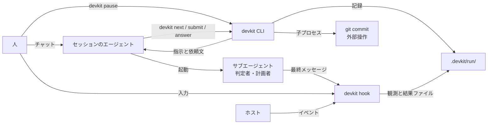

# dev-kit のアーキテクチャ

Claude Code や Codex に開発を任せると、手順の省略、自己 `PASS`、完了の過大申告、セッションをまたぐ文脈の喪失が起きることがある。指示ファイルや skill で頼むだけでは順序と完了条件を守らせる力がないため、dev-kit がこれを担う([基本方針](design.md))。

dev-kit は、リポジトリごとの開発ループを、Claude Code や Codex CLI のセッション内で回すための道具である。人は普段どおりセッションを開き、kit の skill で課題を渡す。セッションのエージェントがコードの変更やコマンドの実行を行い、単一バイナリの `devkit` が「次に何をするか」「終わってよいか」「何を記録するか」を決める。進行の判断は `devkit` が担う。

## 全体構成

- **セッションのエージェント**は実行役である。[brief](architecture/modules.md#brief)(作業や判定の依頼文)を読み、コードを書き、[終了ブロック](architecture/data.md#進捗-progress)(作業の結果を固定の形式で書いた JSON)を返す。判定者と計画者のサブエージェントは、[定型の1行の prompt](architecture/guarantees.md#判定結果の受理)で起動する。
- **`devkit`** は状態機械である。利用者が組んだ[ループの雛形](architecture/data.md#ループの雛形-plantemplate)(再利用するループの定義)から作る[計画](architecture/data.md#計画-plan)(課題ごとの実行内容)と記録から次の指示を計算し、[ステージの完了時に `git commit` し](architecture/guarantees.md#完了条件)、判定者の結果と人の答えを受理し、記録を書く。エージェントが Bash から呼ぶが、sandbox の外で動く。
- **hook** は同じバイナリの別の呼び出し口である。セッションの開始時に状況を注入し、[Stop](architecture/hooks.md#stop)で停止の可否を判断し、危険な操作を拒み、サブエージェントの結果と人の入力を観測してファイルに書く。
- **人**はチャットで問いに答える。`devkit answer` が hook の観測した入力をもとに回答を受理する条件は、[回答の受理](architecture/guarantees.md#回答の受理)で定める。

## 作業の流れ

1. `devkit start --plan <name> <課題>` で[作業を開始](architecture/flow.md#作業の開始)し、計画者が雛形から計画を作る。[check](architecture/modules.md#check)(評価と判定)と人の承認は[計画の check と承認ゲート](architecture/flow.md#計画の-check-と承認ゲート)に従う。
2. `devkit next` が[作業の指示](architecture/flow.md#作業の指示)としてステージ(作業を区切る単位)の brief を返す。判定に使う規範は[規範の固定](architecture/guarantees.md#規範の固定)に従って確定する。
3. エージェントが作業し、終了ブロックを `devkit submit` で[提出する](architecture/flow.md#作業結果の提出)。
4. `devkit` が判定者に先立って検証を実行する。実行順と失敗時の扱いは[作業結果の判定](architecture/flow.md#作業結果の判定)に従う。
5. `devkit next` の指示で判定者サブエージェントを起動し、結果は[作業結果の判定](architecture/flow.md#作業結果の判定)に従って受理する。
6. [router](architecture/modules.md#router)(check の結果から次の行動を分類する部品)が判断し、[判断後の処理](architecture/flow.md#router-の判断)へ進む。[人の回答](architecture/flow.md#人の回答と再開)や[完了の確定](architecture/guarantees.md#完了条件)は、その判断の後に行う。
7. セッションをまたぐ再開は、[人の回答と再開](architecture/flow.md#人の回答と再開)に従う。

[ラウンド](architecture/data.md#ラウンド-round)(作業の指示から次の行動の確定までの往復)では、[Judgment](architecture/data.md#check-の結果-judgment)(`command:` の check を含む判定結果)を受理して次の行動を決める。

人による中断、`devkit pause` と再開の条件、Stop の継続上限は[中断](architecture/guarantees.md#中断)に従う。

段階ごとの詳細は [flow.md](architecture/flow.md)。

## 利用者が組むもの

1. **雛形**: 既定を `.devkit/plans/<name>.json` に複製して編集する([PlanTemplate](architecture/data.md#ループの雛形-plantemplate)、[例](architecture/examples.md#雛形と計画))。
2. **観点**: `.devkit/checks/<観点ID>.md` と例を置き、雛形の check に使う。[検出試験](architecture/guarantees.md#検出試験)(観点ファイルの判定能力を確かめる試験)の対象・実行条件・合格記録の再利用は参照先に従う([例](architecture/examples.md#観点と検出試験))。
3. **検証コマンド(`[commands]`)**: 雛形で `command:` の check(終了コードによる検証)に使う。登録形式と実行主体(runner)は[計画の check](architecture/data.md#計画-plan)に従う([例](architecture/examples.md#設定))。
4. **pre-commit**: リポジトリで有効な pre-commit にテストと lint を書く。既存の hook の仕組みがない場合の配置は[導入と完了条件](architecture/guarantees.md#完了条件)に従う([例](architecture/examples.md#pre-commit))。

## 保証の範囲

[保証と対策](architecture/guarantees.md)で保証の対象を定める。保証が成り立つ条件は[信頼の前提](architecture/guarantees.md#信頼の前提)、git とホストに任せる範囲は[実装対象外の機能](architecture/guarantees.md#実装対象外の機能)を参照する。

## 構成要素

- **データ**: 作業に属するデータの種類は[エンティティ](architecture/data.md#エンティティ)、実行の記録(作業ごとに残す記録)の保存と書き手は[記録の書き込みと排他](architecture/data.md#記録の書き込みと排他)で定める。
- **役割**: 計画・判定・進行・記録・表示を分担する。7つの部品と実装モジュールの対応、runtime の内訳と依存は [modules.md](architecture/modules.md)で定める。
- **配置**: [育てるもの](architecture/data.md#所有と生存期間)(リポジトリが所有して git で管理する資産)を含む利用側の配置は [layout.md](architecture/layout.md)で定める。
- **hook**: SessionStart・Stop・PreToolUse・SubagentStop・UserPromptSubmit の5イベント。[hooks.md](architecture/hooks.md)

## 未決事項

### バイナリの配布方法

バイナリをどの方法で配布・配置するか。当面はインストーラによる配置を含めて未決定とする。

### Bash の一律拒否と他の skill の共存

[PreToolUse](architecture/hooks.md#pretooluse)のリダイレクト・置換・制御構文の拒否範囲を維持するか、狭めるか。当面は現行の範囲を維持し、`[deny]` に一致しなくても他の skill のリダイレクトや heredoc を止め、分けて実行しても続行できない場合がある制約を残す。

### 計画の提案番号

[計画の指示](architecture/data.md#指示-instruction)の提案番号を計画のバージョンと同じ値にするか、採番時点・記録先・出し直し時の保持をどうするか。当面は[状態遷移と受理条件](architecture/data.md#状態遷移と受理条件)を維持し、これらは未確定とする。

### 計画の再提案に適用する上限

[再提案](architecture/data.md#計画のバージョン)の計数・上限の取得元・リセット・人への確認条件をどうするか。ステージの計数と上限を使う場合の対応先も含め、当面は未確定とする。

### 計画の外部操作宣言と承認

雛形からの逸脱がなくても外部操作の宣言があれば計画の承認ゲートを必須とするか、別の経路で承認を得るか。当面は宣言だけで承認済みとせず、有効な計画の承認がない操作は[外部操作の承認](architecture/guarantees.md#外部操作の承認)に従って操作ごとに確認する。

### 検証前の対象の不一致

[コマンド実行前後](architecture/guarantees.md#判定対象の展開と完了時の永続化)や判定前の pre-commit 実行前に対象が不一致なら、取り直すか、その回数と上限をどうするか。当面は遷移を未確定とし、[commit 直前の取り直し回数](architecture/guarantees.md#commit-直前の対象の照合)を検証時にも適用するとは決めない。

### 外部操作の入力場所

`external` の入力ファイルも `inbox/` の下に限定するか、別の場所を認めるか。当面は[状態遷移と受理条件](architecture/data.md#状態遷移と受理条件)の場所の制約を拡張せず、受け取れる場所は未確定とする。

### 観測のないセッションでの開始

観測がないセッションの `start` を拒否するか、束縛先を何から識別し、[hook の稼働確認](architecture/guarantees.md#再開と-hook-の稼働確認)に加えるか。当面は[セッションとブランチ](architecture/data.md#セッションとブランチ)の識別元を維持し、識別できない場合の開始手順は未確定とする。

### 指示のない期間の規範

ラウンドも判定指示もない期間に、`[deny]` などの規範をいつのスナップショットから読むか。当面は[規範の固定](architecture/guarantees.md#規範の固定)を維持し、計画者への指示だけがある期間も含め、該当しない期間の参照元とフォールバックは未確定とする。

### サブエージェント定義の変更と完了

必須 check の定義を編集したラウンドを旧定義で判定して完了させるか、指示を失効させて次へ移すか。当面は[SubagentStop](architecture/hooks.md#subagentstop)が採取した終了時点の定義を[照合](architecture/guarantees.md#判定結果の受理)し、不一致の結果を受理せず、変更を含むラウンドの完了手順は未確定とする。

## 未確認の前提

- `git hook run pre-commit` が `core.hooksPath` や husky・pre-commit フレームワークでも commit 時と同じ hook を実行するか。同等性は未確認とする。
- husky・pre-commit フレームワークと `core.hooksPath` が共存するか。共存は未確認とする。
- Codex で escalation を要さない呼び出しにも rules の allow が適用されるか。適用の可否は未確認とする。
- Codex の SubagentStop の `agent_type` を定義の名前と照合できるか。値の形式は未確認とする。
- 両ホストの SubagentStop で `last_assistant_message` から本文を取得できるか、null になるか。取得と null の条件は未確認とする。
- Codex の UserPromptSubmit が回答後の訂正を含めて入力ごとに発火するか。発火の範囲は未確認とする。
- Codex の UserPromptSubmit が人以外のターンでも発火するか。発火の有無は未確認とする。
- Codex の SessionStart hook から後続コマンドへ環境変数を渡せるか。未確認であり、渡せなければ同じチェックアウトで同時に複数のセッションを開かないことを前提とする。
- Codex に履歴を継承するサブエージェントの起動があるか、禁止できるか。未確認であり、禁止できなければ transcript の照合だけで代える。
- 両ホストの `agent_transcript_path` の形式から最初の prompt を取り出せるか。抽出の可否は未確認とする。
- Codex の PreToolUse がサブエージェントの起動を捕まえるか。捕捉の可否は未確認とする。
- Claude Code の `-p` で `Agent(fork)` などの引数を PreToolUse で判定できるか。判定の可否は未確認とする。
- Claude Code の `Agent(effort:*)` が effort の上書きを禁止できるか。禁止の可否は未確認とする。
- Claude Code の hook の登録に `onFailure: "block"` 相当を使えるか。設定の可否は未確認とする。
- settings の Stop hook がサブエージェントの終了で発火するか。未確認であり、発火する場合は `agent_id` で無視する。
- Codex の Stop の継続上限と Bash の出力上限はいくつか。値は未確認とする。
- Claude Code の skill がシンボリックリンクされたディレクトリをたどるか。追跡の可否は未確認とする。
- `features.shell_tool = false` の Codex の判定者サブエージェントが展開先を読めるか。未確認であり、読めなければ shell を残し、編集しない指示と `[deny]` で代える。

### effort と model の取得元

Claude Code の `effort.level` と Codex の `model` を SubagentStop のイベント JSON または transcript のどの項目から取得できるか。当面は取得元を未確認とし、[判定結果の受理](architecture/guarantees.md#判定結果の受理)の照合条件を維持し、設定値を観測値の代わりに使わない。
