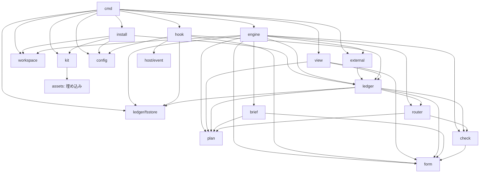

# モジュール

plan・brief・check・router・form がドメインの核を担い、engine が記録と各実装を組み合わせてループを進める。git、ホスト、ファイル、外部操作はそれぞれの境界で扱う。組み立ては cmd/devkit に集める。runtime は engine・hook・host/event・workspace・external・config・install・kit・ledger/fsstore・cmd/devkit からなる。

## モジュール境界と入出力の集約

- **下位モジュール**: plan、form、kit、config、workspace は上位モジュールの名前を知らない。
- **ポート**: interface は置かない。Workspace と External は具体型として利用し、試験では関数値を差し替える。判定者・計画者のサブエージェントの起動の抽象化は、[ホストに任せる範囲](guarantees.md#ホストgit-と-kit-の責務分担)に含める。
- **外部型の変換**: host/event はホストの JSON、workspace は git の出力、config は TOML、ledger/fsstore はファイル形式、external は外部コマンドの入出力を境界で内部の型に変換する。外部の型を公開契約・記録・ドメイン(plan・ledger・check など)に持ち込まない。[assets/principles/structure.md](../../assets/principles/structure.md) の原則5に従う。
- **共通の通過点**: ledger の書き込みは[記録の書き込みと排他](data.md#記録の書き込みと排他)、外部書き込みは [external](#external)、バイナリが供給する資産は [kit](#kit)に集める。ホストの設定はホスト自身が読む。

モジュールの内部構造、view の見た目、ledger/fsstore の最適化は、後から変更できる。

## モジュールごとの契約

各モジュールを Go のパッケージとして実装する。plan、brief、check、router、form は入出力を行わず、自らファイルを読まない。cmd/devkit が config、リポジトリの規範、kit から値を解決して渡す。ポートと外部型の扱いは[モジュール境界と入出力の集約](#モジュール境界と入出力の集約)で定める。

提供単位は [brief](../parts/brief.md)、[check](../parts/check.md)、[router](../parts/router.md)、[ledger](../parts/ledger.md)、[form](../parts/form.md)、[view](../parts/view.md)、[runtime](../parts/runtime.md)であり、それぞれ契約・テンプレート・試験を持つ。brief・check・router・ledger・form・view は同名の実装モジュールに対応し、runtime は冒頭に列挙した実装モジュールに対応する。plan は部品を追加せず計画の意味論を扱う。[基本設計](../design.md)に従う。

### plan

雛形と計画は[データ形式](data.md#データ形式)に従い、キーは英語とする。

- **責務**: ループ計画の意味論を扱う。雛形と計画の JSON Schema による検証、[計画の雛形からの逸脱](data.md#計画-plan)の計算、router の分類から次のステージを選ぶ遷移、計数の上限の判定、現在のバージョンと残りの計画から新しいバージョンを作成する操作、およびその差分、実行可能なバージョンの判定、計画の承認で足りる外部操作の宣言の照合を扱う。遷移 `done` は次のステージ ID、作業の終了を表す `null`、ステージの完了後に残りを作り直す `"replan"` を扱う。
- **持つデータ**: `PlanTemplate`、`Plan`、`Stage`、`Assignee`、`Gate`、`Transition`、`Limits` の型、ID 付きの完了条件、観点と完了条件の対応、check の実行主体、必須 check、任意の文字列配列 `open_questions`、宣言した外部操作、router が使うステージの完了条件の規則を持つ。
- **公開する契約**: 雛形と計画の型と、検証・逸脱の計算・遷移・上限判定・作り直し・実行可能なバージョンの判定を公開する。
- **依存**: form を含む他のモジュールに依存しない。
- **置くもの・置かないもの**: 入出力を伴わない計画の意味論を置く。保存は ledger に、進行は engine に置く。

完了条件ごとの確認手段と、判定者・人・kit の責務の境界は[計画](data.md#計画-plan)に従う。

### brief

- **責務**: ステージ定義、計画(ID 付きの完了条件と上限)、前のステージの出力、要件の正本(既定 `.devkit/requirements.md`)、リポジトリの事実(変更対象のディレクトリの README([配置ガイド](layout.md#利用側のリポジトリ))、[`rules.md` と計画の元に戻せないもの](data.md#規則と強制手段-rules)、利用可能な check)から brief を組み立てる。修正ラウンドでは前回の指摘と指摘 ID、必須の `command:` の check の出力、pre-commit の出力を取り込む。判定者・計画者のサブエージェントに渡す依頼文も brief の一種として組み立てる。判定依頼は [check が決めた内容](#check)を受け取り、依頼文に組み立てる。本文に含める規範は、そのステージ定義、判定の観点と参照する原則、rules、requirements、関係する構造の記録とする。計画者・作業者・判定者の brief には requirements を必ず入れる。その他の規範は論理名と `snap/` 内の実際のパスの一覧で渡す。パスはラウンド開始時、ラウンド外の判定では指示を出す時点のスナップショットを展開した場所を指す。JSON Schema はバイナリから受け取った本文を出力スキーマとして渡す。配置の既定値と変更方法は [paths](#config)に従う。
- **持つデータ**: brief の型を持つ。
- **公開する契約**: brief の型と、brief を組み立てる関数を公開する。
- **依存**: ステージの型を持つ plan と、テンプレートを持つ form に依存する。
- **置くもの・置かないもの**: brief の組み立てを置く。ファイルへの書き出しは engine に置く。

計画者への依頼には、人の要求の原文と `start` の課題の両方を載せる。原文の観測がなければ、その旨を示す。計画の承認の問いは、要求の原文、課題、ID 付きの完了条件、採用したステージと外したステージ、逸脱の明示、各ステージの必須 check、課題固有の元に戻せないもの、宣言した外部操作、`open_questions` を計画などの記録から組み立てる。エージェントの要約には依存しない。

決定や一時状態を渡す際は、自然文の条件と出典・参照をそのまま項目に添える。条件の充足は判定せず、エージェントと人が判断する。

### check

- **責務**: 観点ファイルを解析し、blocking の定義、確認事項、報告しない事項、出力形式を扱う。指示ファイル、リポジトリが所有する原則・ステージ定義・観点などの規範、バイナリが供給する JSON Schema、[規則と強制手段 (Rules)](data.md#規則と強制手段-rules)、brief、計画、観点ファイルを判定の入力として束ね、判定依頼の内容を決める。依頼文への組み立ては brief が担う。[判定結果の受理と集約](guarantees.md#判定結果の受理)、必須 check の網羅状況、[検出試験](guarantees.md#検出試験)の照合を担う。`command:` の check の実行結果も同じ受理境界で [Judgment](data.md#check-の結果-judgment) にする。ラウンド開始時の設定に検証コマンドが登録されていなければ、その check を `FAIL` とし、`auto-fixable` の指摘「検証コマンド `<name>` が登録されていない。検証の手段を作り `devkit.toml` の `[commands.<name>]` に登録する」を返す。コマンドがツリーを変更した場合の指摘には、出力先を ignore する案内を含める。
- **持つデータ**: [Judgment](data.md#check-の結果-judgment) と [Finding](data.md#指摘-finding)の型、解析した観点ファイル、判定依頼と解析結果、検出試験の仕様と結果を持つ。
- **公開する契約**: 規範・観点ファイル・対象のバージョンと場所・出力スキーマを受け取り、判定依頼の内容を返す操作を公開する。ラウンドや観点に応じた追加入力は[判定結果の受理](guarantees.md#判定結果の受理)、修正ラウンドの追加入力は[指摘 ID の引き継ぎ](data.md#指摘-finding)に従う。結果ファイルまたはコマンド実行結果を受け取り、`Judgment` を解析して返す操作も公開する。適用除外、集約、必須 check と検出試験の照合も公開する。
- **依存**: 観点ファイルの形式と `Judgment` のスキーマを扱う form に依存する。
- **置くもの・置かないもの**: 入出力を伴わない判定の意味論、依頼の内容の決定、結果の解析・受理、検出試験の仕様を置く。判定者サブエージェントの起動と hook による結果の受け取りは[判定結果の受理](guarantees.md#判定結果の受理)、判定コマンドの実行は [engine](#engine)に従う。結果の保存は ledger に、次の行動の判断は router に置く。

検出試験の依頼には例の本文を渡し、種別と期待判定は渡さない。期待との照合は check が行う。合格の識別には、観点・試験仕様・担当の定義に加え、観点が参照する原則ファイルと規則ファイルの内容ハッシュを含める。原則や規則が変われば、それを参照する観点を既定では次に必須として使うラウンドの前に再試験する。

観点 `test` は、完了条件ごとの具体的なテスト、登録済みコマンドからの実行、利用者から見える入口での契約の確認、実装をなぞっていないことを `principles/testing.md` に照らして判定する。観点 `harness` は、振り返りでの問題の捕捉先と再発防止、どの原則がどの観点・雛形で使われているか、使われない仕組みや負担に見合わない仕組み、前提の確認を扱う。

### router

メタループは専用モジュールを持たず、リポジトリの規範と[改善の手順](../meta-loop.md#メタループ)で扱う。

- **責務**: 分類表の既定とリポジトリ側の上書き・追加・削除を解析済みの値として受け取り、check の集約、ラウンド数、engine が計算した進展の有無、計画の上限、終了ブロックの終了の種別([進捗](data.md#進捗-progress))から[次の行動](flow.md#router-の判断)を選ぶ。plan の[完了条件](guarantees.md#完了条件)を照合し、[人への確認対象](guarantees.md#人への確認対象)を扱う。
- **持つデータ**: 人への確認、check の結果、ロールと実行主体に関する分類表の型と内容を持つ。router はロールの語彙(作業者・人・判定者・計画者)を持つだけで、実行主体は雛形の check の runner で決まる。
- **公開する契約**: 分類表の型と、渡された分類表による判断、完了条件の照合、人への確認の分類を公開する。
- **依存**: 上限と遷移の語彙を持つ plan、判定の型を持つ check に依存する。
- **置くもの・置かないもの**: 分類と判断を置く。判断に従ってループを進める処理は engine に置く。

### form

- **責務**: 固定フォーマットの定義を持ち、スキーマの型、テンプレートの適用機能、人向けの Markdown の描画機能を提供する。
- **持つデータ**: [終了ブロック](data.md#進捗-progress)、判定者サブエージェントの結果(最終メッセージの形式)、問い([回答の案内](data.md#問い-question)を含む)、`next` の指示、決定と証拠の JSON Schema の型を持つ。終了ブロックの項目と必須項目は[進捗](data.md#進捗-progress)、Finding の項目は[指摘](data.md#指摘-finding)に従う。skill の構成、観点ファイル、PR 本文、設計案のテンプレートを受け取って扱う。PR 本文には計画の要約・決定・検証内容(何をどう確認したか)を含め、見出しはリポジトリの既存テンプレートに合わせる。雛形と計画の JSON Schema による検証は [plan](#plan)が担う。
- **公開する契約**: 固定フォーマットの定義と、受け取ったスキーマ・テンプレートの適用、Markdown の描画を公開する。
- **依存**: 他のモジュールに依存しない。スキーマは kit がバイナリから供給し、テンプレートはリポジトリが所有する。テンプレートの既定の置き場所は `.devkit/templates/` であり、`[paths] templates` で変更できる。form は供給された値を使う。
- **置くもの・置かないもの**: 入出力を伴わない形式の定義と描画を置く。スキーマの供給は kit に、リポジトリのテンプレートの読み出しは cmd/devkit に、計画や判定の意味論は plan と check に、HTML の生成は view に置く。

### ledger

- **責務**: 記録の意味論、問い合わせ、派生値を扱う。決定の記録から承認・却下・保留、置換と記録内の依存関係を解決する。自然文の有効条件・適用条件と外部依存の充足は判定せず、そのまま決定に添える。[checkpoint](data.md#checkpoint)(記録から組み立てる現在地)の組み立てでは、一時状態を条件によって除外せず、確認方法・出典・無効になる条件を添える。作業の中断と中断前の現在地、決定とその記録上の状態、実行可能な計画のバージョンと提案中・却下・撤回の状態、観点ごとの最新判定とバージョンの一致、完了記録のない [StageRun](data.md#ステージの実行-stagerun)(1回のステージ実行)、未回答の問い、承認の解決、未解決の blocking の指摘、未受理の指示を派生値への問い合わせとして提供する。
- **持つデータ**: 記録 ID と参照を持つ。形式の識別は[Work](data.md#作業-work)に従う。ペイロードは、作業、中断・再開、計画のバージョンと撤回、決定、証拠、状態変更、問い・回答・承認、外部書き込み、進捗、check の結果、検出試験の実行、ステージの実行、ラウンド、成果物である。[エンティティ](data.md#エンティティ)の型を用いる。
- **公開する契約**: 記録の型、派生値の問い合わせ、決定と承認の解決を公開する。関数は ledger/fsstore の具体型を受け取る。未回答の問いの派生には、[checkpoint](data.md#checkpoint)と同じく未取り込みの停止の観測を含める。
- **依存**: ペイロードに使う plan、check、router、form の型と、保存を担う ledger/fsstore に依存する。
- **置くもの・置かないもの**: 記録の意味論と問い合わせを置く。ファイル形式は ledger/fsstore に、表示は view に置く。

### ledger/fsstore

- **責務**: [記録の書き込みと排他](data.md#記録の書き込みと排他)で定める保存・公開・破損の検出と、[作業の排他制御](data.md#作業の排他制御)を実装する。生成物の公開も担う。
- **持つデータ**: 記録と生成物のファイル、一時ファイル、作業ロックを扱う。
- **公開する契約**: 追記・一覧・取得、作業の排他制御、生成物の公開の操作を公開する。記録ルートは引数で受け取り、その配下だけを扱う。互換性の失敗は[バージョン互換性](guarantees.md#バージョン互換性)に従って報告する。
- **依存**: 他のモジュールに依存しない。
- **置くもの・置かないもの**: 保存形式、公開、破損の検出、排他を置く。記録の意味論は ledger に、記録ルートの解決は [cmd/devkit](#cmddevkit)に置く。

### engine

別系統のエンジンによる判定は判定コマンドとして表し、`codex exec --output-schema` などを子プロセスとして実行する。

- **責務**: [処理の流れ](flow.md)の状態機械を進める。`start --plan <name>` の雛形の指定(`--plan` 省略時は `default_plan`)、人の要求の原文の結び付けと作業作成、`next` の結果の受理と指示の計算、brief・判定依頼の書き出し、`submit` の終了ブロックと成果物の受理、判定コマンドの判定の実行、[`command:` の check の実行](flow.md#作業結果の判定)、router の判断の記録を担う。`plan` の提案とゲート、`answer` の回答、`external` の要求、`note` の決定と証拠を受理する。教訓は内容と根拠を記録し、反映先の提案は[メタループ](../meta-loop.md#メタループ)で行う。完了時は `[git]` の設定に従って workspace へ `git commit` を依頼する。`allow_empty_commit = false` で変更がないステージはコミットせず、その時点の HEAD を完了記録に使う。commit の成否、完了の記録は[完了条件](guarantees.md#完了条件)に従う。受理の境界は[整合性](data.md#整合性の境界)と[保証](guarantees.md)に従う。
- **持つデータ**: 現在の作業、StageRun、ラウンド、指示の計算結果を扱う。受理した状態はすべて ledger に記録する。
- **公開する契約**: `start`・`next`・`submit`・`plan`・`answer`・`external`・`note`・`pause`・`resume`・`abort` に対応する操作を公開する。`pause`・`resume` による中断・再開の直接の記録、中断中の `next` の応答と新しい指示・処理の抑止は[中断](guarantees.md#中断)に従う。継続上限の問いも停止の観測から受理する。実装の接続は[ポート](#モジュール境界と入出力の集約)の方針に従う。
- **依存**: plan、brief、check、router、ledger、form、workspace、external、ledger/fsstore に依存する。
- **置くもの・置かないもの**: 状態機械の進行、指示の計算、判定コマンドと検証コマンドの実行、判定者の結果の受理を置く。git の操作は workspace に、外部書き込みの実行は external に、保存の実装は ledger/fsstore に置く。判定者・計画者のサブエージェントを起動する処理は置かない。

`start` は HEAD がない場合、または導入したファイルがコミットされていない場合に、理由と直し方を返して拒否する。作業ブランチ名には `[git] branch` を使う。束縛前のセッションで観測した最新の人の入力を要求の原文として作業に結び付け、観測がなければ原文なしと記録する。

計画承認は `[approval] plan` に従う。既定の `requirements` では、最初の計画、直前に人が承認した計画から完了条件の ID または文面が変わった計画、雛形からの逸脱がある計画、外部操作を宣言した計画を人に確認する。完了条件が同じで逸脱も外部操作もない再計画には再確認を求めない。`open_questions` への人の回答は、計画の却下と作り直しの指示として計画者に渡し、人による再提案の回数には上限を設けない。人が承認した完了条件を作業の完了基準とする。

ステージの完了が確定し、遷移 `done` が `"replan"` なら、既存の再計画の経路で計画者へ残りの計画の作り直しを依頼する。作り直した計画にも計画の check と承認の条件を適用する。要件定義を先に行って再計画するかは雛形が決め、engine は要件定義を特別扱いしない。

規範は principles・stages・checks・plans・templates・rules・`devkit.toml`・サブエージェント定義・AGENTS.md・CLAUDE.md であり、ラウンド開始時に固定する。requirements・structure・detect・`.devkit/run/` は規範の識別に含めず、これらの変更で判定を失効させない。

ループ自身の変更は、規範・ホスト設定・skill・有効な pre-commit の設定の変更である。`[approval] meta_loop_edit = "confirm"` では、作業の基点または直前に確認した時点からの未確認の変更を、それが効く最初のラウンドを開く前に問いとして起票して止める。最後のラウンドの変更は、判定後、完了時のコミット前に確認する。確認済みの範囲は確認したスナップショットの規範の識別で表す。却下時は作業者に戻して変更を取り消させる。requirements と structure の変更はステージの判定で確認する。

未登録の `command:` は check の `FAIL` として作業者に返し、検証の手段と登録を作らせる。`devkit.toml` の登録はループ自身の変更として `[approval] meta_loop_edit` に従い確認し、次のラウンド開始時のスナップショットから使う。

振り返りには、すべての判定と指摘、FAIL と NOT ASSESSED の経緯、ラウンド数、人の却下・訂正・作り直しの指示、note の教訓で伝えた見逃し、規範の一覧を渡す。再発防止の反映先は `[lessons] destinations` の優先順に従い、反映しない理由も残す。`rules` の強制手段が未実装の項目と繰り返す違反は、機械の検査に移す候補とする。規範全体の棚卸しは必要が見えた場合に行う。振り返りの必須 check は `command:test` と `harness` である。

### external

- **責務**: kit が管理する外部書き込みの実行経路を担う。[承認](guarantees.md#外部操作の承認)と[二重適用の防止](guarantees.md#外部操作の二重適用)に従い、実行前後の記録、実行、結果不明からの回復をまとめて管理する。中断時の実行と結果の扱いは[中断](guarantees.md#中断)に従う。
- **持つデータ**: [ExternalOp](data.md#外部への書き込み-externalop)(外部操作の記録)の各項目と、登録済みの定型コマンドと照会コマンドを扱う。登録には、実行ファイル、固定引数の配列、実行と照会の期限、同じ入力で繰り返す操作の発生単位を含める。
- **公開する契約**: 具体型の `External` として公開する。操作の入力は標準入力の JSON で渡し、シェル展開しない。操作ごとの対象表示と承認一致は[外部操作の承認](guarantees.md#外部操作の承認)に従う。
- **依存**: ledger に依存する。登録は config が読み込んだ値として受け取る。
- **置くもの・置かないもの**: 承認された外部書き込みの実行と回復を置く。種別ごとの実装は持たず、`devkit.toml` に登録したリポジトリ側の定型コマンドをチェックアウトで呼ぶ。直接の外部書き込みの制限は[危険な操作の防止](guarantees.md#誤った場所への書き込みと危険な操作)に委ねる。

### hook

- **責務**: [5つのイベント](hooks.md)を決定的に処理し、観測と結果を生成物にする。UserPromptSubmit は作業に束縛されていないセッションでも、人の最新の入力をセッションごとに1件保持する。
- **持つデータ**: 共通イベント、解決した作業 ID、組み立てた checkpoint、観測を扱う。
- **公開する契約**: `devkit hook <event>` の処理結果を返す。出力の形式と上限は host/event を通してホストに合わせる。
- **依存**: ledger、config、host/event、form、ledger/fsstore(生成物の公開)に依存する。ルートは cmd/devkit が workspace で解決し、作業 ID はセッションの観測の束縛から取得して渡す。cmd/devkit は workspace で解決した「規範の参照元から `devkit.toml` を読む関数値」も hook に渡し、hook が[規範の固定](guarantees.md#規範の固定)に従って読み出す。
- **置くもの・置かないもの**: イベント処理を置く。モデルによる判定は置かず、書き込みは[記録の書き込みと排他](data.md#記録の書き込みと排他)に従う。

### host/event

- **責務**: hook のイベント JSON を共通イベント型へ変換し、ホストの上限と対応表に合わせて出力 JSON を整形する。
- **持つデータ**: ホストのイベント JSON、共通イベント型、出力の上限と対応表を扱う。
- **公開する契約**: イベント入力の変換と、処理結果の出力 JSON への整形を公開する。
- **依存**: 他のモジュールに依存しない。
- **置くもの・置かないもの**: ホスト形式の変換を置く。イベントごとの判断は hook に置く。

### workspace

- **責務**: git CLI を使い、次の操作を担う。

  - `[git] branch` に従うブランチの作成と切り替え。
  - 対象のバージョンとなるスナップショットとコミットオブジェクトの作成、コミットのツリーハッシュの取得、`git show` による読み出し、一時インデックスからの `git read-tree` と `git checkout-index --prefix` による展開。
  - [完了条件](guarantees.md#完了条件)に従う返却後のスナップショットと同じ index での `git commit`(hook を有効にして)。
  - 変更ファイルの一覧と構造の記録(既定 `.devkit/structure.json`、`[paths] structure` で変更可能)の履歴の取得、cwd のブランチ名の取得、チェックアウトのルートの解決。
- **持つデータ**: 基点コミット、ブランチ、ツリーとコミットオブジェクト、一時インデックス、refs、git から取得したリポジトリ情報を扱う。
- **公開する契約**: 具体型 `Workspace` として、責務に挙げた git 操作を公開する。[対象のバージョン](data.md#対象のバージョン-targetversion)と[展開・永続化](guarantees.md#判定対象の展開と完了時の永続化)の契約に従う。
- **依存**: 他のモジュールに依存しない。外部の git CLI を使う。
- **置くもの・置かないもの**: git 操作と、出力を内部の型に変換する処理を置く。worktree の扱いは[ホスト・git と kit の責務分担](guarantees.md#ホストgit-と-kit-の責務分担)に従う。

### config

設定ファイルは `devkit.toml` とし、TOML で記述する。

- **責務**: 渡された TOML の解析と検証を行う。記録形式とバイナリの互換性を識別する `kit_version`、`default_plan`、`[paths]`、`[approval]`、`[git]`、`[classification]`、`[limits]`、`[lessons]`、`[detection]`、`[judges]` の判定コマンド(名前・実行ファイル・固定引数・期限・出力スキーマの指定)、`[commands]` の検証コマンド(名前・実行ファイル・固定引数・期限)、外部操作の登録、`[deny]`、分類表の上書き・追加・削除を扱う。分類表の追加・削除に未知の分類名があれば設定エラーとする。配置は[利用側のリポジトリ](layout.md#利用側のリポジトリ)に従う。
- **持つデータ**: 解析・検証した設定値と、各コマンドの登録定義を持つ。
- **公開する契約**: 設定の解析・検証と内部の型への変換を公開する。
- **依存**: 他のモジュールに依存しない。
- **置くもの・置かないもの**: 渡された TOML の解析・検証を置く。どこから読むかは cmd/devkit・engine・hook が決める。モデル名、セッションのホストを起動するための専用のバイナリのパス設定は置かない。判定コマンドの実行ファイルと固定引数は登録定義として扱う。判定コマンドと検証コマンドの準備と掃除はコマンド側が担う。

設定項目と既定値は次のとおりである。

- `default_plan = "default"` は `--plan` を省略したときの雛形名である。
- `[paths]` は `principles = ".devkit/principles"`、`stages = ".devkit/stages"`、`checks = ".devkit/checks"`、`plans = ".devkit/plans"`、`templates = ".devkit/templates"`、`rules = ".devkit/rules.md"`、`requirements = ".devkit/requirements.md"`、`structure = ".devkit/structure.json"`、`detect = ".devkit/detect.json"` を既定とする。実行の記録と生成物の `.devkit/run/` は固定である。
- `[approval] plan = "requirements"` は最初の計画、完了条件が変わる計画、逸脱または外部操作の宣言がある計画を確認する。`"always"` は計画のバージョンごとに確認し、`"deviation"` は逸脱または外部操作の宣言がある場合に確認する。
- `[approval] meta_loop_edit = "confirm"` はどのステージでもループ自身の変更を確認する。`"allow"` も指定できる。
- `[git] branch = "devkit/{work_id}"` は `{work_id}` を必須とする。`commit_message = "devkit: {stage} ({work_id})"` は `{stage}`・`{work_id}`・`{task}` を使える。`allow_empty_commit = true` は変更のないステージも空のコミットを作る。false ならコミットせず、その時点の HEAD で完了を記録する。
- `[classification] dependency_files` は依存の宣言として扱うファイルの glob の一覧である。既定は各ディレクトリの `go.mod`・`go.sum`・`package.json`・`package-lock.json`・`yarn.lock`・`pnpm-lock.yaml`・`Cargo.toml`・`Cargo.lock`・`Gemfile`・`Gemfile.lock`・`requirements.txt`・`pyproject.toml`・`poetry.lock`・`uv.lock`・`composer.json`・`composer.lock` を対象とする。
- `[limits] stop_continuation = 3` は Stop の継続上限であり、1以上で無効にはできない。計画の判定のやり直しとラウンドの上限は雛形が持ち、計画の判定のやり直しは既定3である。
- `[detection] required = true` は判定者が担当する必須 check に検出試験の合格を課す。`false` なら検出試験を指示せず、合格記録なしで判定を受理する。
- `[lessons] destinations` の既定の優先順は、機械の検査(hook・lint・型・検証コマンド) → 雛形 → 観点 → 原則 → skill である。反映先はリポジトリの資産である。

判定コマンドと検証コマンドの期限は登録ごとに必須である。人による中断、ループの有限性、JSON Schema、判定結果の受理境界、外部操作の承認と二重適用の防止は設定で無効にできない。

### install

当面はこのリポジトリをクローンして `install.sh` を実行し、利用者の環境に Go を必要とする。`install.sh` は Go で `devkit` をビルドし、PATH の通った場所に配置する。正式な配布方法は後で決める。

- **責務**: `init` で[利用側の配置](layout.md#利用側のリポジトリ)を用意し、[権限の境界](guarantees.md#権限の境界)に従って設定を追記する。`devkit.toml`、`[paths]` で指定した場所に置く原則・ステージ定義・観点と検出試験の例・雛形・テンプレート・規則の初期内容、ignore、ホスト設定、既定のサブエージェント定義、skill とリンクを用意する。文章の規範は assets からコピーし、リポジトリが所有する。`init` は変更を人に確認したあと、導入したファイルをコミットする。`--no-commit` でコミットを省略できる。`uninstall` は `init` の逆を行う。指示ファイルとの境界は[指示ファイルとホスト設定](layout.md#指示ファイルとホスト設定)に従う。既存の git hook の扱いは[完了条件](guarantees.md#完了条件)に従う。既存の設定・skill は上書きせず、処理は冪等にする。
- **持つデータ**: 導入する固定物と設定の断片、導入先との差分、doctor の照合結果を扱う。
- **公開する契約**: `init`・`uninstall`・`doctor` に対応する導入・削除・照合の操作を公開する。`devkit uninstall [--yes]` は変更の一覧を示して人の確認を待ち、`--yes` で確認を省略する。doctor の項目は[doctor の確認項目](#doctor-の確認項目)に従う。
- **依存**: config、kit、ledger、workspace に依存する。
- **置くもの・置かないもの**: 導入先の構成と登録・削除・照合を置く。

`uninstall` は実行の記録 `.devkit/run/` と skill のリンクを削除する。`init` が `[paths]` の場所に置いた原則・ステージ定義・観点と検出試験の例・雛形・テンプレート・規則、および skill・サブエージェント定義は、配布した初期内容と一致するものを削除する。ホスト設定(`.claude/settings.json`・`.codex/hooks.json`・`.codex/config.toml`・`.codex/rules/devkit.rules`)、`devkit.toml`、`.gitignore` から kit の断片を取り除き、空になったファイルとディレクトリを削除する。利用者が書き換えたファイルと、利用者の設定が残る `devkit.toml` は削除せず、一覧で知らせる。処理は冪等であり、git hook とバイナリは扱わない。

### kit

kit は [assets パッケージ](#assets-パッケージ)がバイナリに埋め込む配布物を供給する。JSON Schema、分類表とロールの既定値、ホスト設定の断片はバイナリから供給する。JSON Schema は記録とバイナリの約束であり、リポジトリで育てる対象にはしない。分類表の既定値は `devkit.toml` で上書き・追加・削除できる。

原則・ステージ定義・観点と検出試験の例・雛形・テンプレート・規則の初期内容は `init` に渡す。コピーは install が `[paths]` の置き場所へ行い、以後はリポジトリが所有する規範として育てる。skill とサブエージェント定義もリポジトリに置く。規則の既定は、どのリポジトリにも当てはまるものだけとする。`docs/` とリポジトリ直下の `README.md` は配布しない。

規範内の `principles/…`・`stages/…`・`checks/…`・`templates/…`・`rules.md` はリポジトリ側の置き場所の論理名である。brief には論理名とスナップショット内の実際のパスの対応を渡し、`schemas/…` はバイナリから出力スキーマの本文として渡す。設計文書や部品の契約を読むことは前提にしない。

配布物とバイナリが持つ定義の供給を公開する。他の処理モジュールには依存せず、埋め込みの供給源を assets パッケージから読む。リポジトリの規範と埋め込みの一致は照合しない。`kit_version` は記録形式とバイナリの互換性の識別であり、[Work](data.md#作業-work) に記録する。状態機械の進行やドメインの判断は持たない。

### view

- **責務**: 1作業(1課題)を表示するため、ledger と、構造ステージを使う場合の構造の記録(既定 `.devkit/structure.json`、`[paths] structure` で変更可能)から静的 HTML を生成する。[表示の構成](#view-の表示構成)に従い、冒頭、主表示、判断対象ごとの表示、確認範囲の地図(完了条件ごとの対象のバージョン・方法・確認した範囲・未確認の範囲の一覧)、構造の図を描く。網羅性は「`submit` が成果物を記録した範囲」とする。図は Mermaid のテキストとする。構造の履歴は cmd/devkit が workspace で取得し、解析済みの値を渡す。問いの表示と停止は[状態遷移と受理条件](data.md#状態遷移と受理条件)に従う。
- **持つデータ**: 記録と構造の解析済みの値、表示用の派生値、生成する HTML を扱う。新着は人が最後に回答・承認した時点より後に追加された記録とする。
- **公開する契約**: `devkit view` で静的 HTML を生成する。
- **依存**: ledger、問いを描画する form、ステージ名を持つ plan に依存する。
- **置くもの・置かないもの**: 人向けの表示を置く。サーバは持たない。状態変更は HTML から行わず、[決定と証拠](data.md#決定と証拠-decision--evidence)の経路で記録する。

#### view の表示構成

冒頭は、人が戻る間隔と作業量によらず、目的と対象、現在の到達点、実行状態、人の次の行動、記録の網羅性を固定形式で短く示す。現在の到達点には完了したステージと現在できることを、実行状態には [Work](data.md#作業-work) の中断の有無と [StageRun](data.md#ステージの実行-stagerun)の状態・停止理由・次に動く主体を示す。人の次の行動は1つとし、なければ「対応不要」とする。完了後は完了状態と実際に残る対応を示す。中断中の案内は[中断](guarantees.md#中断)に従う。

主表示は、その時点で必要な情報を優先して組む。同じ対象の本体は1か所だけに置き、他からはリンクで参照する。「新着」「未確認」「承認済み」は各項目の属性として示す。

- **要対応**: 作業を止めているもの、次のゲートまたは PR レビューで人が確認する有効な暫定判断、再検討の条件を付けた保留の順に示す。暫定判断は本体へのリンクを置く。
- **現在の到達点と有効な変更**: [成果物](data.md#成果物-artifact-record)(変更と永続化先の記録)から、成果ごとに、できるようになったことと外から見える振る舞い・契約の変化を示す。有効な暫定判断の本体には、依存する成果・決定、無効になる確認、決定に付いた有効条件・適用条件をそのまま添える。確認範囲の地図と構造の変化もここに置き、構造は影響箇所から全体図へ展開する。

過去の判断と古い確認は履歴で参照し、現在に影響する効果だけを主表示に含める。

要対応の各項目では、[問い](data.md#問い-question)(人への確認事項)、関連する暫定判断と影響する変更へのリンク、確認状況の要点、現在に影響する判断の条件、停止しているステージと理由、根拠へのリンクを1か所に束ねる。問いの文面は form から引き継ぐ。確認状況では判定・有効性・承認状態を示し、実行主体(runner)・対象の一致・規範の一致は異常があるときだけ理由とともに示す。判定値と有効性は [Judgment](data.md#check-の結果-judgment)に従う。判断の条件は現在の影響が分かる範囲で添える。

決定と一時状態の自然文の条件はそのまま表示し、充足の判断はエージェントと人に委ねる。決定の記録上の状態や置換・依存関係の解決結果を、自然文の条件を満たしているという表示にしない。

未回答の問い・未解決の blocking の指摘・有効な暫定判断・再検討の条件を付けた保留など、実際の未解決状態と対象のバージョンを示す。構造の変更は現在の判断に関係するものを優先する。項目を件数で打ち切らず、省略した詳細へのリンクを残す。

### cmd/devkit

- **責務**: サブコマンドを定義し、各実装を接続する。cwd をもとに workspace でルートとブランチ名を解決し、[セッションと作業](data.md#セッションとブランチ)を特定する。チェックアウトのルートと[固定配置](layout.md#利用側のリポジトリ)から記録ルートを解決し、ledger/fsstore に渡す。設定の読み出し元を解決して config に TOML を渡し、解析した設定、`[paths]` から読み出したリポジトリの規範、kit が供給するスキーマと既定値を各モジュールへ渡す。hook には[規範の参照元](guarantees.md#規範の固定)から `devkit.toml` を読む関数値を渡し、[上限に応じた出力](guarantees.md#性能と出力の上限)を行う。
- **持つデータ**: 解決したルート・ブランチ・セッション・作業、設定、リポジトリの規範、kit が供給するスキーマと既定値、各モジュールの実装を扱う。
- **公開する契約**: エージェントが呼ぶのは `start`、`next`、`submit`、`plan`、`answer`、`external`、`note`、`status`、`view`、`pause`、`resume`、`abort`。人が呼ぶのは `init`、`uninstall`、`doctor`、`version`、`pause`、`resume`。ホストが呼ぶのは `hook <event>`。`pause`・`resume` の呼び出しと作業の特定は[中断](guarantees.md#中断)と[セッションとブランチ](data.md#セッションとブランチ)に従う。`status` は記録の照会も担う。
- **依存**: すべての実装パッケージに依存する。
- **置くもの・置かないもの**: コマンドの定義と配線を置く。計画・判定・記録の意味論は各モジュールへ渡す。

### assets パッケージ

assets パッケージ(`github.com/ildjenty/dev-kit/assets`)は、`assets/embed.go` の `package assets` で、自分のディレクトリ内の配布物を `go:embed` によりバイナリに直接埋め込む。`principles/` も `assets/` 内に含む。`docs/` とリポジトリ直下の `README.md` は埋め込まない。埋め込んだ固定物を `FS()` で `fs.FS` として公開し、internal/kit が読む。埋め込み元のファイルを参照し、実装パッケージには依存しない。埋め込みの定義と公開を担い、配布物とスキーマ・既定値の供給は kit が担い、リポジトリへの規範の配置は install が担う。

## モジュール間の依存関係

矢印は、利用する側から依存先へ向ける。cmd/devkit からすべての実装パッケージへの直接依存のうち、他のモジュール経由でも到達する依存の一部は図から省略する。依存は一方向とし、循環させない。

## doctor の確認項目

`doctor` は次を照合する。

- `devkit.toml` の妥当性、`kit_version` とバイナリの互換性、ホスト設定の断片、サブエージェントの定義の存在、skill のリンク、[作業に記録した kit との互換性](guarantees.md#バージョン互換性)。
- 必要な観測の不足から hook が動いていないことを検出し、[ホスト設定と実行権限](guarantees.md#ホスト設定と実行権限)の信頼手順を案内する。

Claude Code の `-p` と対話で `permissions.deny`・hook の登録が読み込まれること(対話では workspace trust の受諾後)、Codex のプロジェクト層の rules・agents が読み込まれる条件がプロジェクトの信頼であることは確認済みである。hook の条件は[ホスト設定と実行権限](guarantees.md#ホスト設定と実行権限)、skill のリンクは[指示ファイルとホスト設定](layout.md#指示ファイルとホスト設定)に従う。
