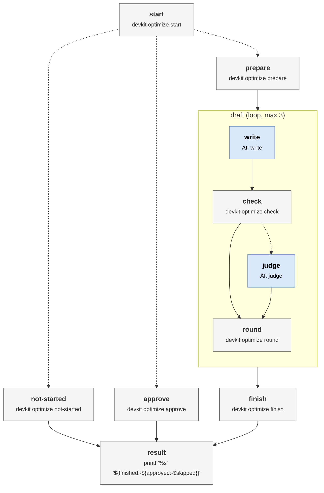
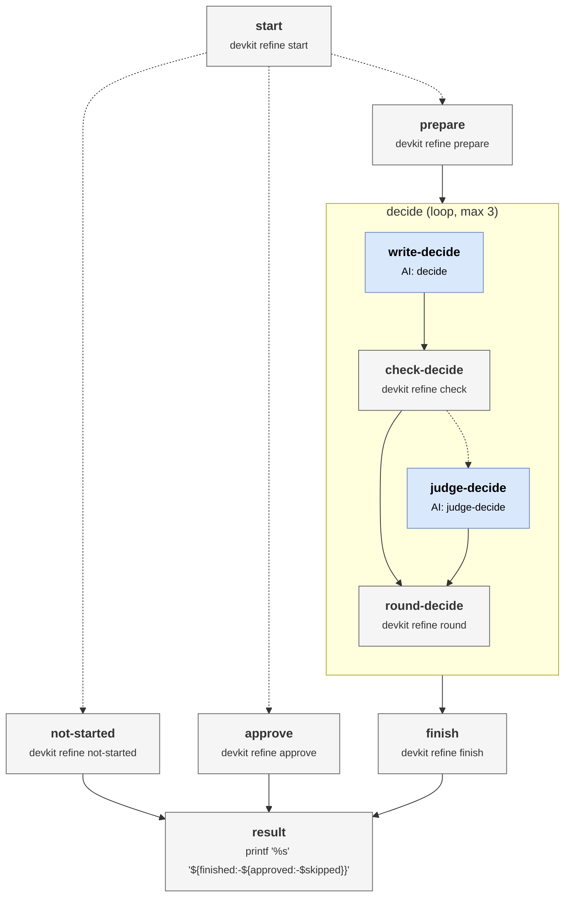
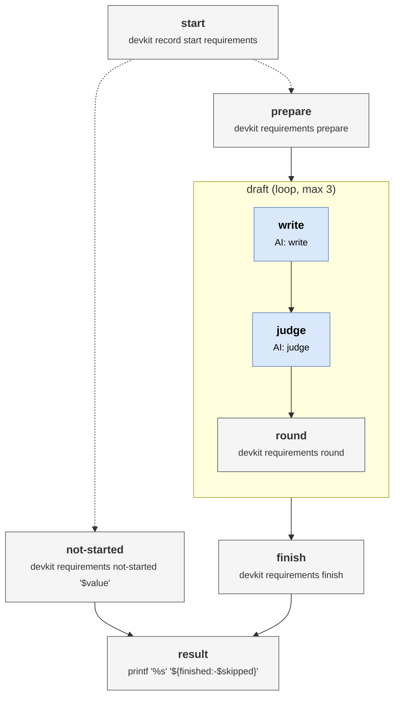
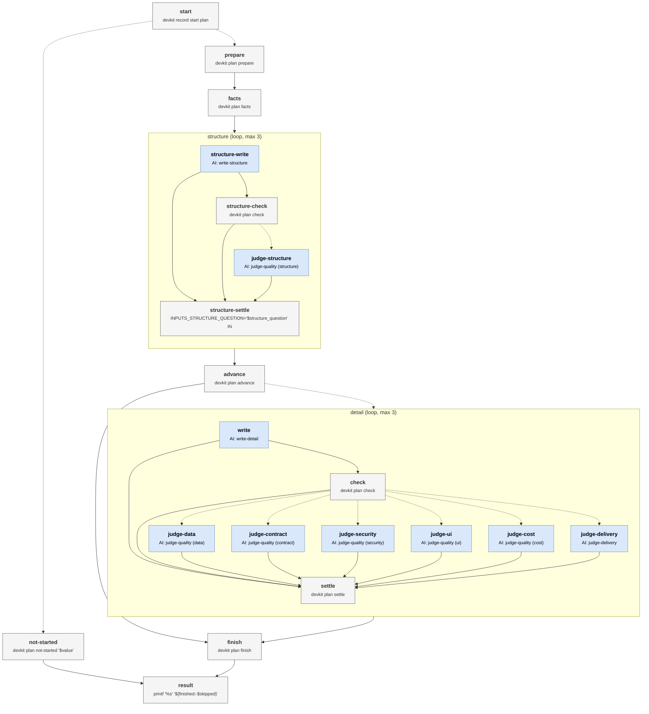
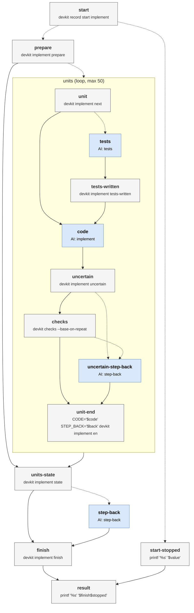
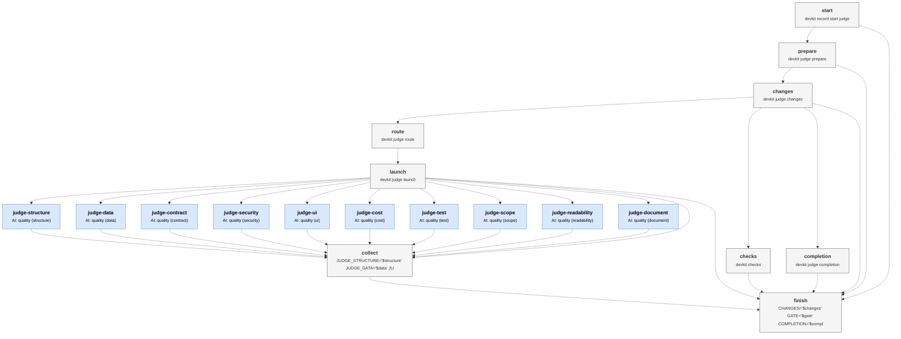
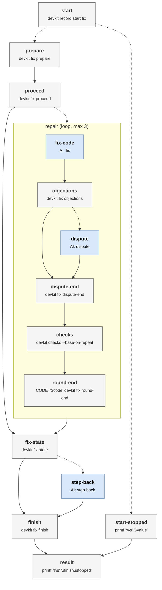
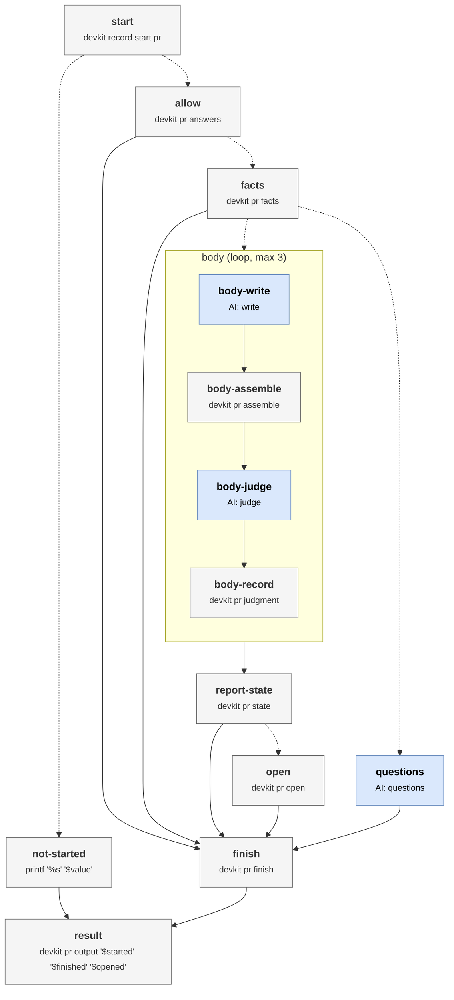
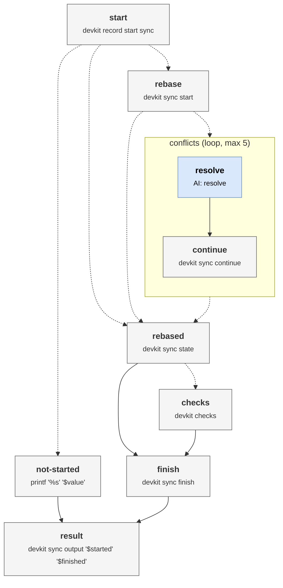
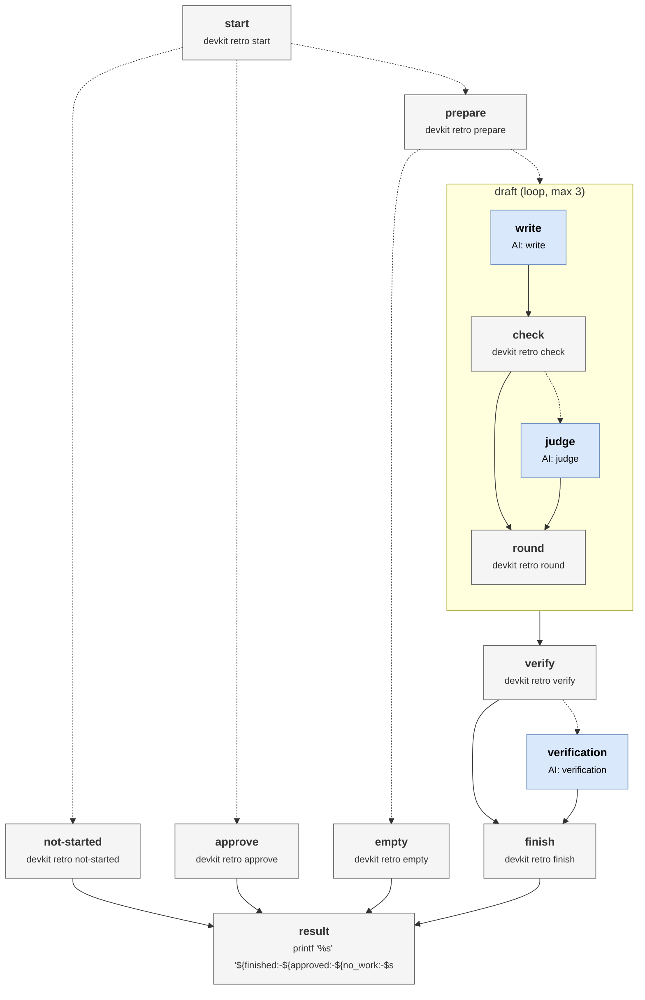

# Workflow diagrams

Generated from `kit/.archon/workflows/dev/*/*.yaml`. After changing a workflow, regenerate with `DEVKIT_UPDATE_DOCS=1 mise exec -- go test ./internal/workflowdoc`; the test fails while this file is out of date.

Gray nodes run on the machine (bash and devkit), blue nodes are AI nodes, and yellow frames are loops. A dotted arrow leads to a node that runs only under a condition (`when`). See the [design document](design.md) for each workflow's role.

## optimize

Fit the kit to repository evidence and the owner's instructions, and triage existing open Issues. Review up to three committed drafts with machine checks and a fresh read-only judge. Ask approval of the reviewed summary and owner-reserved points, then publish the PR and issue triage.

## refine

Turn a topic Issue or owner request into decision records, binding changes and Issue drafts. Review at most three drafts and commit one proposal per version. Restart with approve=<version> to agree decisions, publish the PR and create Issues without AI.

## requirements

The requirements part: turns the request into requirements (goal, completion conditions with IDs, constraints, open points) and has a fresh judge compare them with the requests and the owner's answers (review/purpose.md in the configured criteria folder), rewriting until nothing blocks, at most 3 times. Runs on its own on the branch of the request: the first node checks the start conditions on the record of the request ($STATE_DIR/records/<branch>/) and records the owner's answers; the last writes the requirements, the judgment and the result there. Ends with pass, question (one question per open point, answered by starting this workflow again with the answers) or stop. Inputs: issue (an issue number, or empty for a direct request), owner_words (the owner's words of a new request; empty when only answering), supplement (what the session added, kept apart), answers (a JSON array of {question_id, answer}, or empty), continue (the owner's words that let the branch start past the limit of restarts, or empty).

## plan

Plan the latest passed requirements in two loops, each at most three rounds. First write structure rows and the skeleton, run machine checks and the fresh structure judge, and settle owner questions before detail. Then write other rows, release units and tests inside the fixed structure. Detail may change signatures but no file or folder may be added, removed or moved relative to the structure commit; a required structure change ends with stop. Rows carry evidence. New structure rows carry nature. Prepare exports the draft schema into artifacts. Record judgments and outcomes: pass, carry (detail findings), question, back to requirements, or stop. Inputs: owner answers and optional authorization to pass the request's restart limit.

## implement

The implement part. Input: the latest passed requirements and plan, both from the record of the branch; the answers of the owner when the session passes them (input `answers`). Makes the plan's increments one by one in order: for each unit a fresh session first writes the tests of its completion conditions, then another writes the code, and the checks the change needs run. A unit whose checks pass is committed with the run, the unit and the versions it was made from as trailers, so a later run on the same versions goes on from the next unit. The loop gives each release step at most `limits.passes` passes (default 3) and stops when one step uses them up; the loop itself is bounded at 50 passes as a safety limit. Decisions the implementation made or settled (rows decided later) go into a new version of the plan's decision list; a decision the owner has to make is not implemented: the run returns back to plan with the pending owner row. When the same check fails twice, a fresh judge names the premise that broke and where to go back. Ends with pass, back or stop, written to the record by devkit record result. Output: the result as recorded, or the start's output when the start conditions did not hold.

## judge

Judge the committed change using fixed criteria, configured decision paths and quality materials. Checks and fresh quality judges run together. Missing planned tests block; unlisted decisions return to plan. Record pass, back or stop.

## fix

The fix part. Input: the commit checked out (HEAD) and the findings of the code judgments the record binds to it (blocking, not the owner's), with the latest requirements and, when there is one, the latest plan; the owner's answers when the session passes them (input `answers`). Input `review` supplies verbatim review comments or CI failure text with provenance instead of judge findings. It requires passed requirements and plan and the latest judged change to match HEAD by PR identity. Items outside the requirements or plan, including objections to review items, return back to requirements. Stops without fixing when this fix would exceed the configured limits.fixes since the last implement. Otherwise a fresh session fixes the findings, or objects to one with evidence; a fresh dispute judge that neither made the finding nor fixes it accepts or rejects each objection (accepted: not fixed; rejected: fixed in the next pass). The checks the change needs run after each pass, at most 3 passes. A pass whose checks passed is committed with the run and the commit it fixed as trailers; the judge part judges the new commit. A decision only the owner can make returns back to plan with a pending owner row; a decision of the plan that does not hold, or a check that keeps failing, goes to a fresh judge that names the premise and where to go back. Ends with pass, back or stop, written to the record by devkit record result with the dispute judgments. Output: the result as recorded, or the start's output when the start conditions did not hold.

## pr

Verify that passing judgments reach HEAD, record explicit allow or deny answers, ask about ask-changes not covered by owner rows' touches, assemble and judge the PR body for at most three rounds, then push and open or update the pull request with gh. Never merge.

## sync

Fetch and rebase onto the configured base branch. Resolve conflicts for at most five rounds, abort and restore when both changes cannot hold or conflicts remain, then run configured checks. Return needs_judge after conflict resolution. Do not push.

## retro

Turn the checkout's review backlog into traced work units, mechanical checks and standard edits. Review up to three drafts, commit the proposal and ask one approval question. The proposal commit contains the edits and consumed backlog deletions. Restart with approve=<version> to publish the PR and create unit Issues from that clean branch head.

